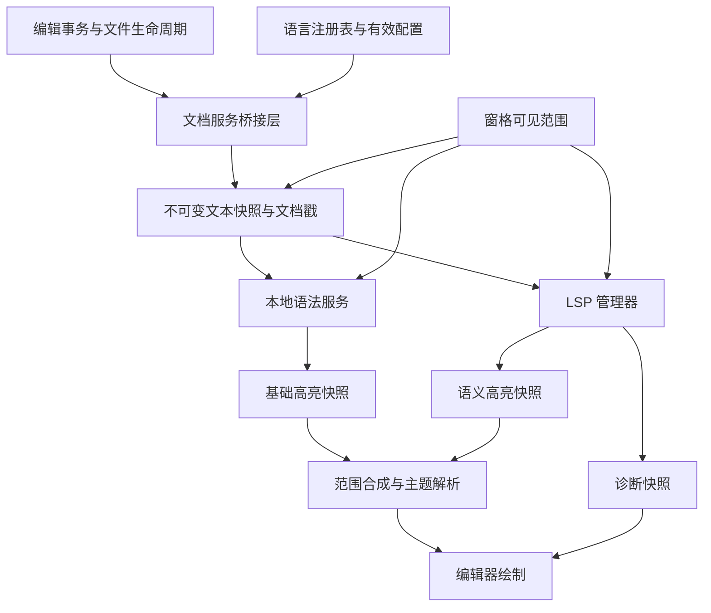

# Loom 语言服务与语法高亮重构设计（临时草案）

- 日期：2026-10-18。
- 修订：语言描述与 grammar 资源分离，由 build.rs 生成内嵌表；增加资源校验、查询编译计时和相应跟踪项。
- 状态：待实施的设计稿；本文不代表相应功能已经实现。
- 范围：公共文档基础、语言注册表、Tree-sitter 基础高亮，以及与 LSP 的接入边界。
- 默认顺序：公共基础 → 开放语言注册表 → 通用 Tree-sitter 基础高亮 → 通用 LSP 最小闭环 → 嵌入语言与常用语言扩展。
- 文件用途：项目根目录临时讨论文件；设计稳定后再拆分进入正式文档。本次不修改业务代码、依赖或配置。
- 阅读范围：本文件主导公共模型与基础高亮实施；LSP 协议细节见 [LSP_DESIGN.tmp.md](LSP_DESIGN.tmp.md)。
- 实施状态：尚未开始；更新入口见 [第 19 节进度跟踪](#19-实施进度跟踪)。

## 1. 决策摘要

将语言能力分成两个独立服务：本地语法服务和 LSP 语言服务。两者共享文档身份、版本、文本快照、坐标约定和语言配置，在界面前合成为统一的高亮结果。

1. 保留现有后台计算、可见窗口查询、版本检查和主题映射的分层。
2. 先统一结果模型，不以一套复杂引擎插件接口作为启动条件。
3. 将封闭的 `Language` 枚举替换为开放的 `LanguageId`，集中注册语言描述、grammar 变体、服务器绑定与资源；通用服务不包含特定语言分支。
4. 先用 Tree-sitter 替换自写 lexer，提供无需服务器的基础高亮、跨行上下文与编辑时的连续显示。Rust 是首个集成样例，必须用第二种语法明显不同的语言检验通用接口。
5. 再接通用 LSP 客户端，交付文档同步、诊断和语义高亮；rust-analyzer 作为首个真实服务器样例，另用不同能力组合的假服务器验证协议通用性。
6. 两个服务共享公共模型但互不依赖。事务后全量文档桥接属于 LSP 接入阶段，本地语法初期沿用视口查询提交最新快照，不要求先完成全部语言服务基础设施。
7. 外部语言包、WASM、自动下载服务器、完整第三方主题格式均不作为前期依赖。
8. 直接替换旧实现，不提供运行时 legacy 后端开关；基础替换阶段删除旧 lexer 与按行索引。现有主题保持视觉风格，但不长期保留旧颜色结构或会话迁移层。
9. 内置语言资源由 JSON 语言描述、grammar 查询目录与代码中唯一的原生 grammar 工厂表组成。build.rs 生成内嵌文本表，启动时解析描述，首次使用时在后台编译查询。内置资源内容错误由构建/测试拦截，不作为常规静默降级场景；未来外部资源才需要容错加载策略，预算超限等正常运行回退仍然保留。

通用性的验收是“增加语言时，修改描述、资源和必要的 grammar 绑定即可，文档版本、缓存、调度、合成与 LSP 协议核心无需修改”，并不等于现在就承诺所有语言或任意外部 grammar 都可无代码安装。

## 2. 项目现状与保留边界

| 位置 | 当前职责 | 迁移方向 |
| --- | --- | --- |
| `src/domain/language.rs` | 四种代码语言与 PlainText；根据扩展名识别 | 替换为开放语言身份与注册表；显式区分 grammar 变体 |
| `src/domain/document.rs` | `FileMeta` 保存路径与语言 | 增加解析后的语言选择信息；明确自动识别与手动覆盖 |
| `crates/editor-core/src/text/revision.rs` | 有界、无文本的编辑范围记录 | 增加通用字节行列及插入范围的几何信息，不引入解析库 |
| `src/features/syntax/lexer.rs` | 自写词法器、八种分类 | 基础替换阶段删除，以独立 fixture 验证新结果 |
| `src/features/syntax/index.rs` | 按行增量词法索引与复用 | 替换为文档解析状态，移除旧索引 |
| `src/infrastructure/syntax_worker.rs` | 单后台线程、请求合并、取消、结果缓存 | 保留运行机制；初期查询提交文档目标，后续支持独立更新入口 |
| `src/app/syntax.rs` | 后台完成后校验快照并触发刷新 | 扩展语言代次等检查，继续通过现有 UI 调度器交付 |
| `src/app/runtime.rs` | 持有运行时服务并清理 | 增加语言服务所有权；服务不进入 AppState |
| `src/ui/editor/syntax.rs` | 分类转颜色，保持字素边界 | 消费统一快照，增加样式解析和范围合成 |
| `src/ui/theme.rs` | 七种语法颜色 | 将内置配色直接写入新样式表，删除旧 SyntaxColors |
| `src/app/editor_performance.rs` | 可选的真实布局与高亮基准 | 保留场景；替换旧 lexer 预期值，增加解析与 LSP 指标 |

当前实现已有 4 MiB 的视口结果缓存预算和默认 16 MiB 的词法索引预算。它们不是未来语法树的准确内存上限，不能直接沿用名称而假定覆盖全部内存。

当前主要正确性限制：按行调用 lexer，没有行间状态；函数、类型等依赖启发式判断；部分测试以同一个 lexer 生成预期结果。缓存一致性与语言正确性需要分开验收。

必须保留的架构边界：

- `editor-core` 保持不依赖 GUI、文件系统、LSP 和 Tree-sitter。
- AppState 与 UI 快照只保存纯数据或不可变结果，不持有进程、解析器、线程或服务句柄。
- AppRuntime 持有服务，AppContext 负责应用编排，infrastructure 执行进程和线程等副作用。
- 后台任务不得持有 UI 状态锁进行解析、JSON 编解码、进程写入或等待。
- 工作区和文档的共享编辑事务保持原子性，不为窗格创建独立文本副本。

## 3. 总体架构



本地语法服务按文档维护上下文；窗格只表达可见范围。两个窗格显示同一文件时共享语法树与服务器文档会话。

LSP 独立于 syntax worker，因为它还需要维护服务器生命周期、诊断及未来的交互请求。可以复用取消、调度与 UI 通知工具，不把全部职责塞入 `SyntaxEngine`。

上图是最终结构。本地高亮首期由视口请求携带最新文档快照，无需先实现图中的事务桥接；隐藏文档可以延迟到再次查询时追赶。LSP 接入后才要求观察所有同步文档的生命周期和修改，两种投递入口服从同一个 stamp 与目标合并规则。

## 4. 共享文档协议

### 4.1 身份与版本

统一使用以下逻辑字段，实际 Rust 类型名可以随代码组织调整：

```rust
struct DocumentStamp {
    document: FileId,
    incarnation: u64,
    version: u64,
    snapshot_identity: usize,
    language_generation: u64,
}

struct DocumentSnapshot {
    stamp: DocumentStamp,
    text: Arc<String>,
    // 与 text 严格匹配的不可变行索引或可在后台生成的索引。
    // 具体复用 editor-core 现有行索引，不再保留一个可变 TextBuffer 副本。
    language: ResolvedLanguage,
}
```

- `FileId` 标识当前工作区文档；`incarnation` 区分关闭后重开等服务会话，避免身份复用污染结果。
- `version` 继续来自 TextBuffer，快照身份用于现有链路的同源检查；指针身份仅用于进程内验证，不能持久化。Arc 释放后地址可能被新分配复用，任何相同快照判断都必须同时比较文档身份、incarnation、version 和相关语言代次，禁止只比较指针。
- 手动切换语言、grammar 或影响解析的配置时增加 `language_generation`。同一文本版本的旧语言结果也必须失效。
- grammar/query 资源另有注册表资源版本；查询缓存和解析会话纳入相应资源代次。
- LSP 请求额外绑定服务器实例代次与文档打开代次，重启或重新打开后旧响应失效。
- 主题代次不进入解析键，只影响样式解析缓存。

### 4.2 文档事件与投递位置

应用层桥接事件：`Opened`、`Changed`、`Saved`、`LanguageChanged`、`UriChanged`、`Closed`，以及独立的 `ViewportChanged`。

本节集中桥接推迟到 LSP 接入阶段，不列为本地 Tree-sitter 高亮的前置工程。本地服务可通过 `query(document, snapshot, windows)` 合并最新解析目标；关闭与语言变化仍需保留现有 retain/失效入口。隐藏文档不保持实时已解析状态，revision 断链时完整重建。

接入 LSP 后，协议文档同步不能依赖 UI 调用高亮查询：后台打开、未显示文档的修改、文件重载与重命名也必须被观察到。

LSP 阶段采取可审核的集中桥接：

1. 在 AppContext 的更新边界收集更新前后的轻量文档戳；只比较身份、版本、路径与语言选择，不比较正文。
2. 在同一个应用事务内确定变化；仅为变化文档取得 Arc 快照及必要事件信息。
3. 模型更新结束、状态锁释放后，将变化批次投递到运行时服务。
4. 对纯高亮/诊断结果回写，如果文档戳未变化，不再次发送文档更新，避免反馈循环。
5. 审计通过 `model()`、Deref 或其他直接 State 更新绕过 AppContext 的入口，确保所有生产文档写入经过同一桥接边界。

这是正确性优先的初版，比较成本为 O(打开文档数)。将其加入 UI 基准；只有数据表明有必要时，再由文档事务显式返回 changed IDs，替换全表元数据比较。不能为优化扫描提前建立第二套文本变更来源。

同一事务内打开后又关闭、但从未发布给服务的文档可以合并掉；已经向 LSP 打开的文档必须匹配关闭。保存事件需要单独记录保存成功，而不能仅从版本是否变化推断。

覆盖普通编辑、Vim、IME 提交、粘贴、撤销重做、工作区替换、文件加载、磁盘重载、会话恢复、Save As 和关闭。IME 预编辑仍是界面状态，提交前不发送正文变更。

### 4.3 快照成本

当前文本由 Arc<String> 共享；后台保留旧快照时，后续修改可能触发现有的写时复制。设计不能据此承诺大文件每次按键绝无整段复制。

- UI 不新增正文 `to_owned()` 或 JSON 序列化。
- 队列只保留每个文档的最新待处理快照；工作中的旧快照尽快取消和释放。
- LSP 每个同步文档最多保留上次发送快照与最新目标快照，另受总体源文本保留预算限制。
- 分别测量正文写时复制、桥接元数据比较、后台解析成本。若文本复制成为主要瓶颈，再单列文本存储重构，不能伪装为高亮引擎问题。

## 5. 坐标与编辑记录

### 5.1 统一约定

| 场景 | 坐标 |
| --- | --- |
| 文本存储、编辑范围、内部高亮 | UTF-8 字节偏移，半开区间 |
| Tree-sitter point | 从 0 开始的行号与行内字节列 |
| LSP position | 从 0 开始，按初始化协商的编码计算 character |
| 屏幕布局 | 显示列、字素和像素，继续使用现有布局工具 |

LSP 初版支持 UTF-8 与 UTF-16，协商优先 UTF-8，同时保证 UTF-16 默认兼容。服务器未给出编码时按协议默认处理。未实现 UTF-32 时不宣称支持。

CRLF 按正文真实字节保留；LSP 位置不落在 CR 与 LF 之间。解析 point 的列是字节列，不等于字符数或 tab 展开后的显示列。编辑几何中的换行计数以 LF 字节为准，CRLF 算一次；不因字段名为 line_breaks 就把独立 CR 也算成一个 Tree-sitter 新行。

入站范围先按对应文本快照转换为合法字符边界。UI 最后处理字素边界，避免切开组合字符；越界、整数溢出和非法编码边界应显式处理，不能导致切片 panic。

### 5.2 扩展无文本的 RevisionEdit

为 Tree-sitter 增量更新补充通用元数据：

```rust
struct BytePoint { row: usize, column: usize }
struct TextExtent {
    bytes: usize,
    line_breaks: usize,
    last_line_bytes: usize,
}

struct RevisionEdit {
    old: Range<usize>,
    new: Range<usize>,
    old_start_point: BytePoint,
    old_end_point: BytePoint,
    inserted_extent: TextExtent,
    line_breaks: bool,
}
```

这些值在编辑提交时、原文与插入文本均可用的位置计算，复用现有行起点索引，避免为了每个 edit 从全文开头重新扫描。记录不保留插入/删除正文，不改变目前 64 条 revision、累计 2048 次 edit 的有界策略；如实测元数据开销显著，再调整预算。

### 5.3 Tree-sitter 批量编辑顺序

现有一次 ChangeSet 中，所有 `old` 范围针对事务前正文，`new` 范围针对事务后正文。它们不能原样当作一组顺序 InputEdit。

每条 revision 按时间顺序处理；同一 revision 内，按 `old.start` 从后往前更新旧树：

- `start_byte = old.start`，`old_end_byte = old.end`。
- `new_end_byte = old.start + inserted_extent.bytes`，不能直接使用最终文本中的 `new.end`。
- 起点、旧终点使用事务前的 point；新终点由起点和插入 extent 推导。

例如原文 `abcdef`，同时将 `b` 改为 `XX`、`e` 改为 `YYY`，最终为 `aXXcdYYYf`。先对树执行 `4..5 → 4..7`，再执行 `1..2 → 1..3`；第一个新范围不是最终正文中的 `5..8`。

只有 revision 链完整且与解析状态同源时才增量更新；reload、链断裂、语言变化时完整解析。建立包含多处修改、多行插入及 Unicode 的独立测试，不能只测单光标插入。

## 6. 语言注册表与配置

### 6.1 开放身份与首期数据模型

```rust
struct LanguageId(u32); // 注册表分配，Copy；不硬编码某语言对应的数字
struct GrammarId(u32); // 资源身份，不是解析库对象
struct VariantId(u32);

struct LanguageDefinition {
    id: LanguageId,
    canonical_name: Arc<str>, // 如 rust、typescript；用于配置和序列化
    display_name: Arc<str>,
    badge: Arc<str>,
    file_rules: Vec<FileRule>,
    variants: Vec<LanguageVariant>,
    // 注释标记、别名等来自描述，不保存语言特有的词法器关键字表。
}

struct LanguageVariant {
    id: VariantId,
    grammar: Option<GrammarId>,
}

struct ResolvedLanguage {
    language: LanguageId,
    variant: VariantId,
    grammar: Option<GrammarId>,
    origin: LanguageOrigin,
}
```

这些是职责示意，不要求原样复制为最终 Rust API。默认使用注册表内 intern 后的小整数 ID，避免视口缓存键反复哈希名称；规范名称仍是配置和序列化表示，不序列化进程内数字。名称与 ID 的双向映射集中维护，不在各模块复制。

同一 AppRuntime 使用一份统一注册表。首批 LanguageId、GrammarId 按规范名称排序后分配，VariantId 按语言名称与变体名称排序后分配，使同一内置资源集的初始化结果稳定；不持久化数字。将来动态追加时只追加分配，在该注册表生命周期内不回收复用。资源配置更新增加资源/语言代次；若整体重建注册表，需要增加注册表代次并使相关会话与缓存失效。测试的独立注册表不得混用 ID 或共享缓存。具体 ID 位宽与 intern 实现仍需基准验证，但不能重新退回封闭语言枚举。

配置中的未知名称报告注册错误，不会自动变成具备解析能力的语言。调度热路径只使用 ID 与代次，协议 languageId 和显示名称留在描述中，不放进逐分页哈希键。

语言、变体、grammar 与后续服务器定义在概念上保持独立，一个 grammar 可以被多种语法兼容的语言定义复用。P2 描述格式与数据结构只包含已实现的识别/语法字段，不提前加入 ServerBinding、ServerDefinitionId 或协议 languageId 占位；P4a 实施时再设计并加入相应格式与校验。

TypeScript / TSX 显式选择不同 grammar，JSX 使用经验证的 JavaScript grammar 配置。未来服务器绑定可以按变体选择不同的协议 languageId；不得在通用 manager 中写 `if language == Rust`，也不得用 UI 徽章名称推导协议 languageId。

注册表只保存描述与资源引用，不持有进程或可变 Parser。实际 grammar factory/query 加载位于 syntax 模块；服务器程序与能力协商位于 language_service/infrastructure。语言特有的 root resolver 或初始化适配通过具名 provider 注册，限制在相应资源/适配模块内，不扩散到文档与调度核心。

内置描述来自 `assets/languages/*.json`，按第 6.5 节加载。display_name、badge、文件规则与注释标记来自描述，不再由 `Language::from_path`、`badge()` 或 `long_name()` 中的语言分支维护。

默认根规则、文件名 marker、注释规则和服务器配置尽量数据驱动。复杂语言行为允许专用 provider；通用性不要求把所有语义硬塞成一套万能配置语言。

纯文本是合法的 language 定义，可没有 grammar 和服务器。仅有 grammar、仅有服务器、两者都有、两者都没有，都是明确支持的能力组合。

### 6.2 扩展契约与反特例验收

增加一种内置语言的步骤：

1. 新增 `assets/languages/<name>.json`，声明识别规则、变体与 grammar 引用。
2. 如需新 grammar，新增 `assets/grammars/<grammar>/` 的查询与 SOURCE.md，加入 grammar crate 依赖，并在唯一 grammar 工厂表增加注册项。
3. 增加识别、分类及必要的编辑 fixture。
4. 涉及新增或变更第三方资源/依赖时更新 THIRD_PARTY_NOTICES。

复用已有 grammar 且没有新增第三方材料时，通常只需第 1、3 步；必须由 fixture 证明语法与高亮覆盖符合该语言/变体，不能仅按名称相近推断兼容。例如 JSONC 的注释、尾逗号等所需行为需按锁定 grammar 实际验证。首期使用自定义 Rust 语法兼容测试语言验证复用路径，不为此额外引入 JSON。上述步骤不修改注册表加载代码、worker、范围合成或主题逻辑。

P2 替换 Language 枚举后，旧 lexer 仍运行到 P3b；它的关键字表临时按规范语言名称选择（如 rust、csharp），这部分局限在旧 lexer 中，随其一起删除，不把关键字表或 legacy backend 选择写入语言描述。未来 P4a 另行增加服务器绑定格式。

P2 就加入一个测试专用的非内置语言 ID，验证识别、手动切换、未知资源与显示回退。P3 至少验证 Rust 加 JavaScript 或 C# 的差异化样例，均来自既定内置范围，不为验证额外引入 JSON grammar。P4 使用一个非 Rust 的假服务器配置完成同步、诊断和语义结果，防止“接口看似通用、实现只认 Rust”。

### 6.3 识别优先级

从高到低：当前文档手动覆盖 → 项目文件关联 → 用户文件关联 → 内置精确文件名 → 内置扩展名 → PlainText。首行/shebang 识别在实现对应规则后扩展，不为尚未实现的行为预留可配置字段。

手动切换作用于共享文档，所有窗格同步变化；保存不覆盖选择。首期不持久化手动覆盖到会话；重启后重新识别。本次不设计会话迁移层。

用户关联和项目关联使用有序规则列表，先匹配先采用，避免依赖未说明的 glob 特异性。规则匹配相对于所属工作区根目录的规范化相对路径；无所属根目录时仅应用明确允许的文件名规则。大小写按平台文件路径策略处理并测试 Windows 情况。

无效 glob 或未知语言名产生设置诊断，忽略该条规则。重命名重新计算自动识别；有手动覆盖则保留。语言相同但 grammar 变体变化仍重建语法会话。

### 6.4 设置草案

沿用现有设置文件与 snake_case 风格；以下是目标设置示例，不是当前可用配置。P2/P3 只接入文件关联与本地语法预算，semantic_highlighting、language_servers 和 lsp_max_document_bytes 到 P4 对应阶段才加入设置格式：

```json
{
  "file_associations": [
    { "pattern": "**/*.custom", "language": "rust" }
  ],
  "semantic_highlighting": "combined",
  "language_servers": {
    "rust-analyzer": {
      "enabled": true,
      "command": "rust-analyzer",
      "args": [],
      "initialization_options": {}
    }
  },
  "syntax_max_file_bytes": 8388608,
  "lsp_max_document_bytes": 8388608
}
```

第一版支持 `off`（关闭语义层）和 `combined`（在本地高亮上叠加语义）；不必同时实现 semantic-only 模式。

项目作用域允许文件关联、启用开关和文档大小限制；服务器可执行文件与参数首期只由用户配置提供。配置解析继续通过 settings/rules 的作用域规则处理，不另起文件读取路径。不自动下载或安装服务器。

徽章来自有效语言元数据；文件图标仍按现有文件名/扩展名系统处理，不与语法配置强绑定。

### 6.5 内置资源的组织与加载

**描述格式。** 每种语言一个 JSON，文件名为规范名称，使用现有 serde/serde_json；P2 不新增 TOML 解析器。所有描述层级使用 `deny_unknown_fields`，未知或拼错字段在测试期失败。示例：

```json
{
  "name": "typescript",
  "display_name": "TypeScript",
  "badge": "TS",
  "comments": { "line": "//", "block": ["/*", "*/"] },
  "variants": [
    { "id": "typescript", "grammar": "typescript" },
    { "id": "tsx", "grammar": "tsx" }
  ],
  "files": [
    { "extensions": ["ts", "mts", "cts"], "variant": "typescript" },
    { "extensions": ["tsx"], "variant": "tsx" }
  ]
}
```

variants 必须非空，首项明确作为未指定变体时的默认项；ID 分配仍按名称排序，不依赖文件枚举顺序。files 规则直接引用语言内的变体，首版支持 extensions 与精确文件名 names，规则必须能唯一解析。comments 仅描述编辑用标记，不替代 grammar 的解析规则；无相应标记的字段可省略。grammar 可以省略，例如 plaintext。可选 aliases 只服务名称解析，不是额外语言注册。服务器绑定字段到 P4a 才加入。

**内嵌方式。** build.rs 使用标准库扫描 `assets/languages/*.json` 与 `assets/grammars/*/`，按规范相对路径排序，生成 `OUT_DIR/language_assets.rs` 的静态文本表。每项包含规范名称、源相对路径与 `include_str!`，绝对输入路径从 CARGO_MANIFEST_DIR 推导并正确转义；不在运行时依赖源码目录存在。build.rs 不解析 JSON、不编译查询，因此无需把应用的 serde_json 另加为构建依赖。

grammar 目录首期只接受 highlights.scm 与 SOURCE.md，P5 再明确增加 injections.scm；缺少必需文件、未知文件、非预期嵌套目录、符号链接或非规范名称使构建失败，避免把输入静默漏掉。语言目录只接受描述 JSON。SOURCE.md 的内容含上游仓库/提交、许可证、查询是否修改及其对应 grammar crate/版本；按语言共享 crate 的多个 grammar 分别引用相应版本。

生成过程从当前扫描结果完整覆盖单个输出文件，不依赖 OUT_DIR 为空或保留旧条目；内容未变化时可以避免重写。确定排序保证相同资源集的条目顺序与 ID 分配稳定，绝对路径的正确性与路径重映射另测，不据此承诺跨不同源码根的二进制逐字节一致。

build.rs 在所有目标平台执行资源生成，同时声明两个资源根目录的 rerun-if-changed；保留已有图标、Cargo.toml 与终端探针的构建职责，不把通用资源生成误放入 Windows 专属分支。Cargo 官方说明目录路径会扫描其内部变化，仍需在 Windows/Linux/macOS 验证资源新增、删除、重命名与修改触发增量重建；测试独立扫描磁盘核对内嵌清单，作为必跑 CI 兜底。

**启动与按需加载。** 注册表启动时解析描述、分配 ID、建立名称与文件规则索引；这一阶段不创建 Parser 或编译查询。P3a 起统一校验 native factory、grammar 资源目录和描述引用的一致性。查询在 grammar 首次被使用时由 syntax worker 编译，按 GrammarId/资源代次缓存；同一 grammar 的多个语言变体共享已编译资源。内置资源代次固定为 0，运行时语言选择/配置代次仍可变化。

**分层。** descriptor.rs、embedded.rs 和 registry.rs 位于 features/language，描述解析不依赖 Tree-sitter。原生工厂表、查询编译与 grammar 适配位于 features/syntax；domain 只保存 ID 与轻量元数据。内部资源来源接口首期只有 Embedded 实现，不提前建设外部包加载器。

**错误边界。** 内置资源是随版本发布的受控输入，格式/引用/查询错误必须在构建或测试中失败；运行时若意外发现仍返回明确初始化错误，不把损坏的内置资源静默注册成 PlainText。无 grammar 的合法语言、预算超限、取消或正常解析恢复与资源内容错误分开处理；将来的外部来源才引入单包拒绝/回退策略。

## 7. 统一高亮模型与主题

### 7.1 分类与来源

```rust
struct HighlightSpan {
    range: Range<usize>,
    class: HighlightId,
    modifiers: HighlightModifiers,
}

struct HighlightSnapshot {
    stamp: DocumentStamp,
    source_generation: u64,
    coverage: Coverage,
    spans: Arc<[HighlightSpan]>,
}
```

- `HighlightId` 是 Loom 分类表的进程内紧凑标识；对外使用稳定名称。不能直接等于某个 grammar capture 或 LSP legend 的索引。
- 基础分类首批包括 keyword、function、function.method、type、type.builtin、variable、variable.parameter、property、constant、string、string.escape、string.regex、comment、comment.documentation、number、operator、punctuation、tag、attribute。
- 修饰符至少预留 declaration、definition、readonly、static、deprecated、async、documentation、default_library 的表示。
- 未知 capture 通过点分层级回退；无法识别的类别采用默认文字。未知 LSP token 类型没有明确映射时，不得用默认色覆盖已有基础高亮。
- 不在每个字符区间写入字符串名称；名称在注册表中解析一次，视口结果使用紧凑 ID。

### 7.2 三类索引不得混用

1. Tree-sitter query capture index：只在该编译查询内有效。
2. LSP legend index：只在相应服务器实例/注册能力内有效。
3. Loom HighlightId：用于语言无关的主题解析。

两种适配器分别建立映射。服务器重启、能力重注册或 query 更新时使旧映射失效。

### 7.3 范围合成规则

后台产出的每一层都必须有明确的文档戳；只有与目标文档完全匹配的层进入合成。

合成以所有边界分段：先确定基础分类，再应用有效语义分类与有定义的修饰符，最后按当前主题解析样式。一个 semantic span 覆盖多个基础片段时必须切分，不能假定 token 一一对应。

语法查询内部的重叠采用可复现的规则：显式优先级 → 更深的注入层 → 更具体/较短的匹配范围 → 查询规则顺序。所有比较项和相同范围的处理都写入测试；资源适配器不支持的谓词或指令应在加载时失败并说明原因，不能静默忽略。

LSP 若宣称不返回重叠 token，收到违规结果时按验证策略处理并记录；不能让异常顺序影响绘制。最终交给 UI 的片段必须有序、不重叠、合法且覆盖所请求文本；未着色间隙用默认样式填充。

搜索背景、选区、诊断下划线、光标与 IME 继续使用独立装饰层。语义分类不负责覆盖它们。

### 7.4 主题解析

分类回退示例：`function.method → function → default`。这是 Loom 的明确约定，不要求原样复制其他编辑器的主题算法。

将内置主题当前颜色直接写入新分类的稀疏样式表，保持已有视觉风格；替换完成即删除 SyntaxColors，不长期维护旧结构与新结构之间的适配层：

P1 到 P3b 之间旧词法器仍然运行，因此 P1 需要一处临时的 `TokenKind → HighlightId` 映射，旧分类也通过新主题表着色。这是阶段间实现过渡，不是旧 API 或主题格式的长期兼容层；P3b 随 lexer 一起删除，并通过引用检查确认没有遗留。P1 可删除 SyntaxColors，不要求同时删除 TokenKind。

```text
HighlightStyle = foreground? + bold? + italic? + underline? + strikethrough?
```

未指定属性继承基础样式；显式 false 表示清除该属性，不能与未指定混淆。先按分类最具体匹配解析，再按明确的修饰符规则顺序覆盖；测试多修饰符冲突。

切主题只清理样式缓存，不使语法树、分类快照或 LSP 数据失效。UI 对尚未接通的字体样式暂不启用显示承诺，阶段验收注明支持的属性。增加粗体/斜体前，必须让布局测量、文本 shaping、光标和命中测试使用同一套有效字体样式；不能只修改绘制字体而继续用另一种字形的宽度。

## 8. LSP 接入边界与后续草案

完整协议与生命周期设计移至 [LSP_DESIGN.tmp.md](LSP_DESIGN.tmp.md)。本文件只保留与基础高亮相关的约束：

- LSP 使用通用 ServerDefinition、语言绑定和协议 languageId，复用第 4–7 节的文档身份、坐标和分类模型。
- 默认在 P3b 后开始 P4；事务后集中桥接在 P4b 实施，不阻塞本地语法服务。
- P4a 通道、P4b 文档同步、P4c 诊断与 semantic full 分开验收；P4b 不再同时交付完整文件监视与进度。
- P4a–P4c 的首个真实服务器可以使用经锁定版本、配置和平台测试验证的自监视模式。验证必须包含未打开源文件、项目清单变化和 git 分支切换；未验证前不能假定自动 fallback。
- 通用 watcher 单列 P4e，在第二个真实服务器或功能缺口需要时实施；若首期自监视失败，必要子集可以提前，不允许静默漏报。
- P4c 先显示连接/等待/结果可用状态；完整 workDoneProgress 为独立 P4f。没有进度时不推断索引是否完成。
- P4d 的正文差分和 semantic delta 属于优化，不改变基础高亮或服务器失败后的本地回退。

## 9. Tree-sitter 本地语法服务

### 9.1 资源与状态

通过资源注册统一接入现有四种语言的静态 grammar：Rust、JavaScript、TypeScript/TSX、C#。Rust 作为首个集成样例，第二种语言用不同语法结构检验通用性，而不是引入 RustSyntaxService、CSharpSyntaxService 等重复调度实现。grammar 和 query 使用兼容版本一起锁定，更新时同时运行 fixture 与跨平台构建；资源许可证进入第三方声明。

资源按语言描述和 grammar 查询分开，目录与第 6.5 节的扫描约定一致：

```text
assets/languages/
  rust.json
  javascript.json
  typescript.json             # 内含 typescript / tsx 两个变体
  csharp.json
  plaintext.json
assets/grammars/
  rust/
    highlights.scm
    SOURCE.md
  javascript/                 # 包括经验证的 JSX 支持
    highlights.scm
    SOURCE.md
  typescript/
    highlights.scm
    SOURCE.md
  tsx/
    highlights.scm
    SOURCE.md
  c_sharp/
    highlights.scm
    SOURCE.md
```

描述和查询由 build.rs 生成的表内嵌，发布包不依赖源码资源路径。grammar 首期是链接进程序的原生代码，不能通过读取 JSON/SCM 就新增解析能力。`features/syntax/grammars.rs` 是唯一的原生工厂表，把规范 grammar 名称映射到 Tree-sitter Language；其他模块不得直接引用具体 grammar crate。新增 grammar 只修改该工厂表、依赖与对应资源，不修改 worker 或注册表加载逻辑。

工厂名称、资源目录和描述中的 grammar 引用在 P3a 起做一致性测试；同一 crate 可以提供 typescript、tsx 两个工厂。SOURCE.md 记录上游/查询提交、许可证、修改说明及与 Cargo 依赖版本的对应关系，和 Cargo.lock 一起审阅升级。首期不运行时下载 grammar，不要求用户机器安装编译器。

每个文档的状态包含语言资源键、已解析 stamp、源快照、Tree、解析状态与使用时间。Parser 可按 grammar 在单 worker 中复用；执行某文档解析时必须携带该文档的树与 stamp，不把 Parser 的暂存取消状态误认为其他文档状态。

### 9.2 解析与查询分离

本地高亮首期由视口查询提交最新文档 stamp 与快照：stamp 未变化时滚动和窗口变化只触发查询，变化时合并解析目标。隐藏文档无需主动解析；再次可见时根据 revision 链追赶，断链则重建。LSP 阶段增加独立文档更新入口后，两个入口仍合并到同一个目标状态，不产生第二套解析生命周期。

首次解析完整文档；后续按第 5 节更新旧树并增量解析最新快照。本地需求驱动更新不等于截断上下文或只解析视口。

第一版每次成功解析后重新查询当前可见范围，不维护复杂的跨版本 capture 局部复用。语法树复用和高亮结果复用是两项不同优化。

查询限制范围只约束输出与遍历工作，不把视口正文当成独立文档解析。匹配允许读取祖先和跨界节点，上方开始的注释在当前视口仍需正确显示。

原来的 1 KiB 页可以保留为查询结果缓存分片，但不作为语法树节点边界。跨页 token 保持完整语义范围，最终在消费窗口裁剪。

### 9.3 Engine 接口策略

首期只需要 Plain 与 TreeSitter 两条内部路径，切换由注册表声明的 grammar 能力决定；替换完成不保留 LegacyLexer 开关。合法的无 grammar 语言或预算超限可以普通文本显示，内置资源内容错误按 6.5 节处理，不作为正常降级输入。不要发布给外部语言包的稳定 ABI。

确有复用价值时引入小型文档接口，其职责是 `reset(snapshot)`、`update(snapshot, revisions)`、`query(ranges)`，由调用者传入取消/预算上下文并接收显式成功、取消、失败结果。接口不返回颜色，也不拥有应用状态。

LSP 不实现这个本地文档引擎接口；它通过语义结果适配器接入统一高亮模型。

### 9.4 取消与提交

以文档目标 stamp 和任务代次判断是否取消；在解析、查询和结果整理阶段均检查预算。使用锁定 Tree-sitter 版本支持的取消/进度机制，不能仅在解析前检查一次 AtomicBool。

旧树的 edit 在 worker 私有的工作副本上执行。解析成功且 stamp 仍有效后，原子替换已提交树与源快照；取消或失败丢弃工作状态。根据解析 API 要求清理 Parser 的中间解析状态，再调度其他文档。

返回可见高亮结果前再次验证任务身份。UI 回写还要再检查一次；两次检查分别保护缓存发布与应用状态交付。

### 9.5 查询兼容与正确性

语法资源不是从其他编辑器复制 `.scm` 后就保证兼容。需要声明 Loom 支持的 capture、谓词、指令和优先级规则；首期先覆盖随程序内置的查询实际使用的集合，拒绝不支持的配置。

P3a 起在 cargo test 中针对对应 grammar 编译所有内置查询，并验证捕获名与 Loom 支持的谓词/指令；不能依赖运行时首次加载才发现内置错误。只有 Query::new 成功还不够，额外校验不被运行时解释的未知谓词，避免其被静默接受但改变匹配含义。

错误恢复节点不使整份文件退回普通文本；语法不完整仍尽量产生基础高亮。预算超限或解析无法继续可进入有原因的运行回退；损坏的内置查询不是正常输入恢复情形。

后续如果优化跨版本高亮缓存，失效集合必须包含实际文本编辑、语法变化与受影响的查询上下文。不能只依赖结构 changed ranges：改名后树形可能不变，但基于文本的查询结果可以变化。

## 10. 调度、缓存与降级

### 10.1 调度

优先级：活动窗格的最新正文与视口 → 其他可见窗格 → 最近使用的隐藏文档 → 可取消预取。

同一文档合并多个窗格窗口；相同目标不重复解析；只保留最新目标版本。避免持续新请求让其他可见文档永久饥饿，使用轮转与有界连续服务次数。

预算检查不能变成每几个毫秒取消并从头重试同一个大文件的循环。一次任务超预算后进入受控降级或等待空闲重试；只有可以证明恢复点与快照一致时才续算。

### 10.2 缓存键与结果状态

- 本地树：文档身份、已解析版本、语言/grammar 代次。
- 基础分类窗口：文档戳、query 资源代次、窗口范围。
- 显示保留缓存：正确基础分类的完整 stamp、资源代次与 coverage；生命周期独立于树和 worker 热缓存。
- 语义快照：文档戳、服务器/打开/语义代次、可选 resultId。
- 合成结果：上述输入身份与窗口；不包含已解析颜色。
- 样式缓存：HighlightId、修饰符、主题代次。

区分 Pending、Ready、Partial、Disabled、Failed；显示层另有第 10.4 节的 Provisional 状态。coverage 表达已查询范围，不要求它内部每字节都有着色 span。UI 对空隙使用默认文字，不能把“没有着色 token”当成“还没计算”。

编辑后不能把旧结果当作当前版本的 Ready 缓存命中，但可以将上次有效基础高亮投影为仅用于显示的 Provisional 片段，保持输入连续性；做法见 10.4。这与后续精确复用跨版本解析/查询缓存是两件事。

### 10.3 初始预算提案

以下是待基准验证的产品默认值，实施前可调整；不是当前测得的性能结论：

| 项目 | 初始策略 |
| --- | --- |
| Tree-sitter 默认最大文档 | 8 MiB，允许用户降低或提高 |
| LSP 默认最大打开文档 | 8 MiB，超过后关闭该服务器文档会话 |
| worker 热分类结果缓存 | 先保持现有 4 MiB 并记录命中/逐出 |
| 独立显示保留缓存 | 另设候选 4 MiB，保留各文档最近可见分类；树逐出不连带清空；与热缓存共享 Arc 时去重记账 |
| 后台保留源快照 | 以不同 Arc 分配去重核算，初始总预算 128 MiB |
| 树资源 | 初始候选最多 16 个文档树，需用标签页基准确认；树被逐出不等于显示结果失效 |
| 单次查询 | 限制 capture 数、输出片段数与可检查的耗时预算 |
| LSP 在途 semantic | 每文档最多一个有效请求；超时或取消后释放槽位 |
| 活动 LSP 实例 | 初始最多 4 个；优先可见根，超限报告状态，禁止无界启动 |
| stdio 消息 | 初始单消息最大 32 MiB，超限结束故障实例并提示可调整限制 |

长行使用字节长度作为额外风险信号，先以 256 KiB 作为候选触发点，在基准中决定是否自动降级；不能将长行裁剪后伪装成正确文档解析。

Tree-sitter 原生内部内存未必能从现有 API 精确统计。因此这里的树预算是软限制；进程内存实测用于评估。首期不能承诺强制原生解析器硬内存上限。

达到限制时：逐出非可见缓存/树 → 取消过期工作并释放快照 → 降级基础高亮为普通文本 → 提供状态与显式重试。恢复条件采用滞回或冷却，避免大小阈值附近反复启动。

LSP 文档大小限制只控制 Loom 发送和持有的正文，不限制语言服务器对整个项目的索引内存或耗时；必须分别观测。

### 10.4 编辑时的临时高亮投影

将“最新版本语义正确”与“后台处理期间的显示连续性”分开：Ready 只来自匹配目标 stamp 的结果；Provisional 由上次 Ready 基础分类沿有验证的 revision 链投影，仅供绘制。它不会作为成功解析状态、查询缓存命中或 LSP 版本依据。

显示返回值独立记录 `target_stamp`、`origin_stamp` 与 `freshness`（Fresh/Provisional/Default）：Fresh 的两个 stamp 相同，Provisional 保留原始正确锚点身份但范围已映射到 target，Default 不承诺分类。不能把改写了 stamp 的旧 HighlightSnapshot 当作当前 Ready 结果存回语法缓存。

为每份文档保留有界的最近可见基础片段与 coverage，绑定原始 Ready stamp。更新时尽量从这个锚点映射到最新版本，不反复将近似结果作为新的正确锚点积累误差。只在相同 incarnation、语言/grammar/query 代次且 revision 链完整时允许投影。

同一份显示保留缓存也服务第 10.5 节的标签页恢复。资源预算允许时，其生命周期长于对应语法树；即使树先逐出，完整 stamp 匹配的基础分类仍然正确。保留的是分类片段，不保留旧 Parser 或额外完整正文副本。

投影在 UI 线程的高亮查询路径上同步执行，使当前帧可以立即使用结果。实现先在 worker 的短锁内取得不可变片段与 revision 引用，释放锁后在调用侧完成投影；不得持有 worker 锁执行范围切分、字素裁剪或主题处理，也不得等待后台解析完成。

工作量由可见片段数 S 和待映射 revision 数 R 约束。还需考虑每条 revision 可以包含多个 edit：直接对每个端点反复调用当前线性遍历 edits 的 `TextRevision::map`，不能自动声称只有 O(S × R) 成本。目标实现对每条 revision 的有序片段与 edits 做一次归并，令 E 为累计处理的 edit 数、S 为包含中间拆分结果的片段上界，总成本约为 O(S × R + E)，输出整理成本另行记录。

S、R、E 和生成片段数均有上限，超限或链断时执行显式回退并记录原因；R 仍受现有日志上限约束。对相同 origin/target stamp 与窗口组合复用已计算的投影，避免每个重绘帧重复映射相同 revision 链。上限与时间预算在 P3a 数据基础上确定，不能靠“只处理可见区域”替代 UI 耗时测量。

投影必须处理边界语义，不能简单对所有 span 都调用 `map(start, Before)` / `map(end, After)`：

1. 未改动的片段保留分类并平移；在插入点分开的左片段结束位置偏向 Before，右片段开始位置偏向 After，避免两个 token 同时吞入插入内容。
2. 删除/替换与 span 相交时，先去掉被删的交集，再映射仍存在的左右片段；整体被删的 span 不保留零长残影。
3. 新插入文本可临时继承插入点所在 span 的分类；恰在边界时按确定规则优先左邻、再右邻、最后默认样式。这只是显示启发式，允许引号、注释边界等修改短暂显示旧分类。
4. 裁剪到当前窗口、当前正文长度与字素边界，去重/合并同类相邻片段，保证绘制结果有序、不重叠、文本重组不变。

`TextRevision::map` 可以作为位置计算工具，但 span 切分、插入内容的归属与端点关联策略需要独立测试。批量 edit 的几何适用规则沿用第 5 节；不能直接把最终 new 范围误当作顺序坐标。

新版本 Ready 返回后，以一次结果发布原子替换对应显示范围，不先清成普通文本。主题切换仍用当前主题映射这些分类。首期只投影本地基础分类，不投影 LSP 语义 token 或诊断。

Provisional 绝不用于折叠、跳转范围、括号语义、自动缩进或 `daf` 等结构编辑。链断、语言变化、正文重载、明确超限/失败时失效并按普通文本回退。UI 同步查询只执行上述有界投影，不扫描全文、运行解析器或阻塞等待 worker；实际同步耗时纳入第 14.4 节的 UI 热路径预算。

验收定义：在已有高亮的 1 MiB 固定源码样例中，以明确记录的连续输入速率测试每个渲染帧；编辑行中未改动且此前有分类的锚定片段不能因为版本更新统一退回默认文字色。新增字符可以临时近似着色，原本无颜色的区域不强制着色。加入可控 150 ms 后台延迟、跨行修改、删除、撤销和多处编辑，检查文本重组与合法边界；链断或显式降级场景另测，不伪装成连续显示保证。

### 10.5 首次打开与标签页恢复

区分三个时点：正文已可用、首个可交互显示帧、首个可见区域获得有效基础分类的帧。首次打开没有旧正确分类，临时投影无法产生首份结果；不能承诺所有 1–8 MiB 文档首个显示帧都已着色。

首次打开仍在后台解析完整文档并优先查询初始视口，不在 UI 线程同步解析，也不为了掩盖普通文本帧无限延迟正文显示。可以在文件加载获得完整正文与语言定义后提前提交解析，早于首个 viewport query；两个入口用同一文档会话与目标合并，避免重复解析。此优化只有在数据证明必要时接入，不能把语法任务塞入 UI 的安装回调。

首次查询编译也位于首次着色关键路径，必须与 Parser 创建、完整解析和查询执行分别计时。若基准确认编译查询拖累预算，允许空闲时仅按已打开文档实际使用的 grammar 预编译；预编译可取消、有预算，不默认在启动时编译所有语言。冷查询编译与预编译命中分组报告，不能以预热结果冒充冷启动。

100 ms 只作为 P3a 开始时的首次着色候选预算，必须在 P3a 确认或修订，不能等四种语言都完成集成的 P3b 才第一次检验。预算衡量 P0 参考机器、release 构建和 1 MiB 普通源码 fixture，从正文快照可用到首个已着色可见帧的 p95；“已着色”要求初始可见窗口获得匹配当前 stamp 的完整基础分类 coverage，不是任意一个 token 已返回。

P3a 必须产出以下早期数据，方法和记录格式见第 14.4 节：

- Rust 与第二种已纳入范围的语言（JavaScript 或 C#），分别记录 1 MiB fixture 的冷树完整解析、视口查询、排队与集成路径首次着色耗时。
- 对 C#、TypeScript/TSX 各自的 1 MiB 代表性 fixture 做独立完整解析基准，可以只使用 grammar 与 Parser，不需要先接入 worker。若 C# 已作为第二语言，复用同一 fixture 的拆分测量。
- 区分查询首次编译、Parser 首次创建、无旧树完整解析和视口查询执行；查询编译耗时单独列出，不与解析时间合并。稳定资源条件下的重复样本也单独分组。
- 用采样数据确认统一预算是否合理；必要时先优化，或明确按语言/场景修订预算及理由，再进入 P3b。纯解析数据只能提供下界，不能直接冒充端到端首次着色延迟。

P3a 的完成条件包含已记录、可复现的预算决定。P3b 按该决定验收完整集成，不在结果出来后为过关临时移动门槛。当前没有实测结果，因此本文没有宣称 100 ms 已可达到。

P0/P3a 记录硬件、语言、grammar 版本、fixture 哈希、初始视口与缓存条件。1–8 MiB 全部记录分布与降级状态，经 P3a 确认的 1 MiB 预算不自动推广到所有文件或冷磁盘读取。

首个可交互帧另按第 14.4 节的 UI 热路径预算验收；端到端打开时间另含磁盘读取/文本准备。P3b 若不满足 P3a 已确认的预算，需要定位集成开销并修复；确需改预算时单独记录重新评估证据，不能通过延后计时起点、阻塞显示或恢复旧 lexer 隐藏问题。

切换标签页时，先查询独立显示保留缓存：完整 stamp、grammar/query 资源代次与覆盖窗口匹配时，直接作为 Fresh 显示；不要求语法树还存在。树重建可以在后台进行，不能先清空已经正确的分类。这里复用的仅是已完成的基础分类，不表示语法树已恢复，也不允许结构编辑借用颜色片段。

原窗口只有部分 coverage 时，仅显示匹配部分，新区域异步查询；文档发生编辑则按 10.4 转为 Provisional，重载/语言变化则失效。因显示缓存自身预算逐出、关闭重开形成新 incarnation 或首次访问新窗口而未命中时，按冷启动处理；不声称缓存可以消除所有首帧等待。

P3b 增加标签页验收：准备至少 32 个打开文档，使最近视口分类总量明确落在显示预算内，主动逐出部分树后切回原视口。版本未变且显示缓存命中时，首个显示帧必须保留原有分类；测试通过延迟树重建验证其不依赖 Parser/Tree。另覆盖新主题、部分 coverage、显示缓存逐出和隐藏文档修改。

## 11. 嵌入语言与后续能力

### 11.1 嵌入语言独立交付

先增加 Markdown、JSON、HTML/CSS 等少量可验证语言，然后实现 Markdown fenced code 和 HTML script/style 两类嵌入样例；不一次性加入全部候选语言。

每个文档维护父树与注入层关系，注入范围用宿主文档绝对字节坐标。子层 grammar 根据注册表中的别名解析，例如 `rs → rust`；未知语言保留宿主样式。

必须覆盖注入范围变化、起始标记改名、删除结束标记、嵌套与重新解析。设置最大深度与层数候选值（如深度 4、每文档 64 层），并让它们共享文档总预算。

注入捕获不能天然等于可无缝解析的字符串：转义文本、被排除的子节点与 combined ranges 需要单独语义；首期只承诺两类样例实际支持的行为。语义层使用宿主坐标合成，不将 server 返回的 token 再错误映射一次。

### 11.2 结构功能通过中立接口进入编辑核心

折叠、大纲、括号、缩进和文本对象分别维护查询与验收；它们不必等到语言全部扩充后才开始。

语法服务向应用提供版本匹配的 `StructureRange { range, kind, inner_or_outer }`。Vim 的宿主适配器请求范围，核心执行选择/删除并使用原有历史、寄存器与 repeat 流程。

`daf` 是拟新增文本对象，需要明确函数外范围是否包含属性、注释、尾换行，处理嵌套函数、count、操作符组合与 `.` 重复。后台范围过期或未准备好时不能删除近似范围；可以报告暂不可用并调度查询，且执行前再次验证文档版本。

首期不为此把解析库引入 editor-core，也不让核心异步等待 worker。

### 11.3 外部语言包后置

资源访问经过内部 ResourceSource 边界，首期只有 Embedded 实现；不因预留来源边界就建设插件平台或运行时目录扫描。以后可以先增加用户配置目录覆盖：加载描述和查询，允许调整现有 grammar 的规则或添加语法兼容、复用已有 grammar 的语言，而不改变注册表使用接口。

用户目录覆盖仍需独立确定优先级、同名冲突、校验、缓存代次与单包错误回退，不属于本次实施。全新 grammar 才需要新增可执行解析能力，后续默认评估 WASM；仅新增文本描述/查询不需要 WASM，也不能让它们偷偷加载原生代码。

外部包清单、grammar ABI、WASM 运行时、包版本与资源限制在实际需求出现后设计。第三方主题可作为单独能力提前交付，不依赖 WASM。

## 12. 拟新增/修改文件与依赖方向

以下是责任分配提案，不要求先创建所有空模块：

```text
build.rs                      # 扫描资源、生成 OUT_DIR/language_assets.rs；保留已有构建职责
crates/editor-core/src/text/
  revision.rs                 # 通用编辑几何元数据
  buffer.rs / change.rs       # 原文可用时捕获编辑信息
src/domain/
  language.rs                 # 开放 LanguageId / GrammarId 与轻量描述
  document.rs                 # 文档语言选择与元数据
src/features/
  language/
    descriptor.rs             # JSON 描述格式、serde 严格反序列化与校验
    embedded.rs               # include! 生成的内嵌表，唯一内置资源来源
    registry.rs               # 排序 ID 分配、名称映射、识别与别名
  highlighting/
    model.rs                  # 统一分类、修饰符、coverage、结果戳
    compose.rs                # 各来源范围合成的纯逻辑
  syntax/
    grammars.rs               # 唯一原生 grammar 工厂表，集中 grammar crate 引用
    treesitter.rs             # 文档树、编辑更新、范围查询
    queries.rs                # 查询后台按需编译、缓存与适配
    presentation.rs           # 仅绘制用的 Provisional 范围投影
  language_service/
    model.rs                  # 会话、能力、诊断与状态
    sync.rs                   # last-sent → latest 同步规划
    semantic.rs               # legend、full/delta 解码与校验
    manager.rs                # 文档路由和请求状态机
    watchers.rs               # 后续 P4e：通用注册、文件模式与事件路由
    progress.rs               # 后续 P4f：通用 workDoneProgress 状态
src/infrastructure/
  syntax_worker.rs             # 本地任务调度与有界结果缓存
  lsp/
    transport.rs              # framing、stdio 与读写队列
    process.rs                # 启动、退出、超时与回收
src/app/
  document_services.rs         # LSP 阶段增加事务桥接、URI与根目录协调
  language_services.rs         # 服务编排与 UI 交付
  syntax.rs / runtime.rs       # 复用和扩展当前所有权模式
src/ui/
  editor/syntax.rs             # 使用统一片段绘制
  editor/diagnostics.rs        # 诊断装饰与消息入口（按需新增）
  theme.rs                    # 新分类样式表与内置主题配色
assets/languages/*.json        # 语言描述；一语言一文件，可包含多个变体
assets/grammars/<grammar>/     # grammar 对应的 highlights.scm 与 SOURCE.md
tests/fixtures/languages/      # 高亮、编辑与嵌入样例
```

共享的 highlighting 模型不能从 UI 反向引用，也不应由语法模块私有到 LSP 无法使用。引入 features 间依赖时同步检查架构门禁；若纯模型适合 domain，可在实施前统一移动，避免重复定义。

依赖提案：协议类型优先评估 `lsp-types`，URI 使用经过验证的库进行编码；Tree-sitter runtime 与各 grammar crate 在接入时选兼容版本并锁定 Cargo.lock。本文不指定尚未验证的版本组合。

不直接依赖 VS Code/Monaco，不引入 JS 引擎；首期不引入 WASM 运行时。CLI 命令与参数通过结构化进程参数传递，Windows 路径含空格等情况必须测试。

## 13. 实施阶段与完成标准

| 阶段 | 工作内容 | 必须达到的完成标准 |
| --- | --- | --- |
| P0 基线 | 固定现有行为、性能样例和生命周期测试 | 记录环境与基线；明确旧 lexer 预期值的适用范围；不声称修复语言问题 |
| P1 公共基础 | DocumentStamp、统一分类、新主题表、编辑几何 | 删除 SyntaxColors 并保留视觉风格；临时 TokenKind 映射明确在 P3b 删除；编辑元数据和失效正确；不依赖集中桥接 |
| P2 注册表与内嵌资源 | 开放 ID、JSON 描述、生成表、变体、关联与手动覆盖；不含服务器绑定字段 | 描述 schema/冲突与磁盘清单测试通过；from_path/badge/long_name 数据迁入 JSON；输出排序确定；非内置测试语言可注册 |
| P3a Tree-sitter 验证与预算校准 | 唯一工厂表、全部查询编译验证、Rust 加第二语言；C#/TS/TSX 独立解析基准 | 工厂/目录/引用一致；查询编译耗时单列；1 MiB 原始采样齐全；确认或修订 100 ms；量化 UI 投影上限 |
| P3b 基础替换 | JS、TS/TSX、C#；查询资源、已确认预算、显示保留与临时投影 | fixture、1 MiB 输入和首次着色均满足 P3a 确认的预算；32 标签页恢复与同步投影耗时验收；删除旧 lexer/索引/TokenKind 映射；跨平台与降级有效 |
| P4a LSP 通道 | 通用 ServerDefinition、stdio、初始化、能力、退出、假服务器 | 非 Rust 服务器定义不改协议核心；半包/粘包、请求响应、超时和销毁正确 |
| P4b LSP 文档 | 事务桥接、URI/root、同步、编码；验证首个服务器自监视 | 不可见文档/Vim/IME/撤销/重载均同步；外部源文件、项目清单和分支变更通过锁定版本测试；Windows URI 与 UTF-16 正确 |
| P4c LSP 可见结果 | 诊断、semantic full、刷新与合成，rust-analyzer 真实 smoke | 真实样例与差异化假服务器通过；旧结果不发布；区分已连接/等待结果；无服务器正常回退 |
| P4d LSP 优化 | 单范围差分与 semantic delta | 镜像等于最新正文；坏 delta 回退 full；不改变 P4c 正确性 |
| P4e 通用文件监视 | 注册/取消、glob、额外根 lease 与重扫收敛 | 第二个真实服务器或已知缺口需要时交付；监视能力声明与实现一致；自监视失败可提前必要子集 |
| P4f 通用进度 | workDoneProgress token 与并发任务 | 按需求独立交付；状态真实，重启/异常清理正确 |
| P5 嵌入与扩充 | 少量新语言、Markdown/HTML 注入 | 代码块与 script/style 正确；编辑标记后范围更新；层数限制有效 |
| 独立后续 | 结构功能、交互 LSP、主题导入 | 每项有独立行为规范，不由高亮迁移阶段隐式承诺 |
| 最后评估 | 外部语言包与 WASM | 只有明确需求和运行约束后立项 |

P3 与 P4 共享 P1/P2 的模型，但互不依赖。默认先完成 P3b，让所有内置语言先获得基础高亮改进；事务桥接推迟到 P4b。P3 的风险仍包括树版本、取消、查询和输入连续性，不以“只接一个库”估计全部工作量。

P3a 的 C#/TS/TSX 纯解析试验是性能探针，不代表这些语言已完成 worker、查询与 UI 集成，也不扩大 P3a 的正式语言支持承诺。P3a 预算决定未完成时不能将 P3b 标记为已具备可验收基线。

P4b 的范围缩减以自监视实际通过为条件，不是所有服务器都具备的通用假设；详细门槛见独立 LSP 草案。P4e、P4f 分别有自己的测试组，不成为 P4b 的隐式依赖。

每阶段以可独立回退的提交组织，回退通过版本控制完成，不通过长期保留两套 backend 完成。P1 不能以关闭旧测试换取通过；P3 修改语义预期时明确区分应继续成立的缓存/文本不变量与应替换的词法分类预期。

## 14. 验证设计

### 14.1 文本与坐标

覆盖 ASCII、中文、非 BMP 字符、组合重音、ZWJ emoji、tab、LF/CRLF、空文档、末尾无换行、行尾位置。测试 byte ↔ UTF-16 的合法边界往返；Tree-sitter point 与真实编辑结果一致。

随机编辑测试包含一事务多处编辑、多个 revision 合并、撤销重做、重载、超出 revision 上限与快照分叉。不能只比较最终字符串，还要核对更新后树与完整重建树的高亮结果。

### 14.2 高亮正确性

每种语言维护带明确分类断言的 fixture，检查需要着色和不应着色的位置：

- Rust：嵌套块注释、raw string、byte string、生命周期、宏、泛型。
- JS：模板插值、正则与除法、转义、跨行注释、JSX。
- TS/TSX：类型注解、泛型、接口、JSX 与不同 grammar 选择。
- C#：普通/verbatim/raw/interpolated 字符串、注释、预处理及不完整输入。

按锁定 grammar 的实际覆盖记录限制，不能只写“支持该语言”而忽略缺口。以完整解析对比增量解析证明更新一致性，再用人工标注分类证明两者并非一致地出错。

绘制继续验证文本逐字节重组不变、片段有序、字素边界合法。增加主题回退、修饰符冲突、跨窗口 token、语义覆盖多个基础范围与未知类型测试。

通用性测试单独列入：不存在于原枚举中的测试语言可以识别和注册；仅 grammar、仅 server、两者都有和纯文本组合均按声明运行。至少两种不同语言通过同一个 syntax worker；至少两个不同服务器定义和能力组合通过同一个 LSP manager。语言 ID、grammar ID、协议 languageId 不相同的样例必须通过。

高亮连续性使用第 10.4 节逐帧验收：记录 Fresh/Provisional/Default 的来源，保留未改着色锚点，验证插入边界两侧不重叠、删除无残影；可控后台延迟下不能因每次改版本整行恢复默认色。另测 reload、链断、切语言时应主动放弃旧分类，避免用“不闪”掩盖跨文档污染。

首次打开与标签页恢复使用第 10.5 节：首次打开单独计时，不用旧结果假装 Fresh；树已逐出但 stamp 与 coverage 完整匹配时，无需等树重建即可 Fresh 显示。32 文档样例的显示缓存预算必须确实容纳其片段，另测真正的显示缓存未命中，以免将无限缓存作为隐含条件。

### 14.3 LSP 假服务器

使用可控测试服务器或传输夹具，不依赖开发机已安装 rust-analyzer：

1. framing 半包、粘包、错误 Content-Length、非 ASCII 与超大消息。
2. 初始化乱序、缺省编码、只支持 UTF-16、不支持 semantic tokens。
3. Full/Incremental/None 同步能力、最后镜像与最新正文一致。
4. 响应乱序、忽略取消、请求超时、编辑后的旧结果、refresh 前旧请求。
5. full、空结果、null、非法 legend、坏 delta、delta 返回 full。
6. 有版本/无版本诊断、清空诊断、关闭后到达的诊断。
7. 服务端请求、EOF、异常退出、重启与 AppRuntime 销毁。
8. Save As、语言变更、多个窗格、多个根以及 URI 含空格/中文/UNC 路径。
9. 非 Rust 配置、不同协议 languageId、仅 grammar/仅 server，以及一个服务器服务多种语言。
10. P4e 独立组：监视注册/取消、relative pattern、外部根 lease 与批量事件收敛；P4b/P4c 先验证所选服务器的自监视路径。
11. P4f 独立组：workDoneProgress create/begin/report/end、多任务和实例清理；P4c 已要求无进度时不能误报索引完成。

另设显式 opt-in 的 rust-analyzer 集成 smoke test，记录服务器版本与工作区条件；普通测试不能需要网络或自动安装服务器。

### 14.4 性能样例与指标

保留 `editor_performance.rs` 的真实布局场景，移除以旧 lexer 作为新结果 expected 的做法。替换完成后不保留旧 lexer 测试运行路径；需要对照的数据存放为明确的 fixture 或 P0 基线记录。

固定样例：10 KiB/100 KiB/1 MiB 的普通源码、8 MiB 附近源码、64 MiB 只验证编辑与降级的文件、压缩单行文件、长字符串/注释、至少 32 文档的树逐出/切换、多文档分屏，以及超过 64 次合并编辑。

记录：

- UI：输入后首帧、滚动帧、跳转帧、桥接元数据扫描、正文写时复制，以及同步 Provisional 投影总耗时；投影另记录 S/R/E、生成片段数、投影缓存命中和超限回退次数。
- 本地：首次基础高亮、编辑后高亮、查询耗时、取消耗时、缓存命中、保留文本、树数量和进程内存。
- LSP：启动/初始化、首个语义结果、热态编辑到结果、发送正文量、排队时间、超时和丢弃结果数；服务器资源单列。

P3a 提前执行 1 MiB 语言基准：Rust 与第二语言测完整集成路径并拆出排队/完整解析/查询执行；C#、TypeScript、TSX 测独立 Parser 无旧树的完整解析。查询首次编译耗时单独列出，不与解析耗时合并；Parser 创建、查询已缓存但树为空，以及查询也未编译的场景分组。各组使用固定 fixture 和 grammar/query 版本，至少采集 50 次有效样本，报告 p50/p95/max 与原始采样，不用增量重解析替代首次解析。

P3a 的预算记录至少包含语言/变体、字节数、grammar/query 版本、环境、描述准备/查询编译/Parser 创建/解析/查询执行/排队/首帧的分项数据、候选预算是否成立，以及确认或修订后的数值和依据。独立 Parser 组没有 UI 查询/排队数据时明确标注不适用，不能据此声称首次着色已达标。

首次打开时间轴记录 `t_open_intent`、`t_text_ready`、`t_query_ready`、`t_first_interactive_frame`、`t_first_highlighted_frame`；t_query_ready 只表示查询编译完成，不表示已有视口分类。P3a 候选 100 ms 及之后确认的预算使用最后一项减 `t_text_ready`，同时报告完整端到端耗时，禁止把开始解析之后的时刻当作 t_text_ready。查询预编译命中时标注其发生在请求前及本次编译耗时为零，预编译本身成本另记，不能挪走冷启动成本。冷树/冷查询/冷显示缓存与热恢复分组，磁盘缓存条件另行记录。

1 MiB 连续输入候选场景为每秒 10 次提交、持续 5 秒，另做突发输入与跨行操作；150 ms 注入延迟只用于验证显示连续性，不混入真实首次着色性能组。标签页热恢复要求缓存命中的原视口首个显示帧保留 Fresh 分类，不能以后台很快重建了树代替这项断言。

同步投影在 UI 查询入口单独计时，覆盖引用获取、锁等待、范围映射/切分/裁剪与结果整理，并将计算部分和锁等待分别报告。测试常见单 edit、多处 edit、接近日志上限的 revision 链、大量可见 span，以及相同版本重复重绘的投影缓存命中；报告 p50/p95/max。P3a 用测量确定片段/edit/时间上限，P3b 验证投影与整帧同时达标，不能只测后台解析快而忽略 UI 同步工作。

使用相同机器、构建模式与样例，预热后比较多轮分布。建议初始 UI 热路径门槛为相对基线 p95 增幅不超过 max(10%, 1 ms)，最终由 P0 的噪声与目标平台数据确认；这是候选门槛，不是实测承诺。原基准目前主要输出 median/max，需要扩展采样才能得到可靠 p95。

首次解析按第 10.5 节单独设候选预算，服务器索引另测，不要求与旧视口 lexer 的首次耗时相等。UI 不得因等待语言服务停顿是硬约束；后台延迟与内存采用可测、可降级的预算。32 标签页验收不要求同时保留 32 棵树，也不能通过提高树上限绕过独立显示缓存测试。

### 14.5 工程检查

实现提交按当前 CI 执行：

```text
cargo fmt --all -- --check
cargo test --locked -p loom-editor-core
cargo test --locked -p loom-workspace-tests
cargo test --locked --workspace
node --test scripts/architecture/check.test.mjs
node --test scripts/baseline/test-results.test.mjs
node scripts/architecture/check.mjs
```

Clippy 使用 `.github/workflows/ci.yml` 中当时的完整参数。grammar 接入需要 Windows、Linux、macOS 编译验证，不能只通过当前 Windows 本地测试。

### 14.6 内置资源校验

**P2 起必跑：**

- 所有描述通过严格反序列化，所有层级的未知字段失败；规范名称与 JSON 文件名一致且唯一，别名不与其他规范名/别名冲突，变体 ID 在语言内唯一。
- 描述包含合法 display_name/badge，变体非空、grammar 可选；files 规则引用存在的变体。非法标记、空扩展名与路径分隔符等字段输入要有负例。
- 内置定义不得争用同一个规范化扩展名或同一个精确文件名，包括一个语言内的不同变体；不同类型的规则仍按精确名优先于扩展名处理。未来确有同类型冲突需求时显式设计优先级，不依赖文件扫描顺序。用户覆盖另按设置优先级处理。
- 描述中引用的 grammar 资源目录存在，每个目录有必需的 highlights.scm 与 SOURCE.md；语法 crate/工厂尚未进入阶段时不假称解析能力已就绪。
- 运行中的测试独立枚举磁盘描述/grammar 文件，并与内嵌表的相对路径、内容及排序一一核对；不能只用生成表检查生成表自身。检查新增文件未嵌入、删除文件残留和同名大小写冲突。
- 验证生成器对未知文件、缺文件、非规范名称、额外目录和不允许的链接明确失败，并检查重复扫描生成的顺序确定；保留 build.rs 现有平台构建行为。

**P3a 起追加：**

- 描述所引用 grammar、唯一工厂表与资源目录三者一致；每个工厂/目录至少被一个描述引用。对应 crate 只能由集中工厂模块引用，运行时可获取兼容的 Tree-sitter Language。
- 全部内置查询针对对应 grammar 编译，捕获名映射或点分回退有效，谓词/指令位于 Loom 支持集合；不以首次使用代替编译测试。
- SOURCE.md 的来源、上游/查询提交、许可证与 grammar crate/版本对应说明齐全；资源与锁版本一起更新审阅，并运行语言 fixture。仅检查文件存在不等于已经证明其版本来源正确。

**构建增量与发布门禁：** 在 Windows/Linux/macOS 测试修改、新增、删除、重命名描述或查询后，未 clean 的再次构建确实刷新内嵌清单；使用隔离测试 fixture 避免改写真实资源。构建生成文件始终只写 OUT_DIR。资源校验纳入现有 cargo test/CI 必跑路径，并测试打包源码是否包含必需输入；没有运行测试的构建不具备该门禁保证。

## 15. 可观测性、失败处理与回退

提供可查询的服务状态：未配置、启动中、已连接、等待结果、后台分析中/明确报告的索引中、结果可用、缺少能力、超限、故障、已停止。连接状态与后台任务/结果状态分开；正常编辑流程不展示内部请求 ID 或资源实现细节。

诊断指标至少区分本地解析与远程语义等待。日志默认记录版本、耗时、字节数、错误类别，不记录完整源代码、初始化参数中的敏感配置或完整协议正文。

内置资源内容错误按第 6.5、14.6 节拦截，不能靠静默回退通过验收；未来外部资源失败才按来源拒绝并清理相应结果。LSP 失败仅影响相应实例并回退本地高亮；语法服务禁用或达到运行预算时仍能普通文本编辑。

P3b 完成即删除旧 lexer、按行索引、旧主题结构与旧统计字段，不提供运行时 legacy 开关。行为对照使用 fixture 与 P0 基线，提交回退使用版本控制。新的性能统计不能沿用 `scanned_bytes` 名称而悄悄改变含义。

设置回退：关闭 semantic_highlighting 只停用语义结果，不必关闭诊断服务；关闭 LSP 才终止对应会话。主题变化不重启服务器，文件关联变化只重建受影响文档会话。

## 16. 关键风险与实施前检查点

| 风险 | 处理方式 |
| --- | --- |
| AppContext 外仍有正文写入口 | P4b 集中桥接前列出调用点并补同步测试；本地 P3 查询驱动可独立交付，但不能作为 LSP 同步兜底 |
| 核心 revision 没有中间插入正文 | Tree-sitter 保存几何信息；LSP 从 last-sent/latest 快照差分 |
| Arc<String> 写时复制主导按键耗时 | 单独测量；限制保留快照；必要时另立文本存储任务 |
| LSP 响应无文档版本 | 绑定请求上下文、服务器与文档代次；不是收到就直接发布 |
| 无版本诊断无法严格判新旧 | 明确 unversioned 语义，编辑即清除，追赶同步时不绘制 |
| grammar 与 query 不兼容 | 一起锁版本，加载校验与 fixture，记录支持的谓词集 |
| 语法树内存难以精确限制 | 文档数/输入大小/工作预算限制，加进程内存实测，不声称硬上限 |
| 大项目服务器启动或索引耗时 | 独立进程、非阻塞 UI、实例上限、状态与有界重试 |
| 前期抽象扩散为插件平台 | 先提供开放身份与内部资源注册，外部包加载、稳定 ABI 和 WASM 后置 |
| 通用接口内部仍写死语言 | 开放身份与描述驱动；第二语言、非 Rust 假服务器、独立 protocol languageId 都纳入验收 |
| 编辑时整行先变默认色再着色 | P3b 交付仅显示用临时投影，逐帧验证；不冒充最新正确解析结果 |
| 首次打开延迟或树逐出导致标签页闪烁 | 分别测首次着色预算与缓存命中首帧；显示分类独立于树保留 |
| 服务器未感知关闭文件或项目清单变化 | P4b 锁定版本验证自监视；缺口提前必要 watcher，通用注册/重扫单列 P4e |
| 把已初始化误报为已索引 | 连接状态与进度/结果分开，按实际能力报告后台分析状态 |
| build.rs 生成表出错或增量构建未触发 | 排序与路径转义确定；两个资源根声明 rerun-if-changed；磁盘与内嵌清单独立核对；跨平台增删改/重命名测试 |
| 查询来源与 grammar 锁版本不匹配 | SOURCE.md 记录来源/提交/许可证及 crate 版本对应；与 Cargo.lock 一起升级，执行查询编译测试和分类 fixture |

以下事项在对应实现提交前核实，不需要阻塞本文确定的整体方向：

- 确定兼容的 Tree-sitter runtime、Rust/JS/TS/C# grammar 版本和 query 来源/许可证，写入各 grammar 的 SOURCE.md；验证 csharp 语言到 c_sharp grammar 的独立命名。
- 核对 build.rs 生成表的目录白名单、路径转义和增量变更行为；描述 schema 与内嵌清单测试先于首次加载。
- 选择协议类型与 URI 库版本，验证与当前 Rust 工具链兼容。
- 根据锁定 rust-analyzer 版本验证能力、配置请求、根目录与文件监视方式；不把服务器私有选项写入通用协议核心。
- P4b 先验证未打开源文件、Cargo.toml/其他语言 marker 与 git 分支变化的自监视更新；P4e 再核对 notify 批次、订阅注册、额外根与丢失恢复。
- P4c 未支持进度时明确等待状态，不虚构索引；完整 workDoneProgress 测试属于 P4f。
- 验证完整 stamp 而非单独 Arc 指针身份；覆盖关闭重开、重载和语言切换。
- 对 P3b 的 1 MiB 输入样例确定速率、延迟注入与着色锚点，将连续性设为正式验收而非后续优化。
- P3a 用 Rust/第二语言集成采样与 C#/TS/TSX 独立解析探针确认或修订 100 ms 候选预算，明确参考环境与计时起点；P3b 按已确认预算验收，不到该阶段才首次试测。
- 明确 UI 查询中的同步投影实现与 S/R/E、耗时上限；测试 32 文档树逐出后的显示恢复，不把无限缓存作为前提。
- 用 P0 数据确认文档大小、长行、超时和 UI 性能门槛，不将候选值冒充测量结果。

## 17. 第一批提交建议

1. 固定高亮、生命周期和性能基线，补独立分类 fixture 的测试读取约定。
2. 引入共享 DocumentStamp / 高亮分类，直接替换主题颜色结构，保持现有视觉风格。
3. 扩展 RevisionEdit 几何信息，验证批量编辑、CRLF、Unicode 和撤销重做。
4. 增加 build.rs 资源内嵌表与 JSON 描述格式，将现有四种代码语言及纯文本的识别/徽章/名称数据迁入描述；用 LanguageId 与注册表替换枚举，加入测试语言、TSX、文件关联和资源校验。旧 lexer 的名称分派只作为 P3b 前临时实现。
5. 增加唯一 grammar 工厂表与 assets/grammars 资源；经 query 提交快照接入通用 Tree-sitter，验证 Rust/第二语言；提前测查询编译与 C#/TS/TSX 完整解析并确定预算，量化 UI 同步投影成本。
6. 补全内置语言，交付独立显示缓存、临时投影、首次着色/标签页/输入验收，删除旧 lexer/按行索引及临时分类映射。
7. 再按独立 LSP 草案建立事务后桥接与通用客户端，先完成同步和可见结果；通用 watcher/完整进度分阶段交付。

第 6 项完成时先获得无需服务器的高亮改进；第 7 项复用已有语言身份、版本、坐标与主题模型，不能以 Rust 专用实现替代通用底座。

## 18. 官方参考资料

以下资料用于协议与现有编辑器实践参考；模块划分、默认预算与实施阶段是 Loom 本设计的选择。

- [VS Code：语法高亮与主题分离](https://code.visualstudio.com/api/language-extensions/syntax-highlight-guide)
- [VS Code：语义分类、修饰符与主题映射](https://code.visualstudio.com/api/language-extensions/semantic-highlight-guide)
- [LSP 3.17：初始化与能力协商源文档](https://github.com/microsoft/language-server-protocol/blob/gh-pages/_specifications/lsp/3.17/general/initialize.md)
- [LSP 3.17：文档修改源文档](https://github.com/microsoft/language-server-protocol/blob/gh-pages/_specifications/lsp/3.17/textDocument/didChange.md)
- [LSP 3.17：semantic tokens 源文档](https://github.com/microsoft/language-server-protocol/blob/gh-pages/_specifications/lsp/3.17/language/semanticTokens.md)
- [LSP 3.17：push diagnostics 源文档](https://github.com/microsoft/language-server-protocol/blob/gh-pages/_specifications/lsp/3.17/language/publishDiagnostics.md)
- [LSP 3.17：文件监视与动态注册](https://github.com/microsoft/language-server-protocol/blob/gh-pages/_specifications/lsp/3.17/workspace/didChangeWatchedFiles.md)
- [LSP 3.17：官方协议模型，包含 workDoneProgress](https://github.com/microsoft/language-server-protocol/blob/gh-pages/_specifications/lsp/3.17/metaModel/metaModel.json)
- [Tree-sitter：编辑旧树与嵌入范围](https://tree-sitter.github.io/tree-sitter/using-parsers/3-advanced-parsing.html)
- [Tree-sitter：高亮、locals 与 injections](https://tree-sitter.github.io/tree-sitter/3-syntax-highlighting.html)
- [Zed：语言资源、查询与结构功能](https://zed.dev/docs/extensions/languages)
- [Zed：基础语法与语义高亮组合](https://zed.dev/docs/semantic-tokens)
- [rust-analyzer：语言服务功能](https://rust-analyzer.github.io/book/features.html)
- [Cargo：build.rs、OUT_DIR 与目录变化检测](https://doc.rust-lang.org/cargo/reference/build-scripts.html#cargorerun-if-changedpath)
- [Rust：include_str! 文本内嵌](https://doc.rust-lang.org/std/macro.include_str.html)

## 19. 实施进度跟踪

### 19.1 更新规则

- 最近更新：2026-10-18。P0 基线与 P1 编辑几何部分已实施；其余阶段未开始。证据见 19.4 的记录 R-001、R-002。
- 状态统一使用：未开始、进行中、待验证、已完成、受阻；按需后续项在备注中注明启动条件。
- 勾选 `[x]` 表示该条目已有实现和验证证据；只写完代码但未完成验证时保留 `[ ]`，阶段标为“待验证”。
- 阶段完成必须满足第 13–14 节全部适用验收标准。以下清单是关键检查点，不替代正文，也不按勾选数量估算工作量百分比。
- 每次实施后更新阶段状态、检查点和证据；未运行的检查明确写“未运行”，基准必须附环境与采样结果，不能只写“通过”。
- 受阻时记录具体阻塞、已完成部分和下一步；重新评估验收预算时保留原值、依据及调整记录，不静默覆盖。
- P4 详细进度只维护在 [LSP 草案跟踪表](LSP_DESIGN.tmp.md#5-实施进度跟踪)，本表引用它，避免两份状态不一致。

### 19.2 阶段总览

| 阶段 | 当前状态 | 实现/验证证据 | 完成日期 | 下一步或启动条件 |
| --- | --- | --- | --- | --- |
| P0 基线 | 进行中 | R-001 | — | 补多样本性能基线（p50/p95）、缓存条件与 8 MiB/64 MiB/压缩单行样例；确认 UI 门槛 |
| P1 公共基础 | 进行中 | R-002 | — | 编辑几何已落地（撤销重做与断链待测）；DocumentStamp、统一分类、主题表未开始 |
| P2 注册表 | 未开始 | — | — | JSON 描述、生成内嵌表、排序 ID、识别与资源校验；不预置服务器字段 |
| P3a 验证与预算校准 | 未开始 | — | — | 工厂/目录/查询一致性，两语言探针、独立解析与查询编译数据 |
| P3b 基础替换 | 未开始 | — | — | 使用 P3a 已确认预算，完成语言替换与显示连续性 |
| P4a–P4f LSP | [以独立跟踪表为准](LSP_DESIGN.tmp.md#5-实施进度跟踪) | — | — | 默认在 P3b 后开始，按子阶段交付 |
| P5 嵌入与扩充 | 未开始 | — | — | 明确首批语言与两类注入样例 |
| 结构功能、交互 LSP、主题导入 | 未开始 | — | — | 按需求单列设计和验收，不计入基础迁移完成条件 |
| 外部语言包与 WASM | 未开始 | — | — | 有明确需求与运行约束后评估 |

### 19.3 关键检查点

- [ ] **P0-1**（部分：fixture 与哈希已固定，缓存条件未记录）：固定源码 fixture、哈希、参考机器、构建和缓存条件。
- [ ] **P0-2**（部分：单样本编辑性能与现有测试数量已记录，缺多样本与 UI 帧基线）：保存现有行为、布局/输入性能与生命周期基线，明确旧 lexer 预期的适用范围。
- [ ] **P1-1**：DocumentStamp、语言/资源代次与旧结果失效测试完成。
- [ ] **P1-2**：统一分类与新主题表接通；临时 TokenKind 映射有明确删除位置。
- [ ] **P1-3**（部分：多处编辑、Unicode、CRLF、随机回放已测；撤销重做与 revision 断链尚未单测）：编辑几何覆盖多处编辑、Unicode、CRLF、撤销重做及 revision 断链。
- [ ] **P2-1**：LanguageId/GrammarId 注册、非内置测试语言和 TSX 变体通过。
- [ ] **P2-2**：文件关联、手动覆盖、重命名及多窗格一致性通过。
- [ ] **P2-3**：严格 JSON 描述与 badge/名称/识别数据迁移完成；build.rs 内嵌表、排序与磁盘清单/增量重建校验通过。
- [ ] **P3a-1**：Rust 与 JavaScript 或 C# 使用同一路径；增量结果与完整解析一致。
- [ ] **P3a-2**：1 MiB 两语言集成路径，以及 C#/TS/TSX 无旧树完整解析已有原始采样。
- [ ] **P3a-3**：100 ms 候选预算已确认或有证据修订；UI 投影 S/R/E 与耗时上限已记录。
- [ ] **P3a-4**：唯一 grammar 工厂与目录/描述一致，SOURCE.md 齐全；全部查询编译与谓词/捕获校验通过，查询编译耗时单列。
- [ ] **P3b-1**：Rust、JS、TS/TSX、C# 分类 fixture 与错误恢复通过。
- [ ] **P3b-2**：首次着色满足 P3a 确认预算，提供分项耗时和采样环境。
- [ ] **P3b-3**：1 MiB 连续输入逐帧与 UI 同步投影耗时通过，超限回退可观测。
- [ ] **P3b-4**：32 标签页、树逐出后的 Fresh 显示恢复，以及显示缓存未命中路径通过。
- [ ] **P3b-5**：删除旧 lexer、按行索引、TokenKind 临时映射和旧统计字段，无运行时 legacy 开关。
- [ ] **P3b-6**：适用 CI、架构检查和 Windows/Linux/macOS grammar 构建验证完成。
- [ ] **P5-1**：首批新增语言与 Markdown/HTML 注入的范围更新、嵌套限制和预算验证完成。

### 19.4 证据与阻塞记录

当前无已确认的实施阻塞。尚未执行的工作不自动标记为受阻。

记录编号 / 日期：R-001 / 2026-10-18
阶段 / 检查点 ID：P0 / P0-1、P0-2（均为部分完成）
状态：进行中
实现证据：src/features/syntax/baseline.rs（确定性 fixture 生成器、SHA-256 校验、旧 lexer 局限的基线测试）；tests/fixtures/languages/generated.sha256（Rust、C#、JavaScript、TypeScript、纯文本各 10 KiB / 100 KiB / 1 MiB，共 15 项）。
验证：
- 环境：Windows 11 Home 10.0.26200；Intel Core Ultra 7 255HX；31.5 GB 内存；rustc 1.97.1（8bab26f4f 2026-07-14）；cargo 1.97.1；由 rust-toolchain.toml 固定。
- 迁移前测试数量：cargo test --locked --workspace 为 699 通过 / 0 失败 / 18 忽略（loom），68 通过（editor-core）。
- 编辑性能（release，app::editor_baseline_tests::perf_baseline，单次运行，非多样本）：1 MB 输入 23.9 µs/字符、粘贴 1 MB 19.5 ms、撤销 0.54 ms、全选缩进 18.5 ms；10 MB 输入 232.6 µs/字符、粘贴 18.8 ms、撤销 1.01 ms、全选缩进 192.3 ms。原始日志：target/baseline/p0-syntax/legacy-editor.log（本地，未入库）。
- 未运行：scripts/baseline/run.ps1 完整流程、UI 帧基线、p50/p95 多样本、8 MiB / 64 MiB / 压缩单行样例、缓存条件记录。因此不能把上面数值当作 UI 热路径 p95 门槛的依据。
旧 lexer 预期值适用范围：只用于保证文本重组与缓存一致性等不变量；legacy_lexer_has_no_cross_line_state 与 legacy_lexer_classifies_by_neighbouring_text 记录的是已知不正确的行为，P3b 替换时随旧 lexer 删除，不作为语言正确性规范。
未完成：见上。
下一步：补多样本性能与缓存条件后再将 P0 标为待验证。

记录编号 / 日期：R-002 / 2026-10-18
阶段 / 检查点 ID：P1 / P1-3（部分完成）
状态：进行中
实现证据：crates/editor-core/src/text/revision.rs（BytePoint、TextExtent、RevisionEdit 新增 old_start_point / old_end_point / inserted_extent / new_end_point()）；crates/editor-core/src/text/buffer.rs（apply_edits 在改动文本前取旧坐标；新增 TextBuffer::byte_point）；mod.rs 导出。
验证：cargo test --locked --workspace 全部通过（loom 702、editor-core 71，较基线分别 +3、+3）；新增测试包含第 5.3 节示例（从后往前应用，第一步新终点为 7 而非 8）、CRLF/独立 CR/中文/emoji 的行列、300 组随机多 edit 回放并与直接计算的坐标逐项比对。cargo fmt --check、与 CI 相同参数的 clippy、架构门禁及其 56 项自测均通过。未跨平台运行。
未完成：撤销/重做与 revision 断链（reload、超出 64 条上限）的几何测试；P1 的 DocumentStamp、统一分类、主题表。
下一步：补撤销重做几何测试，然后开始 DocumentStamp 与统一分类。

每次推进可追加以下记录，并在上表填写对应记录编号或提交/文件链接：

```text
记录编号 / 日期：
阶段 / 检查点 ID：
状态：
实现证据（提交、PR 或文件位置）：
验证（命令、环境、结果、基准原始数据；未执行则注明）：
未完成或阻塞：
下一步：
```

| 日期 | 变更记录 | 实施影响 |
| --- | --- | --- |
| 2026-10-18 | 建立主设计与 LSP 草案的进度跟踪 | 文档更新；所有实施检查点仍未完成 |
| 2026-10-18 | 明确语言 JSON / grammar 目录分离、生成内嵌表、校验与编译计时 | 仅修订设计和检查点；未生成资源或修改 build.rs |
| 2026-10-18 | 实施 P0 fixture 与 P1 编辑几何（R-001、R-002） | 新增 baseline.rs、fixture 哈希与 RevisionEdit 几何字段；P0、P1 仍为进行中 |
