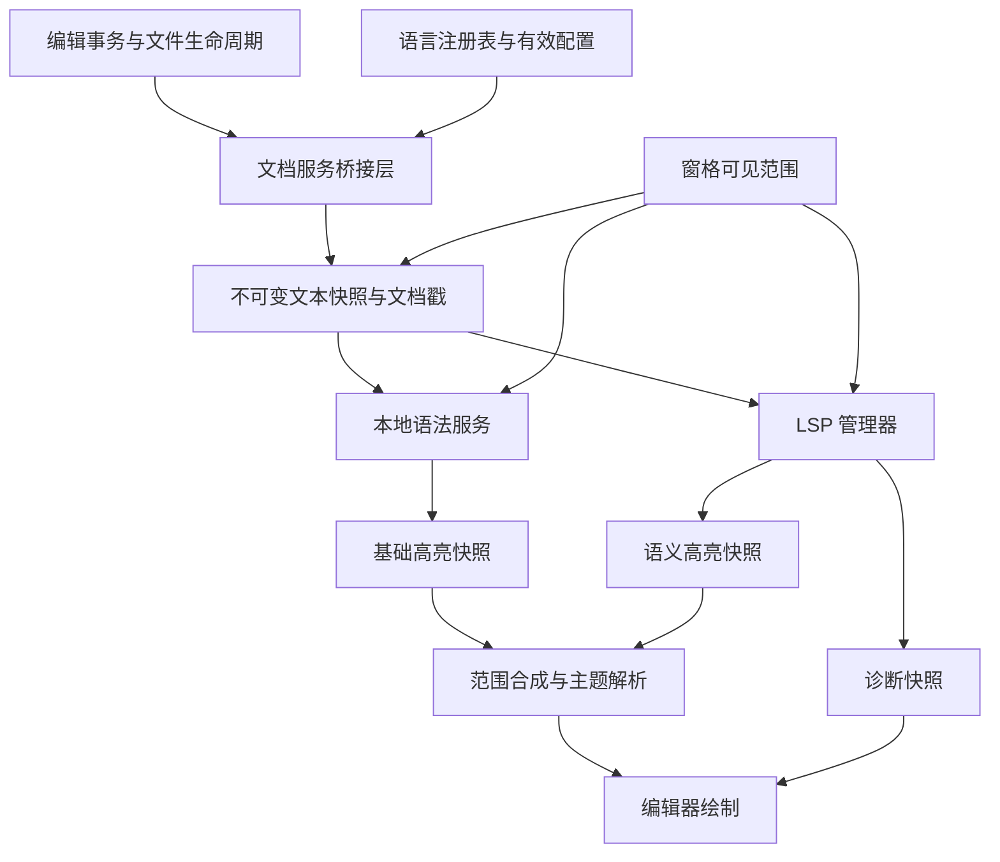

# Loom 语言服务与语法高亮重构设计（临时草案）

- 日期：2026-10-18。
- 修订：2026-10-19 已接入上游 tree-sitter.json 与标准资源布局；不再要求 Loom 专用 package.json 或 SOURCE.md。所有 grammar（含 Markdown/JSON）仍动态加载，应用/用户目录自动发现，重启生效；主工程与语言源码完全独立。Windows 验证见 R-015，跨平台实机验收仍待补。
- 状态：实施中的设计与验收记录；已实现内容和未完成验证以第 19 节为准。
- LSP 最新进展（2026-10-21）：修复候选列表缩短/重排时的主线程越界，并校验 resolve 与缓存的候选身份，见 LSP 草案 R-L23。源码运行资源准备见 R-L22，可关闭安装通知见 R-L21，片段常用变换与未知变量见 R-L20；完整进度和剩余清单以该草案第 13 节为准。事务恢复、Peek、诊断交互、保存顺序与全部 Windows 发布包见 R-L19，灯泡见 R-L18，choice 见 R-L17，签名切换见 R-L16，动态注册及通用文件监视见 R-L13。
- 范围：公共文档基础、语言注册表、Tree-sitter 基础高亮，以及与 LSP 的接入边界。
- 默认顺序：公共基础 → 开放语言注册表 → 通用 Tree-sitter 基础高亮 → 通用 LSP 最小闭环 → 嵌入语言与常用语言扩展。
- 文件用途：项目根目录临时设计与实施记录；设计稳定后再拆分进入正式文档。
- 阅读范围：本文件主导公共模型与基础高亮实施；LSP 协议细节见 [LSP_DESIGN.tmp.md](LSP_DESIGN.tmp.md)。
- 实施状态（2026-10-21 核对至 da7ce4d 并补充本轮修复）：P0 部分完成；P1、P2、P3a、P3b、P5 已实现并待跨平台等验证；P4a、P4b、P4c、P4f 已接入应用并待补充验证。原 P4d、P4e 并入第二代 LSP：P6a 基础大部已实现，P6b/P6c 核心交互通过 Windows 真实 Rust/TypeScript 验证（R-L11），P6d 部分实现，具体以 LSP 草案第 13 节为准。标准 WASM 与原生语言模块均已接入并完成 Windows 功能验证，Linux/macOS 仍待实机验收（第 11.3–11.5 节、R-015）。更新入口见 [第 19 节进度跟踪](#19-实施进度跟踪)。

## 1. 决策摘要

将语言能力分成两个独立服务：本地语法服务和 LSP 语言服务。两者共享文档身份、版本、文本快照、坐标约定和语言配置，在界面前合成为统一的高亮结果。

1. 保留现有后台计算、可见窗口查询、版本检查和主题映射的分层。
2. 先统一结果模型，不以一套复杂引擎插件接口作为启动条件。
3. 将封闭的 `Language` 枚举替换为开放的 `LanguageId`，集中注册语言描述、grammar 变体、服务器绑定与资源；通用服务不包含特定语言分支。
4. 先用 Tree-sitter 替换自写 lexer，提供无需服务器的基础高亮、跨行上下文与编辑时的连续显示。Rust 是首个集成样例，必须用第二种语法明显不同的语言检验通用接口。
5. 再接通用 LSP 客户端，交付文档同步、诊断和语义高亮；rust-analyzer 作为首个真实服务器样例，另用不同能力组合的假服务器验证协议通用性。
6. 两个服务共享公共模型但互不依赖。事务后全量文档桥接属于 LSP 接入阶段，本地语法初期沿用视口查询提交最新快照，不要求先完成全部语言服务基础设施。
7. 原始首期未实现外部语言包；2026-10-19 的后续实现已改为全动态独立语言包与用户目录发现，见第 11.3 节。标准 Tree-sitter WASM 已通过官方 Wasmtime 通路接入（R-014）；服务器目录、发布流水线与按需安装已实现（[LSP 草案第 4 节](LSP_DESIGN.tmp.md#4-服务器注册与分发)、R-L7 至 R-L9），真实发布包安装仍待验收；完整第三方主题格式仍需分别设计与验收。
8. 直接替换旧实现，不提供运行时 legacy 后端开关；基础替换阶段删除旧 lexer 与按行索引。现有主题保持视觉风格，但不长期保留旧颜色结构或会话迁移层。
9. 所有语言 grammar/query 均属于独立动态包，Markdown/JSON 默认随附并启用。启动扫描应用资源和用户目录的逐包清单，实际显示内容时后台加载；用户新增包无需中央注册或重新编译。坏包与资源失败按包隔离，纯文本始终可用，首版安装/更新/禁用后重启生效。

通用性的验收是“增加兼容语言时，只安装自包含描述、查询与兼容 ABI 的标准 WASM（或匹配平台的原生模块），文档版本、缓存、调度、合成与 LSP 核心无需修改”。不承诺缺失平台二进制或 ABI 不兼容的任意 grammar 可直接运行。

## 2. 项目现状与保留边界

本节记录重构前的起点与迁移方向；当前实施状态见第 19 节，表中的旧枚举、lexer、索引与颜色结构已按对应阶段替换。

| 位置 | 当前职责 | 迁移方向 |
| --- | --- | --- |
| `src/domain/language.rs` | 四种代码语言与 PlainText；根据扩展名识别 | 替换为开放语言身份与注册表；显式区分 grammar 变体 |
| `src/domain/document.rs` | `FileMeta` 保存路径与语言 | 语言只由文件本身决定（路径与识别规则）；重命名重新识别并递增语言代次 |
| `crates/editor-core/src/text/revision.rs` | 有界、无文本的编辑范围记录 | 增加通用字节行列及插入范围的几何信息，不引入解析库 |
| `src/features/syntax/lexer.rs` | 自写词法器、八种分类 | 基础替换阶段删除，以独立 fixture 验证新结果 |
| `src/features/syntax/index.rs` | 按行增量词法索引与复用 | 替换为文档解析状态，移除旧索引 |
| `src/infrastructure/syntax_worker.rs` | 单后台线程、请求合并、取消、结果缓存 | 保留运行机制；初期查询提交文档目标，后续支持独立更新入口 |
| `src/app/syntax.rs` | 后台完成后校验快照并触发刷新 | 扩展语言代次等检查，继续通过现有 UI 调度器交付 |
| `src/app/runtime.rs` | 持有运行时服务并清理 | 增加语言服务所有权；服务不进入 AppState |
| `src/ui/editor/syntax.rs` | 分类转颜色，保持字素边界 | 消费统一快照，增加样式解析和范围合成 |
| `src/ui/theme.rs` | 七种语法颜色 | 将内置配色直接写入新样式表，删除旧 SyntaxColors |
| `src/app/editor_performance.rs` | 可选的真实布局与高亮基准 | 保留场景；替换旧 lexer 预期值，增加解析与 LSP 指标 |

当前实现已有 4 MiB 的视口结果缓存预算和默认 16 MiB 的词法索引预算。它们不是未来语法树的准确内存上限，不能直接沿用名称而假定覆盖全部内存。

当前主要正确性限制：按行调用 lexer，没有行间状态；函数、类型等依赖启发式判断；部分测试以同一个 lexer 生成预期结果。缓存一致性与语言正确性需要分开验收。

必须保留的架构边界：

- `editor-core` 保持不依赖 GUI、文件系统、LSP 和 Tree-sitter。
- AppState 与 UI 快照只保存纯数据或不可变结果，不持有进程、解析器、线程或服务句柄。
- AppRuntime 持有服务，AppContext 负责应用编排，infrastructure 执行进程和线程等副作用。
- 后台任务不得持有 UI 状态锁进行解析、JSON 编解码、进程写入或等待。
- 工作区和文档的共享编辑事务保持原子性，不为窗格创建独立文本副本。

## 3. 总体架构



本地语法服务按文档维护上下文；窗格只表达可见范围。两个窗格显示同一文件时共享语法树与服务器文档会话。

LSP 独立于 syntax worker，因为它还需要维护服务器生命周期、诊断及未来的交互请求。可以复用取消、调度与 UI 通知工具，不把全部职责塞入 `SyntaxEngine`。

上图是最终结构。本地高亮首期由视口请求携带最新文档快照，无需先实现图中的事务桥接；隐藏文档可以延迟到再次查询时追赶。LSP 接入后才要求观察所有同步文档的生命周期和修改，两种投递入口服从同一个 stamp 与目标合并规则。

## 4. 共享文档协议

### 4.1 身份与版本

统一使用以下逻辑字段，实际 Rust 类型名可以随代码组织调整：

```rust
struct DocumentStamp {
    document: FileId,
    incarnation: u64,
    version: u64,
    snapshot_identity: usize,
    language_generation: u64,
}

struct DocumentSnapshot {
    stamp: DocumentStamp,
    text: Arc<String>,
    // 与 text 严格匹配的不可变行索引或可在后台生成的索引。
    // 具体复用 editor-core 现有行索引，不再保留一个可变 TextBuffer 副本。
    language: ResolvedLanguage,
}
```

- `FileId` 标识当前工作区文档；`incarnation` 区分关闭后重开等服务会话，避免身份复用污染结果。
- `version` 继续来自 TextBuffer，快照身份用于现有链路的同源检查；指针身份仅用于进程内验证，不能持久化。Arc 释放后地址可能被新分配复用，任何相同快照判断都必须同时比较文档身份、incarnation、version 和相关语言代次，禁止只比较指针。
- 重命名使有效语言或变体改变、或影响解析的配置变化时增加 `language_generation`。同一文本版本的旧语言结果也必须失效。
- grammar/query 资源另有注册表资源版本；查询缓存和解析会话纳入相应资源代次。
- LSP 请求额外绑定服务器实例代次与文档打开代次，重启或重新打开后旧响应失效。
- 主题代次不进入解析键，只影响样式解析缓存。

### 4.2 文档事件与投递位置

应用层桥接事件：`Opened`、`Changed`、`Saved`、`LanguageChanged`、`UriChanged`、`Closed`，以及独立的 `ViewportChanged`。

本节集中桥接推迟到 LSP 接入阶段，不列为本地 Tree-sitter 高亮的前置工程。本地服务可通过 `query(document, snapshot, windows)` 合并最新解析目标；关闭与语言变化仍需保留现有 retain/失效入口。隐藏文档不保持实时已解析状态，revision 断链时完整重建。

接入 LSP 后，协议文档同步不能依赖 UI 调用高亮查询：后台打开、未显示文档的修改、文件重载与重命名也必须被观察到。

LSP 阶段采取可审核的集中桥接：

1. 在 AppContext 的更新边界收集更新前后的轻量文档戳；只比较身份、版本、路径与语言选择，不比较正文。
2. 在同一个应用事务内确定变化；仅为变化文档取得 Arc 快照及必要事件信息。
3. 模型更新结束、状态锁释放后，将变化批次投递到运行时服务。
4. 对纯高亮/诊断结果回写，如果文档戳未变化，不再次发送文档更新，避免反馈循环。
5. 审计通过 `model()`、Deref 或其他直接 State 更新绕过 AppContext 的入口，确保所有生产文档写入经过同一桥接边界。

这是正确性优先的初版，比较成本为 O(打开文档数)。将其加入 UI 基准；只有数据表明有必要时，再由文档事务显式返回 changed IDs，替换全表元数据比较。不能为优化扫描提前建立第二套文本变更来源。

同一事务内打开后又关闭、但从未发布给服务的文档可以合并掉；已经向 LSP 打开的文档必须匹配关闭。保存事件需要单独记录保存成功，而不能仅从版本是否变化推断。

覆盖普通编辑、Vim、IME 提交、粘贴、撤销重做、工作区替换、文件加载、磁盘重载、会话恢复、Save As 和关闭。IME 预编辑仍是界面状态，提交前不发送正文变更。

### 4.3 快照成本

当前文本由 Arc<String> 共享；后台保留旧快照时，后续修改可能触发现有的写时复制。设计不能据此承诺大文件每次按键绝无整段复制。

- UI 不新增正文 `to_owned()` 或 JSON 序列化。
- 队列只保留每个文档的最新待处理快照；工作中的旧快照尽快取消和释放。
- LSP 每个同步文档最多保留上次发送快照与最新目标快照，另受总体源文本保留预算限制。
- 分别测量正文写时复制、桥接元数据比较、后台解析成本。若文本复制成为主要瓶颈，再单列文本存储重构，不能伪装为高亮引擎问题。

## 5. 坐标与编辑记录

### 5.1 统一约定

| 场景 | 坐标 |
| --- | --- |
| 文本存储、编辑范围、内部高亮 | UTF-8 字节偏移，半开区间 |
| Tree-sitter point | 从 0 开始的行号与行内字节列 |
| LSP position | 从 0 开始，按初始化协商的编码计算 character |
| 屏幕布局 | 显示列、字素和像素，继续使用现有布局工具 |

LSP 初版支持 UTF-8 与 UTF-16，协商优先 UTF-8，同时保证 UTF-16 默认兼容。服务器未给出编码时按协议默认处理。未实现 UTF-32 时不宣称支持。

CRLF 按正文真实字节保留；LSP 位置不落在 CR 与 LF 之间。解析 point 的列是字节列，不等于字符数或 tab 展开后的显示列。编辑几何中的换行计数以 LF 字节为准，CRLF 算一次；不因字段名为 line_breaks 就把独立 CR 也算成一个 Tree-sitter 新行。

入站范围先按对应文本快照转换为合法字符边界。UI 最后处理字素边界，避免切开组合字符；越界、整数溢出和非法编码边界应显式处理，不能导致切片 panic。

### 5.2 扩展无文本的 RevisionEdit

为 Tree-sitter 增量更新补充通用元数据：

```rust
struct BytePoint { row: usize, column: usize }
struct TextExtent {
    bytes: usize,
    line_breaks: usize,
    last_line_bytes: usize,
}

struct RevisionEdit {
    old: Range<usize>,
    new: Range<usize>,
    old_start_point: BytePoint,
    old_end_point: BytePoint,
    inserted_extent: TextExtent,
    line_breaks: bool,
}
```

这些值在编辑提交时、原文与插入文本均可用的位置计算，复用现有行起点索引，避免为了每个 edit 从全文开头重新扫描。记录不保留插入/删除正文，不改变目前 64 条 revision、累计 2048 次 edit 的有界策略；如实测元数据开销显著，再调整预算。

### 5.3 Tree-sitter 批量编辑顺序

现有一次 ChangeSet 中，所有 `old` 范围针对事务前正文，`new` 范围针对事务后正文。它们不能原样当作一组顺序 InputEdit。

每条 revision 按时间顺序处理；同一 revision 内，按 `old.start` 从后往前更新旧树：

- `start_byte = old.start`，`old_end_byte = old.end`。
- `new_end_byte = old.start + inserted_extent.bytes`，不能直接使用最终文本中的 `new.end`。
- 起点、旧终点使用事务前的 point；新终点由起点和插入 extent 推导。

例如原文 `abcdef`，同时将 `b` 改为 `XX`、`e` 改为 `YYY`，最终为 `aXXcdYYYf`。先对树执行 `4..5 → 4..7`，再执行 `1..2 → 1..3`；第一个新范围不是最终正文中的 `5..8`。

只有 revision 链完整且与解析状态同源时才增量更新；reload、链断裂、语言变化时完整解析。建立包含多处修改、多行插入及 Unicode 的独立测试，不能只测单光标插入。

## 6. 语言注册表与配置

### 6.1 开放身份与首期数据模型

```rust
struct LanguageId(u32); // 注册表分配，Copy；不硬编码某语言对应的数字
struct GrammarId(u32); // 资源身份，不是解析库对象
struct VariantId(u32);

struct LanguageDefinition {
    id: LanguageId,
    canonical_name: Arc<str>, // 如 rust、typescript；用于配置和序列化
    display_name: Arc<str>,
    badge: Arc<str>,
    file_rules: Vec<FileRule>,
    variants: Vec<LanguageVariant>,
    // 注释标记、别名等来自描述，不保存语言特有的词法器关键字表。
}

struct LanguageVariant {
    id: VariantId,
    grammar: Option<GrammarId>,
}

struct ResolvedLanguage {
    language: LanguageId,
    variant: VariantId,
    grammar: Option<GrammarId>,
    origin: LanguageOrigin,
}
```

这些是职责示意，不要求原样复制为最终 Rust API。默认使用注册表内 intern 后的小整数 ID，避免视口缓存键反复哈希名称；规范名称仍是配置和序列化表示，不序列化进程内数字。名称与 ID 的双向映射集中维护，不在各模块复制。

同一 AppRuntime 使用一份统一注册表。首批 LanguageId、GrammarId 按规范名称排序后分配，VariantId 按语言名称与变体名称排序后分配，使同一内置资源集的初始化结果稳定；不持久化数字。将来动态追加时只追加分配，在该注册表生命周期内不回收复用。资源配置更新增加资源/语言代次；若整体重建注册表，需要增加注册表代次并使相关会话与缓存失效。测试的独立注册表不得混用 ID 或共享缓存。具体 ID 位宽与 intern 实现仍需基准验证，但不能重新退回封闭语言枚举。

配置中的未知名称报告注册错误，不会自动变成具备解析能力的语言。调度热路径只使用 ID 与代次，协议 languageId 和显示名称留在描述中，不放进逐分页哈希键。

语言、变体、grammar 与后续服务器定义在概念上保持独立，一个 grammar 可以被多种语法兼容的语言定义复用。P2 描述格式与数据结构只包含已实现的识别/语法字段，不提前加入 ServerBinding、ServerDefinitionId 或协议 languageId 占位；P4a 实施时再设计并加入相应格式与校验。

TypeScript / TSX 显式选择不同 grammar，JSX 使用经验证的 JavaScript grammar 配置。未来服务器绑定可以按变体选择不同的协议 languageId；不得在通用 manager 中写 `if language == Rust`，也不得用 UI 徽章名称推导协议 languageId。

注册表只保存描述与资源引用，不持有进程或可变 Parser。实际 grammar factory/query 加载位于 syntax 模块；服务器程序与能力协商位于 language_service/infrastructure。语言特有的 root resolver 或初始化适配通过具名 provider 注册，限制在相应资源/适配模块内，不扩散到文档与调度核心。

运行时描述由上游 tree-sitter.json 适配生成，按第 6.5 节发现；无资源时仅有纯文本。文件规则来自标准 file-types；display_name、badge、注释和既有 LSP 默认配置独立于语法资源，未知语言使用通用展示默认值，不需要修改代码。下文旧描述 JSON 是内部注册表/应用配置模型，不再是用户安装资源所需文件。

默认根规则、文件名 marker、注释规则和服务器配置尽量数据驱动。复杂语言行为允许专用 provider；通用性不要求把所有语义硬塞成一套万能配置语言。

纯文本是合法的 language 定义，可没有 grammar 和服务器。仅有 grammar、仅有服务器、两者都有、两者都没有，都是明确支持的能力组合。

### 6.2 扩展契约与反特例验收

增加一个随附语言包的步骤（外部用户只需安装完整包并重启）：

1. 在资源目录放入上游 tree-sitter.json，保留 grammars 声明、file-types 与查询相对路径；无需 Loom 专用清单。随附模板位于 assets/language-packs/。
2. 提供清单指定的查询及兼容的 tree-sitter-<name>.wasm，模块可放清单根目录或 grammar.path 下。保留上游 LICENSE，无需 SOURCE.md、Rust 包装、语言 crate、集中工厂表或修改应用依赖。
3. 增加识别、分类及必要的编辑 fixture。
4. 涉及新增或变更第三方资源/依赖时更新 THIRD_PARTY_NOTICES。

包可复用兼容模块与查询，但需要在自身目录中完整提供对应资源；必须由 fixture 证明语法与高亮覆盖符合该语言/变体，不能仅按名称相近推断兼容。例如 JSONC 的注释、尾逗号等所需行为需按锁定 grammar 实际验证。首期使用自定义 Rust 语法兼容测试语言验证复用路径，不为此额外引入 JSON。上述步骤不修改注册表加载代码、worker、范围合成或主题逻辑。

P2 替换 Language 枚举后，旧 lexer 仍运行到 P3b；它的关键字表临时按规范语言名称选择（如 rust、csharp），这部分局限在旧 lexer 中，随其一起删除，不把关键字表或 legacy backend 选择写入语言描述。未来 P4a 另行增加服务器绑定格式。

P2 就加入一个测试专用的非内置语言 ID，验证识别、重命名后重新识别、未知资源与显示回退。P3 至少验证 Rust 加 JavaScript 或 C# 的差异化样例，均来自既定内置范围，不为验证额外引入 JSON grammar。P4 使用一个非 Rust 的假服务器配置完成同步、诊断和语义结果，防止“接口看似通用、实现只认 Rust”。

### 6.3 识别优先级

从高到低：项目文件关联 → 用户文件关联 → 内置精确文件名 → 内置扩展名 → PlainText。语言是文件的函数：只由路径（及后续实现的首行/shebang 规则）决定，不提供按文档的手动覆盖，也不提供状态栏语言选择器（2026-10-18 决定）。首行/shebang 识别在实现对应规则后扩展，不为尚未实现的行为预留可配置字段。

同一文档的所有窗格共享同一份元数据，因此语言天然一致。语言不写入会话，每次由文件重新识别。本次不设计会话迁移层。

用户关联和项目关联使用有序规则列表，先匹配先采用，避免依赖未说明的 glob 特异性。规则匹配相对于所属工作区根目录的规范化相对路径；无所属根目录时仅应用明确允许的文件名规则。大小写按平台文件路径策略处理并测试 Windows 情况。

无效 glob 或未知语言名产生设置诊断，忽略该条规则。重命名重新识别，语言或变体变化时递增语言代次。语言相同但 grammar 变体变化仍重建语法会话。

### 6.4 设置草案

沿用现有设置文件与 snake_case 风格；以下是目标设置示例，不是当前可用配置。P2/P3 只接入文件关联与本地语法预算，semantic_highlighting、language_servers 和 lsp_max_document_bytes 到 P4 对应阶段才加入设置格式。`language_servers` 在第二代改为下面的形状，完整格式（用户注册服务器、安装策略、语言级服务器排序、格式化器）见 [LSP 草案第 9 节](LSP_DESIGN.tmp.md#9-设置)：

```json
{
  "file_associations": [
    { "pattern": "**/*.custom", "language": "rust" }
  ],
  "semantic_highlighting": "combined",
  "language_servers": {
    "rust-analyzer": {
      "enabled": true,
      "install": "ask",
      "args": [],
      "initialization_options": {}
    }
  },
  "syntax_max_file_bytes": 8388608,
  "lsp_max_document_bytes": 8388608
}
```

第一版支持 `off`（关闭语义层）和 `combined`（在本地高亮上叠加语义）；不必同时实现 semantic-only 模式。

项目作用域允许文件关联、启用开关和文档大小限制；服务器可执行文件与参数只由用户级配置决定，项目级设置不能注册服务器或改命令。配置解析继续通过 settings/rules 的作用域规则处理，不另起文件读取路径。

服务器有两个来源：Loom 维护的内置目录（按需下载、校验、安装，默认安装前询问用户），以及用户在设置里用绝对路径注册的服务器。任何情况下都不搜索 PATH、不解析裸命令名。详见 [LSP 草案第 4 节](LSP_DESIGN.tmp.md#4-服务器注册与分发)。

徽章来自有效语言元数据；文件图标仍按现有文件名/扩展名系统处理，不与语法配置强绑定。

### 6.5 核心资源与语言包的组织和加载

2026-10-19 已改为全部 grammar/query 动态化，包括默认启用的 Markdown、JSON；主程序仅保留 Tree-sitter 引擎与纯文本回退。应用资源目录和用户数据目录逐包发现，实现与验证见第 11.3 节、R-010 与 R-012。

**描述格式。** 每种语言一个 JSON，文件名为规范名称，使用现有 serde/serde_json；P2 不新增 TOML 解析器。所有描述层级使用 `deny_unknown_fields`，未知或拼错字段在测试期失败。示例：

```json
{
  "name": "typescript",
  "display_name": "TypeScript",
  "badge": "TS",
  "comments": { "line": "//", "block": ["/*", "*/"] },
  "variants": [
    { "id": "typescript", "grammar": "typescript" },
    { "id": "tsx", "grammar": "tsx" }
  ],
  "files": [
    { "extensions": ["ts", "mts", "cts"], "variant": "typescript" },
    { "extensions": ["tsx"], "variant": "tsx" }
  ]
}
```

variants 必须非空，首项明确作为未指定变体时的默认项；ID 分配仍按名称排序，不依赖文件枚举顺序。files 规则直接引用语言内的变体，首版支持 extensions 与精确文件名 names，规则必须能唯一解析。comments 仅描述编辑用标记，不替代 grammar 的解析规则；无相应标记的字段可省略。grammar 可以省略，例如 plaintext。可选 aliases 只服务名称解析，不是额外语言注册。服务器绑定字段到 P4a 才加入。

**内嵌方式。** 生产只含纯文本描述，所有 grammar/query 来自磁盘完整包。主工程 build.rs 不扫描、校验或复制语言资源，也不生成语言内嵌表。根 Cargo.toml/Cargo.lock 无 grammar crate、包装 crate、语言源码路径或开发/构建依赖。仓库不再保留 language-packs/ 制作工作区或 loom-grammar-* 包装；assets/language-packs/ 只有描述/查询/来源，标准模块由外部提供。主工程规则测试使用 tests/fixtures/language_registry.rs 的纯元数据，不含 Parser 或查询。

资源校验已由 R-015 的标准清单发现和延迟资源读取替代：支持清单声明的相对查询路径和多文件数组，保留上游目录。缺少模块/必需高亮只使使用该 grammar 的内容降级，不影响主工程构建。SOURCE.md 不作为必需文件，来源与许可证由上游 LICENSE、可选 PROVENANCE.md 和第三方声明保留。

旧的 OUT_DIR 语言表生成过程已删除。启动按稳定排序生成运行期注册表，ID 在进程内不变；变更资源后重启。绝对目录与同一二进制资源安装由 production-mode 探针验证。

主工程 build.rs 只处理图标、Cargo 清单和终端探针，不参与语言资源。标准清单/查询/模块复制由 scripts/package 的成品消费者处理；真实语法回归在独立 tests/language-runtime 中运行，不生产模块、不提供语言制作工程。

**启动与按需加载。** bootstrap 自动扫描应用资源与用户数据目录的一级子目录，只读取各目录的 tree-sitter.json（兼容旧 package.json）并安装进程生命周期内不变的注册表；不依赖全局 catalog.json。读取描述即可识别文件，不加载动态库、查询或 Parser。首次可见文档或可见注入区域的语法请求在 syntax worker 中经 Resources 接口加载所需资源；已发现但不可见的注入区域不提前编译查询。资源及失败结果缓存，安装/更新/禁用包后重启生效。

**分层。** domain/language 只负责纯描述校验与注册表；生产回退为纯文本，测试通过唯一的 cfg(test) include 使用纯元数据夹具。原 build.rs 生成表与 domain 验证包共享扫描器均已删除。Resources 端口和查询编译属于 features/syntax，磁盘及动态加载属于 infrastructure。真实 parser、注入、loader 与 worker 测试由 tests/language-runtime 独立 Cargo 工程组装，使用预构建包作为运行输入；其依赖图也不含任何 grammar crate。主工程默认测试不需要语言文件或动态模块。

**错误边界。** 随附资源错误在构建和回归测试中检测；运行时坏清单、包间名称/规则冲突按包记录并跳过，不能破坏其余注册表。合法用户标准集合按身份或完整 grammar 集合整包覆盖，坏替换保留随附版本；移出目录后重启移除支持，旧清单兼容 enabled=false。用户资源不得借用缺失的随附模块。缺少动态库、坏符号/ABI、缺失或错误查询只让对应语言降级普通文本，失败缓存并逐项记录；纯文本始终可用。

## 7. 统一高亮模型与主题

### 7.1 分类与来源

```rust
struct HighlightSpan {
    range: Range<usize>,
    class: HighlightId,
    modifiers: HighlightModifiers,
}

struct HighlightSnapshot {
    stamp: DocumentStamp,
    source_generation: u64,
    coverage: Coverage,
    spans: Arc<[HighlightSpan]>,
}
```

- `HighlightId` 是 Loom 分类表的进程内紧凑标识；对外使用稳定名称。不能直接等于某个 grammar capture 或 LSP legend 的索引。
- 基础分类首批包括 keyword、function、function.method、type、type.builtin、variable、variable.parameter、property、constant、string、string.escape、string.regex、comment、comment.documentation、number、operator、punctuation、tag、attribute。
- 修饰符至少预留 declaration、definition、readonly、static、deprecated、async、documentation、default_library 的表示。
- 未知 capture 通过点分层级回退；无法识别的类别采用默认文字。未知 LSP token 类型没有明确映射时，不得用默认色覆盖已有基础高亮。
- 不在每个字符区间写入字符串名称；名称在注册表中解析一次，视口结果使用紧凑 ID。

### 7.2 三类索引不得混用

1. Tree-sitter query capture index：只在该编译查询内有效。
2. LSP legend index：只在相应服务器实例/注册能力内有效。
3. Loom HighlightId：用于语言无关的主题解析。

两种适配器分别建立映射。服务器重启、能力重注册或 query 更新时使旧映射失效。

### 7.3 范围合成规则

后台产出的每一层都必须有明确的文档戳；只有与目标文档完全匹配的层进入合成。

合成以所有边界分段：先确定基础分类，再应用有效语义分类与有定义的修饰符，最后按当前主题解析样式。一个 semantic span 覆盖多个基础片段时必须切分，不能假定 token 一一对应。

语法查询内部的重叠采用可复现的规则：显式优先级 → 更深的注入层 → 更具体/较短的匹配范围 → 查询规则顺序。所有比较项和相同范围的处理都写入测试；资源适配器不支持的谓词或指令应在加载时失败并说明原因，不能静默忽略。

LSP 若宣称不返回重叠 token，收到违规结果时按验证策略处理并记录；不能让异常顺序影响绘制。最终交给 UI 的片段必须有序、不重叠、合法且覆盖所请求文本；未着色间隙用默认样式填充。

搜索背景、选区、诊断下划线、光标与 IME 继续使用独立装饰层。语义分类不负责覆盖它们。

### 7.4 主题解析

分类回退示例：`function.method → function → default`。这是 Loom 的明确约定，不要求原样复制其他编辑器的主题算法。

将内置主题当前颜色直接写入新分类的稀疏样式表，保持已有视觉风格；替换完成即删除 SyntaxColors，不长期维护旧结构与新结构之间的适配层：

P1 到 P3b 之间旧词法器仍然运行，因此 P1 需要一处临时的 `TokenKind → HighlightId` 映射，旧分类也通过新主题表着色。这是阶段间实现过渡，不是旧 API 或主题格式的长期兼容层；P3b 随 lexer 一起删除，并通过引用检查确认没有遗留。P1 可删除 SyntaxColors，不要求同时删除 TokenKind。

```text
HighlightStyle = foreground? + bold? + italic? + underline? + strikethrough?
```

未指定属性继承基础样式；显式 false 表示清除该属性，不能与未指定混淆。先按分类最具体匹配解析，再按明确的修饰符规则顺序覆盖；测试多修饰符冲突。

切主题只清理样式缓存，不使语法树、分类快照或 LSP 数据失效。UI 对尚未接通的字体样式暂不启用显示承诺，阶段验收注明支持的属性。增加粗体/斜体前，必须让布局测量、文本 shaping、光标和命中测试使用同一套有效字体样式；不能只修改绘制字体而继续用另一种字形的宽度。

## 8. LSP 接入边界与后续草案

完整协议与生命周期设计移至 [LSP_DESIGN.tmp.md](LSP_DESIGN.tmp.md)。本文件只保留与基础高亮相关的约束：

- LSP 使用通用服务器定义，由服务器声明自己服务的语言和协议 languageId（绑定方向与第一代相反，语言描述里不再带服务器），复用第 4–7 节的文档身份、坐标和分类模型。一个语言可绑定多个服务器；服务器定义不进入进程级 `Registry`，由可热重建的 `ServerSet` 持有（LSP 草案 5.1）。
- 第一代 P4a–P4c、P4f 已实现并接入应用；第二代的多服务器、按需安装、请求通道、增量同步、导航与编辑主要功能已实现（LSP 草案 R-L6 至 R-L10），Windows 真实服务器核心用例及三包安装通过（R-L11），完整能力与跨平台仍待验收。原 P4d 的增量同步与 semantic delta 已实现；原 P4e 的通用文件监视仍待实施，P6d 尚不完整。状态以 LSP 草案第 13 节为准。
- 第一代的交付顺序与验收门槛不变：P4a 通道、P4b 文档同步、P4c 诊断与 semantic full 分开验收；首个真实服务器的自监视路径必须经锁定版本、配置和平台测试验证（未打开源文件、项目清单变化、git 分支切换），未验证前不能假定自动 fallback，缺口提前必要的 watcher 子集，不允许静默漏报。
- P4c 先显示连接/等待/结果可用状态；完整 workDoneProgress 为 P4f。没有进度时不推断索引是否完成。
- LSP 与本地语法互不依赖：服务器缺失、安装中、索引中或崩溃时，基础高亮和编辑不受影响；语义 token 只在文本戳完全匹配时叠加在 tree-sitter 之上。服务器按已解析的语言匹配，不按后缀，语法包是否已安装不影响绑定。

## 9. Tree-sitter 本地语法服务

### 9.1 资源与状态

通过资源注册统一接入标准动态 grammar：Rust、JavaScript、TypeScript/TSX、C#，以及 JSON、Markdown、CSS、HTML。Rust 作为首个集成样例，第二种语言用不同语法结构检验通用性，而不是引入 RustSyntaxService、CSharpSyntaxService 等重复调度实现。grammar 和 query 使用兼容版本一起锁定，更新时同时运行 fixture 与跨平台构建；资源许可证进入第三方声明。

资源按语言描述和 grammar 查询分开，目录与第 6.5 节的扫描约定一致：

```text
assets/language-packs/
  <directory>/tree-sitter.json
  <directory>/queries/       # 或清单声明的其他相对路径
    highlights.scm
    injections.scm           # 可选

# 安装成品追加标准模块，源码模板不包含二进制：
<应用资源>/language-packs/<directory>/
  tree-sitter-<grammar>.wasm # 标准上游下载；也可用兼容原生模块

```

当前描述和查询作为独立包的磁盘资源分发，发布包不依赖源码工作目录。features/syntax/grammars.rs 仅定义 Resources 端口，不再包含原生工厂或具体 grammar 引用；infrastructure/language_packs 与 language_standard 读取上游清单，按需加载模块、校验 ABI 和读取查询。新增兼容外部包无需修改或重编译主程序。原 P3a 静态工厂实现已由 R-013 的标准模块通路替代。

包的导出、资源目录和描述中的 grammar 引用做一致性测试；同一动态库可以提供 typescript、tsx 两个导出。上游版本/许可证与可选 PROVENANCE.md 记录查询来源和修改；资源与通用引擎 ABI 分别审阅升级，不把具体 grammar 再引入 Cargo。首期不运行时下载 grammar，不要求用户机器安装编译器。

每个文档的状态包含语言资源键、已解析 stamp、源快照、Tree、解析状态与使用时间。Parser 可按 grammar 在单 worker 中复用；执行某文档解析时必须携带该文档的树与 stamp，不把 Parser 的暂存取消状态误认为其他文档状态。

### 9.2 解析与查询分离

本地高亮首期由视口查询提交最新文档 stamp 与快照：stamp 未变化时滚动和窗口变化只触发查询，变化时合并解析目标。隐藏文档无需主动解析；再次可见时根据 revision 链追赶，断链则重建。LSP 阶段增加独立文档更新入口后，两个入口仍合并到同一个目标状态，不产生第二套解析生命周期。

首次解析完整文档；后续按第 5 节更新旧树并增量解析最新快照。本地需求驱动更新不等于截断上下文或只解析视口。

第一版每次成功解析后重新查询当前可见范围，不维护复杂的跨版本 capture 局部复用。语法树复用和高亮结果复用是两项不同优化。

查询限制范围只约束输出与遍历工作，不把视口正文当成独立文档解析。匹配允许读取祖先和跨界节点，上方开始的注释在当前视口仍需正确显示。

原来的 1 KiB 页可以保留为查询结果缓存分片，但不作为语法树节点边界。跨页 token 保持完整语义范围，最终在消费窗口裁剪。

### 9.3 Engine 接口策略

首期只需要 Plain 与 TreeSitter 两条内部路径，切换由注册表声明的 grammar 能力决定；替换完成不保留 LegacyLexer 开关。合法的无 grammar 语言或预算超限可以普通文本显示，内置资源内容错误按 6.5 节处理，不作为正常降级输入。Tree-sitter 原生语法使用其 C ABI，应用内部接口不对包暴露 Rust ABI。

确有复用价值时引入小型文档接口，其职责是 `reset(snapshot)`、`update(snapshot, revisions)`、`query(ranges)`，由调用者传入取消/预算上下文并接收显式成功、取消、失败结果。接口不返回颜色，也不拥有应用状态。

LSP 不实现这个本地文档引擎接口；它通过语义结果适配器接入统一高亮模型。

### 9.4 取消与提交

以文档目标 stamp 和任务代次判断是否取消；在解析、查询和结果整理阶段均检查预算。使用锁定 Tree-sitter 版本支持的取消/进度机制，不能仅在解析前检查一次 AtomicBool。

旧树的 edit 在 worker 私有的工作副本上执行。解析成功且 stamp 仍有效后，原子替换已提交树与源快照；取消或失败丢弃工作状态。根据解析 API 要求清理 Parser 的中间解析状态，再调度其他文档。

返回可见高亮结果前再次验证任务身份。UI 回写还要再检查一次；两次检查分别保护缓存发布与应用状态交付。

### 9.5 查询兼容与正确性

语法资源不是从其他编辑器复制 `.scm` 后就保证兼容。需要声明 Loom 支持的 capture、谓词、指令和优先级规则；首期先覆盖随程序内置的查询实际使用的集合，拒绝不支持的配置。

P3a 起在 cargo test 中针对对应 grammar 编译所有内置查询，并验证捕获名与 Loom 支持的谓词/指令；不能依赖运行时首次加载才发现内置错误。只有 Query::new 成功还不够，额外校验不被运行时解释的未知谓词，避免其被静默接受但改变匹配含义。

错误恢复节点不使整份文件退回普通文本；语法不完整仍尽量产生基础高亮。预算超限或解析无法继续可进入有原因的运行回退；损坏的内置查询不是正常输入恢复情形。

后续如果优化跨版本高亮缓存，失效集合必须包含实际文本编辑、语法变化与受影响的查询上下文。不能只依赖结构 changed ranges：改名后树形可能不变，但基于文本的查询结果可以变化。

## 10. 调度、缓存与降级

### 10.1 调度

优先级：活动窗格的最新正文与视口 → 其他可见窗格 → 最近使用的隐藏文档 → 可取消预取。

同一文档合并多个窗格窗口；相同目标不重复解析；只保留最新目标版本。避免持续新请求让其他可见文档永久饥饿，使用轮转与有界连续服务次数。

预算检查不能变成每几个毫秒取消并从头重试同一个大文件的循环。一次任务超预算后进入受控降级或等待空闲重试；只有可以证明恢复点与快照一致时才续算。

### 10.2 缓存键与结果状态

- 本地树：文档身份、已解析版本、语言/grammar 代次。
- 基础分类窗口：文档戳、query 资源代次、窗口范围。
- 显示保留缓存：正确基础分类的完整 stamp、资源代次与 coverage；生命周期独立于树和 worker 热缓存。
- 语义快照：文档戳、服务器/打开/语义代次、可选 resultId。
- 合成结果：上述输入身份与窗口；不包含已解析颜色。
- 样式缓存：HighlightId、修饰符、主题代次。

区分 Pending、Ready、Partial、Disabled、Failed；显示层另有第 10.4 节的 Provisional 状态。coverage 表达已查询范围，不要求它内部每字节都有着色 span。UI 对空隙使用默认文字，不能把“没有着色 token”当成“还没计算”。

编辑后不能把旧结果当作当前版本的 Ready 缓存命中，但可以将上次有效基础高亮投影为仅用于显示的 Provisional 片段，保持输入连续性；做法见 10.4。这与后续精确复用跨版本解析/查询缓存是两件事。

### 10.3 初始预算提案

以下是待基准验证的产品默认值，实施前可调整；不是当前测得的性能结论：

| 项目 | 初始策略 |
| --- | --- |
| Tree-sitter 默认最大文档 | 8 MiB，允许用户降低或提高 |
| LSP 默认最大打开文档 | 8 MiB，超过后关闭该服务器文档会话 |
| worker 热分类结果缓存 | 先保持现有 4 MiB 并记录命中/逐出 |
| 独立显示保留缓存 | 另设候选 4 MiB，保留各文档最近可见分类；树逐出不连带清空；与热缓存共享 Arc 时去重记账 |
| 后台保留源快照 | 以不同 Arc 分配去重核算，初始总预算 128 MiB |
| 树资源 | 初始候选最多 16 个文档树，需用标签页基准确认；树被逐出不等于显示结果失效 |
| 单次查询 | 限制 capture 数、输出片段数与可检查的耗时预算 |
| LSP 在途 semantic | 每文档最多一个有效请求；超时或取消后释放槽位 |
| 活动 LSP 实例 | 初始最多 4 个；优先可见根，超限报告状态，禁止无界启动 |
| stdio 消息 | 初始单消息最大 32 MiB，超限结束故障实例并提示可调整限制 |

长行使用字节长度作为额外风险信号，先以 256 KiB 作为候选触发点，在基准中决定是否自动降级；不能将长行裁剪后伪装成正确文档解析。

Tree-sitter 原生内部内存未必能从现有 API 精确统计。因此这里的树预算是软限制；进程内存实测用于评估。首期不能承诺强制原生解析器硬内存上限。

达到限制时：逐出非可见缓存/树 → 取消过期工作并释放快照 → 降级基础高亮为普通文本 → 提供状态与显式重试。恢复条件采用滞回或冷却，避免大小阈值附近反复启动。

LSP 文档大小限制只控制 Loom 发送和持有的正文，不限制语言服务器对整个项目的索引内存或耗时；必须分别观测。

### 10.4 编辑时的临时高亮投影

将“最新版本语义正确”与“后台处理期间的显示连续性”分开：Ready 只来自匹配目标 stamp 的结果；Provisional 由上次 Ready 基础分类沿有验证的 revision 链投影，仅供绘制。它不会作为成功解析状态、查询缓存命中或 LSP 版本依据。

显示返回值独立记录 `target_stamp`、`origin_stamp` 与 `freshness`（Fresh/Provisional/Default）：Fresh 的两个 stamp 相同，Provisional 保留原始正确锚点身份但范围已映射到 target，Default 不承诺分类。不能把改写了 stamp 的旧 HighlightSnapshot 当作当前 Ready 结果存回语法缓存。

为每份文档保留有界的最近可见基础片段与 coverage，绑定原始 Ready stamp。更新时尽量从这个锚点映射到最新版本，不反复将近似结果作为新的正确锚点积累误差。只在相同 incarnation、语言/grammar/query 代次且 revision 链完整时允许投影。

同一份显示保留缓存也服务第 10.5 节的标签页恢复。资源预算允许时，其生命周期长于对应语法树；即使树先逐出，完整 stamp 匹配的基础分类仍然正确。保留的是分类片段，不保留旧 Parser 或额外完整正文副本。

投影在 UI 线程的高亮查询路径上同步执行，使当前帧可以立即使用结果。实现先在 worker 的短锁内取得不可变片段与 revision 引用，释放锁后在调用侧完成投影；不得持有 worker 锁执行范围切分、字素裁剪或主题处理，也不得等待后台解析完成。

工作量由可见片段数 S 和待映射 revision 数 R 约束。还需考虑每条 revision 可以包含多个 edit：直接对每个端点反复调用当前线性遍历 edits 的 `TextRevision::map`，不能自动声称只有 O(S × R) 成本。目标实现对每条 revision 的有序片段与 edits 做一次归并，令 E 为累计处理的 edit 数、S 为包含中间拆分结果的片段上界，总成本约为 O(S × R + E)，输出整理成本另行记录。

S、R、E 和生成片段数均有上限，超限或链断时执行显式回退并记录原因；R 仍受现有日志上限约束。对相同 origin/target stamp 与窗口组合复用已计算的投影，避免每个重绘帧重复映射相同 revision 链。上限与时间预算在 P3a 数据基础上确定，不能靠“只处理可见区域”替代 UI 耗时测量。

投影必须处理边界语义，不能简单对所有 span 都调用 `map(start, Before)` / `map(end, After)`：

1. 未改动的片段保留分类并平移；在插入点分开的左片段结束位置偏向 Before，右片段开始位置偏向 After，避免两个 token 同时吞入插入内容。
2. 删除/替换与 span 相交时，先去掉被删的交集，再映射仍存在的左右片段；整体被删的 span 不保留零长残影。
3. 新插入文本可临时继承插入点所在 span 的分类；恰在边界时按确定规则优先左邻、再右邻、最后默认样式。这只是显示启发式，允许引号、注释边界等修改短暂显示旧分类。
4. 裁剪到当前窗口、当前正文长度与字素边界，去重/合并同类相邻片段，保证绘制结果有序、不重叠、文本重组不变。

`TextRevision::map` 可以作为位置计算工具，但 span 切分、插入内容的归属与端点关联策略需要独立测试。批量 edit 的几何适用规则沿用第 5 节；不能直接把最终 new 范围误当作顺序坐标。

新版本 Ready 返回后，以一次结果发布原子替换对应显示范围，不先清成普通文本。主题切换仍用当前主题映射这些分类。首期只投影本地基础分类，不投影 LSP 语义 token 或诊断。

P3a 实现了投影本身（presentation.rs，含与逐字节模型对照的随机测试），P3b 把它接入 worker：每个文档保留最近一次完整着色的片段，之后每一帧只把上一帧以来的编辑应用上去，所以一长串连续输入的每帧成本与第一次击键相同，结果与一次性从原锚点穿过全部编辑相同。实测（release，200 次，随机编辑）：S=1000 个片段、16 条 revision、共 64 个 edit 时 p50 0.12 ms、p95 0.18 ms；S=4000 同条件 p95 0.68 ms；S≤200 全部低于 25 µs；S=4000、R=4、32 个 edit 出现过一次 4 ms 离群值。上限因此定为 S≤4000 个片段、R≤16 条 revision、总 edit≤64（presentation.rs 的常量），超出时显示普通文本直到解析完成。一个窗口通常不到 1000 个片段，p95 低于 0.2 ms，在候选 UI 门槛 max(10%, 1 ms) 之内。

Provisional 绝不用于折叠、跳转范围、括号语义、自动缩进或 `daf` 等结构编辑。链断、语言变化、正文重载、明确超限/失败时失效并按普通文本回退。UI 同步查询只执行上述有界投影，不扫描全文、运行解析器或阻塞等待 worker；实际同步耗时纳入第 14.4 节的 UI 热路径预算。

验收定义：在已有高亮的 1 MiB 固定源码样例中，以明确记录的连续输入速率测试每个渲染帧；编辑行中未改动且此前有分类的锚定片段不能因为版本更新统一退回默认文字色。新增字符可以临时近似着色，原本无颜色的区域不强制着色。加入可控 150 ms 后台延迟、跨行修改、删除、撤销和多处编辑，检查文本重组与合法边界；链断或显式降级场景另测，不伪装成连续显示保证。

### 10.5 首次打开与标签页恢复

区分三个时点：正文已可用、首个可交互显示帧、首个可见区域获得有效基础分类的帧。首次打开没有旧正确分类，临时投影无法产生首份结果；不能承诺所有 1–8 MiB 文档首个显示帧都已着色。

首次打开仍在后台解析完整文档并优先查询初始视口，不在 UI 线程同步解析，也不为了掩盖普通文本帧无限延迟正文显示。可以在文件加载获得完整正文与语言定义后提前提交解析，早于首个 viewport query；两个入口用同一文档会话与目标合并，避免重复解析。此优化只有在数据证明必要时接入，不能把语法任务塞入 UI 的安装回调。

首次查询编译也位于首次着色关键路径，必须与 Parser 创建、完整解析和查询执行分别计时。若基准确认编译查询拖累预算，允许空闲时仅按已打开文档实际使用的 grammar 预编译；预编译可取消、有预算，不默认在启动时编译所有语言。冷查询编译与预编译命中分组报告，不能以预热结果冒充冷启动。

100 ms 只作为 P3a 开始时的首次着色候选预算，必须在 P3a 确认或修订，不能等四种语言都完成集成的 P3b 才第一次检验。预算衡量 P0 参考机器、release 构建和 1 MiB 普通源码 fixture，从正文快照可用到首个已着色可见帧的 p95；“已着色”要求初始可见窗口获得匹配当前 stamp 的完整基础分类 coverage，不是任意一个 token 已返回。

P3a 必须产出以下早期数据，方法和记录格式见第 14.4 节：

- Rust 与第二种已纳入范围的语言（JavaScript 或 C#），分别记录 1 MiB fixture 的冷树完整解析、视口查询、排队与集成路径首次着色耗时。
- 对 C#、TypeScript/TSX 各自的 1 MiB 代表性 fixture 做独立完整解析基准，可以只使用 grammar 与 Parser，不需要先接入 worker。若 C# 已作为第二语言，复用同一 fixture 的拆分测量。
- 区分查询首次编译、Parser 首次创建、无旧树完整解析和视口查询执行；查询编译耗时单独列出，不与解析时间合并。稳定资源条件下的重复样本也单独分组。
- 用采样数据确认统一预算是否合理；必要时先优化，或明确按语言/场景修订预算及理由，再进入 P3b。纯解析数据只能提供下界，不能直接冒充端到端首次着色延迟。

P3a 的完成条件包含已记录、可复现的预算决定。P3b 按该决定验收完整集成，不在结果出来后为过关临时移动门槛。**P3a 的预算决定（2026-10-18，记录 R-007）。** 统一的“1 MiB、100 ms”不成立。参考机器（Intel Core Ultra 7 255HX，release，fixture 见 tests/fixtures/languages/generated.sha256）上，1 MiB 冷索引首次着色 p95 为 Rust 191 ms、JavaScript 155 ms、TypeScript 191 ms、C# 249 ms。其中几乎都是解析：纯解析 p95 为 Rust 172、JavaScript 151、TypeScript 165、TSX 167、C# 227 ms；视口查询执行低于 1 ms；冷查询编译为 JavaScript 6.6、Rust 12.8、TypeScript 16.0、TSX 17.3、C# 32.6 ms。解析耗时随体积线性增长，约 4.6–7 MiB/s。因此改为按体积分档的首次着色 p95 预算（冷启动，含查询编译；release；同一参考机器与 fixture）：

| 文档体积 | p95 预算 | 四种语言实测 p95 最大值 |
| --- | --- | --- |
| ≤ 256 KiB | 100 ms | 85 ms（C#） |
| ≤ 512 KiB | 150 ms | 137 ms（C#） |
| ≤ 1 MiB | 275 ms | 249 ms（C#） |
| > 1 MiB，≤ 8 MiB | 记录分布，不设上限 | — |
| > 8 MiB | 不解析，显示普通文本 | — |

1 MiB 档的余量覆盖经 worker 排队的约 10 ms。P3b 按此验收，不再另行移动门槛。

已量化但**不属于**上述预算的一条优化路径，留给 P3b 评估：只解析文档开头（included ranges）。前缀 16/64/256 KiB 的解析耗时分别约 2–3、9–14、39–60 ms（Rust、JavaScript、C#），足以让靠近开头的首个视口在 100 ms 内着色，再由完整解析替换。代价是前缀树在截断处不准确，需要 Provisional 标记和二次发布；若 P3b 采用，必须自带正确性测试，并且只能在那时收紧上限。

P0/P3a 记录硬件、语言、grammar 版本、fixture 哈希、初始视口与缓存条件。1–8 MiB 全部记录分布与降级状态，经 P3a 确认的 1 MiB 预算不自动推广到所有文件或冷磁盘读取。

首个可交互帧另按第 14.4 节的 UI 热路径预算验收；端到端打开时间另含磁盘读取/文本准备。P3b 若不满足 P3a 已确认的预算，需要定位集成开销并修复；确需改预算时单独记录重新评估证据，不能通过延后计时起点、阻塞显示或恢复旧 lexer 隐藏问题。

切换标签页时，先查询独立显示保留缓存：完整 stamp、grammar/query 资源代次与覆盖窗口匹配时，直接作为 Fresh 显示；不要求语法树还存在。树重建可以在后台进行，不能先清空已经正确的分类。这里复用的仅是已完成的基础分类，不表示语法树已恢复，也不允许结构编辑借用颜色片段。

原窗口只有部分 coverage 时，仅显示匹配部分，新区域异步查询；文档发生编辑则按 10.4 转为 Provisional，重载/语言变化则失效。因显示缓存自身预算逐出、关闭重开形成新 incarnation 或首次访问新窗口而未命中时，按冷启动处理；不声称缓存可以消除所有首帧等待。

P3b 增加标签页验收：准备至少 32 个打开文档，使最近视口分类总量明确落在显示预算内，主动逐出部分树后切回原视口。版本未变且显示缓存命中时，首个显示帧必须保留原有分类；测试通过延迟树重建验证其不依赖 Parser/Tree。另覆盖新主题、部分 coverage、显示缓存逐出和隐藏文档修改。

## 11. 嵌入语言与后续能力

### 11.1 嵌入语言独立交付

先增加 Markdown、JSON、HTML/CSS 等少量可验证语言，然后实现 Markdown fenced code 和 HTML script/style 两类嵌入样例；不一次性加入全部候选语言。

每个文档维护父树与注入层关系，注入范围用宿主文档绝对字节坐标。子层 grammar 根据注册表中的别名解析，例如 `rs → rust`；未知语言保留宿主样式。

必须覆盖注入范围变化、起始标记改名、删除结束标记、嵌套与重新解析。设置最大深度与层数候选值（如深度 4、每文档 64 层），并让它们共享文档总预算。

注入捕获不能天然等于可无缝解析的字符串：转义文本、被排除的子节点与 combined ranges 需要单独语义；首期只承诺两类样例实际支持的行为。语义层使用宿主坐标合成，不将 server 返回的 token 再错误映射一次。

### 11.2 结构功能通过中立接口进入编辑核心

折叠、大纲、括号、缩进和文本对象分别维护查询与验收；它们不必等到语言全部扩充后才开始。

语法服务向应用提供版本匹配的 `StructureRange { range, kind, inner_or_outer }`。Vim 的宿主适配器请求范围，核心执行选择/删除并使用原有历史、寄存器与 repeat 流程。

`daf` 是拟新增文本对象，需要明确函数外范围是否包含属性、注释、尾换行，处理嵌套函数、count、操作符组合与 `.` 重复。后台范围过期或未准备好时不能删除近似范围；可以报告暂不可用并调度查询，且执行前再次验证文档版本。

首期不为此把解析库引入 editor-core，也不让核心异步等待 worker。

### 11.3 全动态独立语言包（已实现，跨平台待验证）

2026-10-19 用户确认“内置”表示随安装包分发并默认启用，不表示静态链接。Markdown（块/行内）、JSON、Rust、JavaScript、TypeScript/TSX、C#、HTML、CSS 全部使用同一动态加载通路；纯文本不需要包。用户可自行下载完整包，无需修改全局索引或重新编译 Loom。

**独立格式。** 当前以每个目录的上游 tree-sitter.json 为入口，保留标准 queries/ 和 grammar 子目录布局，WASM 可直接放在清单旁；无需 Loom 专用 package.json、SOURCE.md 或目录重命名。上游 metadata/bindings 等字段无需删除。旧格式只作为迁移兼容入口，标准清单存在时优先且不回退。文件识别与资源路径来自标准清单，应用展示、编辑标记与既有 LSP 默认值独立保存；未知 grammar 不需要补充应用默认值即可工作。详见第 11.5 节和 docs/languages.md。

**自动发现与冲突。** 启动稳定排序扫描应用资源，再扫描平台用户数据目录；目录名允许保留上游 tree-sitter-rust 等名称。用户同身份或相同完整 grammar 集合整包替换应用资源，缺文件不向应用或 Cargo 借用；坏清单保留应用副本。不同集合的 grammar、语言/别名和相同文件后缀冲突原子拒绝。标准包移出扫描目录后重启移除支持（若应用仍有副本则恢复该副本）；旧包继续保留 enabled 兼容语义。目录符号链接及无清单目录不作为资源集合，缺少根目录时为纯文本。

**加载边界。** 启动与文件识别只读清单。浏览目录、搜索、恢复隐藏标签及仅发现包已安装，均不读取 grammar/query、不加载语言库。默认启用同样不触发加载；显示 Markdown/JSON 才加载其模块。可见 Markdown 围栏或 HTML script/style 才加载其对应嵌入语言；不可见区域不提前编译查询。syntax worker 经 Resources 端口加载，生产 feature 不读取文件或依赖 infrastructure。

**资源与生命周期。** 标准 WASM 和 DLL/.so/.dylib 使用同一资源接口。symbol 默认 tree_sitter_<grammar>，别名可显式指定标准入口；module 接受原始 .wasm/.dll/.so/.dylib 文件名。无后缀的 stem 依次查找 tree-sitter-<stem>.wasm、<stem>.wasm、原生平台文件，不添加 lib 前缀；显式文件名只选择指定格式。WASM 损坏不偷偷回退到同目录原生库。macOS 显式 .so 可直接使用。加载时校验 Tree-sitter ABI，不需要 Loom 专属导出或 Rust ABI。安装、更新、禁用后的清单通过重启重新发现，运行时注册表不变；不实现热重载与卸载。原生 Tree/Query 可能持有库内指针，因此库句柄保留至进程退出。WASM Language 由官方引用计数保活，加载 store 可释放；每个执行 Parser 各自持有 store，均来自同一个惰性 Engine。最多 64 个已加载原生模块、64 个缓存 WASM 语言，WASM 单文件 32 MiB，每根目录最多 128 个候选包、最多 128 个活动包；单清单 1 MiB、grammar 128 个、包内语言共 128 个、服务器 64 个；查询单文件 4 MiB、缓存总计 8 MiB。原生包是进程内受信代码，发布方需提供匹配平台/架构的模块。

**发布。** 仓库没有语言制作命令或语法源码。CI/发布通过按平台配置的外部 URL/SHA256 取得预构建 tar.gz；发布要求启用 Markdown/JSON，缺输入明确失败。普通 CI 未配置资源源时仍构建/测试并导出明确标识的纯宿主产物。原生 macOS universal 模块由外部提供；标准 WASM 字节无需按宿主架构重编译。主程序打包仅从 LOOM_LANGUAGE_PACKS 成品目录复制，不编译语言、不查询 Cargo 输出目录；macOS 只对原生模块及应用分别签名，WASM 作为原始资源复制；应用带 allow-jit 供 Wasmtime 使用。定位跟随可执行文件（macOS 为 Contents/Resources），不依赖源码或工作目录。LSP 仍使用独立进程，安装或发现包不得自动启动服务器。

**构建与测试独立。** 仓库不存在语言制作工程或包装 crate；删除全部语言资源后，主工程仍可 cargo build/test --workspace。真实语法套件移至 tests/language-runtime，通过预构建成品运行，缺少输入时报错而非静默跳过。真实测试只消费外部标准语法模块，不生产模块。主工程默认单元测试只用元数据与合成 span；显式 UI 语法基准需要 LOOM_TEST_LANGUAGE_PACKS 指定成品。

**验收。** 覆盖源码物理移除后的完整主构建/测试、所有语法含 Markdown/JSON 的启动零加载、首次使用和缓存、可见注入惰性加载、用户新增包无需重编译、覆盖与禁用、坏清单/冲突/缺模块/坏符号/坏查询隔离，以及重新发现模拟重启生效。冷子进程使用真实发布结构且关闭 Cargo 回退，核验 Windows 模块句柄；另有应用级目录、搜索和隐藏恢复的零加载回归。Windows 结果见 R-015，Linux/macOS 实机加载、实际安装器与新冷加载性能基线仍待验收。

### 11.4 标准 Tree-sitter WASM（已实施，跨平台待验证）

宿主与独立验证工程统一启用 tree-sitter 0.27 的官方 wasm feature，运行时由 Wasmtime 提供；Cargo.lock 锁定通用引擎依赖，不重新引入具体语法 crate、语言制作工作区或专属 ABI。构建入口通过 scripts/dependencies 准备私有 CMake 和目标平台 Skia（见 R-016），无需系统预装 CMake；终端用户只需已编译的 Loom，不需要 CMake、WASI SDK 或任何语言编译器。

R-014 首先在旧清单/modules/ 布局接入 WASM；R-015 已扩展为直接读取上游 tree-sitter.json，在清单根目录或 grammar.path 目录按标准名发现 WASM。旧格式的 module/symbol 显式选取继续兼容，标准格式从 grammar.name 推导入口，无需编写 Loom 元数据。普通 WASI 程序、组件模型与非 Tree-sitter 字节不能冒充语法模块。

启动、识别、搜索和隐藏恢复只读描述，不打开 WASM、不实例化 Engine。首次后台请求才初始化进程共享的不可变 Engine、读取有界字节并经 WasmStore::load_language 解析/编译；结果与失败按 grammar 缓存。加载 store 释放后 Language/Tree/Query 仍有效。Resources::parser 负责执行后端：原生 Parser 无 WASM store；WASM Parser 各自建立独立 store 并关联同一个 Engine。宿主文档和注入层都通过这个通用入口；feature 层不依赖 Wasmtime、文件系统或基础设施实现。

模块头、大小、导出名和 ABI 错误只让对应语言退回纯文本。Parser/store 设置失败也返回完整纯文本帧，不能 panic 或把失败当作取消无限重试。真正取消仍丢弃本次结果；原生语言路径保持兼容。每份 WASM 输入上限 32 MiB，每个资源集缓存至多 64 个成功加载的 WASM 语言；首版仍重启生效，不热替换或卸载。

发布消费者使用与运行时相同的文件优先级，保持 .wasm 字节不变，不调用语言编译器；macOS 不把 .wasm 当 Mach-O 签名，应用增加 allow-jit。CI 即使没有配置原生语言资源源，也必跑只消费上游 Rust WASM 的独立回归；模块下载有固定 SHA-256，与应用内自动下载无关。

验收包括：冷进程发现时 Engine 未初始化；直接使用上游完整 WASM 和外部 scanner；加载 store/适配器释放后的语言与树有效；多 Parser/多索引隔离；增量结果与重新解析一致；可见注入；后台 Worker 实际发布；坏模块/导出/超限与 store 失败；无 DLL 的应用目录、用户目录安装，新扩展名识别以及禁用后重启；全过程保持同一二进制哈希。Windows 证据见 R-014，WASM 首次 JIT 的冷加载性能与跨平台签名/安装尚待测量。

### 11.5 上游清单与标准资源布局（已实施，跨平台待验证）

资源入口改为 tree-sitter.json 的 grammars 数组：name 对应标准入口和模块名，file-types 按 Tree-sitter 文件名后缀语义注册（含完整文件名、复合后缀与点文件），最长匹配优先。path 默认点目录；highlights/injections 接受字符串或有序数组，均相对清单根目录解析，查询缺省路径为 queries/<kind>.scm。数组依声明顺序加换行合并，必需高亮缺失按语言延迟失败并缓存，可选注入缺失不阻塞高亮。未知上游字段不要求移除。

模块按 tree-sitter-<name>.wasm、<name>.wasm、原生候选顺序，在根目录及 path 目录查找；任何 WASM 优先于原生，不重命名、不生成包装配置、不编译源码。查询依赖可放在同集合内 node_modules 等相对目录。路径拒绝绝对位置、父目录逃逸和 Windows 前缀；真正读取查询/模块时检查 canonical containment。清单/查询/模块原有体积与缓存上限继续生效。

应用的 badge、编辑注释标记、既有别名/变体分组和 Rust LSP 默认值迁至独立 language_defaults.json；不包含 grammar/query 实现，不是新语言注册白名单，也不覆盖标准 file-types。八种随附模板全部迁移为标准资源布局，Rust 使用 v0.24.2 未修改的上游 tree-sitter.json、高亮/注入查询与 LICENSE，哈希回归固定输入。可选 PROVENANCE.md 只保留发行来源记录，加载器不读取或要求它。旧 package.json 按原语义兼容；存在标准清单时绝不静默回退。

本轮直接安装标准语法资源，不声明完整 Tree-sitter CLI 功能：first-line-regex/content-regex 判定、injection-regex、locals 语义着色和 tags/导航尚未接入；重复文件后缀仍按现有原子冲突策略处理。支持的谓词/捕获仍按通用查询执行器的边界验证。

验收涵盖：真实上游 Rust 清单/WASM/查询原样安装、无 Loom 配置/来源文件、启动零 Engine 和零资源加载、独立 parser store/增量/注入/后台 worker、应用与用户目录/重启/移除、任意目录名、整包覆盖不借资源、查询数组/复合后缀/点文件、多 grammar、坏路径/缺查询/失败缓存与旧格式兼容。八种随附模板用真实标准模块全部解析着色；独立 Python 上游资源在同一可执行文件上安装后从纯文本变成高亮，无应用默认条目或重编译。证据与结果见 R-015。

## 12. 拟新增/修改文件与依赖方向

以下是责任分配提案，不要求先创建所有空模块：

```text
build.rs                      # 主工程图标/终端探针，无语言资源构建职责
crates/editor-core/src/text/
  revision.rs                 # 通用编辑几何元数据
  buffer.rs / change.rs       # 原文可用时捕获编辑信息
src/domain/
  language/
    mod.rs                    # LanguageId / VariantId / GrammarId、ResolvedLanguage
    descriptor.rs             # JSON 描述格式、serde 严格反序列化与校验
    embedded.rs               # 生产纯文本回退；测试使用纯元数据夹具
    registry.rs               # 排序 ID 分配、名称映射、识别与别名
  document.rs                 # 文档语言选择与元数据
src/features/
  highlighting/
    model.rs                  # 统一分类、修饰符、coverage、结果戳
    compose.rs                # 各来源范围合成的纯逻辑
  syntax/
    grammars.rs               # Resources 端口与无包纯文本后端，无具体 grammar 引用
    treesitter.rs             # 文档树、编辑更新、范围查询
    queries.rs                # 查询后台按需编译、缓存与适配
    presentation.rs           # 仅绘制用的 Provisional 范围投影
  language_service/
    model.rs                  # 会话、能力、诊断与状态
    sync.rs                   # last-sent → latest 同步规划
    semantic.rs               # legend、full/delta 解码与校验
    manager.rs                # 文档路由和请求状态机
    watchers.rs               # 后续 P4e：通用注册、文件模式与事件路由
    progress.rs               # 后续 P4f：通用 workDoneProgress 状态
src/infrastructure/
  syntax_worker.rs             # 本地任务调度与有界结果缓存
  lsp/
    transport.rs              # framing、stdio 与读写队列
    process.rs                # 启动、退出、超时与回收
src/app/
  document_services.rs         # LSP 阶段增加事务桥接、URI与根目录协调
  language_services.rs         # 服务编排与 UI 交付
  syntax.rs / runtime.rs       # 复用和扩展当前所有权模式
src/ui/
  editor/syntax.rs             # 使用统一片段绘制
  editor/diagnostics.rs        # 诊断装饰与消息入口（按需新增）
  theme.rs                    # 新分类样式表与内置主题配色
src/infrastructure/language_standard.rs # 上游元数据到中立注册表的适配
src/infrastructure/language_defaults.json # 可选展示/编辑/LSP 默认数据
assets/language-packs/<directory>/tree-sitter.json # 标准上游资源描述
assets/language-packs/<directory>/queries/ # 或清单指定的标准相对查询路径
tests/language-runtime/        # 只消费预构建包的独立测试工程
tests/fixtures/languages/      # 高亮、编辑与嵌入样例
```

共享的 highlighting 模型不能从 UI 反向引用，也不应由语法模块私有到 LSP 无法使用。引入 features 间依赖时同步检查架构门禁；若纯模型适合 domain，可在实施前统一移动，避免重复定义。

依赖提案：协议类型优先评估 `lsp-types`，URI 使用经过验证的库进行编码；Tree-sitter runtime 锁定于 Cargo.lock；外部标准模块按平台/架构、ABI 和查询版本验证，不引入具体 grammar crate。本文不指定尚未验证的版本组合。

不直接依赖 VS Code/Monaco，不引入 JS 引擎；R-014 通过 Tree-sitter 官方 wasm feature 嵌入通用 Wasmtime 运行时，不引入语言源码或包装 crate。CLI 命令与参数通过结构化进程参数传递，Windows 路径含空格等情况必须测试。

## 13. 实施阶段与完成标准

| 阶段 | 工作内容 | 必须达到的完成标准 |
| --- | --- | --- |
| P0 基线 | 固定现有行为、性能样例和生命周期测试 | 记录环境与基线；明确旧 lexer 预期值的适用范围；不声称修复语言问题 |
| P1 公共基础 | DocumentStamp、统一分类、新主题表、编辑几何 | 删除 SyntaxColors 并保留视觉风格；临时 TokenKind 映射明确在 P3b 删除；编辑元数据和失效正确；不依赖集中桥接 |
| P2 注册表与内嵌资源 | 开放 ID、JSON 描述、生成表、变体、文件关联规则；不含服务器绑定字段 | 描述 schema/冲突与磁盘清单测试通过；from_path/badge/long_name 数据迁入 JSON；输出排序确定；非内置测试语言可注册 |
| P3a Tree-sitter 验证与预算校准 | 通用资源端口、全部查询编译验证、Rust 加第二语言；C#/TS/TSX 独立解析基准 | 描述/模块/查询引用一致；查询编译耗时单列；1 MiB 原始采样齐全；确认或修订 100 ms；量化 UI 投影上限 |
| P3b 基础替换 | JS、TS/TSX、C#；查询资源、已确认预算、显示保留与临时投影 | fixture、1 MiB 输入和首次着色均满足 P3a 确认的预算；32 标签页恢复与同步投影耗时验收；删除旧 lexer/索引/TokenKind 映射；跨平台与降级有效 |
| P4a LSP 通道 | 通用 ServerDefinition、stdio、初始化、能力、退出、假服务器 | 非 Rust 服务器定义不改协议核心；半包/粘包、请求响应、超时和销毁正确 |
| P4b LSP 文档 | 事务桥接、URI/root、同步、编码；验证首个服务器自监视 | 不可见文档/Vim/IME/撤销/重载均同步；外部源文件、项目清单和分支变更通过锁定版本测试；Windows URI 与 UTF-16 正确 |
| P4c LSP 可见结果 | 诊断、semantic full、刷新与合成，rust-analyzer 真实 smoke | 真实样例与差异化假服务器通过；旧结果不发布；区分已连接/等待结果；无服务器正常回退 |
| P4d LSP 优化 | 单范围差分与 semantic delta | 镜像等于最新正文；坏 delta 回退 full；不改变 P4c 正确性 |
| P4e 通用文件监视 | 注册/取消、glob、额外根 lease 与重扫收敛 | 第二个真实服务器或已知缺口需要时交付；监视能力声明与实现一致；自监视失败可提前必要子集 |
| P4f 通用进度 | workDoneProgress token 与并发任务 | 按需求独立交付；状态真实，重启/异常清理正确 |
| P5 嵌入与扩充 | 少量新语言、Markdown/HTML 注入 | 代码块与 script/style 正确；编辑标记后范围更新；层数限制有效 |
| 独立后续 | 结构功能、交互 LSP、主题导入 | 每项有独立行为规范，不由高亮迁移阶段隐式承诺 |
| 后续扩展 | WASM、包管理界面与热更新 | 原生独立语言包已实现；其余按明确需求分别评估 |

P3 与 P4 共享 P1/P2 的模型，但互不依赖。默认先完成 P3b，让所有内置语言先获得基础高亮改进；事务桥接推迟到 P4b。P3 的风险仍包括树版本、取消、查询和输入连续性，不以“只接一个库”估计全部工作量。

P3a 的 C#/TS/TSX 纯解析试验是性能探针，不代表这些语言已完成 worker、查询与 UI 集成，也不扩大 P3a 的正式语言支持承诺。P3a 预算决定未完成时不能将 P3b 标记为已具备可验收基线。

P4b 的范围缩减以自监视实际通过为条件，不是所有服务器都具备的通用假设；详细门槛见独立 LSP 草案。P4e、P4f 分别有自己的测试组，不成为 P4b 的隐式依赖。

每阶段以可独立回退的提交组织，回退通过版本控制完成，不通过长期保留两套 backend 完成。P1 不能以关闭旧测试换取通过；P3 修改语义预期时明确区分应继续成立的缓存/文本不变量与应替换的词法分类预期。

## 14. 验证设计

### 14.1 文本与坐标

覆盖 ASCII、中文、非 BMP 字符、组合重音、ZWJ emoji、tab、LF/CRLF、空文档、末尾无换行、行尾位置。测试 byte ↔ UTF-16 的合法边界往返；Tree-sitter point 与真实编辑结果一致。

随机编辑测试包含一事务多处编辑、多个 revision 合并、撤销重做、重载、超出 revision 上限与快照分叉。不能只比较最终字符串，还要核对更新后树与完整重建树的高亮结果。

### 14.2 高亮正确性

每种语言维护带明确分类断言的 fixture，检查需要着色和不应着色的位置：

- Rust：嵌套块注释、raw string、byte string、生命周期、宏、泛型。
- JS：模板插值、正则与除法、转义、跨行注释、JSX。
- TS/TSX：类型注解、泛型、接口、JSX 与不同 grammar 选择。
- C#：普通/verbatim/raw/interpolated 字符串、注释、预处理及不完整输入。

按锁定 grammar 的实际覆盖记录限制，不能只写“支持该语言”而忽略缺口。以完整解析对比增量解析证明更新一致性，再用人工标注分类证明两者并非一致地出错。

绘制继续验证文本逐字节重组不变、片段有序、字素边界合法。增加主题回退、修饰符冲突、跨窗口 token、语义覆盖多个基础范围与未知类型测试。

通用性测试单独列入：不存在于原枚举中的测试语言可以识别和注册；仅 grammar、仅 server、两者都有和纯文本组合均按声明运行。至少两种不同语言通过同一个 syntax worker；至少两个不同服务器定义和能力组合通过同一个 LSP manager。语言 ID、grammar ID、协议 languageId 不相同的样例必须通过。

高亮连续性使用第 10.4 节逐帧验收：记录 Fresh/Provisional/Default 的来源，保留未改着色锚点，验证插入边界两侧不重叠、删除无残影；可控后台延迟下不能因每次改版本整行恢复默认色。另测 reload、链断、切语言时应主动放弃旧分类，避免用“不闪”掩盖跨文档污染。

首次打开与标签页恢复使用第 10.5 节：首次打开单独计时，不用旧结果假装 Fresh；树已逐出但 stamp 与 coverage 完整匹配时，无需等树重建即可 Fresh 显示。32 文档样例的显示缓存预算必须确实容纳其片段，另测真正的显示缓存未命中，以免将无限缓存作为隐含条件。

### 14.3 LSP 假服务器

使用可控测试服务器或传输夹具，不依赖开发机已安装 rust-analyzer：

1. framing 半包、粘包、错误 Content-Length、非 ASCII 与超大消息。
2. 初始化乱序、缺省编码、只支持 UTF-16、不支持 semantic tokens。
3. Full/Incremental/None 同步能力、最后镜像与最新正文一致。
4. 响应乱序、忽略取消、请求超时、编辑后的旧结果、refresh 前旧请求。
5. full、空结果、null、非法 legend、坏 delta、delta 返回 full。
6. 有版本/无版本诊断、清空诊断、关闭后到达的诊断。
7. 服务端请求、EOF、异常退出、重启与 AppRuntime 销毁。
8. Save As、语言变更、多个窗格、多个根以及 URI 含空格/中文/UNC 路径。
9. 非 Rust 配置、不同协议 languageId、仅 grammar/仅 server，以及一个服务器服务多种语言。
10. P4e 独立组：监视注册/取消、relative pattern、外部根 lease 与批量事件收敛；P4b/P4c 先验证所选服务器的自监视路径。
11. P4f 独立组：workDoneProgress create/begin/report/end、多任务和实例清理；P4c 已要求无进度时不能误报索引完成。

另设显式 opt-in 的 rust-analyzer 集成 smoke test，记录服务器版本与工作区条件；普通测试不能需要网络或自动安装服务器。

### 14.4 性能样例与指标

保留 `editor_performance.rs` 的真实布局场景，移除以旧 lexer 作为新结果 expected 的做法。替换完成后不保留旧 lexer 测试运行路径；需要对照的数据存放为明确的 fixture 或 P0 基线记录。

固定样例：10 KiB/100 KiB/1 MiB 的普通源码、8 MiB 附近源码、64 MiB 只验证编辑与降级的文件、压缩单行文件、长字符串/注释、至少 32 文档的树逐出/切换、多文档分屏，以及超过 64 次合并编辑。

记录：

- UI：输入后首帧、滚动帧、跳转帧、桥接元数据扫描、正文写时复制，以及同步 Provisional 投影总耗时；投影另记录 S/R/E、生成片段数、投影缓存命中和超限回退次数。
- 本地：首次基础高亮、编辑后高亮、查询耗时、取消耗时、缓存命中、保留文本、树数量和进程内存。
- LSP：启动/初始化、首个语义结果、热态编辑到结果、发送正文量、排队时间、超时和丢弃结果数；服务器资源单列。

P3a 提前执行 1 MiB 语言基准：Rust 与第二语言测完整集成路径并拆出排队/完整解析/查询执行；C#、TypeScript、TSX 测独立 Parser 无旧树的完整解析。查询首次编译耗时单独列出，不与解析耗时合并；Parser 创建、查询已缓存但树为空，以及查询也未编译的场景分组。各组使用固定 fixture 和 grammar/query 版本，至少采集 50 次有效样本，报告 p50/p95/max 与原始采样，不用增量重解析替代首次解析。

P3a 的预算记录至少包含语言/变体、字节数、grammar/query 版本、环境、描述准备/查询编译/Parser 创建/解析/查询执行/排队/首帧的分项数据、候选预算是否成立，以及确认或修订后的数值和依据。独立 Parser 组没有 UI 查询/排队数据时明确标注不适用，不能据此声称首次着色已达标。

首次打开时间轴记录 `t_open_intent`、`t_text_ready`、`t_query_ready`、`t_first_interactive_frame`、`t_first_highlighted_frame`；t_query_ready 只表示查询编译完成，不表示已有视口分类。P3a 候选 100 ms 及之后确认的预算使用最后一项减 `t_text_ready`，同时报告完整端到端耗时，禁止把开始解析之后的时刻当作 t_text_ready。查询预编译命中时标注其发生在请求前及本次编译耗时为零，预编译本身成本另记，不能挪走冷启动成本。冷树/冷查询/冷显示缓存与热恢复分组，磁盘缓存条件另行记录。

1 MiB 连续输入候选场景为每秒 10 次提交、持续 5 秒，另做突发输入与跨行操作；150 ms 注入延迟只用于验证显示连续性，不混入真实首次着色性能组。标签页热恢复要求缓存命中的原视口首个显示帧保留 Fresh 分类，不能以后台很快重建了树代替这项断言。

同步投影在 UI 查询入口单独计时，覆盖引用获取、锁等待、范围映射/切分/裁剪与结果整理，并将计算部分和锁等待分别报告。测试常见单 edit、多处 edit、接近日志上限的 revision 链、大量可见 span，以及相同版本重复重绘的投影缓存命中；报告 p50/p95/max。P3a 用测量确定片段/edit/时间上限，P3b 验证投影与整帧同时达标，不能只测后台解析快而忽略 UI 同步工作。

使用相同机器、构建模式与样例，预热后比较多轮分布。建议初始 UI 热路径门槛为相对基线 p95 增幅不超过 max(10%, 1 ms)，最终由 P0 的噪声与目标平台数据确认；这是候选门槛，不是实测承诺。原基准目前主要输出 median/max，需要扩展采样才能得到可靠 p95。

首次解析按第 10.5 节单独设候选预算，服务器索引另测，不要求与旧视口 lexer 的首次耗时相等。UI 不得因等待语言服务停顿是硬约束；后台延迟与内存采用可测、可降级的预算。32 标签页验收不要求同时保留 32 棵树，也不能通过提高树上限绕过独立显示缓存测试。

### 14.5 工程检查

实现提交按当前 CI 执行：

```text
cargo fmt --all -- --check
cargo test --locked -p loom-editor-core
cargo test --locked -p loom-workspace-tests
cargo test --locked --workspace
node --test scripts/architecture/check.test.mjs
node --test scripts/baseline/test-results.test.mjs
node scripts/architecture/check.mjs
```

Clippy 使用 `.github/workflows/ci.yml` 中当时的完整参数。grammar 接入需要 Windows、Linux、macOS 编译验证，不能只通过当前 Windows 本地测试。

### 14.6 随附与第三方资源校验（R-015）

- 标准描述接受上游 metadata/bindings/扩展字段，校验实际使用的语法名、路径与文件规则；名称、别名、变体和规则冲突原子拒绝。旧专用格式继续严格反序列化。
- assets/language-packs/ 仅含描述、查询与来源。仓库没有语言制作工作区、语法源码或 Rust 包装。Markdown/JSON 默认启用，发现/识别不加载模块与查询。
- 标准模块放在清单根目录或 grammar.path，入口由 name 推导；验证原样上游清单、查询数组、模块文件名及路径拒绝，无 Loom 导出/配置也可着色。
- tests/language-runtime 只消费外部模块，覆盖所有查询编译、固定样例、编辑一致性、注入与 worker 回归。查询谓词/指令兼容性单独检查，不承诺任意 Neovim 查询无需适配。
- 上游 LICENSE 与可选 PROVENANCE.md 保存发行来源；语言安装不要求 SOURCE.md。Rust 上游清单/查询固定哈希，外部模块版本不作为主 Cargo 依赖。
- 生产探针以同一二进制哈希验证无资源纯文本、安装至应用目录、移至隔离用户目录、新扩展名真实高亮，以及禁用后重启。Windows 冷子进程另检查原生模块句柄，WASM 冷进程检查 Engine 未提前初始化。
- 物理快照排除语言资源与独立验证工程后，完成格式、依赖、完整构建和宿主测试；发布只复制成品，缺模块/默认资源明确失败，不调用语法编译器或借用 Cargo 输出。
- Windows/Linux/macOS 分别验收真实加载、签名/安装器和工具链；未执行的平台保持待验证。

## 15. 可观测性、失败处理与回退

提供可查询的服务状态：未配置、启动中、已连接、等待结果、后台分析中/明确报告的索引中、结果可用、缺少能力、超限、故障、已停止。连接状态与后台任务/结果状态分开；正常编辑流程不展示内部请求 ID 或资源实现细节。

诊断指标至少区分本地解析与远程语义等待。日志默认记录版本、耗时、字节数、错误类别，不记录完整源代码、初始化参数中的敏感配置或完整协议正文。

内置资源内容错误按第 6.5、14.6 节拦截，不能靠静默回退通过验收；未来外部资源失败才按来源拒绝并清理相应结果。LSP 失败仅影响相应实例并回退本地高亮；语法服务禁用或达到运行预算时仍能普通文本编辑。

P3b 完成即删除旧 lexer、按行索引、旧主题结构与旧统计字段，不提供运行时 legacy 开关。行为对照使用 fixture 与 P0 基线，提交回退使用版本控制。新的性能统计不能沿用 `scanned_bytes` 名称而悄悄改变含义。

设置回退：关闭 semantic_highlighting 只停用语义结果，不必关闭诊断服务；关闭 LSP 才终止对应会话。主题变化不重启服务器，文件关联变化只重建受影响文档会话。

## 16. 关键风险与实施前检查点

| 风险 | 处理方式 |
| --- | --- |
| AppContext 外仍有正文写入口 | P4b 集中桥接前列出调用点并补同步测试；本地 P3 查询驱动可独立交付，但不能作为 LSP 同步兜底 |
| 核心 revision 没有中间插入正文 | Tree-sitter 保存几何信息；LSP 从 last-sent/latest 快照差分 |
| Arc<String> 写时复制主导按键耗时 | 单独测量；限制保留快照；必要时另立文本存储任务 |
| LSP 响应无文档版本 | 绑定请求上下文、服务器与文档代次；不是收到就直接发布 |
| 无版本诊断无法严格判新旧 | 明确 unversioned 语义，编辑即清除，追赶同步时不绘制 |
| grammar 与 query 不兼容 | 一起锁版本，加载校验与 fixture，记录支持的谓词集 |
| 语法树内存难以精确限制 | 文档数/输入大小/工作预算限制，加进程内存实测，不声称硬上限 |
| 大项目服务器启动或索引耗时 | 独立进程、非阻塞 UI、实例上限、状态与有界重试 |
| 前期抽象扩散为插件平台 | 先提供开放身份与内部资源注册，外部包加载、稳定 ABI 和 WASM 后置 |
| 通用接口内部仍写死语言 | 开放身份与描述驱动；第二语言、非 Rust 假服务器、独立 protocol languageId 都纳入验收 |
| 编辑时整行先变默认色再着色 | P3b 交付仅显示用临时投影，逐帧验证；不冒充最新正确解析结果 |
| 首次打开延迟或树逐出导致标签页闪烁 | 分别测首次着色预算与缓存命中首帧；显示分类独立于树保留 |
| 服务器未感知关闭文件或项目清单变化 | P4b 锁定版本验证自监视；缺口提前必要 watcher，通用注册/重扫单列 P4e |
| 把已初始化误报为已索引 | 连接状态与进度/结果分开，按实际能力报告后台分析状态 |
| build.rs 生成表出错或增量构建未触发 | 排序与路径转义确定；两个资源根声明 rerun-if-changed；磁盘与内嵌清单独立核对；跨平台增删改/重命名测试 |
| 查询来源与 grammar 锁版本不匹配 | 上游版本/许可证与可选 PROVENANCE.md 记录来源；资源和通用引擎 ABI 分别核验，执行查询编译与分类 fixture |

以下事项在对应实现提交前核实，不需要阻塞本文确定的整体方向：

- 确定兼容的 Tree-sitter runtime、Rust/JS/TS/C# grammar 版本和 query 来源/许可证，记录上游许可与可选来源文档，无强制 SOURCE.md；验证 csharp 语言到 c_sharp grammar 的独立命名。
- 核对 build.rs 生成表的目录白名单、路径转义和增量变更行为；描述 schema 与内嵌清单测试先于首次加载。
- 选择协议类型与 URI 库版本，验证与当前 Rust 工具链兼容。
- 根据锁定 rust-analyzer 版本验证能力、配置请求、根目录与文件监视方式；不把服务器私有选项写入通用协议核心。
- P4b 先验证未打开源文件、Cargo.toml/其他语言 marker 与 git 分支变化的自监视更新；P4e 再核对 notify 批次、订阅注册、额外根与丢失恢复。
- P4c 未支持进度时明确等待状态，不虚构索引；完整 workDoneProgress 测试属于 P4f。
- 验证完整 stamp 而非单独 Arc 指针身份；覆盖关闭重开、重载和语言切换。
- 对 P3b 的 1 MiB 输入样例确定速率、延迟注入与着色锚点，将连续性设为正式验收而非后续优化。
- P3a 用 Rust/第二语言集成采样与 C#/TS/TSX 独立解析探针确认或修订 100 ms 候选预算，明确参考环境与计时起点；P3b 按已确认预算验收，不到该阶段才首次试测。
- 明确 UI 查询中的同步投影实现与 S/R/E、耗时上限；测试 32 文档树逐出后的显示恢复，不把无限缓存作为前提。
- 用 P0 数据确认文档大小、长行、超时和 UI 性能门槛，不将候选值冒充测量结果。

## 17. 第一批提交建议

1. 固定高亮、生命周期和性能基线，补独立分类 fixture 的测试读取约定。
2. 引入共享 DocumentStamp / 高亮分类，直接替换主题颜色结构，保持现有视觉风格。
3. 扩展 RevisionEdit 几何信息，验证批量编辑、CRLF、Unicode 和撤销重做。
4. 使用严格 JSON 语言描述与磁盘自动发现；用 LanguageId/注册表统一文件关联和资源校验，不再生成语言内嵌表。
5. 使用通用 Resources 端口加载标准 Tree-sitter 模块与查询；验证跨语言 fixture、查询耗时、编辑性能与嵌入。
6. 补全内置语言，交付独立显示缓存、临时投影、首次着色/标签页/输入验收，删除旧 lexer/按行索引及临时分类映射。
7. 再按独立 LSP 草案建立事务后桥接与通用客户端，先完成同步和可见结果；通用 watcher/完整进度分阶段交付。

第 6 项完成时先获得无需服务器的高亮改进；第 7 项复用已有语言身份、版本、坐标与主题模型，不能以 Rust 专用实现替代通用底座。

## 18. 官方参考资料

以下资料用于协议与现有编辑器实践参考；模块划分、默认预算与实施阶段是 Loom 本设计的选择。

- [VS Code：语法高亮与主题分离](https://code.visualstudio.com/api/language-extensions/syntax-highlight-guide)
- [VS Code：语义分类、修饰符与主题映射](https://code.visualstudio.com/api/language-extensions/semantic-highlight-guide)
- [LSP 3.17：初始化与能力协商源文档](https://github.com/microsoft/language-server-protocol/blob/gh-pages/_specifications/lsp/3.17/general/initialize.md)
- [LSP 3.17：文档修改源文档](https://github.com/microsoft/language-server-protocol/blob/gh-pages/_specifications/lsp/3.17/textDocument/didChange.md)
- [LSP 3.17：semantic tokens 源文档](https://github.com/microsoft/language-server-protocol/blob/gh-pages/_specifications/lsp/3.17/language/semanticTokens.md)
- [LSP 3.17：push diagnostics 源文档](https://github.com/microsoft/language-server-protocol/blob/gh-pages/_specifications/lsp/3.17/language/publishDiagnostics.md)
- [LSP 3.17：文件监视与动态注册](https://github.com/microsoft/language-server-protocol/blob/gh-pages/_specifications/lsp/3.17/workspace/didChangeWatchedFiles.md)
- [LSP 3.17：官方协议模型，包含 workDoneProgress](https://github.com/microsoft/language-server-protocol/blob/gh-pages/_specifications/lsp/3.17/metaModel/metaModel.json)
- [Tree-sitter：编辑旧树与嵌入范围](https://tree-sitter.github.io/tree-sitter/using-parsers/3-advanced-parsing.html)
- [Tree-sitter：高亮、locals 与 injections](https://tree-sitter.github.io/tree-sitter/3-syntax-highlighting.html)
- [Zed：语言资源、查询与结构功能](https://zed.dev/docs/extensions/languages)
- [Zed：基础语法与语义高亮组合](https://zed.dev/docs/semantic-tokens)
- [rust-analyzer：语言服务功能](https://rust-analyzer.github.io/book/features.html)
- [Cargo：build.rs、OUT_DIR 与目录变化检测](https://doc.rust-lang.org/cargo/reference/build-scripts.html#cargorerun-if-changedpath)
- [Rust：include_str! 文本内嵌](https://doc.rust-lang.org/std/macro.include_str.html)

## 19. 实施进度跟踪

### 19.1 更新规则

- 最近更新：2026-10-21（LSP 核对至 da7ce4d 并补充本轮真实验证与修复）。P0 基线部分完成；P1 公共基础、P2 注册表与文件关联、P3a 预算校准、P3b Tree-sitter 基础替换及 P5 常用语言与嵌入语言均已实现并待验证，主要剩余 Linux/macOS 构建与运行等验收。旧 lexer 与按行索引已删除，预算按实测分档，手动语言覆盖与选择器已取消。P4a–P4c、P4f 已接入应用；原 P4d、P4e 并入第二代，P6a 大部已实现、P6b/P6c Windows 核心真实用例通过、P6d 部分实现。LSP 状态与证据只维护在 LSP 草案第 13 节（R-L1 至 R-L20），剩余实施逐项列于 13.4。全动态独立语言包、用户目录发现和重启生效的实施与验证见 R-012；跨平台仍待验证。
- 状态统一使用：未开始、进行中、待验证、已完成、受阻；按需后续项在备注中注明启动条件。
- 勾选 `[x]` 表示该条目已有实现和验证证据；只写完代码但未完成验证时保留 `[ ]`，阶段标为“待验证”。
- 阶段完成必须满足第 13–14 节全部适用验收标准。以下清单是关键检查点，不替代正文，也不按勾选数量估算工作量百分比。
- 每次实施后更新阶段状态、检查点和证据；未运行的检查明确写“未运行”，基准必须附环境与采样结果，不能只写“通过”。
- 受阻时记录具体阻塞、已完成部分和下一步；重新评估验收预算时保留原值、依据及调整记录，不静默覆盖。
- P4 详细进度只维护在 [LSP 草案跟踪表](LSP_DESIGN.tmp.md#13-实施进度跟踪)，本表引用它，避免两份状态不一致。

### 19.2 阶段总览

| 阶段 | 当前状态 | 实现/验证证据 | 完成日期 | 下一步或启动条件 |
| --- | --- | --- | --- | --- |
| P0 基线 | 进行中 | R-001 | — | 补多样本性能基线（p50/p95）、缓存条件与 8 MiB/64 MiB/压缩单行样例；确认 UI 门槛 |
| P1 公共基础 | 待验证 | R-002、R-003 | — | 缺 Linux/macOS 编译验证与首次桥接耗时测量；资源代次随 P2 注册表加入 |
| P2 注册表 | 待验证 | R-004、R-005、R-006 | — | 剩余：Linux/macOS 增量重建验证；打包源码包含必需输入的检查。手动覆盖与状态栏选择器已取消 |
| P3a 验证与预算校准 | 待验证 | R-007 | — | 缺 Linux/macOS 编译验证（C 语法库）；P3b 用已定的分档预算验收 |
| P3b 基础替换 | 待验证 | R-008 | — | 缺 Linux/macOS 编译验证；是否采用“只解析开头”的首屏优化留待数据证明需要 |
| P4a–P4f LSP | [以独立跟踪表为准](LSP_DESIGN.tmp.md#13-实施进度跟踪) | — | — | 默认在 P3b 后开始，按子阶段交付 |
| P5 嵌入与扩充 | 待验证 | R-009 | — | 缺 Linux/macOS 编译验证（新增 4 个 C grammar）；Markdown 的 YAML/TOML front matter 注入未做（没有对应 grammar） |
| 交互 LSP（P6a–P6d） | 进行中，Windows 核心真实用例与全部发布包通过 | LSP 草案 R-L6 至 R-L20 | 见 LSP 草案第 13 节与剩余清单 13.4 | 资源恢复、诊断修复、Peek、底部面板、保存顺序、常用片段变换与未知变量已补；真实共享 Node 通过。折叠、视口范围缓存、完整片段兼容及跨平台仍待补 |
| 其余结构功能、主题导入 | 未开始 | — | — | 按需求单列设计和验收，不计入基础迁移完成条件 |
| 标准上游清单与资源布局 | 待验证 | R-015（2026-10-19） | — | Windows 原样上游资源、用户目录、懒加载、八种模板与新语言安装已实施；Linux/macOS 实机、完整 CLI 识别语义另行验收 |
| 标准 Tree-sitter WASM 与动态加载 | 待验证 | R-014（2026-10-19） | — | 官方 WASM/原生通路、Engine 惰性初始化、解析 store 隔离、无 DLL 安装与同一二进制新增语言已验证；跨平台签名/安装与冷加载性能待补 |

### 19.3 关键检查点

- [ ] **P0-1**（部分：fixture 与哈希已固定，缓存条件未记录）：固定源码 fixture、哈希、参考机器、构建和缓存条件。
- [ ] **P0-2**（部分：单样本编辑性能与现有测试数量已记录，缺多样本与 UI 帧基线）：保存现有行为、布局/输入性能与生命周期基线，明确旧 lexer 预期的适用范围。
- [x] **P1-1**：DocumentStamp、语言代次与旧结果失效测试完成（资源代次随 P2 注册表加入：内置资源固定为 0，目前没有可变资源）。
- [x] **P1-2**：统一分类与新主题表接通；临时 TokenKind 映射已在 P3b 随旧 lexer 删除。
- [x] **P1-3**：编辑几何覆盖多处编辑、Unicode、CRLF、撤销重做及 revision 断链。
- [x] **P2-1**：LanguageId/VariantId/GrammarId 注册、非内置测试语言和 TSX 变体通过。
- [x] **P2-2**：文件关联（用户与项目作用域、有序、首个匹配生效）、重命名及多窗格一致性通过；手动覆盖已取消。
- [ ] **P2-3**（Windows 已验证；Linux/macOS 增量重建未运行）：上游 JSON 描述与独立应用展示数据已迁移；R-015 标准 file-types 注册和资源发现回归取代旧专用清单要求。
- [x] **P3a-1**：Rust 与 JavaScript 或 C# 使用同一路径；增量结果与完整解析一致。
- [x] **P3a-2**：1 MiB 两语言集成路径，以及 C#/TS/TSX 无旧树完整解析已有原始采样。
- [x] **P3a-3**：100 ms 候选预算已确认或有证据修订；UI 投影 S/R/E 与耗时上限已记录。
- [x] **P3a-4**：阶段历史的唯一 grammar 工厂与目录/描述一致（已由 R-012 的动态包替代），SOURCE.md 齐全；全部查询编译与谓词/捕获校验通过，查询编译耗时单列。
- [x] **P3b-1**：Rust、JS、TS/TSX、C# 分类 fixture 与错误恢复通过。
- [x] **P3b-2**：首次着色满足 P3a 确认预算，提供分项耗时和采样环境。
- [x] **P3b-3**：1 MiB 连续输入逐帧与 UI 同步投影耗时通过，超限回退可观测。
- [x] **P3b-4**：32 标签页、树逐出后的 Fresh 显示恢复，以及显示缓存未命中路径通过。
- [x] **P3b-5**：删除旧 lexer、按行索引、TokenKind 临时映射和旧统计字段，无运行时 legacy 开关。
- [ ] **P3b-6**（Windows 上 CI 同参数的 clippy、fmt、测试与架构门禁已通过；Linux/macOS 未运行）：适用 CI、架构检查和 Windows/Linux/macOS grammar 构建验证完成。
- [x] **P5-1**：首批新增语言（JSON、CSS、HTML、Markdown）与 Markdown 围栏代码/HTML script、style 注入的范围更新、嵌套限制和预算验证完成（Windows；Linux/macOS 未运行）。

### 19.4 证据与阻塞记录

当前无已确认的实施阻塞。尚未执行的工作不自动标记为受阻。

记录编号 / 日期：R-001 / 2026-10-18
阶段 / 检查点 ID：P0 / P0-1、P0-2（均为部分完成）
状态：进行中
实现证据：src/features/syntax/baseline.rs（确定性 fixture 生成器、SHA-256 校验、旧 lexer 局限的基线测试）；tests/fixtures/languages/generated.sha256（Rust、C#、JavaScript、TypeScript、纯文本各 10 KiB / 100 KiB / 1 MiB，共 15 项）。
验证：
- 环境：Windows 11 Home 10.0.26200；Intel Core Ultra 7 255HX；31.5 GB 内存；rustc 1.97.1（8bab26f4f 2026-07-14）；cargo 1.97.1；由 rust-toolchain.toml 固定。
- 迁移前测试数量：cargo test --locked --workspace 为 699 通过 / 0 失败 / 18 忽略（loom），68 通过（editor-core）。
- 编辑性能（release，app::editor_baseline_tests::perf_baseline，单次运行，非多样本）：1 MB 输入 23.9 µs/字符、粘贴 1 MB 19.5 ms、撤销 0.54 ms、全选缩进 18.5 ms；10 MB 输入 232.6 µs/字符、粘贴 18.8 ms、撤销 1.01 ms、全选缩进 192.3 ms。原始日志：target/baseline/p0-syntax/legacy-editor.log（本地，未入库）。
- 未运行：scripts/baseline/run.ps1 完整流程、UI 帧基线、p50/p95 多样本、8 MiB / 64 MiB / 压缩单行样例、缓存条件记录。因此不能把上面数值当作 UI 热路径 p95 门槛的依据。
旧 lexer 预期值适用范围：只用于保证文本重组与缓存一致性等不变量；legacy_lexer_has_no_cross_line_state 与 legacy_lexer_classifies_by_neighbouring_text 记录的是已知不正确的行为，P3b 替换时随旧 lexer 删除，不作为语言正确性规范。
未完成：见上。
下一步：补多样本性能与缓存条件后再将 P0 标为待验证。

记录编号 / 日期：R-002 / 2026-10-18
阶段 / 检查点 ID：P1 / P1-3
状态：完成（撤销重做与断链测试见 R-003）
实现证据：crates/editor-core/src/text/revision.rs（BytePoint、TextExtent、RevisionEdit 新增 old_start_point / old_end_point / inserted_extent / new_end_point()）；crates/editor-core/src/text/buffer.rs（apply_edits 在改动文本前取旧坐标；新增 TextBuffer::byte_point）；mod.rs 导出。
验证：cargo test --locked --workspace 全部通过（loom 702、editor-core 71，较基线分别 +3、+3）；新增测试包含第 5.3 节示例（从后往前应用，第一步新终点为 7 而非 8）、CRLF/独立 CR/中文/emoji 的行列、300 组随机多 edit 回放并与直接计算的坐标逐项比对。cargo fmt --check、与 CI 相同参数的 clippy、架构门禁及其 56 项自测均通过。未跨平台运行。
未完成：无（本条）。
下一步：见 R-003。

记录编号 / 日期：R-003 / 2026-10-18
阶段 / 检查点 ID：P1 / P1-1、P1-2、P1-3
状态：待验证
实现证据：
- 统一分类：src/features/highlighting/（HighlightId 与点分层级回退、HighlightModifiers、HighlightStyle、StyleTable；解析规则为子类覆盖父类、未设置属性继承、显式 false 清除、修饰符规则按表顺序后者生效）。
- 主题：src/ui/theme.rs 以 StyleTable 取代 SyntaxColors；Palette::syntax_color 与 theme::syntax_color 取代对字段的直接读取，git 图、标签、设置预览同步改用类查询；测试 built_in_themes_keep_their_syntax_colors 固定四套内置主题各 7 个颜色，外观不变。
- 临时桥接：src/features/syntax/legacy_class.rs（TokenKind 到 HighlightId），P3b 随 lexer 删除。
- DocumentStamp：src/domain/document.rs（document、incarnation、version、snapshot_identity、language_generation）；FileMeta.language_generation 与 set_language；Workspace::insert_document 是唯一的文档入口并分配 incarnation；高亮 worker 的 Request、Epoch、Key 均携带 stamp，完成回调传回 stamp，应用层以完整 stamp 比较后才刷新（src/infrastructure/syntax_worker.rs、src/app/syntax.rs）。
- 架构门禁：scripts/architecture/policy.json 登记 Workspace.next_incarnation。
验证：cargo test --locked --workspace 全部通过（loom 712、editor-core 73，较 P0 基线 699、68 分别 +13、+5）；新增测试覆盖分类名回退、样式继承与修饰符冲突、四套主题颜色、stamp 在编辑/换语言/关闭重开时的变化、以及同一文档在新 incarnation 或新语言代次下不复用 worker 缓存。与 CI 相同参数的 clippy、cargo fmt --check、架构门禁及 56 项自测通过。未运行：Linux/macOS 编译、桥接元数据比较耗时（P1 尚未引入全表比较，该项属 P4b）、性能基线对比。
未完成：资源代次（P2）；字体粗体/斜体等样式属性已可解析但未接入绘制，按设计 7.4 暂不承诺。
下一步：P2——开放 LanguageId、JSON 描述与 build.rs 内嵌表。

每次推进可追加以下记录，并在上表填写对应记录编号或提交/文件链接：

```text
记录编号 / 日期：
阶段 / 检查点 ID：
状态：
实现证据（提交、PR 或文件位置）：
验证（命令、环境、结果、基准原始数据；未执行则注明）：
未完成或阻塞：
下一步：
```

| 日期 | 变更记录 | 实施影响 |
| --- | --- | --- |
| 2026-10-18 | 建立主设计与 LSP 草案的进度跟踪 | 文档更新；所有实施检查点仍未完成 |
| 2026-10-18 | 明确语言 JSON / grammar 目录分离、生成内嵌表、校验与编译计时 | 仅修订设计和检查点；未生成资源或修改 build.rs |
| 2026-10-18 | 实施 P0 fixture 与 P1 编辑几何（R-001、R-002） | 新增 baseline.rs、fixture 哈希与 RevisionEdit 几何字段；P0、P1 仍为进行中 |
| 2026-10-18 | 完成 P1：统一分类、样式表主题、DocumentStamp（R-003） | SyntaxColors 已删除；高亮 worker 按完整 stamp 失效；P1 待验证 |
| 2026-10-18 | 实施 P2 的描述、注册表与内嵌资源（R-004） | Language 枚举已删除；注册表落在 domain/language 并对门禁做三处窄化放行 |
| 2026-10-18 | 取消手动覆盖，修复改名重置语言代次，实施 file_associations（R-005、R-006） | P2 待验证 |
| 2026-10-18 | 实施 P3a：Tree-sitter 引擎、五个 grammar、查询校验、投影原型与基准；预算改为分档（R-007） | Rust、JavaScript 已走语法树，其余仍走旧 lexer 直到 P3b |
| 2026-10-18 | 实施 P5：新增 JSON/CSS/HTML/Markdown 与注入层引擎（R-009） | 注入层按窗口惰性解析；组合注入分块；预算与限制写入 layers.rs |
| 2026-10-18 | 实施 P3b：全部语言走语法树，删除旧 lexer、行索引与临时映射，接入保留片段与投影（R-008） | 无运行时 legacy 开关；无 grammar 的语言为普通文本 |

记录编号 / 日期：R-004 / 2026-10-18
阶段 / 检查点 ID：P2 / P2-1、P2-3（部分）
状态：进行中
实现证据：
- 资源：assets/languages/{plaintext,rust,csharp,javascript,typescript}.json（typescript 含 typescript、tsx 两个变体）；assets/grammars/README.md。现有描述不引用 grammar（P3a 随资源目录一并加入）。
- 构建：build_support/language_assets.rs（仅用 std 的扫描器与生成器，拒绝未知文件、缺文件、非规范名称、额外目录与符号链接）；build.rs 与 crates/workspace-tests/build.rs 共用它，把表写入 OUT_DIR/language_assets.rs。
- 注册表：src/domain/language/（descriptor.rs 严格解析与校验；registry.rs 按排序名称分配 LanguageId/VariantId/GrammarId，处理扩展名、精确文件名与别名冲突，要求 plaintext；embedded.rs 内嵌表）。Language 枚举、from_path、badge、long_name 已删除，数据迁入 JSON；FileMeta.lang 改为 ResolvedLanguage；旧 lexer 以规范名称选关键字表（lexer.rs 内的 Dialect，随 lexer 在 P3b 删除）。
- 与设计的偏差：注册表放在 domain/language 而非 features/language（见 6.5 分层）。架构门禁三处窄化放行并各有自测：descriptor.rs 可用 serde；embedded.rs 可 include 且仅限生成表一条；domain 验证包 build.rs 可 #[path] 共享扫描器。
验证：cargo test --locked --workspace 全部通过（loom 730、editor-core 73、workspace-tests 43）；新增覆盖描述的未知字段/非法值负例、ID 排序稳定、变体默认项、精确名优先于扩展名、冲突与缺失项报告、旧 Language::from_path 的全部扩展名映射、徽章与显示名与原状态栏一致、扫描器的负例与确定性输出、内嵌表与磁盘逐项核对（独立列目录）。门禁自测 59 项通过，clippy（CI 同参数）与 fmt 通过。增量重建在 Windows 上实测：新增、重命名、修改、删除描述文件后，未 clean 的再次构建都刷新了内嵌表（磁盘核对测试每次通过）。
未运行：Linux/macOS 的增量重建验证；P2-2 中的 file_associations 设置；打包源码包含必需输入的检查。
下一步：P2-2。

记录编号 / 日期：R-005 / 2026-10-18
阶段 / 检查点 ID：P2 / P2-2（部分）
状态：进行中
决定：语言只由文件本身决定。取消按文档的手动覆盖与状态栏语言选择器；设计中的识别优先级、P2 阶段表与检查点已同步修改。
实现证据：src/domain/workspace.rs 的 move_path_with_disk 原先用新元数据整体替换旧元数据，会把语言代次重置为 0，改名后同文本、同快照的新旧语言结果的 stamp 会相同；现保留代次，语言或变体变化时加一，同语言改名不变。
验证：新增测试 renaming_a_file_recomputes_its_language_and_invalidates_old_results（同语言改名 stamp 不变；rs 改 txt 后 stamp 不同；改回 rs 后与前两者都不同）。cargo test --locked --workspace 通过（loom 731、workspace-tests 44）。
未完成：file_associations 设置——是否保留待确认；多窗格一致性由共享元数据保证，尚无专门测试。
下一步：确认 file_associations 去留后继续。

记录编号 / 日期：R-006 / 2026-10-18
阶段 / 检查点 ID：P2 / P2-2
状态：完成
决定：保留 file_associations——有序路径模式到语言名，用户与项目两个作用域，在文件打开与重命名时生效。
实现证据：
- 模式与规则：src/domain/language/rules.rs（Glob 子集：*、?、整段 **；不含 / 的模式匹配任意深度的文件名，含 / 的模式从工作区文件夹起匹配；拒绝 [ ] { } \ 与空段；大小写按平台——Windows、macOS 忽略）。LanguageRules 先试文件所在文件夹的项目规则，再试用户规则，首个匹配生效；文件不在任何工作区文件夹时只试不含 / 的模式。
- 工作区：Workspace.language_rules；insert_document 是唯一入口，新文档按规则识别；set_language_rules 重新识别所有已打开文件，仅语言变化的文件语言代次加一，其余 stamp 不变；重命名按规则识别新名字。同一文档的所有窗格共用一份元数据，语言天然一致。
- 设置：features/settings/rules.rs 新增 FileAssociation 与 Settings.file_associations（默认空）；解析时逐条校验，坏规则单独丢弃并报告 file_associations[i]，其余规则照常；PROJECT_KEYS 加入该键；已有 patch 逻辑只写改变的成员，加载时被丢弃的坏规则不会被写回覆盖。
- 应用：AppState.refresh_language_rules 汇总用户规则、各项目规则与工作区文件夹；在 apply_settings（关联变化时）与每次 refresh_project_settings（含仅文件夹变化）后运行。
- 文档：docs/settings.md 新增 File associations 一节。
验证：cargo test --locked --workspace 全部通过（loom 751、editor-core 73、workspace-tests 59；较 R-004 分别 +21、0、+15）；新增覆盖模式匹配（任意深度、锚定、** 零段、大小写、非法模式）、项目先于用户且首个匹配生效、最内层文件夹拥有文件、文件夹外只匹配纯文件名模式、坏规则报告且其余生效、别名、打开/安装规则/重命名/多窗格、设置的逐条校验与项目作用域、未改变的关联不被写回、以及用户与项目设置经 AppState 到达已打开文件的端到端用例。clippy（CI 同参数）、fmt、架构门禁（新增 Workspace.language_rules 与 Values.file_associations 的登记）及 59 项自测通过。
未运行：Linux/macOS；Settings 页面不显示该设置（只能手写 JSONC）；启动时项目规则要等项目设置读入后才作用于已恢复的标签页（读入时会重新识别，语言代次加一）。
下一步：P2 剩余项为跨平台验证；之后进入 P3a。

记录编号 / 日期：R-007 / 2026-10-18
阶段 / 检查点 ID：P3a / P3a-1 至 P3a-4
状态：待验证
实现证据：
- 依赖与资源：Cargo.toml 新增 tree-sitter 0.27.1、tree-sitter-rust 0.24.2、tree-sitter-javascript 0.25.0、tree-sitter-typescript 0.23.2、tree-sitter-c-sharp 0.23.5、streaming-iterator 0.1（Cargo.lock 已锁）；assets/grammars/{rust,javascript,typescript,tsx,c_sharp}/ 各含 highlights.scm 与 SOURCE.md（来源 crate 版本与提交、许可证、是否修改）；TypeScript 与 TSX 的查询用 tree-sitter-javascript 0.23.1 的查询加 TypeScript 查询拼接，因为 TypeScript grammar 基于 0.23 的 JavaScript grammar；语言描述现在引用这些 grammar；THIRD_PARTY_NOTICES.md 已更新。
- 引擎：src/features/syntax/grammars.rs（唯一的原生 grammar 工厂表）、queries.rs（编译与校验：未知 capture、未支持的谓词和 #set! 都报错，#is-not? local 被接受并说明限制）、treesitter.rs（TreeIndex：按文档保存语法树；用 journal 的编辑几何增量更新，在私有副本上编辑，解析成功才替换；进度回调取消；超过 8 MiB 显示普通文本；最多保留 16 棵树；覆盖 capture 的规则为较短范围优先、同范围后写的 pattern 优先，并把窗口铺满为无缝隙的片段）、presentation.rs（临时显示投影，尚未接入）。
- 接入：TokenSpan 由旧 kind 改为 class（HighlightId），旧 lexer 通过 legacy_class 映射；syntax worker 对已启用 grammar（rust、javascript）用 TreeIndex，其余仍用旧 Index；高亮类别新增 constant.builtin、variable.builtin、function.builtin、function.macro、constructor、module，内置主题保持原观感。
- 架构门禁：为原生 parser crate 增加窄规则（grammar crate 只能在 grammars.rs 出现，运行时只能在引擎文件出现），并加自测。
验证：cargo test --locked --workspace 全部通过（loom 777、editor-core 73、workspace-tests 59）；新增覆盖 grammar 表/资源目录/描述三方一致、全部查询编译且 capture 可解析、不支持特性的拒绝、Rust/JavaScript/TypeScript/TSX/C# 的跨行注释与字符串、嵌套注释、原始字符串、生命周期、模板字符串、JSX、冗长字符串与不完整输入的分类断言、片段铺满窗口且可还原文本、**增量更新结果与重新完整解析在 4 种语言各 60 步随机多 edit 事务下逐步相同**、取消后的旧树仍可用、reload 与语言变化与超长链都改为完整解析、树的数量上限、worker 对启用与未启用语言走不同路径。clippy（CI 同参数）、fmt、架构门禁与 60 项自测通过。
基准（release；Intel Core Ultra 7 255HX；原始采样在 target/baseline/p3a/ 下，本地未入库；每组 50 个样本，p50/p95/max）：
- 1 MiB 纯解析（无旧树）：Rust 159.7/172.0/174.1 ms；JavaScript 144.1/151.0/153.1；TypeScript 160.6/164.9/167.1；TSX 161.2/167.3/168.5；C# 212.6/227.2/236.1。
- 经 worker 的首次着色（50 行视口，含排队）：Rust 冷 170.7/175.9/193.2、热 177.5/197.8/204.1；JavaScript 冷 143.0/151.5/157.5、热 145.5/152.1/159.5。冷与热差约等于查询编译。
- 查询：冷编译 C# 32.6、Rust 12.8、TypeScript 16.0、TSX 17.3、JavaScript 6.6 ms；Parser 创建 ≤0.02 ms；50 行视口查询 Rust 0.58/0.72/0.79 ms、JavaScript 0.60/0.96/1.19 ms。
- 单字符编辑后增量解析加 50 行查询：Rust 11.3/15.4/18.4 ms，JavaScript 5.1/5.8/6.7 ms。
- 按体积的冷索引首次着色 p95：Rust 25/59/104/191 ms（64/256/512/1024 KiB）；JavaScript 16/45/87/155；TypeScript 26/57/102/191；C# 42/85/137/249。
- 前缀解析与投影成本见 10.5 与 10.4。
预算决定：见 10.5，分档（≤256 KiB 100 ms；≤512 KiB 150 ms；≤1 MiB 275 ms）。原候选 100 ms 对 1 MiB 不成立。
未完成：Linux/macOS 上 C grammar 的编译验证；P3a 之外的 P3b 全部工作；本记录的数字来自单台机器，换机器或工具链后须重新建立基线。
下一步：P3b——把 TypeScript/TSX/C# 也切到语法树，接入显示保留缓存与投影，删除旧 lexer、按行索引与临时映射。

记录编号 / 日期：R-008 / 2026-10-18
阶段 / 检查点 ID：P3b / P3b-1 至 P3b-6
状态：待验证
实现证据：
- 删除：src/features/syntax/{lexer.rs,index.rs,legacy_class.rs,tests.rs}（旧 lexer、按行索引、TokenKind 到分类的临时映射及其测试），以及 baseline.rs 里两条记录旧 lexer 局限的测试；Worker 的 index 统计与 scanned_bytes、reused_* 字段随之删除，editor_performance 的输出改用 parsed_bytes、full_parses、incremental_parses 等新名字，含义不与旧名混用。没有任何运行时 legacy 开关。
- 保留：Source、Window、WindowTokens 迁入 window.rs；WindowTokens 新增 freshness（Fresh 或 Provisional）。
- 引擎：所有带 grammar 的语言走 TreeIndex；没有 grammar 的语言（纯文本）得到整窗一个无类别片段且不建树。高亮结果现在保留 token 的完整范围（跨页的长 token 对相邻页仍然已知），不对查询没看过的文字作任何声明；worker 合并多页时每页只代表自己那一段，避免一页的长 token 盖掉下一页找到的内部细节。
- 显示保留与投影：src/infrastructure/syntax_worker_retained.rs。文档换版本时，上一版已就绪的各页被保留（预算 4 MiB，按文档 LRU，与 4 MiB 的热缓存和语法树各自独立；只存片段，不存树、Parser 或正文副本）；之后每帧只应用上一帧以来的编辑，沿用 presentation.rs 的规则与限制；重载、日志断链、语言或生命周期变化时丢弃，超限时退回普通文本并计数。
验证：cargo test --locked --workspace 全部通过（loom 775、editor-core 73、workspace-tests 59）；clippy（CI 同参数）、fmt、架构门禁与 60 项自测通过。新增或改写的 worker 测试包括：滑动与跨页期间已知片段不丢、长 token 跨页、版本被取代时只发布最新、窗口与树的复用、关闭与关停时丢弃、新生命周期与新语言代次不复用缓存与保留的颜色、无 grammar 的文本为普通文本、**逐帧输入测试（40 KiB，150 ms 注入延迟，10 次连续输入）：每一帧都对每行有结果，没改动的文字保持与锚点完全相同的颜色并随上方输入后移，全部为 Provisional，解析追上后换成与重新解析一致的 Fresh 结果**、重载与新生命周期与换语言后不携带颜色、超出投影上限时显示普通文本并计数、**32 个标签页在语法树被逐出（只保留 16 棵）并冻结后台后切回，首个显示帧即为完整的 Fresh 分类且没有任何重新解析**、超过 8 MiB 的文档为普通文本并计数。
验收测量（release，Intel Core Ultra 7 255HX；日志在 target/baseline/p3a/，本地未入库；仅限本机，换机器后须重新建立基线）：
- 1 MiB 连续输入（每 100 ms 一次，共 50 次，解析被注入 150 ms 延迟）：50 行视口的每帧耗时 p50 0.10 ms、p95 0.19 ms、max 0.24 ms；2500 个窗口全部由保留片段按 Provisional 画出，没有拒绝也没有断链；投影累计 3.5 ms。每帧断言不低于锚点的着色行数（50 帧均通过）。
- 首次着色预算（P3a 决定，脚本带断言）：冷启动 p95 最大值 256 KiB 86.9 ms（预算 100）、512 KiB 145.3 ms（预算 150）、1 MiB 262.8 ms（预算 275），均为 C#；余量最小处约 3%，换机器或工具链后须重新测量。Rust 1 MiB 194.7、TypeScript 193.8、JavaScript 167.8 ms。
- 真实布局（Skia，release）下的两项既有检查在新引擎上通过：editor_navigation_highlight_continuity（逐步移动光标时已知颜色不丢，改为按类别而不是逐字节相同比较）与 editor_viewport_benchmark（worker 的结果与第二次独立解析逐窗口一致）。后者的样例：158 KB 的压缩 JS 首次可用 41.5 ms、1 MiB 单行压缩 JS 首次可用 188.6 ms，其余帧耗时低于 1 ms 至 6 ms；两个样例的编辑帧后都是一次增量解析。
未完成：Linux/macOS 上 C grammar 的编译与测试；是否采用“只解析开头”的首屏优化（P3a 已量化，当前预算不需要它）；Settings 页面与状态栏不显示语言或高亮状态；编辑器在大于 8 MiB 时的降级提示只体现在统计计数中，没有界面提示。
下一步：P4（LSP），按 LSP_DESIGN.tmp.md 从 P4a 开始；先建议在 Linux/macOS 跑一遍 P1–P3 的验证。

记录编号 / 日期：R-009 / 2026-10-18
阶段 / 检查点 ID：P5 / P5-1
状态：待验证
实现证据：
- 新语言：json、css、html、markdown（grammar：tree-sitter-json 0.24.8、tree-sitter-css 0.25.0、tree-sitter-html 0.23.2、tree-sitter-md 0.5.3 的块与行内两个 grammar）；json/css/html 使用上游 highlights（json 把键改为 @property），markdown 两个查询为 Loom 分类重写，均记入各自 SOURCE.md；markdown_inline 是仅供嵌入的 grammar（grammars::EMBEDDED_ONLY），没有对应语言描述。别名 rs、jsx、jsonc 加入。build 扫描接受可选的 injections.scm。
- 注入引擎：injections.rs（injections.scm 编译与校验：只允许 @injection.content/@injection.language 与 injection.language、combined、include-children；其余谓词/属性在加载时报错；围栏信息串按宽松规则取语言名；默认排除内容节点的具名子节点，以免把引用块的 `> ` 当作代码，匿名子节点是该节点自身文本的记号）与 layers.rs（层：先在宿主树上找出深度 1 的区域，只有窗口触及的区域才解析，解析后再找其内部区域；组合区域按 32 个范围/16 KiB 分块，因为单次带 2.5 万个范围的解析约 3.1 s、分块后约 0.5 s；区域文本与范围不变时沿用上一版的树；窗口不触及且层数/字节过半时释放旧树）。
- 限制：深度 4（MAX_DEPTH）；每文档记住 10000 个区域；同时解析的层 64 个（MAX_LIVE_LAYERS）、4 MiB 嵌入文本（MAX_INJECTED_BYTES）；超出的区域保持宿主颜色并计入 layer_overflows。高亮合成顺序：更深的层 → 更短的范围 → 后写的规则。
- 测试：injection_tests.rs 共 12 项（HTML script/style；Markdown 围栏的语言按信息串、别名、大小写、逗号后缀匹配，未知或 {.rust} 保持宿主颜色；行内文本分块且只解析可见块；引用块内围栏；markdown>html>javascript 三层嵌套；超过深度上限；超过层数上限；改围栏标记后改用另一种语言且结果与重新解析一致；删除结束围栏后区域延伸到结尾且一致；未变化的围栏不重新解析）；worker 层测试验证逐行窗口与整篇一次解析一致。新增 json/css/html/markdown 的固定样例与哈希。
验收测量（release，Intel Core Ultra 7 255HX，冷启动首次着色 p95）：JSON 256 KiB 50.6 ms、1 MiB 201.7 ms；CSS 1 MiB 140.0 ms；HTML 1 MiB 159.0 ms；Markdown 64 KiB 54.5 ms、256 KiB 162.8 ms、1 MiB 614.8 ms。Markdown 受块 grammar 限制（1 MiB 整篇解析约 363 ms），因此有单独分档：64 KiB 100 ms、256 KiB 250 ms、1 MiB 900 ms；其余语言沿用 100/275 ms 分档。1 MiB 一个字符编辑：HTML 约 70 ms，Markdown 约 260–330 ms（块解析增量 + 重新定位区域），显示连续性由保留片段保证。
未完成：Linux/macOS 上新增 C grammar 的编译；Markdown front matter（YAML/TOML）注入；组合层的增量解析（目前移动过的区域在需要时重新解析）；语义 token 与注入层的组合没有单独验证。


记录编号 / 日期：R-010 / 2026-10-19
阶段：按需语言包与发布资源改造（历史首版，已由 R-011 的全动态方案替代）
状态：待验证（Windows 功能与回归已通过，跨平台仍待验收）
实现证据：
- 主程序仅静态链接 Markdown（块/行内）、JSON；纯文本无解析器。Rust、JS/JSX、TS/TSX、C#、CSS、HTML 由 crates/language-packs 的六个独立 cdylib 目标提供，开发测试依赖不进入主程序正常依赖图。
- 启动只解析轻量 catalog.json 并固定注册表 ID；文件识别无需读取 grammar/query。非核心查询不再 include_str 内嵌。Parser 及资源读取保持在 syntax worker，已发现但不可见的注入层不会提前编译查询。
- 加载器校验清单、路径片段、导出符号与 Tree-sitter ABI，缓存资源与失败并逐项记录错误；核心格式不受缺包/坏包影响。库句柄有界保留至进程结束，首版不热更新/卸载。
- build.rs 为开发目标生成磁盘目录索引与查询资源；发布脚本复制目录索引/查询/模块，macOS 合并双架构模块并在签名应用前逐个签名。发布定位跟随可执行文件，与源码/工作目录无关。
- 冷进程测试在 Windows 用 GetModuleHandleW 验证注册和核心 Markdown 解析后六个语言 DLL 均未加载，显示新测试语言后只加载 Rust。测试在发布目录结构和不同工作目录下增加新语言描述、grammar 与查询，无需改动或重编译主程序。
- 加载活动测试覆盖 JSON/Markdown 零非核心资源请求、可见 Rust 围栏仅加载 Rust、重复请求缓存、缺模块/坏符号/坏查询独立回退。构建资源测试禁止非核心查询进入内嵌表；架构检查禁止非核心 grammar 或包装 crate 进入主程序正常依赖。
- 应用级冷进程测试覆盖启动高亮服务、实际目录枚举、工作区搜索，以及后台恢复隐藏 Rust/CSS 标签页，完成后非核心模块加载和外部查询读取均为零。
验证：Windows x86_64，rustc/cargo 1.98.0。cargo test --locked --offline --workspace --no-fail-fast 通过：loom 956 项、editor-core 73 项、host_contract 3 项、workspace-tests 63 项，共 1095 项通过、30 项忽略、无失败。CI 同参数 clippy、fmt 与 diff 检查通过；架构检查及其 63 项自测、发布资源 3 项自测通过（共 66 项 Node 测试）。
产物核验：主程序编译/链接已生成 target/debug/deps/Loom.exe；默认输出 target/debug/Loom.exe 被正在运行的旧进程占用，未覆盖该进程。新程序及 6 个独立模块已组装到 target/language-pack-preview/。PE 检查确认主程序仅导出 tree_sitter_json、tree_sitter_markdown、tree_sitter_markdown_inline，未立即导入语言模块；正常依赖图也不含非核心 grammar 或模块包装 crate。
未完成：Linux/macOS 实机动态加载；macOS lipo/codesign、各平台安装器的实际构建；Rust 1.97.1 环境与新的冷加载性能基线；热更新和包管理界面未实现。

记录编号 / 日期：R-011 / 2026-10-19
阶段：全部 grammar 动态化、独立语言包与用户目录自动发现
状态：待验证（Windows 实施与回归已通过，Linux/macOS 实机及发布验收仍待补齐）
实现证据：
- 主程序正常依赖移除 tree-sitter-md、tree-sitter-json，所有八个语法模块独立构建；生产回退注册表仅含纯文本，无查询内嵌。
- 随附包逐包 package.json；自动扫描应用资源及平台用户数据目录，支持整包覆盖、禁用、原子冲突拒绝和坏包隔离，不依赖中央 catalog。
- 新增包、更新与禁用在下次启动生效，进程内注册表不可变；用户包禁用 Cargo/随附模块回退。
- 冷子进程验证自定义扩展名识别与真实高亮：零初始模块，显示 Markdown、JSON、自定义用户语言后按需逐个加载。
- 更新跨平台发布资源脚本、macOS 第三方库加载签名配置、用户安装文档、架构门禁与回归测试。
验证：Windows x86_64，Rust/Cargo 1.98.0。最终 cargo test --locked --offline --workspace --no-fail-fast 全部通过：loom 965、editor-core 73、host_contract 3、workspace-tests 63，共 1104 项通过、30 项忽略、无失败。CI 同参数 Clippy、fmt、架构检查及其 63 项自测、发布资源 3 项自测（Node 共 66 项）、基线工具 3 项自测和 diff 检查通过。冷进程回归同时验证实际平台用户数据路径，不依赖 Cargo 模块回退；增量构建测试验证删除/重命名包及移除可选查询不会留下旧注册。
产物核验：主程序正常依赖图无任何具体 grammar 或包装 crate；PE 导出中无 grammar 符号，也无语言模块的立即导入。新程序与 8 个完整独立包已组装到 target/language-pack-preview-v2/。默认 target/debug/Loom.exe 被正在运行的旧进程占用，编译/链接完成后最终复制受阻，未停止用户进程。
未完成：Linux/macOS 实机动态加载和发布/签名/安装器验收，Rust 固定版本环境与新冷加载性能基线；自动下载、包管理界面和热更新不属首版。

记录编号 / 日期：R-012 / 2026-10-19
阶段：语言包生产和测试彻底移出主工程（历史中间版，制作工程由 R-013 移除）
状态：待验证（Windows 主构建、独立解析与安装回归已通过，跨平台实机仍待补齐）
实现证据：
- 根 workspace、所有 Cargo 普通/开发/构建依赖及 Cargo.lock 移除具体 grammar 和包装 crate；主 build.rs 删除语言扫描、生成和复制，domain 验证包不再有资源构建脚本。生产回退仅纯文本。
- 原 crates/language-packs 与所有语言查询/清单移动到可删除的 language-packs 独立工程，独立 Cargo.lock、authoring 校验和生产命令；成品为可直接分发的完整目录，无主程序依赖。
- 原真实语法、嵌入和 worker 回归由 tests/language-runtime 独立工程执行，只依赖引擎和预构建成品，不依赖任何 grammar crate。主工程规则测试只用纯元数据和合成 span，默认运行不需要包；真实测试模块仅在独立工程外部组装，主源码不引用其文件路径，也不依赖 Cargo feature 或自定义 cfg 开关。
- 运行加载器彻底移除 Cargo profile/deps 模块回退，只加载包目录内的模块；发布消费者同样只复制 LOOM_LANGUAGE_PACKS 成品。CI/发布显式执行独立生产和验证，主工程 compile/test 不生产语言包。
- scripts/architecture/standalone-host.mjs 物理创建不含任何语言实现、作者资源或独立解析测试工程的主工程快照，检查完整依赖图、执行格式检查后构建整个 Loom 并运行主工作区测试；测试二进制改名避免覆盖用户正在运行的应用。
- 同一个 production-mode 探针在空资源下对 JSON/Markdown/新扩展名输出纯文本；安装独立包至隔离用户目录后，新进程能识别和高亮 JSON、Markdown、自定义下载语言，且未安装的 Rust 仍纯文本；禁用 JSON 后重启降级。
验证：Windows x86_64，Rust/Cargo 1.98.0。主工作区 cargo test --locked --offline --workspace --no-fail-fast 为 loom 903、editor-core 73、host_contract 3、workspace-tests 63，共 1042 项通过、21 项忽略、无失败。物理移除语言来源及独立验证工程的主工程快照也成功完成格式检查、完整构建和同一组 1042 项测试（Windows 原生控制台回归串行执行）。独立语法工程 141 项通过、9 项忽略，安装/禁用/重启的 production-mode 探针通过；独立作者/构建工程 3 项通过。Node 架构、源码排除、发布成品消费者与基线工具共 71 项通过。三个 Cargo 工作区的 Clippy（主工程/验证工程沿用 CI 允许项）、fmt 及 diff 检查通过。
产物：target/source-independent-preview/ 包含从无语言源码快照构建的完整 Loom.exe，以及由独立工程预构建并通过发布消费者复制的八个完整包。原 target/debug/Loom.exe 的用户进程未停止或覆盖。CI/三个发布工作流已拆分主构建、独立成品生产/验证和成品组装；远端流水线未在本地执行。
未完成：Linux/macOS 实机动态加载与实际签名/安装器验收，固定 Rust 1.97.1 环境及新性能基线；自动下载、包管理界面与热更新仍不属首版。


记录编号 / 日期：R-013 / 2026-10-19
阶段：标准 Tree-sitter 原生模块直接接入，移除语言制作工程与 Rust 包装层（原生阶段记录，WASM 由 R-014 扩展）
状态：待验证（Windows 实施、完整回归与真实新语言安装已通过；跨平台发布验收待补）
实现证据：
- 删除根 language-packs/ 制作工程及全部 loom-grammar-* 包装，根和独立验证 Cargo 图均只含通用 Tree-sitter 引擎；无语法源码、专属导出包装或制作工程依赖。assets/language-packs/ 只保留随附描述、查询与来源，不包含原生模块或构建工程。
- 标准 C 入口默认 tree_sitter_<grammar>，symbol 可省略；语言/变体别名可指定上游标准符号。module 支持原始 .dll/.so/.dylib 文件名，不要求 Loom 命名；省略后缀按平台追加，不添加 lib 前缀。Markdown 块/行内与 TypeScript/TSX 分别使用标准模块。
- 加载仍统一经 Resources，文件识别与资源发现不加载动态库/查询；纯文本无需资源。清单冲突、覆盖、禁用、模块失败缓存和按需注入边界继续保留。
- 回归验证原始标准 JSON 模块不导出 loom_tree_sitter_json 仍可解析着色，默认入口与显式别名均可工作；覆盖跨平台文件名、路径拒绝、坏符号/查询隔离、冷启动模块句柄和缺资源降级。
- 同一 production-mode 探针的可执行文件哈希不变：空目录为纯文本；把成品资源放到应用目录后识别/着色；移到隔离用户目录仍有效；禁用后重启降级。额外安装之前从未注册的 Python 标准模块后，.py 从纯文本变为 Python，4 个着色片段、仅 python.dll 被按需加载且零错误。
- Python 验证输入来自上游 v0.25.0、提交 293fdc02038ee2bf0e2e206711b69c90ac0d413f；与基线 10 个标准模块一样，仅为验证在临时目录直接编译上游 C 源码，未经过 Rust 包装，也未加入宿主源码、依赖或默认语言列表。验证脚本支持 --new-package 与 --sample 输入任意独立新语言资源。
- CI/发布移除语言构建命令，只消费预构建资源。支持按平台 URL/SHA256 取得外部成品；发布要求启用 Markdown/JSON，缺资源明确失败；无资源源的普通 CI 仍验证并导出纯宿主。远端资源地址/校验值由发行配置提供，本次没有创建外部发布服务或假定下载地址。
验证：Windows x86_64，Rust/Cargo 1.98.0。主工作区 905 + editor-core 73 + host_contract 3 + workspace-tests 63，共 1044 项通过、21 项忽略、无失败。物理排除全部语言资源和独立语法验证工程的快照也完成格式检查、完整依赖图检查、完整 Loom 构建及相同 1044 项测试。独立标准模块套件 144 项通过、9 项忽略，应用目录/用户目录/禁用/重启探针和额外 Python 安装探针通过。Node 架构、资源边界、发布消费者/归档输入与基线工具共 74 项通过。两个 Cargo 工作区 Clippy（CI 同允许项）、fmt、架构门禁与 diff 检查通过。
证据日志：.tmp/standard-host-tests.log、.tmp/standard-standalone-host.log、.tmp/standard-runtime-external-language.log、.tmp/standard-node-final.log；均为本地忽略输出，不入库。
产物：target/standard-language-preview/Loom.exe 来自无语言资源快照的完整构建；旁置八个资源目录、十个标准原生模块，均经发布消费者复制。当前用户正在运行的旧应用未停止或覆盖。
未完成：Linux/macOS 实机模块加载、macOS 签名/安装器及实际远端流水线验收，固定 Rust 1.97.1 工具链与性能复测；发行方需配置外部预构建资源源。自动下载、包管理界面、WASM 与热更新不属本次范围。


记录编号 / 日期：R-014 / 2026-10-19
阶段：直接加载标准 Tree-sitter WASM，终端用户无需编译原生语言库
状态：待验证（Windows 实施、完整回归与无 DLL 安装已通过；跨平台实机及冷加载性能待补）
实现证据：
- 宿主与独立验证工程启用 Tree-sitter 0.27 官方 wasm feature，锁定 Wasmtime 48.0.6、Cranelift 0.135.6；只增加通用执行引擎，没有语法源码、语言制作工程或 loom-grammar-* 包装依赖。构建所需 CMake 记入文档和 Linux CI 依赖，终端用户不需要编译工具。
- 标准 .wasm 可保持上游原始文件名。module 为 stem 时优先 tree-sitter-<stem>.wasm、其次 <stem>.wasm、最后原生平台文件；显式文件名选择唯一格式。Rust 保留原 module: "rust" 描述，直接放入上游 tree-sitter-rust.wasm 即可；无清单改写、无 DLL、无 Loom 重编译。
- Engine 在首次 WASM 请求才初始化，Language/失败按 grammar 缓存；读取前检查 32 MiB 上限和模块头，经官方 WasmStore 加载并验证 ABI。每个文档/注入 Parser 通过 Resources::parser 获得自己的执行 store，所有 store 使用同一个 Engine。加载 store、适配器和另一个 Parser 被释放后，引用计数 Language、Tree、Query 与剩余 Parser 仍可使用。
- feature 层仍只有通用 Tree-sitter 类型，不依赖 Wasmtime 或磁盘实现。解析器初始化失败返回完整纯文本帧，避免 panic 或把资源错误当作取消重复排队；真正取消仍丢弃结果。原生模块通路继续工作。
- 核验原始上游 Rust v0.24.2 WASM，SHA-256 为 24c89bd9252255e4aebbcbd7d2d308bd92c86dd95a130fdc80efa49577b8d738。独立 WASM 套件覆盖冷进程零 Engine/模块加载、外部 scanner、缓存、独立 store、多索引/增量与重新解析一致、可见注入、真实后台 Worker 发布、坏导出/坏模块/超限与执行 store 失败，以及重启禁用。
- production-mode 探针仅安装描述、查询和原始 .wasm：无资源时为纯文本；放在应用目录或隔离用户目录后 Rust 有 9 个着色片段；再放入新扩展名的独立资源后有 4 个着色片段。两者只请求 tree-sitter-rust.wasm，零错误；禁用后重启回到纯文本，全程可执行文件 SHA-256 不变。
- 发布复制规则与运行时优先级一致，WASM 字节不变；macOS 不把 .wasm 当 Mach-O 单独签名，应用增加 allow-jit。CI/各发布流程始终运行 WASM-only 套件，未配置原生成品源也可验证真实解析；测试工具从固定 URL/SHA256 获取输入，应用本身没有自动下载行为。Wasmtime/Cranelift 许可补入第三方声明。
验证：Windows x86_64，Rust/Cargo 1.98.0。主工作区为 loom 907、editor-core 73、host_contract 3、workspace-tests 63，共 1046 项通过、21 项忽略、无失败。物理排除所有语言资源及独立验证工程的快照也完成格式检查、完整依赖图检查、完整 WASM 版 Loom 构建和同一组 1046 项测试。独立完整语法套件 153 项通过、9 项忽略；WASM-only 的 7 项专项回归及无 DLL 安装/新增语言/禁用探针通过。Node 架构、资源边界、发布与基线工具共 76 项通过。两个 Cargo 工作区 Clippy（CI 同允许项）、fmt、架构门禁与 diff 检查通过。
证据日志：.tmp/wasm-host-tests.log、.tmp/wasm-standalone-host.log、.tmp/wasm-native-final-regression.log、.tmp/wasm-only-final-regression.log、.tmp/wasm-node-tests.log；本地忽略输出不入库。
产物：target/wasm-language-preview/Loom.exe 来自不含语言资源的完整宿主快照；旁置八个资源目录，Rust 的 modules/ 只有原始 tree-sitter-rust.wasm，其余包兼容已有原生模块。当前用户正在运行的旧应用未停止或覆盖。
未完成：Linux/macOS 实机加载、macOS hardened runtime/JIT 签名及安装器实际验收，固定 Rust 1.97.1 环境与 WASM 首次 JIT/冷加载性能基线。在线测试入口与下载脚本已接入 CI，但远端流程未在本地执行；完整发行资源源仍需发行配置。应用内自动下载、语言包管理界面与热更新不属本次范围。

记录编号 / 日期：R-015 / 2026-10-19
阶段：直接识别上游 tree-sitter.json，标准资源无需 Loom 专用配置
状态：实施完成，Windows 验证通过（跨平台实机验收仍待补）
实现证据：
- 标准元数据适配独立于 parser/worker；标准文件名、根/子目录和字符串/数组查询均直接消费，不生成专用配置，不读/要求 SOURCE.md，仍按需加载并自动发现用户目录。
- 随附八包迁移到标准布局；Rust 清单/查询来自官方 v0.24.2 原文件，Git 保持 LF 并以 SHA-256 回归固定；许可证和可选来源资料在发行中保留。
- 文件后缀支持复合后缀、完整文件名和点文件，最长匹配；既有应用展示/注释/LSP 默认与标准资源分开，未知 Python 无默认条目也可安装。
- 用户整包覆盖、坏资源隔离、路径与总量上限、缺资源纯文本、重启生效保留；旧专用清单仅为迁移兼容入口，存在 tree-sitter.json 时不回退。
- 打包和归档输入识别标准布局与任意上游目录名，逐一复制标准清单/查询/模块，不合成 Loom 包装，发行 JSON/Markdown 按 grammar 名校验。
验证：Windows x86_64，Rust/Cargo 1.98.0。主工作区 loom 916、editor-core 73、host_contract 3、workspace-tests 63，共 1055 项通过、21 项忽略。最终物理移除语言资源及独立验证工程的完整宿主快照也完成 fmt、依赖检查、完整构建与相同 1055 项测试。独立语法套件在旧格式输入和全标准格式输入下均为 163 项通过、9 项忽略；WASM-only 7 项及同一可执行文件的应用/用户目录、扩展名、移除重启探针通过。新增未知 Python 标准资源后有 4 个着色片段，零错误且可执行文件哈希不变。Node 架构/资源/打包/归档/基线共 82 项通过；两个 Cargo 工作区 Clippy（CI 同允许项）、fmt、架构门禁及 diff 检查通过。
证据日志：.tmp/upstream-host-tests.log、.tmp/upstream-standalone-final.log、.tmp/upstream-runtime-tests.log、.tmp/upstream-standard-feed-tests.log、.tmp/upstream-wasm-only.log、.tmp/upstream-new-language-probe.log、.tmp/upstream-node-final.log；本地忽略输出不入库。最初受限环境的 tasklist 进程存活断言失败，在正常权限的完整套件和最终无资源快照中均通过。
产物：target/upstream-language-preview/Loom.exe 来自最终无语言资源快照，附八个标准布局目录和十个标准模块。Rust 只提供上游 WASM，无 DLL、package.json 或 SOURCE.md；上游许可证与可选来源说明保留。
未完成：Linux/macOS 实机/签名/安装器、固定工具链和冷启动性能；标准 CLI 的内容/首行正则识别、injection-regex、locals 和 tags 尚未接入；应用内下载/管理界面与热更新不属本轮范围。


记录编号 / 日期：R-016 / 2026-10-19
阶段：统一本地与 GitHub Actions 的 CMake / Skia 依赖准备
状态：实施完成，Windows 验证通过；首次 GitHub 三平台依赖准备、宿主测试及 WASM 回归通过，完整 CI 复验见 R-017
实现证据：
- 新增 scripts/dependencies，manifest.json 固定 CMake 3.31.6 和 Skia 0.99.0 的官方 URL、SHA-256、宿主归档布局和目标特性。CMake 校验和取自 Kitware 官方发布校验文件，Skia 校验和取自官方 GitHub release asset digest。
- 缓存位于 .packaging/dependencies，下载到唯一临时文件，校验后发布；每次复用核对归档哈希，解压内容按文件/符号链接清单核对，损坏时从归档重建，并串行化并发解压。无需系统预装 CMake，不安装全局工具，不修改父进程 PATH。
- CMake 按运行 Node 的宿主 OS/架构准备并加入 Cargo 子进程 PATH，同时设置 CMAKE；Skia 按 Rust target、Cargo.lock 版本和 cargo tree 实际特性准备，验证内嵌版本/key，使用上游支持的本地 file:// 路径。缺缓存的离线构建、未知目标/特性、显式坏归档均在编译前失败。
- Windows x64、Linux x64、macOS arm64/x64 的 Skia 输入已固定；macOS universal 编译为两次独立准备，避免沿用宿主 Skia。上游 FORCE_SKIA_BINARIES_DOWNLOAD 是 Git 源码检出的专用开关，registry 构建不能设置；统一准备器使用正常预编译分支并替换继承的源码构建开关。
- 新增 node scripts/build/cargo.mjs；原 PowerShell 入口改为薄适配，删除旧 Windows 专用 skia-cache 清单/实现/测试。各平台打包 compile、基线脚本、独立语言运行时与物理移除语言源码验证共用依赖准备。格式检查和只选 editor-core / workspace-tests 的 Cargo 命令不下载这些 GUI/宿主依赖。
- 新增共享 composite action，CI quality/build 及三个 release 工作流在宿主测试、lint、构建前调用同一个 ensure.mjs，选择 Node 24，并通过 GITHUB_PATH/GITHUB_ENV 导出私有工具；缓存键包含 OS、架构、依赖清单/实现/Cargo.lock 哈希。移除 Linux apt 对 CMake 的显式安装，保留系统 C/C++ SDK 与 GUI 开发库。每个宿主平台执行依赖回归和实际 CMAKE_COMMAND 路径/Actions 环境导出 smoke 检查。
- Inno Setup/MinGit 仍属于打包工具；语言资源仍是独立运行时输入，没有新增语法制作工程或静态语言依赖。裸 cargo 不负责外部工具引导；完整宿主构建使用 Node 入口或打包入口。
验证：Windows x86_64，Node 24.19.0、Rust/Cargo 1.98.0。默认 PATH 无 cmake 时，从空私有缓存自动下载并验证 CMake/Skia；清理 release 的 Wasmtime C API 与 Skia 输出后，node scripts/package/package.mjs compile 重新编译成功，Skia 构建日志确认从已校验本地归档安装成功。新的 Node Cargo 入口也通过 --release --locked --offline 构建。CMAKE_COMMAND 探针确认命中的为项目私有 cmake.exe；验证本地子进程和 Actions 环境文件导出。93 项 Node 回归通过（新增 11 项依赖测试），架构门禁通过；官方 actionlint 1.7.12 检查四个工作流通过。无语言源码快照完成 fmt、完整构建、1055 项工作区测试（21 项忽略）。独立 WASM 7 项及同一探针的应用/用户目录、扩展名、移除重启检查通过。PowerShell 包装和基线的成功/准备失败路径均验证父进程环境恢复。
跨平台输入核验：全部五种 CMake 归档的 SHA-256 和可执行文件路径已逐项验证，四个 Skia 目标归档的 SHA-256、内嵌版本/key 均通过；macOS 归档在 Windows 上仅列目录，实际解压/执行由 macOS runner 验证，不计作 macOS 实机通过。
证据日志：.tmp/dependency-managed-compile.log、.tmp/dependency-cargo-wrapper.log、.tmp/dependency-platform-inputs.log、.tmp/dependency-node-tests.log、.tmp/dependency-standalone-host.log、.tmp/dependency-wasm-regression.log、.tmp/dependency-actions-lint.log；本地忽略输出不入库。
未完成：GitHub Actions 远端 Windows/Linux/macOS 全流程，以及 Rust 1.97.1 的实际验证。当前环境未推送或触发发布流程，不能将本地与静态检查等同于远端成功。后续可将其他编译/打包依赖逐项纳入统一清单，本轮只统一 CMake/Skia。


记录编号 / 日期：R-017 / 2026-10-19
阶段：GitHub Actions 跟踪与并发假服务器日志修复
状态：修复完成，本地验证通过；推送后复跑完整 CI
首次远端证据：4d55a87 已推送，CI https://github.com/lius-new/loom/actions/runs/39207936248 。Windows x64、Linux x64、macOS universal 的共享依赖准备、宿主测试与独立 WASM 回归均通过，固定 Rust 1.97.1 的 Clippy 也通过。质量任务在物理移除语言资源后的完整宿主测试中，changing_the_launch_replaces_the_instance 等待第二次 initialize 超时；错误现场新进程已 Ready。该轮 release 编译在准备修复时仍进行，未计为成功。
原因与修复：旧、新假服务器在替换期间同时向同一 server.log 追加日志。writeln! 对 serde_json::Value 的格式化包含多次底层写入，两个进程的记录可能交错，产生被测试读取器丢弃的损坏 JSON 行。examples/fake_lsp.rs 改为先编码完整 JSON 和换行，再一次 write_all 追加；不改变正式 LSP 管理器，不增加超时，不忽略断言。
回归证据：新增 concurrent_fake_servers_keep_shared_log_messages_intact，用四个真实客户端/假服务器进程并发发送 64 个带中文和结构化参数的请求，共用一份日志；所有行必须是完整 JSON，请求键全部保留且四次 initialize 可读。修复前本地稳定复现损坏 JSON；修复后完整 LSP 套件 45 项通过、2 项原有真实服务器用例忽略，CI 同参数 Clippy、fmt 及 diff 检查通过。
日志：.tmp/actions-job-117914739053.log、.tmp/actions-shared-log-before.log、.tmp/actions-lsp-regression.log、.tmp/actions-log-fix-clippy.log；临时日志不入库。修复提交需要在远端完整 CI 中复验三平台构建和质量门禁。
