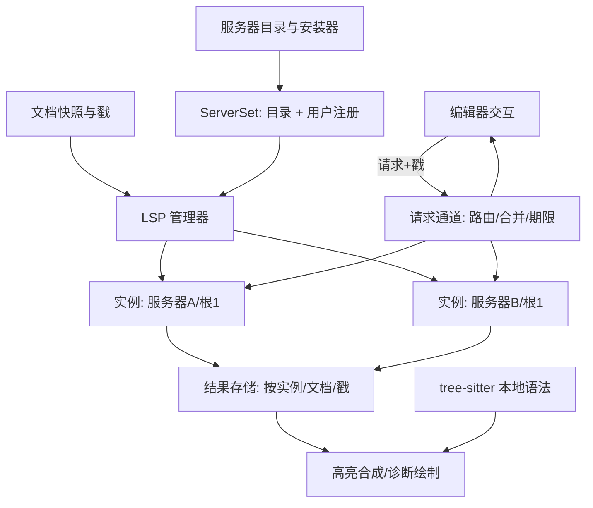

# Loom LSP 设计（临时草案）

- 日期：2026-10-20（重写；上一版为 2026-10-18 的第一代设计，见 git 历史）。
- 状态：第一代（P4a–P4c、P4f）已实现并接入应用，仍有验收项待验证；P4d、P4e 并入第二代。第二代（P6a–P6d）为设计稿，尚未实施。
- 公共身份、坐标、语言注册表和高亮模型以 [主设计](LANGUAGE_SERVICES_DESIGN.tmp.md) 第 4–7 节为准；本文件不重复定义。
- 适用范围：多语言通用客户端。协议核心必须通过不同能力组合和非 Rust 假服务器验证，不得出现 `if language == Rust`。
- 目标形态：服务器像语法包一样由 Loom 注册、分发、按需安装；一个语言可绑定多个服务器；交互式语言功能（悬停、补全、跳转、重命名等）对标 VS Code、JetBrains、Zed。
- 状态维护入口：[第 13 节](#13-实施进度跟踪)。

## 1. 目标、范围与决策

### 1.1 目标

1. 在不削弱现有"本地编辑永远可用"保证的前提下，把 LSP 从被动通道（同步、诊断、语义 token、进度）扩展为完整的语言智能。
2. 服务器不依赖用户机器的环境：Loom 维护一份服务器目录，按需下载、校验、安装；需要 Node 的服务器由 Loom 维护的运行时包运行。
3. 用户也可以通过 Loom 的设置注册自己的服务器，但必须给出明确路径。
4. 语法包与 LSP 共享语言身份、按需安装、代次失效的思路，两者互不依赖：没有服务器时 tree-sitter 单独工作，没有语法包时服务器单独工作。

### 1.2 决策记录（2026-10-20）

| ID | 决策 |
| --- | --- |
| D1 | 一个语言可绑定多个服务器，首版即支持；数据模型、实例、结果存储和路由一次到位。 |
| D2 | 服务器的注册只有两个来源：Loom 维护的目录，以及用户在 Loom 设置里的完整定义。任何情况下都不搜索 PATH、不解析裸命令名。 |
| D3 | 内置服务器按语法包的方式分发：固定仓库、固定 release、固定 SHA-256，按需安装。 |
| D4 | 依赖 Node 的服务器在第一阶段交付，由 Loom 维护的运行时包解决；运行时不调用 npm 等包管理器。 |
| D5 | 安装策略默认 `ask`，可设为 `auto` 或 `never`。 |
| D6 | 交互式能力全部纳入计划（见第 8 节），按依赖分四期交付。 |
| D7 | 体验以 VS Code、JetBrains、Zed 的共同做法为参照。 |
| D8 | 早期版本不保留兼容层：删除 `LanguageVariant.server`，`language_servers` 设置改格式，不迁移旧设置与会话。 |
| D9 | 服务器定义移出进程级 `Registry`，由 `ServerSet` 持有（5.1）。 |
| D10 | 应用的源码和打包目录里**没有任何手写的服务器定义**，也默认不安装任何服务器。定义只存在于由发布工作流生成的目录 `assets/lsp-servers/lsp-servers.toml` 中，目标在 `scripts/lsp-servers/` 维护（与语言包同一模式）。目录在第一个服务器发布之前不含任何服务器。 |

待确认：

| ID | 问题 | 当前设计的默认 |
| --- | --- | --- |
| Q1 | `WorkspaceEdit` 触及未打开的文件时，是以脏文档打开再应用，还是直接写盘？ | 以脏文档打开（VS Code 做法；可预览、可撤销、保存才落盘），见 6.9。 |

### 1.3 非目标

linked editing、document color、document link、notebook、远程或 TCP 服务器、调试适配器（DAP）、markdown 等文档内嵌代码块的子文档 LSP、未命名草稿文件的 LSP。这些保留为后续单列项，不影响本设计的接口。

## 2. 现状基线（第一代）

### 2.1 已实现

- **协议核心**（`features/language_service`，无 I/O）：分帧、消息、能力解析、会话状态机、URI、位置编码、根目录解析、文档同步规划、诊断与语义 token 解码。
- **进程客户端**（`infrastructure/lsp/client.rs`）：读、写、stderr、驱动四个线程；超时、取消、崩溃、有序关停；Windows Job Object 保证子进程树随 Loom 结束。
- **协调器**（`infrastructure/lsp/manager.rs`）：单线程拥有全部实例；实例键 `(服务器定义, 根目录, 配置代次)`；1/2/4 秒退避重启三次；空闲 60 秒停止；一个文档最多一个在途语义请求。
- **应用桥**（`app/language_services.rs`）：对打开文档的指纹（文档、版本、语言代次、路径、根目录、服务器设置）变化才向协调器发快照，因此任何写入口都不会漏同步。
- **可见结果**：诊断波浪线、概览标记、悬浮卡；语义 token 叠加在 tree-sitter span 上；状态栏与服务器面板（状态、任务、日志、重启）。
- **服务器**：仅 `rust-analyzer`，定义写在 `src/infrastructure/language_defaults.json`，绑定在 Rust 变体上。

### 2.2 局限（驱动第二代）

- 只有被动功能；`client_capabilities` 不声明补全、悬停、定义等，`workspaceFolders` 与 `applyEdit` 为 false，也没有请求通道。
- 一个变体至多一个服务器（`LanguageVariant.server: Option<ServerBinding>`）；协调器 `assignments` 和结果 `Entry.diagnostics` 都是单份。
- 服务器定义嵌在语言默认表里，设置的 `server` 只能引用已知定义（`features/settings/servers.rs`），用户无法注册新服务器。
- 服务器由用户自备，缺失只显示"未找到"。
- 全文替换式同步；无动态注册、无拉取式诊断、无文件监视。

### 2.3 第一代遗留的验收缺口

真实 rust-analyzer 下 Cargo.toml 修改、已存在文件的外部修改、git 分支切换的自监视未实测；Linux/macOS 未运行；丢失 `end` 的进度任务只靠实例重启清理。这些继续有效，并入第二代的验收（P6a-8）。

## 3. 总体架构



模块边界（沿用第一代并扩展）：

| 位置 | 职责 |
| --- | --- |
| `features/language_service` | 纯规则：协议模型、能力表、同步规划、结果解码、合并策略、补全过滤排序、片段解析。不启动进程、不读盘。 |
| `domain/language` | 语言身份与注册表；**不再包含服务器**。 |
| `features/language_service/server_set.rs`（新） | `ServerSet`：由目录、用户注册、语言覆盖合成的服务器定义集合与反向绑定。纯数据。 |
| `infrastructure/lsp` | 进程、传输、协调器、请求通道。 |
| `infrastructure/lsp_servers`（新） | 服务器目录读取、下载、校验、解包、冒烟、缓存、运行时包；复用 `language_catalog.rs` 的归档与校验代码。 |
| `app/language_services.rs` | 文档桥、设置桥、安装提示桥、结果投递到 UI 调度器。 |
| `AppRuntime` | 持有服务生命周期；UI 状态里只有不可变结果。 |
| `ui/…` | 锚定浮层、补全列表、悬停卡、引用面板等（8.6）。 |

保持不变的约束：`editor-core` 不依赖 LSP；`AppState` 不持有进程、线程或句柄；后台任务不持有 UI 锁做 JSON、进程写或等待；协议 I/O 的读、写、stderr 独立，不会因为阻塞写入导致没人读响应；UI 先收到邮箱里的最新目标，不直接等待进程写队列。

## 4. 服务器注册与分发

### 4.1 两种来源

- **目录**（Loom 维护）：随应用发布的目录 `assets/lsp-servers/lsp-servers.toml`。它是**生成物**，不手写、不手改：由 `scripts/lsp-servers/` 的目标定义经发布工作流生成并回写（4.6）。每个条目含启动方式、服务的语言、根目录规则，以及指向 Loom 自己 release 里归档的固定版本与哈希。应用的源码里没有任何服务器定义；目录里没有条目时就没有服务器。
- **用户注册**：用户级 `settings.json` 的完整定义（第 9 节）。项目级 `.loom/settings.json` 不能注册服务器、不能改命令与参数（沿用第一代安全边界）。

两者进入 `ServerSet` 后是同一种定义，差别只有 `origin` 与是否由 Loom 下载。

### 4.2 不使用 PATH

- `command` 必须是绝对路径，或以受管占位符开头：`${pack}`（该服务器包的解压目录）、`${runtime.node}`（已安装的 Node 运行时目录）。
- 裸命令名（如 `rust-analyzer`）在设置校验和目录校验时都报错，不使用 `where`、`which`、PATHEXT。
- 用户注册的路径不存在或不可执行时，实例状态为 `unavailable`，面板显示路径与原因。
- 说明：这只约束 Loom **如何找到服务器**。服务器进程继承用户环境（含 PATH），因为服务器自己可能调用 cargo、go 等工具链。

### 4.3 内置服务器目录

格式与 `language-packs.toml` 同构，按平台给出归档：

```toml
schema = 1

[distribution]
repository = "lius-new/loom"

[servers.rust-analyzer]
name = "rust-analyzer"
version = "2026-10-12"
license = "MIT OR Apache-2.0"
languages = [{ language = "rust", language_id = "rust" }]
command = "${pack}/rust-analyzer"       # Windows 由加载器补 .exe
args = []
priority = 100
root = { markers = ["Cargo.toml", "rust-project.json"], strategy = "outermost", fallback = "file_directory" }

[servers.rust-analyzer.platforms.windows-x86_64]
asset = "rust-analyzer-windows-x86_64.tar.gz"
release = "lsp-servers-2026.10.21.1"
sha256 = "…"
size = 12345678
```

规则：

- 平台键为 `<os>-<arch>`，os 取 `windows`、`macos`、`linux`，arch 取 `x86_64`、`aarch64`。当前平台没有条目时状态为 `unavailable`，面板写明原因。
- 目录里的 `languages` 引用语言规范名。该语言既不在已装语法包也不在语法 catalog 中时，忽略此绑定并记录一次，不当作错误。
- 可选字段：`runtime`（见 4.4）、`initialization_options`、`settings`（`workspace/configuration` 的默认值）、`env`。
- 归档根目录为 `<id>/`，必须含 `LICENSE` 与 `PROVENANCE.md`。解包沿用语法包的安全规则（拒绝穿越、链接、特殊文件、重复路径、超限）。
- 服务器归档的大小上限与解包上限单独配置，不沿用语法包的 64 MiB 与 128 MiB（clangd 等会超过）。具体值按首批实测定。

### 4.4 运行时包与 Node 系服务器

- **运行时包**是目录里的另一类条目 `[runtimes.node]`：归档含官方 Node 二进制与许可证。Loom 的发布流水线校验上游 SHASUMS 后重新打包。每个运行时 ID 固定一个 LTS 大版本，随应用发布升级。
- **Node 系服务器包**包含服务器代码及其 `node_modules`，由流水线在发布时按锁定版本离线打包，**用户机器上不会运行 npm**。条目声明 `runtime = "node@22"`，`command = "${runtime.node}/node"`，`args = ["${pack}/server.js", "--stdio"]`。
- 多个服务器共享同一运行时包，按版本去重。安装 Node 系服务器时若运行时缺失，一并入队，提示里合计大小。
- 用户注册的服务器可以写 `runtime = "node@22"` 并在 `command` 中使用 `${runtime.node}`，即复用 Loom 管理的 Node；`${pack}` 对用户注册服务器不可用。
- Node 系服务器与原生二进制的信任依据相同：固定哈希、来源是 Loom 的 release、目录随应用签名发布。

### 4.5 安装状态与 ask 策略

```text
NotInstalled → Prompted → Queued → Downloading → Verifying → Ready
                 │                       │             └→ Failed(重试冷却)
                 └→ Declined             └→ Unavailable(平台)
```

触发：文档的语言绑定了某个内置服务器、该服务器是 `NotInstalled`、且设置不是 `never`。

- **ask（默认）**：显示非模态提示条"为 Rust 安装 rust-analyzer（约 N MB）？[安装] [暂不] [不再提示]"。同一会话每个服务器至多提示一次；一次打开多个语言时合并成一条。"暂不"在本次会话内不再提示；"不再提示"写入用户设置 `install = "never"`，之后只能在面板里手动安装。
- **auto**：直接入队。
- **never**：不提示，不下载。

安装过程：

1. 队列、并发（至多 2）、失败 30 秒冷却、显式重试跳过冷却，沿用语法包。
2. 读 `<user>/lsp-servers/.managed/<sha>.tar.gz` 缓存，大小和 SHA-256 不符才下载；下载有字节进度，可取消。
3. 解包到暂存目录，核对目录声明的平台条目，可执行文件存在。
4. **冒烟**：用真实启动参数启动一次，`initialize` 成功再 `shutdown`，30 秒超时，通过才激活。这对应语法包的"用真实 loader 校验"。
5. 原子改名为 `<id>-<version>-<sha>/`。新版本就绪后保留一个旧版本，其余清理。
6. 完成后通知协调器，让该语言的打开文档重新分配实例，无需重启。

服务器身份（名字、语言、命令模板）在启动时就进入 `ServerSet`，安装只改变可用性，所以不依赖 `Registry` 的不可变性。

### 4.6 发布流水线

新增 `.github/workflows/lsp-servers.yml` 和 `scripts/lsp-servers/`，结构仿 `scripts/language-packs`：

0. `scripts/lsp-servers/` 是服务器目标的唯一维护位置，目标的启动命令模板、服务的语言、根目录规则、初始化选项等定义都写在这里（不在应用源码里）；目录文件 `assets/lsp-servers/lsp-servers.toml` 由流水线从已发布并验证的归档生成，和 `assets/language-packs/language-packs.toml` 一样不手改。
1. `build.toml` 声明上游来源与版本。
2. 下载并校验上游自己的校验和（二进制）或锁定 lockfile（Node 包，离线打包，lockfile 附进 `PROVENANCE.md` 作为依赖清单）。
3. 重新打包，写入 `LICENSE` 与 `PROVENANCE.md`。
4. 发布到 Loom 的 release，把 SHA-256 写回目录，并有与语言包相同的目录同步测试和同步回工作流分支的机制。
5. 更新 `THIRD_PARTY_NOTICES.md`。

升级只随应用发布；应用不轮询新版本，也不升级已安装的服务器。

### 4.7 首批服务器（候选）

名单是常见选择，二进制可得性、许可证、体积需逐个核对后才能定稿。

| 语言 | 服务器 | 类型 |
| --- | --- | --- |
| Rust | rust-analyzer | 原生 |
| C / C++ / Objective-C | clangd | 原生 |
| Go | gopls | 原生（完整分析需要用户机器有 Go 工具链） |
| Zig | zls | 原生 |
| TOML | taplo | 原生 |
| Markdown | marksman | 原生 |
| Lua | lua-language-server | 原生 |
| Python | ruff、pyright | 原生、Node（多服务器示例） |
| TypeScript / JavaScript | typescript-language-server、biome | Node、原生（多服务器示例） |
| HTML / CSS / JSON / ESLint | vscode-langservers-extracted | Node |
| YAML | yaml-language-server | Node |
| Bash | bash-language-server | Node |

P6a 落地 rust-analyzer、typescript-language-server、biome、ruff、pyright，用来验证协议、多服务器路由、Node 运行时与安装流程；其余按需增加，加入时不需要改核心代码。

## 5. 语言绑定与多服务器

### 5.1 `ServerSet`（D9）

- `Registry` 删除服务器定义、`ServerBinding`、`ServerDefinitionId` 与 `from_parts` 的服务器参数；`LanguageVariant.server` 删除。`Registry` 只保留语言、变体、grammar 与文件规则。
- `ServerSet` 由三部分合成：目录里的服务器、用户注册、语言级覆盖（`languages.<name>.language_servers`）。它是纯数据。启动时由 `infrastructure/lsp_catalog.rs` 读取目录并安装为进程级集合（`ServerSet::current()`，没有安装时为空）；已实现的只有目录部分，用户注册与语言级覆盖随后加入，届时随设置变化重建并经快照交给协调器。
- 服务器定义声明自己服务的语言，方向与 VS Code、Zed、Helix 一致：

  ```text
  languages = [
    { language = "typescript", variant = "typescript", language_id = "typescript" },
    { language = "typescript", variant = "tsx",        language_id = "typescriptreact" },
  ]
  ```

  `variant` 省略表示该语言所有变体；`language_id` 必须显式给出，是服务器自己的词汇，与 Loom 的名字无关。
- 反向索引 `servers_for(ResolvedLanguage) → 有序 [(服务器, language_id)]`。顺序：语言级设置 > 定义里的 `priority`（大者优先）> 名称。语言级设置支持 Zed 风格：`["biome", "!pyright", "..."]`，`!` 禁用，`...` 表示其余按默认。
- 服务器标识用名称。`ServerDefinitionId` 若仍需要，是 `ServerSet` 内部的、随重建变化的下标，不进入缓存键之外的持久位置；实例键使用 `(服务器名, 定义指纹, 根目录)`，定义指纹变化即换实例代次（取代第一代的 `config_generation`）。

### 5.2 文档与实例

- 一个文档对应**有序的实例列表**，每个绑定的服务器一个，根目录各自按该服务器的 `root` 规则解析，所以同一文档在不同服务器下可能落在不同根。
- 同步：每个实例一份 `DocumentSync`（连接级单调版本计数器本来就按连接），文本快照 `Arc` 共享，差分规划按实例各算一次。
- 结果存储 `Entry` 按**实例**保存诊断（来源即服务器名）；语义 token 只取优先级最高且声明了能力的实例；请求结果按 7 节处理。
- 空闲回收、崩溃退避、重启按实例独立；一个实例失败不影响同文档的其他实例。
- 状态栏显示聚合状态（最差状态加后台任务）；面板按实例分节（第一代已有）。

### 5.3 路由与合并

| 功能 | 策略 |
| --- | --- |
| 诊断 | 全部合并，标注来源服务器；各实例独立存储与清理。 |
| 悬停 | 并发询问，内容按优先级拼接成一张卡片。 |
| 补全、引用、工作区符号、代码操作、内嵌提示、code lens | 并发询问，合并并去重；晚到的结果增量追加。 |
| 定义、声明、类型定义、实现 | 并发询问，按目标位置去重。 |
| 文档符号 | 取优先级最高且有能力的实例。 |
| 重命名、签名帮助、文档高亮、折叠、选区扩展、语义 token、hierarchy | 按优先级逐个尝试，首个非空结果即用。 |
| 格式化 | 用语言设置里的 `formatter`；未设置则取优先级最高且声明了格式化能力的实例；**不叠加多个格式化器**。 |

合并规则：

- 只询问声明了该能力（静态或动态注册）的实例，不发送未协商的请求。
- 每类请求有总期限（初值：补全 150 ms 先出已到结果，悬停 500 ms，其余 2 s）。期限到达时用已到的结果成型；晚到结果对补全、引用、符号增量追加，对悬停、签名丢弃。单实例请求超时沿用 5 秒。
- 去重：定义类按（URI, range）；补全按（label, kind, insertText）相同时保留优先级高者。
- 排序：先实例优先级，再服务器给出的 `sortText`。
- 代码操作带来源实例标记，`codeAction/resolve` 和执行命令发回产生它的实例。

## 6. 协议核心

### 6.1 进程与分帧

先支持本机 stdio。每个实例的读、写、stderr 消费和驱动各自独立线程，沿用 std 线程和有界通道，不引入全应用异步运行时。读取正确处理半包、粘包、按 UTF-8 正文字节数计的 `Content-Length`；stdout 只解析协议，stderr 持续消费到有界日志。

### 6.2 生命周期

```text
Stopped → Starting → Initializing → Ready → Stopping → Stopped
                       └→ Failed ←───────────┘
```

顺序：启动 → `initialize` → 读取能力与编码 → `initialized` → 同步待打开文档 → 请求能力结果。结束时先停止新任务，尝试 `shutdown`/`exit`；超过有界等待后终止并回收自有进程。Windows 后台服务器不显示控制台，进程树由 Job Object 回收；Linux/macOS 的进程组清理待补。清理幂等，`AppRuntime` 销毁后排队的回调不得恢复服务或写入状态。

默认超时：初始化 30 秒、普通请求 5 秒、退出宽限 2 秒。超时不阻塞编辑。崩溃按 1/2/4 秒退避自动重启三次，之后等待显式重启；定义指纹变化重建实例代次。程序不存在（用户路径无效、平台无构建）为 `unavailable`，不重试。

### 6.3 能力协商

只声明已经实现并验收的能力；每个功能随对应阶段的验收一起加入声明，不预先声明。

| 范围 | 内容 |
| --- | --- |
| 已声明（第一代） | 文档同步、`positionEncodings`（utf-8、utf-16）、push 诊断（版本支持）、semantic tokens full、`workspace/configuration`、semantic tokens refresh、`window.workDoneProgress`、`showMessage`。 |
| P6a | `workspaceFolders`、`dynamicRegistration`（凡声明者都必须实现注册与注销）、pull 诊断、`applyEdit`、`workspaceEdit`（`documentChanges`、资源操作、失败处理）、`window.showDocument`、`executeCommand`、`showMessageRequest`。 |
| P6b | `hover`（`contentFormat`: markdown、plaintext）、`definition`/`declaration`/`typeDefinition`/`implementation`（`linkSupport`）、`references`、`documentHighlight`、`documentSymbol`（`hierarchicalDocumentSymbolSupport`）、`workspace/symbol`。 |
| P6c | `completion`（`snippetSupport`、`resolveSupport`: documentation、detail、additionalTextEdits，`insertReplaceSupport`、`labelDetailsSupport`、`tagSupport`、`contextSupport`、`insertTextModeSupport`）、`signatureHelp`（`activeParameterSupport`、`contextSupport`）、`rename`（`prepareSupport`）、`codeAction`（literal、`isPreferredSupport`、`resolveSupport`、`disabledSupport`）、`formatting`/`rangeFormatting`/`onTypeFormatting`。 |
| P6d | `inlayHint`（`resolveSupport`）、`foldingRange`、`selectionRange`、`callHierarchy`、`typeHierarchy`、`codeLens`、`workspace/fileOperations`、semantic tokens `delta` 与 `range`、各类 `refresh`。 |

仅提供 `range` 语义 token 的服务器，在 range 路径验收前显示该能力不可用，不伪装成 full。

### 6.4 服务端请求与通知

必须回应服务器发来的请求，不只处理客户端发出的：

| 请求/通知 | 行为 |
| --- | --- |
| `workspace/configuration` | 按 item 顺序返回该服务器 `settings` 里对应 section，缺则 null |
| `workspace/workspaceFolders` | 返回该实例的根 |
| `workspace/semanticTokens/refresh`、`inlayHint/refresh`、`codeLens/refresh`、`diagnostic/refresh` | 回应并递增对应代次，重新调度可见文档 |
| `client/registerCapability`、`client/unregisterCapability` | 更新实例能力表（6.6）；只接受已声明支持的注册，其余明确拒绝 |
| `window/workDoneProgress/create`、`$/progress` | 按实例与 token 维护任务（6.11） |
| `window/logMessage`、`window/showMessage` | 有界日志，非重复状态消息 |
| `window/showMessageRequest` | 显示带按钮的提示，返回所选项 |
| `window/showDocument` | 打开文件并定位 |
| `workspace/applyEdit` | 经 6.9 的事务应用并返回是否成功 |
| 未知 request | 返回 MethodNotFound |
| 未知 notification | 忽略或限流记录，不使实例失败 |

### 6.5 文档同步

每个服务器连接共享一个递增的协议版本计数器，向任意 URI 发送新版本时分配下一个值，因此同一 URI 的版本递增但允许跳号；关闭再打开或切换语言后不复用版本。版本到 `DocumentStamp` 的历史（32 条）与正文历史仅属于当前打开代次，关闭或重开即清除。一个同步批次无法全部分配合法版本时整个批次不提交，协调器清除该实例结果、重建连接并增加运行代次，旧运行的通知与响应因此失效。

- `didOpen` 发最新完整正文；同一文档的多个窗格不重复 `didOpen`，窗格关闭而文档仍打开时不 `didClose`。
- `didChange` 按服务器同步类型：`None` 时不发送，并在本地编辑后禁用该文档的语义结果直到有效重开。
- `didSave` 只在磁盘保存成功后发，是否带正文遵循服务器能力。
- URI 或语言变化先关闭旧会话、清理结果，再以新 URI 和语言打开；根变化要重新路由实例。
- 服务器重启后从最新正文重新 `didOpen`，不重放旧请求。
- 所有文档通知与该文档的请求经同一个实例写队列排序：先写入更新，再发依赖它的请求。写队列拥堵时可丢弃**尚未派生协议消息**的中间目标并从最后一个已排队基准重新规划；已进入有序传输的 `didOpen`/`didChange`/`didClose` 与依赖请求不得静默丢弃。传输写入失败或无法证明顺序完整时使实例失效并重建，禁止在损坏的镜像上继续发请求。
- 超过 8 MiB 的文档不同步。

**增量同步（P6a，取代第一代的整文替换；是补全的前置）**：在同步规划路径上比较 last-sent 与 latest 两份快照，用公共前缀和后缀构造一条连续替换，前后缀收敛到合法字符边界，range 按协商编码从旧快照计算，replacement 取自新快照。服务器只声明 Full 时仍整文发送。文本相同但本地版本变化时发送完整替换以推进协议版本。核心 revision 若能提供精确且有界的编辑序列，可作为优化取代扫描，但不是前提。验收：随机编辑下镜像与最新正文逐字一致（含 UTF-8/UTF-16、代理对、CRLF），8 MiB 文档单字符编辑的规划耗时有基准值（暂定 5 ms 内，待实测调整）。

### 6.6 动态注册、多根与配置

- 能力表 = 初始化返回的静态能力 + 动态注册，按实例保存；注册 ID 管理注销；实例退出清空。
- 多根：同一服务器在每个根一个实例（实例键已含根），`workspaceFolders` 只报告该实例的根，不使用 `didChangeWorkspaceFolders` 动态增减。
- `workspace/configuration` 的值来自设置里该服务器的 `settings`；设置变化时发 `workspace/didChangeConfiguration`，不重启实例（仅 `command`、`args`、`initialization_options`、`runtime` 变化才换实例代次）。

### 6.7 诊断

- push 与 pull 并存。声明了 `diagnosticProvider` 的服务器，编辑停顿约 200 ms 后对打开文档发 `textDocument/diagnostic`，用 `resultId` 去重；`workspace/diagnostic` 后置到问题面板阶段（P6d）。
- 诊断按（实例, URI）存储；每次发布替换该来源先前集合，空集合表示清除；关闭实例只清自己的结果。
- 带 `version` 的诊断只接受可映射到当前打开代次和当前文本的版本；编辑后先清除当前范围装饰，避免位置错位。缺 `version` 时无法严格证明对应关系：接收时按已发送快照做范围校验并标记 unversioned，服务正在追赶本地修改时不发布范围装饰，下一次编辑立即失效，不声称严格一致。
- 解析 `tags`（未使用灰显、已弃用删除线）、`relatedInformation`、`codeDescription`；完全相同的诊断去重。

### 6.8 语义 token

- 第一代已有 full：按 legend 映射分类，相对编码解码为绝对位置，用请求绑定的快照转换字节范围；校验长度、类型索引、修饰符位、整数溢出和文本边界。
- 每个请求记录请求 ID、运行代次、打开代次、`DocumentStamp`、语义失效代次。每个文档至多一个有效请求在途，新编辑使旧请求过期并尽力取消，客户端仍必须丢弃旧结果。编辑停顿约 75 ms 后发请求。
- refresh 到达时即使文本没变也递增语义代次，使 refresh 前的在途结果不能覆盖新语义。`null` 与空集合都清除当前发布的语义层，不据此永久判定不支持。
- P6d 增加 `delta`：保存原始整数数组与 `resultId`，在数组层验证并应用（start/deleteCount 是整数数组索引，多条 edit 基于同一旧数组、验证不冲突后从后向前应用），非法或缺基准回退 full。随后增加 `range`：仅查视口、单独缓存覆盖范围，不把局部结果冒充全文。
- 多服务器下语义 token 只取优先级最高且有能力的实例（5.2），tree-sitter 始终打底。

### 6.9 WorkspaceEdit 事务

服务器的 `WorkspaceEdit`（`changes`、`documentChanges`，含创建、重命名、删除资源）由应用层编排，作为一个原子操作：

1. 校验：带 `version` 的 `TextDocumentEdit` 必须与当前文档一致，否则整体拒绝并提示。同一文档内的多个编辑基于同一快照，重叠则整体拒绝。
2. 应用文本编辑：每个目标文档的编辑倒序应用。未打开的文件**先读盘并作为脏文档打开再应用**（Q1 的默认），用户可预览、撤销，保存才落盘。
3. 资源操作经 workspace 现有的文件操作路径执行，保持资源管理器与文件监视同步。
4. 全部编辑进入同一个**跨文档撤销组**；任一步失败则回滚已应用部分。
5. 读盘之外的工作不在 UI 线程做。

现状（12.1 第 5 行）：撤销历史挂在每个文档的 `TextBuffer` 上，只能在单个文档内成组；但 `EditorMut::edit(Vec<Edit>)` 已经按 LSP `TextEdit[]` 的语义一次性校验并应用一批互不重叠、基于当前文本的编辑，产生一个撤销步，单文档部分直接映射到它。

跨文档的原子撤销需要新增：撤销条目带可选的事务标识，工作区维护事务表。撤销时若该事务涉及的**每个文档栈顶都还是这个事务**，则一起撤销；否则拒绝并提示，不静默只撤销一部分。重做同理。事务涉及的文档在历史被截断（超过 500 步）或被关闭后，该事务视为不可撤销。

重命名、代码操作、格式化、`workspace/applyEdit` 都走这条路径。

### 6.10 文件监视与外部变更

不假定所有服务器自行监视文件。随 P6d（若首个或第二个真实服务器暴露漏报则提前），复用现有 notify 事件源，通过通用订阅适配器匹配服务器注册的 glob、base URI 与 Create/Change/Delete，生成 `workspace/didChangeWatchedFiles`，不为每种语言重复建 watcher。

订阅按实例代次与注册 ID 管理，取消注册或退出时释放。只有实现并验收的 glob 与 relative pattern 语义才可声明能力，不假定现有 globset 与 LSP 模式完全等价。注册范围超出已有监视根时需要受预算限制的额外 watcher lease，无法建立则明确报告注册失败。合并重复事件但保留创建/删除的最终语义；重命名表达为旧 URI 删除加新 URI 创建。磁盘事件与内存正文是两条通道：打开且未保存的正文仍以协议同步为准。`requires_full_rescan` 没有对应的 LSP 事件，需要比较已知元数据或安排受控项目重载，不能伪造 Rescan 通知。

在此之前，首个真实服务器的自监视必须由实测证明：记录服务器版本、平台、有效初始化配置、是否声明客户端 watcher；覆盖未打开源文件的修改、新建、删除，项目清单变化（Cargo.toml 与适用的 .cargo 配置），外部磁盘编辑与 git 分支切换。自监视有缺口时先尝试文档化的显式模式，仍失败则提前对应的 watcher 子集，不得带着已知漏报宣称完成。服务器的私有选项放进 `ServerSet` 的定义，不进入通用核心。

### 6.11 进度与状态

连接 `Ready` 只表示初始化完成。状态拆为"连接状态 + 后台任务集合 + 能力结果可用性"：连接就绪时仍可有加载项目、索引或检查任务。`$/progress` 按实例与 token 处理 begin/report/end（字符串或数字 token，百分比上限 100，最多 32 个任务，实例重启清空），不写死某服务器的私有 token 或消息；丢失 `end` 的任务需要有界超时清理（第一代遗留）；P6d 增加任务取消。没有进度时显示"已连接，等待语义结果"，不把长时间无结果推断成正在索引，也不承诺固定耗时。

## 7. 请求通道与结果新鲜度

第一代的结果是"推给存储、按戳取"。交互式功能需要"UI 发出、等结果、过期就丢"的通道。

**接口**：`Manager::request(RequestSpec) → RequestHandle`。`RequestSpec` 含功能、文档、`DocumentStamp`、位置或范围、路由与合并策略、期限。协调器线程接收，向各目标实例发送，聚合后写入 handle 的邮箱，并通过 `on_change` 通知 UI 重绘。`RequestHandle` 可取消（发 `$/cancelRequest`，丢弃晚到响应），`Drop` 即取消。

**新鲜度规则**：

| 类别 | 例子 | 规则 |
| --- | --- | --- |
| 随位置的瞬时信息 | 悬停、签名帮助、文档高亮 | 结果交付时戳与发起时不同则丢弃。 |
| 补全 | completion | 列表绑定触发位置与过滤前缀；在同一标识符内继续输入时本地过滤并保留列表，越过起点或 `isIncomplete` 时重发（8.2）。 |
| 导航与动作 | 定义、引用、重命名、代码操作 | 结果的位置针对发起时的快照。跳转到**其他文件**直接使用；当前文件内的范围用修订记录映射到最新文本，无法映射则放弃并提示重试。 |
| 后台装饰 | 内嵌提示、code lens、折叠 | 与语义 token 相同：只对精确的编辑器状态展示。 |

**并发**：每个文档每类功能至多一个在途请求，新请求取代并取消旧请求；全局在途数有上限。取消和超时释放槽位，不等服务器无限响应。

**错误**：`ContentModified` 与 `ServerCancelled` 视为过期，必要时按功能重试一次；其他错误记入面板计数，不弹窗。

## 8. 编辑器功能

### 8.1 功能矩阵

体验取 VS Code、JetBrains、Zed 的共同做法。

| 功能 | LSP 方法 | 体验要点 | 多服务器 | 阶段 |
| --- | --- | --- | --- | --- |
| 悬停 | `textDocument/hover` | 鼠标停留约 300 ms 或快捷键；与诊断合并成一张卡片；Markdown 渲染，代码块用语法包高亮 | 拼接 | P6b |
| 定义、声明、类型定义、实现 | `definition` 等 | F12、Ctrl+点击；单结果直接跳转，多结果弹出选择列表；Peek；进入导航历史 | 合并去重 | P6b |
| 文档高亮 | `documentHighlight` | 光标停留后给同一符号的所有出现位置加底色 | 首个非空 | P6b |
| 查找引用 | `references` | 底部面板按文件分组，复用搜索结果列表组件 | 合并 | P6b |
| 文档符号 | `documentSymbol` | 大纲面板、面包屑、文件内符号跳转 | 首个有能力 | P6b |
| 工作区符号 | `workspace/symbol` | 通用选择器（输入即过滤，带预览行）；应用目前没有快速打开，选择器随 P6b 新建 | 合并 | P6b |
| 诊断导航 | — | F8、Shift+F8 跳下一个、上一个诊断 | — | P6b |
| 补全 | `completion`、`completionItem/resolve` | 见 8.2 | 合并增量 | P6c |
| 签名帮助 | `signatureHelp` | `(` 与 `,` 触发；活动参数加粗；重载上下切换 | 首个非空 | P6c |
| 重命名 | `prepareRename`、`rename` | F2 行内输入框；结果走 6.9 | 首个非空 | P6c |
| 代码操作 | `codeAction`、`codeAction/resolve` | 灯泡、Ctrl+.、诊断卡片内的快速修复、保存时动作 | 合并 | P6c |
| 格式化 | `formatting`、`rangeFormatting`、`onTypeFormatting` | 文档、选区、保存时、输入时 | 指定一个 | P6c |
| 内嵌提示 | `inlayHint` | 类型与参数名提示，设置开关，点击跳转 | 合并 | P6d |
| 折叠、选区扩展 | `foldingRange`、`selectionRange` | tree-sitter 优先，LSP 作后备 | 首个有能力 | P6d |
| 语义 token 增强 | full、delta、range | 6.8 | 首个有能力 | P6d |
| 调用、类型层次 | `callHierarchy`、`typeHierarchy` | 面板 | 首个有能力 | P6d |
| code lens | `codeLens`、`executeCommand` | 行上方文字，点击执行命令 | 合并 | P6d |
| 问题面板 | 诊断聚合、`workspace/diagnostic` | 全工程列表，按文件分组，可过滤 | 合并 | P6d |
| 文件操作 | `willRename`、`didRename`、`didCreate`、`didDelete` | 资源管理器改名时让服务器更新引用 | 广播 | P6d |
| 文件监视 | `didChangeWatchedFiles` | 6.10 | — | P6d，可提前 |

### 8.2 补全

- **触发**：输入标识符字符（去抖约 30 ms）、服务器的 `triggerCharacters`、手动 Ctrl+Space。请求携带 `CompletionContext`。
- **列表生命周期**：立即用上一次缓存列表做本地过滤并显示，同时发新请求；列表非 `isIncomplete` 时，在同一标识符内继续输入只做本地过滤，不重发；退格越过起点或 `isIncomplete` 为真时重发；新按键取消在途旧请求。
- **过滤与排序**：客户端模糊匹配（子序列、驼峰首字母、连续加权），使用 `filterText`；排序依次为匹配得分、实例优先级、`sortText`，`preselect` 置顶。
- **接受**：Enter 或 Tab（设置），`commitCharacters`；`textEdit` 与 `insertReplaceEdit`（插入或替换模式可设置）；`additionalTextEdits`（如自动补 `use`）；`insertTextMode` 的缩进调整；`command` 经 `executeCommand`。
- **片段**：`insertTextFormat = 2` 走片段引擎，支持 tabstop、占位符、选择项、变量、嵌套、镜像；Tab 在 tabstop 间跳转，Esc 退出。不声明 `snippetSupport` 会让 rust-analyzer 等失去函数括号补全，所以必须做。
- **文档卡片**：选中项延迟 `completionItem/resolve` 取 `documentation` 与 `detail`，显示在列表右侧（空间不足时在下方）；Markdown 渲染。
- **多服务器**：各实例结果合并去重，晚到的实例增量并入列表且不抖动已选项。
- **后备**：没有服务器、或服务器不支持补全时，提供当前文档的缓冲区单词补全，可在设置里关闭。

### 8.3 悬停与诊断卡片

把第一代的 `editor_diagnostic_hover` 并入统一悬停卡片：诊断在上（带来源服务器、`codeDescription` 链接与"快速修复"入口），服务器悬停内容在下。内容为 Markdown，代码块按围栏语言用语法包高亮。鼠标移走、输入、滚动、换文档都使卡片失效。键盘触发的悬停在 vim 普通态映射为 `K`。

### 8.4 导航

- 定义族单结果直接跳转，多结果弹出选择列表（按文件分组，带预览行），Peek 在编辑器内嵌显示目标上下文。
- 跳转进入**导航历史**（后退、前进）。应用目前没有跨文件的位置栈（12.1 第 6 行），随 P6a 新建 `NavigationHistory` 与统一的 `navigate_to(location)`；LSP 跳转同时写入 vim 的跳转列表，使 `<C-o>` 在同一文档内也能返回。
- 引用面板复用搜索结果的数据形状和行渲染（提取为共享的位置列表组件），不复用搜索面板本身；支持按文件折叠、点击跳转、与当前选择同步。
- 符号：文件内符号与工作区符号使用新建的通用选择器；大纲面板与面包屑使用同一份文档符号结果。

### 8.5 编辑类功能

- **重命名**：先 `prepareRename` 确定范围与默认名；F2 在符号处弹出行内输入框；提交后经 6.9 应用，作为一个撤销组。暂不做 JetBrains 式的预览对话框。
- **代码操作**：光标处有可用 action 时在槽边显示灯泡，Ctrl+. 打开菜单；诊断卡片内直接列出该诊断的快速修复；`isPreferred` 的 action 置顶；有 `data` 或 `edit` 缺失的 action 先 resolve；`disabled` 的 action 显示原因。保存时动作（如整理 import）由语言设置的 `code_actions_on_save` 指定。
- **格式化**：格式化文档与选区；保存时格式化（`format_on_save`），在写盘前执行并在失败或超时（默认 1 秒）时直接保存；输入时格式化（`onTypeFormatting`）只对服务器声明的触发字符启用。格式化器选择见 5.3。

### 8.6 共用 UI 基础（工作量最大；现状与依据见 12.1）

1. **锚定浮层**（P6a）：补全、签名、悬停、Peek、重命名框、代码操作菜单共用。把诊断卡片现有的 `card_origin`（下方右侧、不足则翻到上方、右侧不足则对齐锚点、都放不下则留在编辑器内）提取为共享的定位函数，加标准卡片容器；浮层不抢编辑器焦点（`EventPolicy { focus: false }`），点击外部关闭沿用右键菜单的透明面板做法。浮层放在窗格内还是 `Popup` 渲染阶段，取决于验证 S1。
2. **键盘路由**（P6a）：沿用 `Menu` 的模式——`ContextFacts` 增加 `completion`、`signature`、`peek`、`rename` 等事实并压入对应上下文节点，默认 keymap 在 `Editor && Completion` 等条件下绑定上下、Tab、Enter、Esc；每个新动作在 `action.rs` 登记，用户可在 keymap 页重绑。keymap 在捕获阶段先于 vim 解析，插入态补全因此不会被 vim 吞掉。**vim 约定**：插入态 Ctrl+N、Ctrl+P 选择补全项（由 keymap 绑定，vim 本身没有插入态补全）；普通态 `K` 悬停、`gd` 定义、`gr` 引用、`gD` 声明、`gy` 类型定义、`gi` 实现，经 vim 的 `Request` 通道交给宿主。
3. **定时器 `UiTimer`**（P6a）：单线程、可取消、结果经 `application.post` 回到 UI 线程，供悬停停留和行内输入框使用；补全与语义请求的去抖放在协调器的截止时间表里。
4. **导航**（P6a）：`NavigationHistory` 与 `navigate_to(location)`，见 8.4。
5. **位置列表组件**（P6a）：从搜索结果的行渲染（`match_row`、`match_preview`、`file_labels`）提取，供引用、问题、hierarchy 面板共用。
6. **通用选择器**（P6b）：输入框加模糊过滤加列表加预览行加键盘导航，文件内符号与工作区符号使用，日后也是快速打开的基础；最接近的现有参照是 Git 分支选择器。
7. **Markdown 渲染器**（P6b）：悬停、补全文档、签名文档共用。需自建：块级解析、行内样式分段、按词换行，每段用 `text::layout` 度量后定位；代码块用语法包高亮。解析方案由验证 S2 决定，解析在后台线程完成。
8. **片段引擎**（P6c）：解析放纯规则层，应用放编辑事务。editor-core 只有单选区，所以会话保存各 tabstop 的范围，用 `ChangeSet::map` 配合 `Assoc` 随编辑移动，Tab 只移动单个选区，镜像位置在每次编辑后于同一撤销组内补一批编辑；不为 LSP 引入多光标。
9. **虚拟行内文本**（P6d，内嵌提示）：只改渲染层。把提示文字插入行的显示串并扩展 `source_to_display`，命中测试把提示区域映射到最近的源下标，行布局缓存键包含提示内容。光标移动、选择和 vim 都在缓冲区偏移上工作，不受影响，不需要改 editor-core。
10. **面板**：引用、问题、大纲复用现有抽屉与第 5 项的位置列表组件。

### 8.7 与语法包的结合

- 服务器按**已解析的语言**匹配，不按后缀，因此语法包是否已安装不影响绑定；语法 catalog 里的语言启动时即有身份，可提前绑好服务器。
- 悬停与文档里的 Markdown 代码块按围栏语言使用 tree-sitter 高亮，缺包时走语法包的按需安装队列。
- 语义 token 继续叠加在 tree-sitter 之上；服务器不可用、在索引或崩溃时，高亮不退化。
- 折叠、选区扩展、缩进等结构功能优先使用 tree-sitter（主设计 11.2 的中立接口），LSP 作后备。
- 两套按需安装互相独立：语法包失败不影响服务器，反之亦然；面板分开显示状态与重试。

## 9. 设置

`language_servers` 由数组改为以服务器名为键的对象（D8，不迁移旧设置）。

```jsonc
"language_servers": {
  // 内置服务器：只改行为
  "rust-analyzer": {
    "enabled": true,
    "install": "ask",                 // ask / auto / never，默认 ask
    "args": [],
    "initialization_options": {},
    "settings": {}                    // workspace/configuration 的返回值
  },
  // 用户注册的服务器：完整定义，command 必须是绝对路径或受管占位符
  "my-server": {
    "command": "C:\\tools\\my-server.exe",
    "args": ["--stdio"],
    "runtime": null,                  // 可选 "node@22"，command 可写 "${runtime.node}/node"
    "languages": [{ "language": "foo", "language_id": "foo" }],
    "root": { "markers": ["foo.toml"], "strategy": "nearest", "fallback": "workspace" },
    "initialization_options": {},
    "settings": {},
    "env": {}
  }
},
"languages": {
  "typescript": {
    "language_servers": ["biome", "typescript-language-server", "..."],
    "formatter": "biome",
    "format_on_save": true,
    "code_actions_on_save": ["source.organizeImports"]
  }
},
"lsp": {
  "hover_delay_ms": 300,
  "completion": { "auto": true, "accept_on": "enter_and_tab", "words_fallback": true },
  "inlay_hints": false,
  "semantic_highlighting": "combined",   // off / combined
  "max_document_bytes": 8388608
}
```

规则：

- 内置服务器的 `command` 不可改（路径由安装管理）；需要换程序的用户用同一份定义以新名字注册。
- 所有字段逐项校验：`command` 不是绝对路径且不以受管占位符开头则报错并忽略该项；未知字段报错；`languages` 引用不存在的语言只记录一次，不阻止其他项。
- 项目级 `.loom/settings.json` 只允许 `enabled` 与 `languages.*.language_servers`（只能引用已注册的名字）、`format_on_save` 等不涉及执行程序的开关；不能注册服务器，不能改 `command`、`args`、`runtime`、`install`。
- 设置变化通过快照进入协调器；仅 `command`、`args`、`initialization_options`、`runtime`、`env` 变化才换实例代次，其余直接生效。
- 同步更新 `docs/settings.md`。

## 10. 阶段与验收

阶段按依赖排序：基础设施 → 只读导航（用最小 UI 风险验证请求通道）→ 编辑 → 扩展。第一代 P4a–P4c、P4f 已完成实现，其遗留验收并入 P6a。

| 阶段 | 工作内容 | 完成标准 |
| --- | --- | --- |
| P6a 基础 | `ServerSet` 与 `Registry` 重构、多服务器实例与按来源结果、服务器目录与安装器、运行时包、Node 系样本、ask 提示与面板、请求通道、增量同步、动态注册与多根与配置、pull 诊断、WorkspaceEdit 事务与跨文档撤销事务、UI 基础（锚定定位提取、浮层上下文与动作、`UiTimer`、导航历史与 `navigate_to`、位置列表组件、统一悬停状态） | 见 P6a-1 至 P6a-10 |
| P6b 只读导航 | 统一悬停卡片、Markdown 渲染器、通用选择器、定义族与选择列表与 Peek、文档高亮、引用面板、文档与工作区符号、诊断导航 | 假服务器与真实 rust-analyzer、typescript-language-server 的端到端用例通过 |
| P6c 编辑 | 补全（含 resolve、片段、合并）、签名帮助、格式化、重命名、代码操作、保存时动作 | 补全延迟与正确性基准达标；WorkspaceEdit 回滚用例通过 |
| P6d 扩展 | 内嵌提示、折叠与选区、语义 token delta/range、hierarchy、code lens、问题面板、文件操作、文件监视 | 每项独立验收；watcher 声明在 6.10 验收后 |

P6a 的关键验收：

- **P6a-1** 非 Rust 假服务器对同一语言双实例：诊断带来源，一个崩溃不影响另一个；语义 token 取优先级最高者。
- **P6a-2** 目录与安装：哈希或大小不符、归档穿越、重复路径、平台缺失、下载取消、离线缓存复用、冒烟失败都有测试；通过前不激活。
- **P6a-3** ask 流程：提示至多一次、"不再提示"持久、`auto` 与 `never` 行为、安装完成后无需重启即分配实例。
- **P6a-4** 裸命令名在设置与目录校验中都被拒绝；用户注册路径无效为 `unavailable`；不存在任何 PATH 查找路径（有架构门禁或测试断言）。
- **P6a-5** Node 运行时包与 Node 系服务器：真实 typescript-language-server 完成握手并给出诊断；运行时被多个服务器共享；用户机器无 Node 也能运行。
- **P6a-6** 增量同步：随机编辑属性测试镜像一致（UTF-8、UTF-16、代理对、CRLF），基准达标。
- **P6a-7** 请求通道：取消、过期、乱序、`ContentModified` 重试、期限合并、晚到追加的假服务器用例。
- **P6a-8** 第一代遗留：真实 rust-analyzer 的自监视实测记录（6.10），Linux/macOS 运行。
- **P6a-9** WorkspaceEdit：版本不符整体拒绝、重叠拒绝、跨文档撤销事务（栈顶不一致时拒绝并提示）、失败回滚、未打开文件作为脏文档打开。
- **P6a-10** UI 基础：锚定定位函数提取后原有 4 个诊断卡片测试仍通过并新增覆盖；浮层不抢编辑器焦点；`Completion` 等上下文可被 keymap 绑定并与 vim 各模式共存；`UiTimer` 可取消且无泄漏；`navigate_to` 与导航历史（去重、容量、后退前进、与 vim 跳转列表联动）；位置列表组件被搜索面板与引用面板共用且搜索行为不变；验证 S1、S3 有结论记录。

## 11. 测试与观测

- 协议与路由测试使用可控假服务器（`examples/fake_lsp.rs`）。第二代需扩展：补全、悬停、定义等响应；延迟、乱序、`isIncomplete`、取消、错误、动态注册、双实例、`applyEdit`。
- 真实服务器 smoke 为 opt-in（`--ignored`），记录服务器版本、平台、配置与工作区条件：rust-analyzer、typescript-language-server、pyright、ruff。假服务器通过不能替代真实自监视验证。
- 性能指标：按键到补全弹出的耗时（缓存命中与冷启动）、增量同步规划耗时、合并总期限命中率、安装耗时与带宽、首次语义结果与热态更新、发送量与排队。服务器项目索引内存与 Loom 自身资源单列。
- 面板增加：能力表（静态与动态）、各类请求的计数与平均耗时、安装状态与进度、丢弃原因日志（第一代已有诊断发布、显示、过期、未知、投影计数）。
- 架构门禁：协议核心只用 `serde_json`；进程客户端可用 `std::process` 与 `std::thread`；安装器放 `infrastructure/lsp_servers`；`Registry` 不再依赖服务器；新增的 UI 状态登记到 `scripts/architecture/policy.json`。

## 12. 风险与待勘查

### 12.1 UI 层勘查结论（2026-10-20）

读了 keymap、按键与文本输入通路、vim 与 editor-core 的撤销和选区、编辑器视图的行布局与浮层、搜索结果面板、Git 局部预览，以及 lgui（rev 6fc706e）的渲染阶段与文本模型。未读的部分：vim 的 `Request`/`Host` 回调细节、`ui_dispatch`、主题与字体模块；lgui `Popup` 渲染阶段的实际行为只看了文档，没有运行验证。

| # | 项 | 勘查结果 | 对设计的影响 |
| --- | --- | --- | --- |
| 1 | 键盘与 keymap | 根节点在捕获阶段监听（`app/key_actions.rs` 的 `attach`），先于焦点元素解析按键。keymap 移植自 Zed，上下文栈为 `Workspace > Editor > Vim mode=…`，菜单打开时再压入 `Menu`（`features/keymap/context_stack.rs`）。`Action` 是封闭枚举（`features/keymap/action.rs`），没有扩展机制。未被绑定的键才落到编辑器或 vim；IME 组合期间不经过 keymap。 | 浮层沿用 `Menu` 的模式：`ContextFacts` 增加 `completion`、`signature`、`peek`、`rename` 等事实，压入对应上下文节点，默认 keymap 在 `Editor && Completion` 下绑定上下、Tab、Enter、Esc。每个新功能要在 `action.rs` 的宏里加动作与说明，keymap 页自动列出。keymap 先于 vim 解析，所以插入态补全不会被 vim 吞掉。 |
| 2 | 文本输入与 vim | 输入走 `Event::Text` → `editor::insert_text`（`app/editor.rs`），vim 激活时先交给 `vim_input::handle_text`。vim 在 editor-core，经 `Request` 与 `Host` 回调宿主。vim 没有插入态补全，Ctrl+N、Ctrl+P 在插入态未被占用。 | 补全触发点挂在 `insert_text` 之后、退格类动作之后、vim 插入事件之后。vim 普通态的 `K`、`gd`、`gr` 经 `Request` 通道交给宿主；插入态 Ctrl+N、Ctrl+P 由 keymap 绑定，不改 vim。 |
| 3 | 浮层 | lgui 有 `RenderPhase::{Background, Content, Overlay, Popup}`，文档说明 popup 阶段的元素会逃出祖先裁剪；Loom 没有用过 `Popup` 阶段。右键菜单（`ui/editor/menu.rs`）是手写的：全视口透明面板接点击外部关闭，加一张绝对定位的卡片，按视口夹紧；用 `EventPolicy { focus: false }` 不抢编辑器焦点。诊断卡片已有锚定与翻转算法 `card_origin`（`ui/editor/view.rs`，4 个测试：下方右侧、空间不足翻到上方、右侧不足对齐下划线、都放不下留在编辑器内）。没有共享的锚定组件。 | 把 `card_origin` 提取为共享的锚定定位函数，加一个标准卡片容器；补全、签名、悬停、重命名框、代码操作菜单共用。需要一个小验证（S1）：`Popup` 阶段能否逃出窗格裁剪并正常命中测试，决定浮层放在窗格内还是 popup 阶段。保持 `focus: false`，键盘留在编辑器。 |
| 4 | 选区 | 每个视图只有一个 `Selection { cursor, anchor, preferred_column }`，没有多光标。同一文档的其他视图是 `peers`，随 `ChangeSet` 移动。 | 片段引擎不依赖多光标：会话保存各 tabstop 的范围，用 `ChangeSet::map` 配合 `Assoc` 随编辑移动；Tab 只移动单个选区；镜像位置在每次编辑后由会话在同一撤销组内补一批编辑。不为 LSP 引入多光标。 |
| 5 | 撤销 | 历史挂在每个 `TextBuffer` 上，最多 500 步；`begin_group`/`end_group` 只在单个文档内合并；没有跨文档撤销。但 `EditorMut::edit(Vec<Edit>)` 一次性校验并应用一批互不重叠、基于当前文本的编辑，产生一个 `ChangeSet` 和一个撤销步，与 LSP 的 `TextEdit[]` 语义一致，重叠返回错误。 | 单文档的 WorkspaceEdit 直接映射到 `edit()`。跨文档见 6.9：给撤销条目加可选的事务标识，撤销时要求该事务涉及的每个文档栈顶都还是它，否则拒绝并提示。 |
| 6 | 导航 | 没有导航历史。界面有前进后退图标，但没有对应的位置栈。vim 有跳转列表（`push_jump`、`<C-o>`、`<C-i>`），但 `jump()` 只在当前文档内移动。没有“打开文件并定位”的统一函数；现有路径是异步读文件 → `workspace.open_path` → 设置选区 → `reveal_cursor`。 | 新增跨文件 `NavigationHistory`（路径加位置，后退、前进，去重，容量上限）和应用层 `navigate_to(location)`，统一“打开、定位、显示光标、入历史”。LSP 跳转同时调用 vim 的 `push_jump`，让 `<C-o>` 在同一文档内也能返回。 |
| 7 | 选择器与快速打开 | 没有快速打开、命令面板、跳转到行。最接近的是 Git 分支选择器（`ui/git/branch_picker.rs`，Dialog 上下文）。 | 原设计里“接入快速打开”不成立。P6b 新建通用选择器（输入框、模糊过滤、列表、预览行、键盘导航），文件内符号和工作区符号都用它，也是日后快速打开的基础。 |
| 8 | 引用面板 | 搜索结果面板是定制实现（`ui/search/view.rs`）：`Results { files: [FileMatches] }` 数据模型、折叠状态、手算行高的绝对布局，与 `SearchPanelState` 的输入和过滤耦合。 | 复用数据形状和行渲染（`match_row`、`match_preview`、`file_labels`），不复用面板本身。先把行渲染提取成共享的位置列表组件。 |
| 9 | Peek | 已有编辑器内 Peek 的先例 `editor_hunk_peek`（`app/git_peek.rs`）：状态里放请求键，后台线程加载，`application.post` 回到 UI 线程，只接受仍然匹配的答案。 | Peek 定义沿用这个模式。 |
| 10 | Markdown | 应用里没有任何 Markdown 渲染（Markdown 只是一种语言）。lgui 的 `Text` 控件一个元素一种样式；底层有 `TextLayout`（簇、`caret_rect`）和 `text::layout`。 | 需要自建小型渲染器：块级解析、行内样式分段、按词换行、每段用 `text::layout` 度量后定位；代码块用语法包高亮。解析用已随应用发布的 tree-sitter markdown 包，还是引入解析 crate，需要一个小验证（S2）；解析不能在 UI 线程跑。 |
| 11 | 行内虚拟文本 | 编辑器每行是一个单行 `TextLayout`，由 tab 展开后的显示串构建，以行文本为键缓存；`source_to_display` 把源字符下标映射到显示下标，用于光标定位和点击命中。高亮是叠在文本上的颜色分段。 | 内嵌提示只需改渲染层：把提示文字插入显示串并扩展 `source_to_display`，命中测试把提示区域映射到最近的源下标，缓存键包含提示内容。光标移动和 vim 都在缓冲区偏移上工作，不受影响。因此“需要编辑器核心改动”的判断不成立，只涉及 `ui/editor/view.rs`。 |
| 12 | 定时与去抖 | lgui 没有定时器 API。现有做法是线程加通道超时（keymap 待定序列用 `recv_timeout`）、语法 worker 用 Condvar、`LatestNotification` 合并通知。LSP 协调器自带截止时间表（`next_deadline`），语义请求的 75 ms 去抖已在其中。 | 补全去抖放进协调器（已有机制）。悬停停留需要 UI 侧的小定时器：新增通用 `UiTimer`（单线程、可取消、结果经 `application.post` 回到 UI），悬停、重命名框等共用（S3）。 |
| 13 | 悬停命中 | 现有悬停只对诊断下划线命中：视图的指针移动回调产生 `Event::DiagnosticHover`，滚轮与输入会清掉它。 | 统一悬停要对任意文本位置命中：用现成的 `cursor_offset_from_point` 得到偏移，加停留定时器，再合并诊断；状态 `editor_diagnostic_hover` 改名为通用悬停状态，并同步 `scripts/architecture/policy.json`。 |

### 12.2 对阶段的影响与建议顺序

勘查没有推翻任何已确定的决策，但有三处设计需要修正：快速打开不存在（改为新建选择器）、导航历史不存在（新建）、内嵌提示不需要改编辑器核心（降低风险）。以下顺序已同步进第 10 节。

- **P6a 的 UI 基础**，按依赖排序：
  1. 提取 `card_origin` 为锚定定位并加卡片容器；做 S1 验证。
  2. `ContextFacts` 与 `Action` 的扩展样板，先用占位的浮层上下文验证 keymap 绑定与 vim 共存。
  3. `UiTimer`（S3）。
  4. `NavigationHistory` 与 `navigate_to`。
  5. 位置列表组件（从搜索结果行渲染提取）。
  6. 跨文档撤销事务（6.9）。
  7. 统一悬停状态，替换 `editor_diagnostic_hover`。
- **P6b** 增加：通用选择器、Markdown 渲染器（S2 先定解析方案）。
- **P6c** 的片段引擎采用单选区方案（第 4 行）。
- **P6d** 的内嵌提示只改渲染层（第 11 行）。
- **三个小验证**：S1 `Popup` 阶段的裁剪与命中测试；S2 Markdown 解析方案；S3 `UiTimer` 与悬停停留的手感。它们各自半天量级，结论记入第 13 节。

**其他风险**：

- Node 系服务器的打包体积、传递依赖的供应链风险与升级成本：锁定 lockfile，`PROVENANCE.md` 附依赖清单，升级随应用发布。
- 各服务器的再分发许可证、归档大小（需要单独的上限）与流水线维护成本。
- 大归档下载失败：不做断点续传，失败重试；离线缓存可复用。
- Windows Defender 或 SmartScreen 对 `%APPDATA%` 下新可执行文件的扫描延迟，首次启动可能变慢。
- Linux/macOS 的子进程树清理（仅 Windows 有 Job Object）。
- 多服务器合并的延迟预算与重复项质量；格式化器冲突（只允许一个）。
- `Registry` 重构的影响面：`Registry::from_parts` 的服务器参数、`ServerBinding`、`features/settings/servers.rs`、协调器与结果存储、`tests/fixtures/language_registry.rs`、`language_defaults.json`、`policy.json`、`docs/settings.md`、`language_standard.rs` 中按默认表附带服务器的逻辑。
- 主设计 `LANGUAGE_SERVICES_DESIGN.tmp.md` 中与本稿冲突的描述已于 2026-10-20 同步：决策摘要第 7 点、6.4 的 `language_servers` 示例与"不自动下载或安装服务器"、第 8 节要点、文件头与进度摘要里的 P4d/P4e 状态，以及指向本稿章节的链接。主设计 12 节的文件规划（`watchers.rs`）、13 节阶段表、14 节验证与 16 节风险里仍按第一代 P4 编号描述，是历史计划，以本稿为准。

## 13. 实施进度跟踪

最近更新：2026-10-20。第一代 P4a–P4c、P4f 已实现并接入应用，待补充验收；第二代 P6a–P6d 为设计稿，未开始实施。状态与证据规则沿用[主设计第 19 节](LANGUAGE_SERVICES_DESIGN.tmp.md#19-实施进度跟踪)；本节是 LSP 状态的唯一维护位置。

### 13.1 阶段总览

| 阶段 | 当前状态 | 证据 | 下一步或启动条件 |
| --- | --- | --- | --- |
| P4a 通道与生命周期 | 待验证 | R-L1 | 缺 Linux/macOS 运行 |
| P4b 文档同步 | 待验证 | R-L2、R-L5 | 缺 rust-analyzer 自监视实测（并入 P6a-8）；Linux/macOS 未运行 |
| P4c 可见结果 | 待验证 | R-L3、R-L5 | 缺 Linux/macOS；真实 smoke 为 opt-in |
| P4d 增量同步与 semantic delta | 并入第二代 | — | 增量同步在 P6a，delta 在 P6d |
| P4e 通用文件监视 | 并入第二代 | — | P6d，漏报暴露时提前 |
| P4f 完整进度 | 待验证 | R-L4 | 缺 Linux/macOS；丢失 `end` 的有界清理、任务取消 |
| P6a 基础 | 进行中 | UI 勘查已完成（12.1）；P6a-1 数据模型与多实例已实现（R-L6）；P6a-2 的目录读取与打包已实现（R-L7） | 下一步：`scripts/lsp-servers/` 与发布工作流、占位符与路径校验、下载与安装（P6a-2 其余）、请求通道与增量同步；UI 基础按 12.2 的顺序，验证 S1、S3 随其做 |
| P6b 只读导航 | 未开始 | — | 依赖 P6a |
| P6c 编辑 | 未开始 | — | 依赖 P6a、P6b |
| P6d 扩展 | 未开始 | — | 依赖 P6a |

### 13.2 关键检查点

第一代：

- [x] **P4a-1** 服务器绑定格式通过严格校验；非 Rust 服务器与不同能力组合不修改协议核心即可运行。
- [x] **P4a-2** 半包、粘包、服务端请求、超时、取消、异常退出与幂等清理通过。
- [x] **P4b-1** 所有正文写入口、不可见文档及多窗格共享会话同步通过。
- [x] **P4b-2** URI、根目录、打开代次、协议版本和 UTF-8/UTF-16 转换通过。
- [ ] **P4b-3**（部分：新建未打开文件已实测）Cargo.toml 变化、外部修改、分支切换的自监视实测。并入 P6a-8。
- [x] **P4c-1** push 诊断、semantic full 与空结果、refresh、过期结果丢弃通过。
- [x] **P4c-2** 连接、等待、结果状态真实；无服务器或能力缺失不影响本地编辑与基础高亮。
- [x] **P4c-3** opt-in 真实服务器 smoke 及差异化假服务器验证有环境、版本和结果记录。
- [x] **P4f-1** progress create/begin/report/end、并发任务和实例退出清理通过。

第二代：

- [x] **P6a-1** 多服务器：`ServerSet` 取代 `Registry` 里的服务器定义；同一语言的多个服务器各有实例；诊断按来源合并并独立清除；语义 token 取优先级最高者；一个崩溃不影响另一个（R-L6）。
- [ ] **P6a-2 至 P6a-10** 见第 10 节。
- [ ] **S1 至 S3** 小验证：`Popup` 渲染阶段的裁剪与命中测试；Markdown 解析方案；`UiTimer` 与悬停停留手感。结论记入 13.3。
- [ ] **P6b-1** 悬停、定义族、文档高亮、引用、符号的假服务器与真实服务器用例。
- [ ] **P6b-2** 统一悬停卡片：诊断与服务器内容同卡片，失效规则正确。
- [ ] **P6b-3** 导航历史带位置，后退前进正确。
- [ ] **P6c-1** 补全：本地过滤、`isIncomplete`、resolve、`additionalTextEdits`、多服务器合并与晚到追加。
- [ ] **P6c-2** 片段引擎：tabstop、占位符、选择项、变量、嵌套、镜像。
- [ ] **P6c-3** 重命名、代码操作、格式化经 WorkspaceEdit 事务，撤销与回滚正确。
- [ ] **P6c-4** 补全按键到弹出的延迟达标（基准值待首批实测定）。
- [ ] **P6d-1** 内嵌提示、折叠、选区、hierarchy、code lens、问题面板、文件操作逐项通过。
- [ ] **P6d-2** watcher 的注册、取消、glob、relative pattern、额外根、rename、rescan 收敛通过后才声明能力。
- [ ] **P6d-3** semantic delta 的数组索引、无序 edits、非法结果回退 full；range 的覆盖缓存。

### 13.3 证据记录（第一代）

以下为第一代各记录的要点；完整原文见 git 历史（本次重写前的 `LSP_DESIGN.tmp.md`）。

**R-L1 · 2026-10-18 · P4a · 待验证**

- 服务器定义数据：程序、默认参数、根规则（marker、nearest 或 outermost、回退 workspace、file_directory 或 none）、可选初始化选项；变体用 `server { definition, language_id }` 绑定。注册表严格校验（未知服务器、重名、空 marker、非对象 options、未知字段）。
- 协议核心（无 I/O）：framing（Content-Length 按字节计；任意切分、粘包、一字节一读、大小写与多余头、重复或非法长度、超限在读正文前拒绝、头部过长）、message、capabilities（utf-8 或 utf-16，其余拒绝；同步方式数字或对象；semantic legend 与 full、delta、range）、session 状态机（握手、请求取消超时、服务端请求一律有应答、关停、崩溃、幂等清理）。
- 进程客户端：读、写、stderr、驱动四线程；初始化 30 s、请求 5 s、退出宽限 2 s；Windows 不弹控制台；超时请求通知取消并立即返回错误；崩溃使等待中请求失败并给出退出码；Drop 结束进程。
- 假服务器 `examples/fake_lsp.rs` 可调编码、同步方式、semantic 模式、初始化失败或延迟、崩溃、忽略请求、分块或粘包、超大消息、坏帧、stderr、拒不退出，并记录收到的每条消息。
- 验证：协议核心 34 项、进程客户端 17 项；`cargo test --locked --workspace` 全部通过；clippy、fmt、架构门禁通过。
- 未完成：Linux/macOS 运行；服务器子进程树清理（Windows Job Object 已在 R-L2 加入）。

**R-L2 · 2026-10-18 · P4b · 待验证（P4b-3 未完成）**

- 纯规则：uri（Windows 盘符、UNC、特殊字符往返，key 忽略盘符大小写）、position（UTF-8/UTF-16 列与字节偏移互转，字符内部与代理对中间向下取整，越界取行尾）、root（marker 与 nearest/outermost/回退，不越过工作区）、plan（文档到实例键归属，设置变更即换实例）、sync（reconcile 输出 didOpen/didChange/didClose，关闭在前、打开次之、修改最后；戳含 incarnation；协议版本到编辑器戳的 32 条历史；didSave 按能力带或不带正文；整文替换）。
- 设置 `language_servers`（server、enabled、command、args、initialization_options）仅用户级。
- 协调器：单线程拥有全部实例；快照只保留最新；根目录读盘只在新文档或设置变化时；1/2/4 秒退避三次后 Failed；程序不存在为 Unavailable 且不重试；空闲 60 秒停止；停止在后台线程；Drop 时先 didClose 再 shutdown/exit。12 个进程级测试。
- 应用桥：指纹（文档、版本、语言代次、路径、根目录、服务器设置）变化才发快照；保存后发 didSave；超过 8 MiB 不同步。
- Windows Job Object（`infrastructure/lsp/job.rs`）：kill-on-close 作业，Client 结束或 Loom 崩溃时子进程一并结束。
- 未验证：真实 rust-analyzer 的未打开文件、Cargo.toml、分支切换自监视；Linux/macOS。

**R-L3 · 2026-10-18 · P4c · 待验证**

- 诊断解析：坏条目单独丢弃，缺 severity 视为错误，位置按协商编码解析为字节范围，空范围扩成一个字符。语义 token：长度非 5 的倍数、负数、非整数、溢出、类型超出 legend 均拒绝；跨行截断；重叠丢弃；null 与空集合都清除；`compose` 把语义类覆盖到语法树 span 上并保持铺满窗口。`LineIndex` 支持 LF/CRLF/CR。
- 协调器：诊断带 version 时经同步历史映射到编辑器戳，只在等于当前戳时接受；无 version 按最新状态接受，下一次编辑后失效；语义请求在编辑停顿 75 ms 后发出，每文档至多一个在途；响应按（文档戳、refresh 代次）校验；`ContentModified` 重试；无 full 能力不发请求。
- 应用：语义 token 与当前文本一致时叠加；红、黄、蓝下划线绘制诊断；状态栏显示服务器状态与当前文件错误和警告数。
- 测试：manager_tests 20 个进程级用例；真实 rust-analyzer 1.97.1（8bab26f4 2026-07-14，Windows，无客户端 watcher 能力）opt-in 测试 `real_rust_analyzer_sees_files_changed_outside_the_editor`：声明 `mod other` 得到 unresolved module 诊断和 2 个语义 span，编辑器外新建 `other.rs` 后诊断清除。
- 未验证：Cargo.toml 修改、已存在文件的外部修改、git 分支切换；Linux/macOS。

**R-L4 · 2026-10-18 · P4f · 待验证**

- 起因：大项目里输入语法错误后界面没有反馈。真实 rust-analyzer 1.97.1（Windows，本仓库 `build.rs` 加一行错误）约 9 至 27 秒后才推送诊断，期间状态栏显示"就绪"。
- 实现：声明 `window.workDoneProgress`；`$/progress` 解析为 Begin/Report/End；协调器按实例保存任务（最多 32 个，重启清空）和最近 100 条 logMessage/showMessage；状态栏"服务器: 任务标题 百分比"；点击打开面板（每实例一节：状态、根目录、失败原因与设置提示、任务、文档数与进程号、最近日志、失败时附 stderr 末几行、"Restart servers"）；相同诊断去重。
- 真实 rust-analyzer opt-in 测试可打印任务序列（Fetching、Roots Scanned、Building compile-time-deps、Indexing 1% 至 97%、cargo check）。
- 未做：面板内"停止"和"打开设置"按钮；任务取消；面板内诊断列表。

**R-L5 · 2026-10-19 · P4b-2、P4c-1、P4c-2 · 已完成（本次缺陷修复与 Windows 回归）**

- `DocumentSync` 连接级单调版本分配，关闭、重开、切换语言、`close_all`、`forget_all` 均不复用版本；打开代次改变时清除旧版本与正文历史，迟到的旧版本诊断不能显示，也不能通过正文投影进入新文档。缓存诊断的编辑跟随检查 incarnation。版本耗尽时批次原子拒绝，协调器清除该实例结果并重启。
- `editor_diagnostic_hover` 登记到 `policy.json`，由 `ui/editor/view` 绘制；面板有诊断发布、显示、过期、未知、投影计数和丢弃原因日志。
- 回归：假服务器 `--diag-defer-until-save`；先关闭再重开、同次更新更换 incarnation 的用例，修复前复现旧诊断被显示；缓存回归用例同样先失败后通过。
- 验证：`cargo test --locked --offline --workspace --no-fail-fast` 通过（loom 947 项通过、30 项忽略，editor-core 单元 73 项与 host_contract 3 项，workspace-tests 63 项）；架构检查与 61 项自测、fmt、clippy 通过。环境：Windows x86_64，rustc/cargo 1.98.0。
- 限制：没有 version 的诊断仍按既有策略关联当前文档；未运行真实 rust-analyzer smoke、Linux/macOS 或自监视验收。

**R-L6 · 2026-10-20 · P6a-1 · 已完成（Windows）**

- `ServerSet`（`features/language_service/server_set.rs`）：服务器定义由服务器声明自己服务的语言（`languages` 里的语言名、可选变体、该服务器自己的 `language_id`）和 `priority`；按优先级降序、再按名称排序；变体绑定优先于整个语言的绑定；绑定到未知语言的条目被忽略而不报错；名称、根规则、初始化选项、绑定逐项校验，未知字段报错。协议核心目录只依赖 `serde_json`，所以解析是手写的严格解析（门禁 `src/features/language_service/` 的依赖约束未改）。（当时的内置数据 `builtin_servers.json` 已在 R-L7 删除。）
- 领域层剥离：`Registry` 删除服务器定义、`ServerBinding`、`ServerDefinitionId`、`from_parts`、`server_for` 等；`LanguageVariant.server` 与语言描述里的服务器字段删除；`language_defaults.json` 不再含服务器；包清单里的旧 `servers` 字段仍可读取但被忽略。
- 实例分配（`plan.rs`）：`assign` 返回有序的分配列表，每个服务器各自解析根目录；实例键为 `(服务器名, 根目录, 启动参数)`。
- 协调器（`manager.rs`）：一个文档对应多个实例；结果按实例保存（`Entry` 的诊断与语义 token 以实例为键），读取时合并诊断（按文本位置排序，相同位置保持服务器顺序），语义 token 取列表序最靠前且戳匹配者；实例失败、文档离开或服务器被关闭时只清除该实例的结果；状态栏为语言绑定的每个服务器各显示一条。
- 测试：`server_set` 8 项（排序、变体优先、变体专属绑定、多服务器与多语言、未知语言、定义数据、内置 rust-analyzer、校验）；`plan` 新增两服务器的根目录与语言 id 用例；`manager_tests` 新增 4 项进程级用例（双服务器各自 `didOpen` 且 `languageId` 不同、诊断合并与单独清除、一个崩溃另一个正常、语义 token 的优先与回退）；假服务器新增 `--diag-message`、`--semantic-length`。`cargo test --locked --offline --workspace`：loom 941 项通过、21 项忽略，editor-core 73 项、host_contract 3 项、workspace-tests 59 项；架构门禁与 67 项自测、`cargo fmt --check` 通过。
- 已知：CI 同参数的 clippy 在本机（rustc 1.98，CI 固定 1.97.1）报 `language_catalog_tests.rs:245` 的 `clone` 提示，该文件本次未改，在改动前的基线上同样出现；本次引入的 clippy 问题已修。
- 未做（属 P6a 其余项）：用户注册服务器与设置新格式、服务器目录与安装、请求通道；设置里 `language_servers` 仍是数组且 `server` 必须引用内置定义；语言级服务器排序设置；诊断的来源标注显示。

**R-L7 · 2026-10-20 · P6a-2（目录读取部分）· 已完成（Windows）**

- 起因：应用源码里不应有手写的服务器定义，默认也不安装任何服务器（D10）。R-L6 里嵌在 `src` 的 `builtin_servers.json` 删除。
- `ServerSet::builtin()` 删除；改为进程级 `ServerSet::current()` 与 `ServerSet::install()`（没有安装时为空），像 `Registry` 一样在启动时安装。`LanguageServices::new` 显式接收服务器集合；设置解析新增 `parse_with`，服务器名按传入的集合校验，生产路径用 `current()`。测试需要服务器时用 `rust_analyzer_for_tests()` 夹具（仅测试编译），不依赖任何随应用发布的数据。
- 目录读取（`infrastructure/lsp_catalog.rs`）：读取 `lsp-servers/lsp-servers.toml`（与语言包同样放在可执行文件旁，macOS 在 `Resources` 里；`language_packs::bundled_directory` 抽出共用）。条目严格校验：schema、仓库名、服务器 id、名称/版本/许可证、平台键（`windows/macos/linux` × `x86_64/aarch64`）、归档名 `<id>-<平台>.tar.gz`、发布标签前缀 `lsp-servers-`、SHA-256、大小上限（256 MiB）。条目转成 `ServerSet`，其定义再经 `ServerSet` 自己的校验。文件不存在或没有条目都得到空集合；读取失败在 stderr 报告并同样得到空集合。
- 提交的目录 `assets/lsp-servers/lsp-servers.toml` 只有 schema 与仓库名，不含任何服务器；有测试保证它始终可解析。
- 打包：`scripts/package/lib/lsp-servers.mjs` 在 Windows、Linux、macOS 的暂存步骤里只复制这个目录文件（`lsp-servers/lsp-servers.toml`），不复制任何其他内容；有测试，并加入 CI 的打包库检查。
- 架构门禁为 `lsp_catalog.rs` 登记依赖（`serde`、`serde_json`、`toml`、`std::fs`）。
- 测试：目录 7 项（条目成为完整服务器定义、空目录、提交的目录有效、文件缺失、暂存位置、11 种无效目录、语言服务拒绝的定义）；`cargo test --locked --offline --workspace`：loom 949 项通过、21 项忽略，editor-core 73、host_contract 3、workspace-tests 59；架构门禁与 67 项自测、打包库 13 项、`cargo fmt --check` 通过。CI 同参数的 clippy 仍只有改动前就存在的 `language_catalog_tests.rs:245`。
- 文档：`docs/settings.md` 与 `docs/languages.md` 改为“Loom 不自带服务器，也不查找 PATH”。
- 未做：`scripts/lsp-servers/` 目标定义与发布工作流（目录因此还没有任何条目）；`${pack}`、`${runtime.node}` 占位符的展开与“命令必须是绝对路径或占位符”的校验；下载、校验、解包、冒烟与安装状态（4.5）；用户注册服务器；设置新格式。

| 日期 | 变更记录 | 实施影响 |
| --- | --- | --- |
| 2026-10-18 | 建立 P4 子阶段与关键验收跟踪；实施 P4a 至 P4c、P4f | 见 R-L1 至 R-L5 |
| 2026-10-20 | 重写本文件：确定第二代方向（多服务器、Loom 维护的服务器包与 Node 运行时包、按需安装、全部交互式功能），阶段改为 P6a–P6d | 设计稿；无实现。需同步主设计中的冲突描述（第 12 节） |
| 2026-10-20 | UI 层勘查（12.1）：核对 13 项假设；修正快速打开不存在（改为新建选择器）、无导航历史（新建）、内嵌提示只需改渲染层、片段不依赖多光标、跨文档撤销需事务 | 更新 6.9、8.1、8.4、8.6、第 10 节与检查点；新增 P6a-10 与验证 S1–S3 |
| 2026-10-20 | 决策 D10：应用源码与打包目录不含手写服务器定义，定义只来自生成的目录；实现 P6a-1（R-L6）与目录读取、打包（R-L7） | 删除 `builtin_servers.json`；`ServerSet::current()` 取代内置集合；修正 4.1、4.6、5.1 |

## 14. 官方参考资料

- [LSP 3.17：规范总览](https://microsoft.github.io/language-server-protocol/specifications/lsp/3.17/specification/)
- [LSP 3.17：初始化与能力协商](https://github.com/microsoft/language-server-protocol/blob/gh-pages/_specifications/lsp/3.17/general/initialize.md)
- [LSP 3.17：文档修改](https://github.com/microsoft/language-server-protocol/blob/gh-pages/_specifications/lsp/3.17/textDocument/didChange.md)
- [LSP 3.17：completion](https://github.com/microsoft/language-server-protocol/blob/gh-pages/_specifications/lsp/3.17/language/completion.md)
- [LSP 3.17：semantic tokens](https://github.com/microsoft/language-server-protocol/blob/gh-pages/_specifications/lsp/3.17/language/semanticTokens.md)
- [LSP 3.17：push diagnostics](https://github.com/microsoft/language-server-protocol/blob/gh-pages/_specifications/lsp/3.17/language/publishDiagnostics.md)
- [LSP 3.17：pull diagnostics](https://github.com/microsoft/language-server-protocol/blob/gh-pages/_specifications/lsp/3.17/language/pullDiagnostics.md)
- [LSP 3.17：文件监视](https://github.com/microsoft/language-server-protocol/blob/gh-pages/_specifications/lsp/3.17/workspace/didChangeWatchedFiles.md)
- [LSP 3.17：协议模型与进度能力](https://github.com/microsoft/language-server-protocol/blob/gh-pages/_specifications/lsp/3.17/metaModel/metaModel.json)
- [rust-analyzer：配置，包含 files.watcher](https://rust-analyzer.github.io/book/configuration.html#rust-analyzerfileswatcher)
