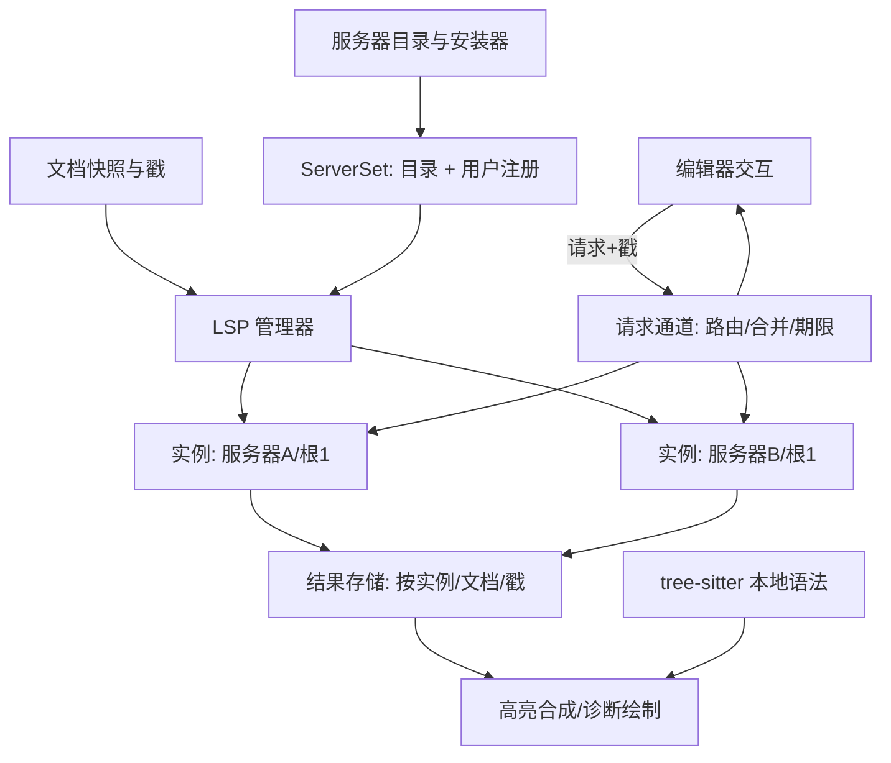

# Loom LSP 设计（临时草案）

- 日期：2026-10-20（重写；上一版为 2026-10-18 的第一代设计，见 git 历史）。
- 状态（2026-10-21，核对至 da7ce4d 并补充本轮修复）：第一代（P4a–P4c、P4f）已接入应用；第二代 P6a 基础大部已实现，P6b 只读导航与 P6c 编辑的主要功能已接入，P6d 部分实现。Windows 上真实 Rust/TypeScript 核心交互已验证（R-L11）；完整能力、桌面目视与跨平台验收仍未齐；详细状态见第 13 节。
- 本轮进展：片段变量/占位符的常用正则变换、捕获与条件替换、大小写转换、未知变量可编辑占位符已接入（R-L20）；完整 ECMAScript 正则兼容与其余清单仍待补。此前事务恢复、Peek、诊断交互、保存顺序、全部 Windows 发布包与共享 Node 见 R-L19，灯泡见 R-L18、choice 见 R-L17、签名重载见 R-L16。
- 公共身份、坐标、语言注册表和高亮模型以 [主设计](LANGUAGE_SERVICES_DESIGN.tmp.md) 第 4–7 节为准；本文件不重复定义。
- 适用范围：多语言通用客户端。协议核心必须通过不同能力组合和非 Rust 假服务器验证，不得出现 `if language == Rust`。
- 目标形态：服务器像语法包一样由 Loom 注册、分发、按需安装；一个语言可绑定多个服务器；交互式语言功能（悬停、补全、跳转、重命名等）对标 VS Code、JetBrains、Zed。
- 状态维护入口：[第 13 节](#13-实施进度跟踪)。

## 1. 目标、范围与决策

### 1.1 目标

1. 在不削弱现有"本地编辑永远可用"保证的前提下，把 LSP 从被动通道（同步、诊断、语义 token、进度）扩展为完整的语言智能。
2. 服务器不依赖用户机器的环境：Loom 维护一份服务器目录，按需下载、校验、安装；需要 Node 的服务器由 Loom 维护的运行时包运行。
3. 用户也可以通过 Loom 的设置注册自己的服务器，但必须给出明确路径。
4. 语法包与 LSP 共享语言身份、按需安装、代次失效的思路，两者互不依赖：没有服务器时 tree-sitter 单独工作，没有语法包时服务器单独工作。

### 1.2 决策记录（2026-10-20）

| ID | 决策 |
| --- | --- |
| D1 | 一个语言可绑定多个服务器，首版即支持；数据模型、实例、结果存储和路由一次到位。 |
| D2 | 服务器的注册只有两个来源：Loom 维护的目录，以及用户在 Loom 设置里的完整定义。任何情况下都不搜索 PATH、不解析裸命令名。 |
| D3 | 内置服务器按语法包的方式分发：固定仓库、固定 release、固定 SHA-256，按需安装。 |
| D4 | 依赖 Node 的服务器在第一阶段交付，由 Loom 维护的运行时包解决；运行时不调用 npm 等包管理器。 |
| D5 | 安装策略默认 `ask`，可设为 `auto` 或 `never`。 |
| D6 | 交互式能力全部纳入计划（见第 8 节），按依赖分四期交付。 |
| D7 | 体验以 VS Code、JetBrains、Zed 的共同做法为参照。 |
| D8 | 早期版本不保留兼容层：删除 `LanguageVariant.server`，`language_servers` 设置改格式，不迁移旧设置与会话。 |
| D9 | 服务器定义移出进程级 `Registry`，由 `ServerSet` 持有（5.1）。 |
| D10 | 应用的源码和打包目录里**没有任何手写的服务器定义**，也默认不安装任何服务器。定义只存在于由发布工作流生成的目录 `assets/lsp-servers/lsp-servers.toml` 中，目标在 `scripts/lsp-servers/` 维护（与语言包同一模式）。目录在第一个服务器发布之前不含任何服务器。 |

待确认：

| ID | 问题 | 当前设计的默认 |
| --- | --- | --- |
| Q1 | `WorkspaceEdit` 触及未打开的文件时，是以脏文档打开再应用，还是直接写盘？ | 以脏文档打开（VS Code 做法；可预览、可撤销、保存才落盘），见 6.9。 |

### 1.3 非目标

linked editing、document color、document link、notebook、远程或 TCP 服务器、调试适配器（DAP）、markdown 等文档内嵌代码块的子文档 LSP、未命名草稿文件的 LSP。这些保留为后续单列项，不影响本设计的接口。

## 2. 历史基线（第一代；当前实现见第 13 节）

### 2.1 已实现

- **协议核心**（`features/language_service`，无 I/O）：分帧、消息、能力解析、会话状态机、URI、位置编码、根目录解析、文档同步规划、诊断与语义 token 解码。
- **进程客户端**（`infrastructure/lsp/client.rs`）：读、写、stderr、驱动四个线程；超时、取消、崩溃、有序关停；Windows Job Object 保证子进程树随 Loom 结束。
- **协调器**（`infrastructure/lsp/manager.rs`）：单线程拥有全部实例；实例键 `(服务器定义, 根目录, 配置代次)`；1/2/4 秒退避重启三次；空闲 60 秒停止；一个文档最多一个在途语义请求。
- **应用桥**（`app/language_services.rs`）：对打开文档的指纹（文档、版本、语言代次、路径、根目录、服务器设置）变化才向协调器发快照，因此任何写入口都不会漏同步。
- **可见结果**：诊断波浪线、概览标记、悬浮卡；语义 token 叠加在 tree-sitter span 上；状态栏与服务器面板（状态、任务、日志、重启）。
- **服务器**：仅 `rust-analyzer`，定义写在 `src/infrastructure/language_defaults.json`，绑定在 Rust 变体上。

### 2.2 局限（驱动第二代）

- 只有被动功能；`client_capabilities` 不声明补全、悬停、定义等，`workspaceFolders` 与 `applyEdit` 为 false，也没有请求通道。
- 一个变体至多一个服务器（`LanguageVariant.server: Option<ServerBinding>`）；协调器 `assignments` 和结果 `Entry.diagnostics` 都是单份。
- 服务器定义嵌在语言默认表里，设置的 `server` 只能引用已知定义（`features/settings/servers.rs`），用户无法注册新服务器。
- 服务器由用户自备，缺失只显示"未找到"。
- 全文替换式同步；无动态注册、无拉取式诊断、无文件监视。

### 2.3 第一代遗留的验收缺口

真实 rust-analyzer 下 Cargo.toml 修改、已存在文件的外部修改、git 分支切换及 Linux/macOS 的完整监视验收仍未齐，并入第二代验收（P6a-8）。丢失 `end` 的进度任务已在 R-L12 加入有界清理；R-L13 已实现通用客户端监视，并用 Rust 显式客户端模式验证未打开模块的创建，不再依赖该用例的服务器自监视。

## 3. 总体架构



模块边界（沿用第一代并扩展）：

| 位置 | 职责 |
| --- | --- |
| `features/language_service` | 纯规则：协议模型、能力表、同步规划、结果解码、合并策略、补全过滤排序、片段解析。不启动进程、不读盘。 |
| `domain/language` | 语言身份与注册表；**不再包含服务器**。 |
| `features/language_service/server_set.rs`（新） | `ServerSet`：由目录、用户注册、语言覆盖合成的服务器定义集合与反向绑定。纯数据。 |
| `infrastructure/lsp` | 进程、传输、协调器、请求通道。 |
| `infrastructure/lsp_servers`（新） | 服务器目录读取、下载、校验、解包、冒烟、缓存、运行时包；复用 `language_catalog.rs` 的归档与校验代码。 |
| `app/language_services.rs` | 文档桥、设置桥、安装提示桥、结果投递到 UI 调度器。 |
| `AppRuntime` | 持有服务生命周期；UI 状态里只有不可变结果。 |
| `ui/…` | 锚定浮层、补全列表、悬停卡、引用面板等（8.6）。 |

保持不变的约束：`editor-core` 不依赖 LSP；`AppState` 不持有进程、线程或句柄；后台任务不持有 UI 锁做 JSON、进程写或等待；协议 I/O 的读、写、stderr 独立，不会因为阻塞写入导致没人读响应；UI 先收到邮箱里的最新目标，不直接等待进程写队列。

## 4. 服务器注册与分发

### 4.1 两种来源

- **目录**（Loom 维护）：随应用发布的目录 `assets/lsp-servers/lsp-servers.toml`。它是**生成物**，不手写、不手改：由 `scripts/lsp-servers/` 的目标定义经发布工作流生成并回写（4.6）。每个条目含启动方式、服务的语言、根目录规则，以及指向 Loom 自己 release 里归档的固定版本与哈希。应用的源码里没有任何服务器定义；目录里没有条目时就没有服务器。
- **用户注册**：用户级 `settings.json` 的完整定义（第 9 节）。项目级 `.loom/settings.json` 不能注册服务器、不能改命令与参数（沿用第一代安全边界）。

两者进入 `ServerSet` 后是同一种定义，差别只有 `origin` 与是否由 Loom 下载。

### 4.2 不使用 PATH

- `command` 必须是绝对路径，或以受管占位符开头：`${pack}`（该服务器包的解压目录）、`${runtime.node}`（已安装的 Node 运行时目录）。
- 裸命令名（如 `rust-analyzer`）在设置校验和目录校验时都报错，不使用 `where`、`which`、PATHEXT。
- 用户注册的路径不存在或不可执行时，实例状态为 `unavailable`，面板显示路径与原因。
- 说明：这只约束 Loom **如何找到服务器**。服务器进程继承用户环境（含 PATH），因为服务器自己可能调用 cargo、go 等工具链。

### 4.3 服务器目录

目录是**生成物**（4.6），格式与 `language-packs.toml` 同构，分成**包**（可安装的归档，按平台给出）和**服务器**（怎么启动包里的东西）两张表，多个服务器可以共享一个包：

```toml
schema = 1

[distribution]
repository = "lius-new/loom"

[packs.pyright]
version = "1.1.414"
license = "MIT"
requires = ["node@22"]

[packs.pyright.platforms.any]
asset = "pyright-any.tar.gz"
release = "lsp-servers-2026.10.21.1"
sha256 = "…"
size = 12345678

[servers.pyright]
name = "Pyright"
pack = "pyright"
command = "${runtime.node}/node"
args = ["${pack}/node_modules/pyright/langserver.index.js", "--stdio"]
priority = 10

[servers.pyright.root]
markers = ["pyrightconfig.json", "pyproject.toml"]
strategy = "nearest"
fallback = "workspace"

[[servers.pyright.languages]]
language = "python"
language_id = "python"
```

规则（流水线生成时与应用读取时各校验一遍）：

- 平台键为 `<os>-<arch>`（os 取 `windows`、`macos`、`linux`，arch 取 `x86_64`、`aarch64`），或 `any`；`any` 与具体平台互斥。当前平台没有条目时状态为 `unavailable`，面板写明原因。
- 归档名是 `<包>-<平台>.tar.gz`，发布标签以 `lsp-servers-` 开头，单个归档上限 256 MiB。
- **命令必须以 `${pack}/` 或所需包的 `${runtime.<id>}/` 开头**，裸命令名与绝对路径都被拒绝，目录里不存在“靠 PATH 找程序”的条目。
- `requires` 写成 `id@主版本`，必须由目录里的另一个包提供。服务器引用的包必须存在。
- 目录里的 `languages` 引用语言规范名。该语言既不在已装语法包也不在语法 catalog 中时，忽略此绑定，不当作错误。
- 归档根目录为 `<包>/`，含 `licenses/` 与 `PROVENANCE.md`。解包沿用语法包的安全规则（拒绝穿越、链接、特殊文件、重复路径、超限）。
- 目录读取、包下载、校验、解包、冒烟与 `${pack}` / `${runtime.*}` 展开已实现（R-L7 至 R-L9）；未安装的包显示“未安装”，安装完成后自动重新分配并启动实例。真实发布包的应用内安装仍待验收。
- 设计里的可选字段 `settings`、`env` 尚未加入目录格式。

### 4.4 运行时包与 Node 系服务器

- **运行时包**就是目录里的普通包 `node`：归档只放官方 Node 可执行文件（根目录的 `node` 或 `node.exe`）和许可证，不含 npm。流水线用 nodejs.org 公布的 `SHASUMS256.txt` 固定每个平台的归档。每个运行时固定一个 LTS 大版本，随应用发布升级。
- **Node 系服务器包**（`npm` 类）含服务器代码及其 `node_modules`，由流水线按锁文件在 CI 里用 `npm ci --ignore-scripts` 打包，**用户机器上不会运行 npm**，只构建一次（平台 `any`）。包声明 `requires = ["node@22"]`，服务器的命令是 `${runtime.node}/node`，参数是 `${pack}/node_modules/…`。
- 多个服务器共享同一个包（例如 vscode-langservers-extracted 的四个服务器），也共享同一个运行时包，按版本去重。安装 Node 系服务器时若运行时缺失，一并入队，提示里合计大小。
- 用户注册的服务器可以写 `runtime = "node@22"` 并在 `command` 中使用 `${runtime.node}`，即复用 Loom 管理的 Node；`${pack}` 对用户注册服务器不可用。
- Node 系服务器与原生二进制的信任依据相同：固定哈希、来源是 Loom 的 release、目录随应用签名发布。

### 4.5 安装状态与 ask 策略

```text
NotInstalled → Prompted → Queued → Downloading → Verifying → Ready
                 │                       │             └→ Failed(重试冷却)
                 └→ Declined             └→ Unavailable(平台)
```

触发：文档的语言绑定了某个内置服务器、该服务器是 `NotInstalled`、且设置不是 `never`。

- **ask（默认）**：显示非模态提示条"为 Rust 安装 rust-analyzer（约 N MB）？[安装] [暂不] [不再提示]"。同一会话每个服务器至多提示一次；一次打开多个语言时合并成一条。"暂不"在本次会话内不再提示；"不再提示"写入用户设置 `install = "never"`，之后只能在面板里手动安装。
- **auto**：直接入队。
- **never**：不提示，不下载。

R-L14 已实现上述询问流程：协调器按服务器保存当前语言服务会话的提示历史，多根实例合并为一项、多个服务器合并为一条；重启实例、关闭再打开文档不会重复询问。提示显示实际打开文档的语言、服务器名及缺失归档的估计大小，共享运行时去重，已安装的依赖不重复计入。条带不覆盖窗口的事件接收面，按钮不抢编辑器焦点，窄窗时纵向排列。

“暂不”仅清除本次显示的项，不改变安装策略；“不再提示”只把本次项写为用户设置 `install = "never"`，沿用设置的 JSONC 差异写入和重载路径，保留服务器参数、环境变量及其他设置。无效的手改文件不会被覆盖，保存失败显示错误。“安装”只提交本次显示项；过期条带回调不操作已撤回的项。自动安装、安装中、已安装、禁用、不受当前平台支持及自备路径服务器不弹询问；`never` 仍允许从语言面板手动安装。

安装过程：

1. 队列、并发（至多 2）、失败 30 秒冷却、显式重试跳过冷却，沿用语法包。
2. 读 `<user>/lsp-servers/.managed/archives/<sha>.tar.gz` 缓存，大小和 SHA-256 不符才下载；下载有字节进度，可取消。
3. 解包到暂存目录，核对目录声明的平台条目，可执行文件存在。
4. **冒烟**：用真实启动参数启动一次，`initialize` 成功再 `shutdown`，30 秒超时，通过才激活。这对应语法包的"用真实 loader 校验"。
5. 原子改名为 `.managed/packs/<id>/<version>-<sha前16位>/`。新版本就绪后保留一个旧版本，其余清理。
6. 完成后通知协调器，让该语言的打开文档重新分配实例，无需重启。

R-L15 已实现安装取消与恢复：面板为安装请求提供 Cancel，等待阻塞读取返回及临时文件/进程清理时显示 cancelling，完成后显示 cancelled 与 Resume。取消的是带代次的根请求，只移除不再被其他请求需要的排队项；共享运行时仍有使用者时继续，最后一个使用者取消才停止。自动策略和失败重试不会恢复已取消请求；当前语言服务会话内需手动 Resume。Resume 可复用完整校验过的归档，半成品及暂存目录被移除；旧按钮、旧进度和旧失败不会覆盖新一轮，激活与取消由同一把锁仲裁，已激活的包保留。

取消采用协作检查：缓存哈希、下载读取、解包的每个条目及 64 KiB 数据块、启动和激活前都检查；initialize 等待每 50 ms 检查取消，随后沿用客户端关停并回收进程。同步网络调用本身须等返回或传输超时（连接配置 30 秒、读取配置 60 秒），期间不宣称已停止；最多两个工作线程，依赖未就绪的任务不占工作线程。

服务器身份（名字、语言、命令模板）在启动时就进入 `ServerSet`，安装只改变可用性，所以不依赖 `Registry` 的不可变性。

### 4.6 发布流水线（已实现；首次运行与修复记录见 R-L8）

`scripts/lsp-servers/` 与 `.github/workflows/lsp-servers.yml`，结构仿语法包流水线并复用其下载、归档与发布助手；说明见 `scripts/lsp-servers/README.md`。

- `build.toml`：服务器目标的唯一维护位置。包有三种：`archive`（上游归档，格式 zip、tar.gz、tar.xz、gz、raw）、`npm`（精确版本加锁文件）、`go`（固定版本的模块与固定的 Go 工具链）。服务器的命令模板、服务的语言、根目录规则、初始化选项都写在这里，不在应用源码里。
- `pins.toml`（`pin.mjs` 生成）：每个上游归档与许可证文件的 SHA-256 与大小，优先取发布方公布的校验和，没有才下载计算。未固定的下载不会发生。`npm/<包>/` 的 `package-lock.json` 以完整性哈希锁定每个依赖，安装使用 `npm ci --ignore-scripts`。
- `check.mjs`：离线检查配方、固定与锁文件一致；`pipeline.test.mjs`：用假归档和假发布端测试解包、组装、目录生成与发布，不联网。`fixtures/catalog.toml` 是流水线为生产配方生成的目录，应用的目录读取器在自己的测试里读取它，两边共用同一份格式约定。
- `build.mjs`：每个包与平台生成 `<包>-<平台>.tar.gz`（根目录 `<包>/`，含 `licenses/` 与 `PROVENANCE.md`）、`SHA256SUMS` 与 `build-report.json`；归档顺序与时间戳固定，可复现。只有每个平台都构建成功的批次才算完整，局部构建不能进入发布。
- `validate.mjs`：在 Linux、Windows、macOS 三种 runner 上解包本平台的包，展开占位符，真正启动每个服务器并完成 LSP `initialize`/`shutdown`。
- `publish.mjs`：`prepare` 由配方与构建报告生成候选目录，`verify` 核对每个归档，`publish` 创建草稿、上传、在服务端核对、发布，确认公开后才把目录提升到 `assets/lsp-servers/lsp-servers.toml`，由工作流提交回分支。同一标签下已有的资产永不覆盖；内容变了就必须换标签。标签以 `lsp-servers-` 开头，不标为 latest。
- 工作流手动触发，默认只构建与验证；`publish` 只能在分支上选，并复用语法包的“提交并推送目录”步骤（同一套同步测试）。

升级只随应用发布；应用不轮询新版本，也不升级已安装的服务器。第三方许可证与来源列在 `THIRD_PARTY_NOTICES.md`。

### 4.7 已落配方的服务器

配方在 `scripts/lsp-servers/build.toml`，共 15 个包、17 个服务器，覆盖第一代设计列出的全部名单。版本是 2026-10-20 当天各上游的最新稳定版，哈希与锁文件已固定。

| 语言 | 服务器（包） | 类型与版本 | 平台 |
| --- | --- | --- | --- |
| Rust | rust-analyzer | 上游归档，2026-10-19 | 六个 |
| C / C++ / Objective-C | clangd | 上游归档，23.1.0 | windows-x86_64、macos 两个、linux-x86_64 |
| Go | gopls | 从源码按平台交叉编译，v0.24.0，Go 1.27.0 | 六个 |
| Zig | zls | 上游归档，0.17.0 | 六个 |
| TOML | taplo | 上游归档，0.10.0 | 六个 |
| Markdown | marksman | 上游单文件，2026-02-08 | 除 windows-aarch64 |
| Lua | lua-language-server | 上游归档，3.19.2 | 除 windows-aarch64 |
| Python | ruff | 上游归档，0.17.1 | 六个 |
| Python | pyright | npm，1.1.414 | any |
| JS / TS / JSON / CSS | biome | 上游单文件，2.5.15 | 六个 |
| JS / TS | typescript-language-server（含 typescript 5.9.3） | npm，6.0.2 | any |
| HTML / CSS / SCSS / JSON / ESLint | vscode-langservers-extracted（四个服务器共用一个包） | npm，4.10.0 | any |
| YAML | yaml-language-server | npm，2.0.0 | any |
| Bash | bash-language-server | npm，5.8.1 | any |
| （运行时） | node | 上游归档，22.23.3 | 六个 |

说明：

- 没有某平台归档的包在该平台不可用（面板写明原因），例如 clangd 没有 Linux aarch64 构建。
- clangd 的 macOS 归档同时用于 x86_64 与 aarch64，其内容是否同时含两种架构尚未核对。
- typescript-language-server 通过初始化选项 `tsserver.path` 指向包内的 typescript；该选项名与 `${pack}` 在初始化选项里的展开都待安装器实现后实测。
- ESLint 服务器优先级最低，且需要工程里有 ESLint 配置；它按设计列入，是否默认启用留给安装与设置阶段决定。
- 首次 GitHub 构建成功，Windows/macOS 冒烟成功，Linux 的 marksman 加载器问题已有修复记录；生成目录已由 a349f36 同步到 lsp-servers-2026.10.20.1。完整远端复跑结果尚未在本文件补录，不据此推定全部平台通过（见 R-L8）。

## 5. 语言绑定与多服务器

### 5.1 `ServerSet`（D9）

- `Registry` 删除服务器定义、`ServerBinding`、`ServerDefinitionId` 与 `from_parts` 的服务器参数；`LanguageVariant.server` 删除。`Registry` 只保留语言、变体、grammar 与文件规则。
- `ServerSet` 由三部分合成：目录里的服务器、用户注册、语言级覆盖（`languages.<name>.language_servers`）。它是纯数据。启动时由 `infrastructure/lsp_catalog.rs` 读取目录并安装为进程级集合（`ServerSet::current()`，没有安装时为空）；已实现的只有目录部分，用户注册与语言级覆盖随后加入，届时随设置变化重建并经快照交给协调器。
- 服务器定义声明自己服务的语言，方向与 VS Code、Zed、Helix 一致：

  ```text
  languages = [
    { language = "typescript", variant = "typescript", language_id = "typescript" },
    { language = "typescript", variant = "tsx",        language_id = "typescriptreact" },
  ]
  ```

  `variant` 省略表示该语言所有变体；`language_id` 必须显式给出，是服务器自己的词汇，与 Loom 的名字无关。
- 反向索引 `servers_for(ResolvedLanguage) → 有序 [(服务器, language_id)]`。顺序：语言级设置 > 定义里的 `priority`（大者优先）> 名称。语言级设置支持 Zed 风格：`["biome", "!pyright", "..."]`，`!` 禁用，`...` 表示其余按默认。
- 服务器标识用名称。`ServerDefinitionId` 若仍需要，是 `ServerSet` 内部的、随重建变化的下标，不进入缓存键之外的持久位置；实例键使用 `(服务器名, 定义指纹, 根目录)`，定义指纹变化即换实例代次（取代第一代的 `config_generation`）。

### 5.2 文档与实例

- 一个文档对应**有序的实例列表**，每个绑定的服务器一个，根目录各自按该服务器的 `root` 规则解析，所以同一文档在不同服务器下可能落在不同根。
- 同步：每个实例一份 `DocumentSync`（连接级单调版本计数器本来就按连接），文本快照 `Arc` 共享，差分规划按实例各算一次。
- 结果存储 `Entry` 按**实例**保存诊断（来源即服务器名）；语义 token 只取优先级最高且声明了能力的实例；请求结果按 7 节处理。
- 空闲回收、崩溃退避、重启按实例独立；一个实例失败不影响同文档的其他实例。
- 状态栏显示聚合状态（最差状态加后台任务）；面板按实例分节（第一代已有）。

### 5.3 路由与合并

| 功能 | 策略 |
| --- | --- |
| 诊断 | 全部合并，标注来源服务器；各实例独立存储与清理。 |
| 悬停 | 并发询问，内容按优先级拼接成一张卡片。 |
| 补全、引用、工作区符号、代码操作、内嵌提示、code lens | 并发询问，合并并去重；晚到的结果增量追加。 |
| 定义、声明、类型定义、实现 | 并发询问，按目标位置去重。 |
| 文档符号 | 取优先级最高且有能力的实例。 |
| 重命名、签名帮助、文档高亮、折叠、选区扩展、语义 token、hierarchy | 按优先级逐个尝试，首个非空结果即用。 |
| 格式化 | 用语言设置里的 `formatter`；未设置则取优先级最高且声明了格式化能力的实例；**不叠加多个格式化器**。 |

合并规则：

- 只询问声明了该能力（静态或动态注册）的实例，不发送未协商的请求。
- 每类请求有总期限（初值：补全 150 ms 先出已到结果，悬停 500 ms，其余 2 s）。期限到达时用已到的结果成型；晚到结果对补全、引用、符号增量追加，对悬停、签名丢弃。单实例请求超时沿用 5 秒。
- 去重：定义类按（URI, range）；补全按（label, kind, insertText）相同时保留优先级高者。
- 排序：先实例优先级，再服务器给出的 `sortText`。
- 代码操作带来源实例标记，`codeAction/resolve` 和执行命令发回产生它的实例。

## 6. 协议核心

### 6.1 进程与分帧

先支持本机 stdio。每个实例的读、写、stderr 消费和驱动各自独立线程，沿用 std 线程和有界通道，不引入全应用异步运行时。读取正确处理半包、粘包、按 UTF-8 正文字节数计的 `Content-Length`；stdout 只解析协议，stderr 持续消费到有界日志。

### 6.2 生命周期

```text
Stopped → Starting → Initializing → Ready → Stopping → Stopped
                       └→ Failed ←───────────┘
```

顺序：启动 → `initialize` → 读取能力与编码 → `initialized` → 同步待打开文档 → 请求能力结果。结束时先停止新任务，尝试 `shutdown`/`exit`；超过有界等待后终止并回收自有进程。Windows 后台服务器不显示控制台，进程树由 Job Object 回收；Linux/macOS 的进程组清理待补。清理幂等，`AppRuntime` 销毁后排队的回调不得恢复服务或写入状态。

默认超时：初始化 30 秒、普通请求 5 秒、退出宽限 2 秒。超时不阻塞编辑。崩溃按 1/2/4 秒退避自动重启三次，之后等待显式重启；定义指纹变化重建实例代次。程序不存在（用户路径无效、平台无构建）为 `unavailable`，不重试。

### 6.3 能力协商

只声明已经实现并验收的能力；每个功能随对应阶段的验收一起加入声明，不预先声明。

下表保留阶段目标；当前已声明静态交互能力、semantic full/delta、pull 诊断及文件操作通知。R-L13 新增交互 provider 的动态注册及 watched files（含 RelativePattern）；同步、semantic tokens、pull 诊断和文件操作的动态注册仍为 false，semantic range、folding 客户端能力、willRename、workspace diagnostics 尚未交付。真实核心交互验证见 R-L11–R-L13。

| 范围 | 内容 |
| --- | --- |
| 已声明（第一代） | 文档同步、`positionEncodings`（utf-8、utf-16）、push 诊断（版本支持）、semantic tokens full、`workspace/configuration`、semantic tokens refresh、`window.workDoneProgress`、`showMessage`。 |
| P6a | `workspaceFolders`、`dynamicRegistration`（凡声明者都必须实现注册与注销）、pull 诊断、`applyEdit`、`workspaceEdit`（`documentChanges`、资源操作、失败处理）、`window.showDocument`、`executeCommand`、`showMessageRequest`。 |
| P6b | `hover`（`contentFormat`: markdown、plaintext）、`definition`/`declaration`/`typeDefinition`/`implementation`（`linkSupport`）、`references`、`documentHighlight`、`documentSymbol`（`hierarchicalDocumentSymbolSupport`）、`workspace/symbol`。 |
| P6c | `completion`（`snippetSupport`、`resolveSupport`: documentation、detail、additionalTextEdits，`insertReplaceSupport`、`labelDetailsSupport`、`tagSupport`、`contextSupport`、`insertTextModeSupport`）、`signatureHelp`（`activeParameterSupport`、`contextSupport`）、`rename`（`prepareSupport`）、`codeAction`（literal、`isPreferredSupport`、`resolveSupport`、`disabledSupport`）、`formatting`/`rangeFormatting`/`onTypeFormatting`。 |
| P6d | `inlayHint`（`resolveSupport`）、`foldingRange`、`selectionRange`、`callHierarchy`、`typeHierarchy`、`codeLens`、`workspace/fileOperations`、semantic tokens `delta` 与 `range`、各类 `refresh`。 |

仅提供 `range` 语义 token 的服务器，在 range 路径验收前显示该能力不可用，不伪装成 full。

### 6.4 服务端请求与通知

必须回应服务器发来的请求，不只处理客户端发出的：

| 请求/通知 | 行为 |
| --- | --- |
| `workspace/configuration` | 按 item 顺序返回该服务器 `settings` 里对应 section，缺则 null |
| `workspace/workspaceFolders` | 返回该实例的根 |
| `workspace/semanticTokens/refresh`、`inlayHint/refresh`、`codeLens/refresh`、`diagnostic/refresh` | 回应并递增对应代次，重新调度可见文档 |
| `client/registerCapability`、`client/unregisterCapability` | 更新实例能力表（6.6）；只接受已声明支持的注册，其余明确拒绝 |
| `window/workDoneProgress/create`、`$/progress` | 按实例与 token 维护任务（6.11） |
| `window/logMessage`、`window/showMessage` | 有界日志，非重复状态消息 |
| `window/showMessageRequest` | 显示带按钮的提示，返回所选项 |
| `window/showDocument` | 打开文件并定位 |
| `workspace/applyEdit` | 经 6.9 的事务应用并返回是否成功 |
| 未知 request | 返回 MethodNotFound |
| 未知 notification | 忽略或限流记录，不使实例失败 |

### 6.5 文档同步

每个服务器连接共享一个递增的协议版本计数器，向任意 URI 发送新版本时分配下一个值，因此同一 URI 的版本递增但允许跳号；关闭再打开或切换语言后不复用版本。版本到 `DocumentStamp` 的历史（32 条）与正文历史仅属于当前打开代次，关闭或重开即清除。一个同步批次无法全部分配合法版本时整个批次不提交，协调器清除该实例结果、重建连接并增加运行代次，旧运行的通知与响应因此失效。

- `didOpen` 发最新完整正文；同一文档的多个窗格不重复 `didOpen`，窗格关闭而文档仍打开时不 `didClose`。
- `didChange` 按服务器同步类型：`None` 时不发送，并在本地编辑后禁用该文档的语义结果直到有效重开。
- `didSave` 只在磁盘保存成功后发，是否带正文遵循服务器能力。
- URI 或语言变化先关闭旧会话、清理结果，再以新 URI 和语言打开；根变化要重新路由实例。
- 服务器重启后从最新正文重新 `didOpen`，不重放旧请求。
- 所有文档通知与该文档的请求经同一个实例写队列排序：先写入更新，再发依赖它的请求。写队列拥堵时可丢弃**尚未派生协议消息**的中间目标并从最后一个已排队基准重新规划；已进入有序传输的 `didOpen`/`didChange`/`didClose` 与依赖请求不得静默丢弃。传输写入失败或无法证明顺序完整时使实例失效并重建，禁止在损坏的镜像上继续发请求。
- 超过 8 MiB 的文档不同步。

**增量同步（P6a，取代第一代的整文替换；是补全的前置）**：在同步规划路径上比较 last-sent 与 latest 两份快照，用公共前缀和后缀构造一条连续替换，前后缀收敛到合法字符边界，range 按协商编码从旧快照计算，replacement 取自新快照。服务器只声明 Full 时仍整文发送。文本相同但本地版本变化时发送完整替换以推进协议版本。核心 revision 若能提供精确且有界的编辑序列，可作为优化取代扫描，但不是前提。验收：随机编辑下镜像与最新正文逐字一致（含 UTF-8/UTF-16、代理对、CRLF），8 MiB 文档单字符编辑的规划耗时有基准值（暂定 5 ms 内，待实测调整）。

### 6.6 动态注册、多根与配置

- 能力表 = 初始化返回的静态能力 + 动态注册，按实例保存；注册 ID 管理注销；实例退出清空。
- R-L13 已实现：注册/注销整批校验并原子提交；同 ID 同方法可更新选项，同一批重复 ID 或跨方法复用明确拒绝。文档选择器按 language、scheme、pattern 求交集，多个 filter 求并集；null 应用到该实例，空数组不匹配。能力合并保留静态 provider 和其他 ID 的选项；注销后重新计算路由与面板，并取消该实例旧能力下的在途交互结果。实例退出、重启和根变化释放注册与监听，旧运行回调无效。
- 当前动态范围：hover、completion、signatureHelp、定义族、references、highlight、symbols、rename、codeAction、formatting/range/onType、inlayHint、selectionRange、hierarchy、codeLens、executeCommand 及 watched files。未声明支持的注册返回明确错误；同步、semantic tokens、pull 诊断、文件操作的动态注册保留 false。
- 多根（R-L12 已实现）：同一服务器在每个根一个实例（实例键已含根），初始化声明 `workspaceFolders` 支持并发送单元素根列表；`workspace/workspaceFolders` 查询也只报告该实例的根，不使用 `didChangeWorkspaceFolders` 动态增减。
- `workspace/configuration` 的值来自设置里该服务器的 `settings`；设置变化时发 `workspace/didChangeConfiguration`，不重启实例（仅 `command`、`args`、`initialization_options`、`runtime` 变化才换实例代次）。

### 6.7 诊断

- push 与 pull 并存。声明了 `diagnosticProvider` 的服务器，编辑停顿约 200 ms 后对打开文档发 `textDocument/diagnostic`，用 `resultId` 去重；`workspace/diagnostic` 后置到问题面板阶段（P6d）。
- 诊断按（实例, URI）存储；每次发布替换该来源先前集合，空集合表示清除；关闭实例只清自己的结果。
- 带 `version` 的诊断只接受可映射到当前打开代次和当前文本的版本；编辑后先清除当前范围装饰，避免位置错位。缺 `version` 时无法严格证明对应关系：接收时按已发送快照做范围校验并标记 unversioned，服务正在追赶本地修改时不发布范围装饰，下一次编辑立即失效，不声称严格一致。
- 解析 `tags`（未使用灰显、已弃用删除线）、`relatedInformation`、`codeDescription`；完全相同的诊断去重。

### 6.8 语义 token

- 第一代已有 full：按 legend 映射分类，相对编码解码为绝对位置，用请求绑定的快照转换字节范围；校验长度、类型索引、修饰符位、整数溢出和文本边界。
- 每个请求记录请求 ID、运行代次、打开代次、`DocumentStamp`、语义失效代次。每个文档至多一个有效请求在途，新编辑使旧请求过期并尽力取消，客户端仍必须丢弃旧结果。编辑停顿约 75 ms 后发请求。
- refresh 到达时即使文本没变也递增语义代次，使 refresh 前的在途结果不能覆盖新语义。`null` 与空集合都清除当前发布的语义层，不据此永久判定不支持。
- P6d 增加 `delta`：保存原始整数数组与 `resultId`，在数组层验证并应用（start/deleteCount 是整数数组索引，多条 edit 基于同一旧数组、验证不冲突后从后向前应用），非法或缺基准回退 full。随后增加 `range`：仅查视口、单独缓存覆盖范围，不把局部结果冒充全文。
- 多服务器下语义 token 只取优先级最高且有能力的实例（5.2），tree-sitter 始终打底。

### 6.9 WorkspaceEdit 事务

服务器的 `WorkspaceEdit`（`changes`、`documentChanges`，含创建、重命名、删除资源）由应用层编排，作为一个原子操作：

1. 校验：带 `version` 的 `TextDocumentEdit` 必须与当前文档一致，否则整体拒绝并提示。同一文档内的多个编辑基于同一快照，重叠则整体拒绝。
2. 应用文本编辑：每个目标文档的编辑倒序应用。未打开的文件**先读盘并作为脏文档打开再应用**（Q1 的默认），用户可预览、撤销，保存才落盘。
3. 资源操作经 workspace 现有的文件操作路径执行，保持资源管理器与文件监视同步。
4. 全部编辑进入同一个**跨文档撤销组**；任一步失败则回滚已应用部分。
5. 读盘之外的工作不在 UI 线程做。

现状（12.1 第 5 行）：撤销历史挂在每个文档的 `TextBuffer` 上，只能在单个文档内成组；但 `EditorMut::edit(Vec<Edit>)` 已经按 LSP `TextEdit[]` 的语义一次性校验并应用一批互不重叠、基于当前文本的编辑，产生一个撤销步，单文档部分直接映射到它。

跨文档的原子撤销需要新增：撤销条目带可选的事务标识，工作区维护事务表。撤销时若该事务涉及的**每个文档栈顶都还是这个事务**，则一起撤销；否则拒绝并提示，不静默只撤销一部分。重做同理。事务涉及的文档在历史被截断（超过 500 步）或被关闭后，该事务视为不可撤销。

重命名、代码操作、格式化、`workspace/applyEdit` 都走这条路径。

### 6.10 文件监视与外部变更

不假定所有服务器自行监视文件。随 P6d（若首个或第二个真实服务器暴露漏报则提前），复用现有 notify 事件源，通过通用订阅适配器匹配服务器注册的 glob、base URI 与 Create/Change/Delete，生成 `workspace/didChangeWatchedFiles`，不为每种语言重复建 watcher。

订阅按实例代次与注册 ID 管理，取消注册或退出时释放。只有实现并验收的 glob 与 relative pattern 语义才可声明能力，不假定现有 globset 与 LSP 模式完全等价。注册范围超出已有监视根时需要受预算限制的额外 watcher lease，无法建立则明确报告注册失败。合并重复事件但保留创建/删除的最终语义；重命名表达为旧 URI 删除加新 URI 创建。磁盘事件与内存正文是两条通道：打开且未保存的正文仍以协议同步为准。`requires_full_rescan` 没有对应的 LSP 事件，需要比较已知元数据或安排受控项目重载，不能伪造 Rescan 通知。

R-L13 实现：复用 `infrastructure/file_watcher.rs` 的 notify 批处理源，LSP 实例与候选租约共享同一物理根的源，最后一个订阅释放时停止监听。LSP 订阅可显式匹配 `.git`，编辑器原有重载监视继续排除它。独立 glob 编译器验证 `*`、`?`、`**`、备选、字符范围/否定与转义；单段字符类不跨 `/`，`?` 按 Unicode 字符匹配。支持字符串和 URI/WorkspaceFolder base 的 RelativePattern，以及 Windows 原生绝对路径；缺失的绝对字面前缀租用已有祖先，但按模式剪枝扫描无关分支。未注册、注销或旧代次均不发送通知。

每实例最多 128 个注册、256 个 watcher、16 个归并根，所有 LSP 实例最多共享 64 个物理根；每次元数据扫描最多 200000 项/10 秒，注册等待最多 20 秒，失败明确回复且保留旧订阅。根监听与基线准备均在后台完成后才确认注册；更换租约时通过有序暂停/基线交接保留期间的创建、修改、删除，失败则恢复旧租约。比较前后磁盘状态处理重命名与目录子树，已知文件删除后重建归为 Change；重叠模式去重。事件溢出立即重扫，另每 30 秒作恢复比较，失败 2 秒后重试；只发送真实差异，并将大批次拆为最多 4096 项的消息。

在此之前，首个真实服务器的自监视必须由实测证明：记录服务器版本、平台、有效初始化配置、是否声明客户端 watcher；覆盖未打开源文件的修改、新建、删除，项目清单变化（Cargo.toml 与适用的 .cargo 配置），外部磁盘编辑与 git 分支切换。自监视有缺口时先尝试文档化的显式模式，仍失败则提前对应的 watcher 子集，不得带着已知漏报宣称完成。服务器的私有选项放进 `ServerSet` 的定义，不进入通用核心。

### 6.11 进度与状态

连接 `Ready` 只表示初始化完成。状态拆为"连接状态 + 后台任务集合 + 能力结果可用性"：连接就绪时仍可有加载项目、索引或检查任务。`$/progress` 按实例与 token 处理 begin/report/end（字符串与整数 token 保留类型，百分比上限 100，最多 32 个任务，实例重启清空），不写死某服务器的私有 token 或消息。没有进度时显示"已连接，等待语义结果"属于状态展示目标，不把长时间无结果推断成正在索引，也不承诺固定耗时。

R-L12 已实现进度取消与有界清理：begin/report 的 `cancellable` 决定面板是否提供 Cancel；点击后向原实例发送 `window/workDoneProgress/cancel`，保留原 token 的 JSON 类型。按钮携带实例 ID、运行代次与本地任务 ID，旧按钮不会取消重启后的同名任务。取消只发送一次，等待 end 时显示 cancelling；5 秒未确认则停止跟踪并记录警告，不能宣称服务器已停止工作。未取消任务 5 分钟未收到进度即停止跟踪并记录警告；report 延长静默期限，取消后的报告不延长取消宽限。所有期限进入协调器截止时间表，服务器安静时也会清理。

## 7. 请求通道与结果新鲜度

第一代的结果是"推给存储、按戳取"。交互式功能需要"UI 发出、等结果、过期就丢"的通道。

**接口**：`Manager::request(RequestSpec) → RequestHandle`。`RequestSpec` 含功能、文档、`DocumentStamp`、位置或范围、路由与合并策略、期限。协调器线程接收，向各目标实例发送，聚合后写入 handle 的邮箱，并通过 `on_change` 通知 UI 重绘。`RequestHandle` 可取消（发 `$/cancelRequest`，丢弃晚到响应），`Drop` 即取消。

**新鲜度规则**：

| 类别 | 例子 | 规则 |
| --- | --- | --- |
| 随位置的瞬时信息 | 悬停、签名帮助、文档高亮 | 结果交付时戳与发起时不同则丢弃。 |
| 补全 | completion | 列表绑定触发位置与过滤前缀；在同一标识符内继续输入时本地过滤并保留列表，越过起点或 `isIncomplete` 时重发（8.2）。 |
| 导航与动作 | 定义、引用、重命名、代码操作 | 结果的位置针对发起时的快照。跳转到**其他文件**直接使用；当前文件内的范围用修订记录映射到最新文本，无法映射则放弃并提示重试。 |
| 后台装饰 | 内嵌提示、code lens、折叠 | 与语义 token 相同：只对精确的编辑器状态展示。 |

**并发**：每个文档每类功能至多一个在途请求，新请求取代并取消旧请求；全局在途数有上限。取消和超时释放槽位，不等服务器无限响应。

**错误（R-L12 已实现有界重试）**：`ContentModified` 与 `ServerCancelled` 最多对失败的目标实例重试一次。必须仍处于同一实例运行代次和文档 Stamp（工作区符号查询无文档戳），并且服务器没有明确给出 `retriggerRequest: false`；保留原参数，沿用原总期限，只给重试剩余时间。其他实例已成功的结果不重发；命令执行不自动重放；取消、文档失效与期限耗尽时不重试。第二次仍过期则返回 Stale，其余错误沿用现有请求失败处理。

## 8. 编辑器功能

### 8.1 功能矩阵

体验取 VS Code、JetBrains、Zed 的共同做法。

| 功能 | LSP 方法 | 体验要点 | 多服务器 | 阶段 |
| --- | --- | --- | --- | --- |
| 悬停 | `textDocument/hover` | 鼠标停留约 300 ms 或快捷键；与诊断合并成一张卡片；Markdown 渲染，代码块用语法包高亮 | 拼接 | P6b |
| 定义、声明、类型定义、实现 | `definition` 等 | F12、Ctrl+点击；单结果直接跳转，多结果弹出选择列表；Peek；进入导航历史 | 合并去重 | P6b |
| 文档高亮 | `documentHighlight` | 光标停留后给同一符号的所有出现位置加底色 | 首个非空 | P6b |
| 查找引用 | `references` | 底部面板按文件分组，复用搜索结果列表组件 | 合并 | P6b |
| 文档符号 | `documentSymbol` | 大纲面板、面包屑、文件内符号跳转 | 首个有能力 | P6b |
| 工作区符号 | `workspace/symbol` | 通用选择器（输入即过滤，带预览行）；应用目前没有快速打开，选择器随 P6b 新建 | 合并 | P6b |
| 诊断导航 | — | F8、Shift+F8 跳下一个、上一个诊断 | — | P6b |
| 补全 | `completion`、`completionItem/resolve` | 见 8.2 | 合并增量 | P6c |
| 签名帮助 | `signatureHelp` | `(` 与 `,` 触发；活动参数加粗；重载上下切换 | 首个非空 | P6c |
| 重命名 | `prepareRename`、`rename` | F2 行内输入框；结果走 6.9 | 首个非空 | P6c |
| 代码操作 | `codeAction`、`codeAction/resolve` | 灯泡、Ctrl+.、诊断卡片内的快速修复、保存时动作 | 合并 | P6c |
| 格式化 | `formatting`、`rangeFormatting`、`onTypeFormatting` | 文档、选区、保存时、输入时 | 指定一个 | P6c |
| 内嵌提示 | `inlayHint` | 类型与参数名提示，设置开关，点击跳转 | 合并 | P6d |
| 折叠、选区扩展 | `foldingRange`、`selectionRange` | tree-sitter 优先，LSP 作后备 | 首个有能力 | P6d |
| 语义 token 增强 | full、delta、range | 6.8 | 首个有能力 | P6d |
| 调用、类型层次 | `callHierarchy`、`typeHierarchy` | 面板 | 首个有能力 | P6d |
| code lens | `codeLens`、`executeCommand` | 行上方文字，点击执行命令 | 合并 | P6d |
| 问题面板 | 诊断聚合、`workspace/diagnostic` | 全工程列表，按文件分组，可过滤 | 合并 | P6d |
| 文件操作 | `willRename`、`didRename`、`didCreate`、`didDelete` | 资源管理器改名时让服务器更新引用 | 广播 | P6d |
| 文件监视 | `didChangeWatchedFiles` | 6.10 | — | P6d，可提前 |

### 8.2 补全

- **触发**：输入标识符字符（去抖约 30 ms）、服务器的 `triggerCharacters`、手动 Ctrl+Space。请求携带 `CompletionContext`。
- **列表生命周期**：立即用上一次缓存列表做本地过滤并显示，同时发新请求；列表非 `isIncomplete` 时，在同一标识符内继续输入只做本地过滤，不重发；退格越过起点或 `isIncomplete` 为真时重发；新按键取消在途旧请求。
- **过滤与排序**：客户端模糊匹配（子序列、驼峰首字母、连续加权），使用 `filterText`；排序依次为匹配得分、实例优先级、`sortText`，`preselect` 置顶。
- **接受**：Enter 或 Tab（设置），`commitCharacters`；`textEdit` 与 `insertReplaceEdit`（插入或替换模式可设置）；`additionalTextEdits`（如自动补 `use`）；`insertTextMode` 的缩进调整；`command` 经 `executeCommand`。
- **片段**：`insertTextFormat = 2` 走片段引擎，支持 tabstop、占位符、选择项、变量、嵌套、镜像；Tab 在 tabstop 间跳转，Esc 退出。不声明 `snippetSupport` 会让 rust-analyzer 等失去函数括号补全，所以必须做。
- **文档卡片**：选中项延迟 `completionItem/resolve` 取 `documentation` 与 `detail`，显示在列表右侧（空间不足时在下方）；Markdown 渲染。
- **多服务器**：各实例结果合并去重，晚到的实例增量并入列表且不抖动已选项。
- **后备**：没有服务器、或服务器不支持补全时，提供当前文档的缓冲区单词补全，可在设置里关闭。

R-L17 已交付片段 choice 菜单：进入 `${1|a,b|}` 停靠点时展示已有浮层列表；上下键、翻页、滚轮与鼠标选择可用，Enter/Tab 确认后仍选中当前停靠点，下一次 Tab 前往后续停靠点。确认不受补全的 `accept_on` 设置影响；Shift+Tab 返回 choice 时保留当前值的选中项。Esc 或列表外点击只关闭候选菜单，允许继续自由输入；`SnippetChoice` 上下文的 Ctrl+Space / `editor::ShowSnippetChoices` 重新打开，关闭菜单后再 Esc 退出片段。文字直接进入编辑器，不进入隐藏列表的过滤框。

候选值保留空字符串、转义逗号/竖线和 Unicode；显示用 `(empty)` 区分空项。选择和其直接/外层镜像更新组成一个撤销组，原值不变时不增加撤销步；正常 Undo/Redo 结束片段会话。镜像边界映射区分本次编辑的拥有者，相邻或同位置的空镜像分别映射，光标停留在主停靠点。换文档、换语言、重载、旧菜单代次或失效快照拒绝回调；已投递的自动补全不能盖过 choice 列表，手动补全命令仍可显式切换过去。多行初值与后续候选保持插入位置的缩进。

R-L20 增加 `${VAR/regex/format/options}` 与 `${1/regex/format/options}`：变量在插入时变换，占位符在 Tab 离开时变换；支持 `$n`/`${n}` 捕获、条件格式、常用大小写与命名格式转换。活动占位符输入时镜像保持原值，离开时的变换及外层镜像更新共用一个撤销组；回退后不重复叠加变换，重新输入则重新计算。未知裸变量成为可编辑占位符，同名变量镜像联动；已知但当前未提供值的变量采用默认值或空字符串。引擎有编译、回溯与输出预算，错误或超限保留输入；其 Unicode 标量与正则语义尚不等同完整 ECMAScript UTF-16 语义，兼容边界见 R-L20。

R-L16 已交付签名重载切换：多重载卡片显示独立的上下按钮与序号，`SignatureHelp` 快捷键上下文提供 Alt+↑/↓，本地循环切换且不修改正文、光标或撤销历史。参数文档、签名文档与活动参数一起更新；没有或只有一个签名时不接管切换快捷键。补全的普通上下键和 Vim 上下文继续工作；按钮不抢编辑器焦点，并带卡片代次，过期卡片不能操作新的结果。

刷新请求按 Invoked / TriggerCharacter / ContentChange 填写上下文，仅字符触发包含 `triggerCharacter`；带上当前来源的 `activeSignatureHelp`，包括用户选中的 `activeSignature` 和原始 UTF-16 参数标签偏移。当前来源的新结果按签名标签保留手动选择，顺序变化时重新定位，签名消失时回退服务器选择；刷新期间的切换也保留。逗号保留调用起点，嵌套调用重新选择；正文/光标变化去抖刷新，离开调用、切换文档、关闭帮助时废弃旧请求与已投递的定时回调。

### 8.3 悬停与诊断卡片

把第一代的 `editor_diagnostic_hover` 并入统一悬停卡片：诊断在上（带来源服务器、`codeDescription` 链接与"快速修复"入口），服务器悬停内容在下。内容为 Markdown，代码块按围栏语言用语法包高亮。鼠标移走、输入、滚动、换文档都使卡片失效。键盘触发的悬停在 vim 普通态映射为 `K`。

### 8.4 导航

- 定义族单结果直接跳转，多结果弹出选择列表（按文件分组，带预览行），Peek 在编辑器内嵌显示目标上下文。
- 跳转进入**导航历史**（后退、前进）。应用目前没有跨文件的位置栈（12.1 第 6 行），随 P6a 新建 `NavigationHistory` 与统一的 `navigate_to(location)`；LSP 跳转同时写入 vim 的跳转列表，使 `<C-o>` 在同一文档内也能返回。
- 引用面板复用搜索结果的数据形状和行渲染（提取为共享的位置列表组件），不复用搜索面板本身；支持按文件折叠、点击跳转、与当前选择同步。
- 符号：文件内符号与工作区符号使用新建的通用选择器；大纲面板与面包屑使用同一份文档符号结果。

### 8.5 编辑类功能

- **重命名**：先 `prepareRename` 确定范围与默认名；F2 在符号处弹出行内输入框；提交后经 6.9 应用，作为一个撤销组。暂不做 JetBrains 式的预览对话框。
- **代码操作**：光标处有可用 action 时在槽边显示灯泡，Ctrl+. 打开菜单；诊断卡片内直接列出该诊断的快速修复；`isPreferred` 的 action 置顶；有 `data` 或 `edit` 缺失的 action 先 resolve；`disabled` 的 action 显示原因。保存时动作（如整理 import）由语言设置的 `code_actions_on_save` 指定。

代码操作灯泡已交付（R-L18）：光标/选区停留 350 ms 后自动查询，使用 `triggerKind: 2`；Ctrl+. 显式查询使用 `triggerKind: 1`，合入每实例诊断时保留触发上下文。灯泡独占行号左侧 18 px 槽位，点击复用有效候选列表并保留焦点和光标。自动列表排除 disabled，空结果与失败静默；显式菜单保留 disabled 原因。候选及灯泡菜单随活动窗格、文档生命周期/版本/语言代次、光标/选区、所有打开文档戳、诊断发布、服务器 run 和动态注册代次失效；R-L19 补齐诊断卡片内的直接快速修复入口。
- **格式化**：格式化文档与选区；保存时格式化（`format_on_save`），在写盘前执行并在失败或超时（默认 1 秒）时直接保存；输入时格式化（`onTypeFormatting`）只对服务器声明的触发字符启用。格式化器选择见 5.3。

### 8.6 共用 UI 基础（工作量最大；现状与依据见 12.1）

1. **锚定浮层**（P6a）：补全、签名、悬停、Peek、重命名框、代码操作菜单共用。把诊断卡片现有的 `card_origin`（下方右侧、不足则翻到上方、右侧不足则对齐锚点、都放不下则留在编辑器内）提取为共享的定位函数，加标准卡片容器；浮层不抢编辑器焦点（`EventPolicy { focus: false }`），点击外部关闭沿用右键菜单的透明面板做法。浮层放在窗格内还是 `Popup` 渲染阶段，取决于验证 S1。
2. **键盘路由**（P6a）：沿用 `Menu` 的模式——`ContextFacts` 增加 `completion`、`signature`、`peek`、`rename` 等事实并压入对应上下文节点，默认 keymap 在 `Editor && Completion` 等条件下绑定上下、Tab、Enter、Esc；每个新动作在 `action.rs` 登记，用户可在 keymap 页重绑。keymap 在捕获阶段先于 vim 解析，插入态补全因此不会被 vim 吞掉。**vim 约定**：插入态 Ctrl+N、Ctrl+P 选择补全项（由 keymap 绑定，vim 本身没有插入态补全）；普通态 `K` 悬停、`gd` 定义、`gr` 引用、`gD` 声明、`gy` 类型定义、`gi` 实现，经 vim 的 `Request` 通道交给宿主。
3. **定时器 `UiTimer`**（P6a）：单线程、可取消、结果经 `application.post` 回到 UI 线程，供悬停停留和行内输入框使用；补全与语义请求的去抖放在协调器的截止时间表里。
4. **导航**（P6a）：`NavigationHistory` 与 `navigate_to(location)`，见 8.4。
5. **位置列表组件**（P6a）：从搜索结果的行渲染（`match_row`、`match_preview`、`file_labels`）提取，供引用、问题、hierarchy 面板共用。
6. **通用选择器**（P6b）：输入框加模糊过滤加列表加预览行加键盘导航，文件内符号与工作区符号使用，日后也是快速打开的基础；最接近的现有参照是 Git 分支选择器。
7. **Markdown 渲染器**（P6b）：悬停、补全文档、签名文档共用。需自建：块级解析、行内样式分段、按词换行，每段用 `text::layout` 度量后定位；代码块用语法包高亮。解析方案由验证 S2 决定，解析在后台线程完成。
8. **片段引擎**（P6c）：解析放纯规则层，应用放编辑事务。editor-core 只有单选区，所以会话保存各 tabstop 的范围，用 `ChangeSet::map` 配合 `Assoc` 随编辑移动，Tab 只移动单个选区，镜像位置在每次编辑后于同一撤销组内补一批编辑；不为 LSP 引入多光标。
9. **虚拟行内文本**（P6d，内嵌提示）：只改渲染层。把提示文字插入行的显示串并扩展 `source_to_display`，命中测试把提示区域映射到最近的源下标，行布局缓存键包含提示内容。光标移动、选择和 vim 都在缓冲区偏移上工作，不受影响，不需要改 editor-core。
10. **面板**：引用、问题、大纲复用现有抽屉与第 5 项的位置列表组件。

### 8.7 与语法包的结合

- 服务器按**已解析的语言**匹配，不按后缀，因此语法包是否已安装不影响绑定；语法 catalog 里的语言启动时即有身份，可提前绑好服务器。
- 悬停与文档里的 Markdown 代码块按围栏语言使用 tree-sitter 高亮，缺包时走语法包的按需安装队列。
- 语义 token 继续叠加在 tree-sitter 之上；服务器不可用、在索引或崩溃时，高亮不退化。
- 折叠、选区扩展、缩进等结构功能优先使用 tree-sitter（主设计 11.2 的中立接口），LSP 作后备。
- 两套按需安装互相独立：语法包失败不影响服务器，反之亦然；面板分开显示状态与重试。

## 9. 设置

`language_servers` 由数组改为以服务器名为键的对象（D8，不迁移旧设置）。

```jsonc
"language_servers": {
  // 内置服务器：只改行为
  "rust-analyzer": {
    "enabled": true,
    "install": "ask",                 // ask / auto / never，默认 ask
    "args": [],
    "initialization_options": {},
    "settings": {}                    // workspace/configuration 的返回值
  },
  // 用户注册的服务器：完整定义，command 必须是绝对路径或受管占位符
  "my-server": {
    "command": "C:\\tools\\my-server.exe",
    "args": ["--stdio"],
    "runtime": null,                  // 可选 "node@22"，command 可写 "${runtime.node}/node"
    "languages": [{ "language": "foo", "language_id": "foo" }],
    "root": { "markers": ["foo.toml"], "strategy": "nearest", "fallback": "workspace" },
    "initialization_options": {},
    "settings": {},
    "env": {}
  }
},
"languages": {
  "typescript": {
    "language_servers": ["biome", "typescript-language-server", "..."],
    "formatter": "biome",
    "format_on_save": true,
    "code_actions_on_save": ["source.organizeImports"]
  }
},
"lsp": {
  "hover_delay_ms": 300,
  "completion": { "auto": true, "accept_on": "enter_and_tab", "words_fallback": true },
  "inlay_hints": false,
  "semantic_highlighting": "combined",   // off / combined
  "max_document_bytes": 8388608
}
```

规则：

- 内置服务器的 `command` 不可改（路径由安装管理）；需要换程序的用户用同一份定义以新名字注册。
- 所有字段逐项校验：`command` 不是绝对路径且不以受管占位符开头则报错并忽略该项；未知字段报错；`languages` 引用不存在的语言只记录一次，不阻止其他项。
- 项目级 `.loom/settings.json` 只允许 `enabled` 与 `languages.*.language_servers`（只能引用已注册的名字）、`format_on_save` 等不涉及执行程序的开关；不能注册服务器，不能改 `command`、`args`、`runtime`、`install`。
- 设置变化通过快照进入协调器；仅 `command`、`args`、`initialization_options`、`runtime`、`env` 变化才换实例代次，其余直接生效。
- 同步更新 `docs/settings.md`。

## 10. 阶段与验收

阶段按依赖排序：基础设施 → 只读导航（用最小 UI 风险验证请求通道）→ 编辑 → 扩展。第一代 P4a–P4c、P4f 已完成实现，其遗留验收并入 P6a。

| 阶段 | 工作内容 | 完成标准 |
| --- | --- | --- |
| P6a 基础 | `ServerSet` 与 `Registry` 重构、多服务器实例与按来源结果、服务器目录与安装器、运行时包、Node 系样本、ask 提示与面板、请求通道、增量同步、动态注册与多根与配置、pull 诊断、WorkspaceEdit 事务与跨文档撤销事务、UI 基础（锚定定位提取、浮层上下文与动作、`UiTimer`、导航历史与 `navigate_to`、位置列表组件、统一悬停状态） | 见 P6a-1 至 P6a-10 |
| P6b 只读导航 | 统一悬停卡片、Markdown 渲染器、通用选择器、定义族与选择列表与 Peek、文档高亮、引用面板、文档与工作区符号、诊断导航 | 假服务器与真实 rust-analyzer、typescript-language-server 的端到端用例通过 |
| P6c 编辑 | 补全（含 resolve、片段、合并）、签名帮助、格式化、重命名、代码操作、保存时动作 | 补全延迟与正确性基准达标；WorkspaceEdit 回滚用例通过 |
| P6d 扩展 | 内嵌提示、折叠与选区、语义 token delta/range、hierarchy、code lens、问题面板、文件操作、文件监视 | 每项独立验收；watcher 声明在 6.10 验收后 |

P6a 的关键验收：

- **P6a-1** 非 Rust 假服务器对同一语言双实例：诊断带来源，一个崩溃不影响另一个；语义 token 取优先级最高者。
- **P6a-2** 目录与安装：哈希或大小不符、归档穿越、重复路径、平台缺失、下载取消、离线缓存复用、冒烟失败都有测试；通过前不激活。
- **P6a-3** ask 流程：提示至多一次、"不再提示"持久、`auto` 与 `never` 行为、安装完成后无需重启即分配实例。
- **P6a-4** 裸命令名在设置与目录校验中都被拒绝；用户注册路径无效为 `unavailable`；不存在任何 PATH 查找路径（有架构门禁或测试断言）。
- **P6a-5** Node 运行时包与 Node 系服务器：真实 typescript-language-server 完成握手并给出诊断；运行时被多个服务器共享；用户机器无 Node 也能运行。
- **P6a-6** 增量同步：随机编辑属性测试镜像一致（UTF-8、UTF-16、代理对、CRLF），基准达标。
- **P6a-7** 请求通道：取消、过期、乱序、`ContentModified` 重试、期限合并、晚到追加的假服务器用例。
- **P6a-8** 第一代遗留：真实 rust-analyzer 的自监视实测记录（6.10），Linux/macOS 运行。
- **P6a-9** WorkspaceEdit：版本不符整体拒绝、重叠拒绝、跨文档撤销事务（栈顶不一致时拒绝并提示）、失败回滚、未打开文件作为脏文档打开。
- **P6a-10** UI 基础：锚定定位函数提取后原有 4 个诊断卡片测试仍通过并新增覆盖；浮层不抢编辑器焦点；`Completion` 等上下文可被 keymap 绑定并与 vim 各模式共存；`UiTimer` 可取消且无泄漏；`navigate_to` 与导航历史（去重、容量、后退前进、与 vim 跳转列表联动）；位置列表组件被搜索面板与引用面板共用且搜索行为不变；验证 S1、S3 有结论记录。

## 11. 测试与观测

- 协议与路由测试使用可控假服务器（`examples/fake_lsp.rs`）。第二代需扩展：补全、悬停、定义等响应；延迟、乱序、`isIncomplete`、取消、错误、动态注册、双实例、`applyEdit`。
- 真实服务器 smoke 为 opt-in（`--ignored`），记录服务器版本、平台、配置与工作区条件：rust-analyzer、typescript-language-server、pyright、ruff。假服务器通过不能替代真实自监视验证。
- 性能指标：按键到补全弹出的耗时（缓存命中与冷启动）、增量同步规划耗时、合并总期限命中率、安装耗时与带宽、首次语义结果与热态更新、发送量与排队。服务器项目索引内存与 Loom 自身资源单列。
- 面板增加：能力表（静态与动态）、各类请求的计数与平均耗时、安装状态与进度、丢弃原因日志（第一代已有诊断发布、显示、过期、未知、投影计数）。
- 架构门禁：协议核心只用 `serde_json`；进程客户端可用 `std::process` 与 `std::thread`；安装器放 `infrastructure/lsp_servers`；`Registry` 不再依赖服务器；新增的 UI 状态登记到 `scripts/architecture/policy.json`。

## 12. 风险与待勘查

### 12.1 UI 层勘查结论（2026-10-20）

读了 keymap、按键与文本输入通路、vim 与 editor-core 的撤销和选区、编辑器视图的行布局与浮层、搜索结果面板、Git 局部预览，以及 lgui（rev 6fc706e）的渲染阶段与文本模型。未读的部分：vim 的 `Request`/`Host` 回调细节、`ui_dispatch`、主题与字体模块；lgui `Popup` 渲染阶段的实际行为只看了文档，没有运行验证。

| # | 项 | 勘查结果 | 对设计的影响 |
| --- | --- | --- | --- |
| 1 | 键盘与 keymap | 根节点在捕获阶段监听（`app/key_actions.rs` 的 `attach`），先于焦点元素解析按键。keymap 移植自 Zed，上下文栈为 `Workspace > Editor > Vim mode=…`，菜单打开时再压入 `Menu`（`features/keymap/context_stack.rs`）。`Action` 是封闭枚举（`features/keymap/action.rs`），没有扩展机制。未被绑定的键才落到编辑器或 vim；IME 组合期间不经过 keymap。 | 浮层沿用 `Menu` 的模式：`ContextFacts` 增加 `completion`、`signature`、`peek`、`rename` 等事实，压入对应上下文节点，默认 keymap 在 `Editor && Completion` 下绑定上下、Tab、Enter、Esc。每个新功能要在 `action.rs` 的宏里加动作与说明，keymap 页自动列出。keymap 先于 vim 解析，所以插入态补全不会被 vim 吞掉。 |
| 2 | 文本输入与 vim | 输入走 `Event::Text` → `editor::insert_text`（`app/editor.rs`），vim 激活时先交给 `vim_input::handle_text`。vim 在 editor-core，经 `Request` 与 `Host` 回调宿主。vim 没有插入态补全，Ctrl+N、Ctrl+P 在插入态未被占用。 | 补全触发点挂在 `insert_text` 之后、退格类动作之后、vim 插入事件之后。vim 普通态的 `K`、`gd`、`gr` 经 `Request` 通道交给宿主；插入态 Ctrl+N、Ctrl+P 由 keymap 绑定，不改 vim。 |
| 3 | 浮层 | lgui 有 `RenderPhase::{Background, Content, Overlay, Popup}`，文档说明 popup 阶段的元素会逃出祖先裁剪；Loom 没有用过 `Popup` 阶段。右键菜单（`ui/editor/menu.rs`）是手写的：全视口透明面板接点击外部关闭，加一张绝对定位的卡片，按视口夹紧；用 `EventPolicy { focus: false }` 不抢编辑器焦点。诊断卡片已有锚定与翻转算法 `card_origin`（`ui/editor/view.rs`，4 个测试：下方右侧、空间不足翻到上方、右侧不足对齐下划线、都放不下留在编辑器内）。没有共享的锚定组件。 | 把 `card_origin` 提取为共享的锚定定位函数，加一个标准卡片容器；补全、签名、悬停、重命名框、代码操作菜单共用。需要一个小验证（S1）：`Popup` 阶段能否逃出窗格裁剪并正常命中测试，决定浮层放在窗格内还是 popup 阶段。保持 `focus: false`，键盘留在编辑器。 |
| 4 | 选区 | 每个视图只有一个 `Selection { cursor, anchor, preferred_column }`，没有多光标。同一文档的其他视图是 `peers`，随 `ChangeSet` 移动。 | 片段引擎不依赖多光标：会话保存各 tabstop 的范围，用 `ChangeSet::map` 配合 `Assoc` 随编辑移动；Tab 只移动单个选区；镜像位置在每次编辑后由会话在同一撤销组内补一批编辑。不为 LSP 引入多光标。 |
| 5 | 撤销 | 历史挂在每个 `TextBuffer` 上，最多 500 步；`begin_group`/`end_group` 只在单个文档内合并；没有跨文档撤销。但 `EditorMut::edit(Vec<Edit>)` 一次性校验并应用一批互不重叠、基于当前文本的编辑，产生一个 `ChangeSet` 和一个撤销步，与 LSP 的 `TextEdit[]` 语义一致，重叠返回错误。 | 单文档的 WorkspaceEdit 直接映射到 `edit()`。跨文档见 6.9：给撤销条目加可选的事务标识，撤销时要求该事务涉及的每个文档栈顶都还是它，否则拒绝并提示。 |
| 6 | 导航 | 没有导航历史。界面有前进后退图标，但没有对应的位置栈。vim 有跳转列表（`push_jump`、`<C-o>`、`<C-i>`），但 `jump()` 只在当前文档内移动。没有“打开文件并定位”的统一函数；现有路径是异步读文件 → `workspace.open_path` → 设置选区 → `reveal_cursor`。 | 新增跨文件 `NavigationHistory`（路径加位置，后退、前进，去重，容量上限）和应用层 `navigate_to(location)`，统一“打开、定位、显示光标、入历史”。LSP 跳转同时调用 vim 的 `push_jump`，让 `<C-o>` 在同一文档内也能返回。 |
| 7 | 选择器与快速打开 | 没有快速打开、命令面板、跳转到行。最接近的是 Git 分支选择器（`ui/git/branch_picker.rs`，Dialog 上下文）。 | 原设计里“接入快速打开”不成立。P6b 新建通用选择器（输入框、模糊过滤、列表、预览行、键盘导航），文件内符号和工作区符号都用它，也是日后快速打开的基础。 |
| 8 | 引用面板 | 搜索结果面板是定制实现（`ui/search/view.rs`）：`Results { files: [FileMatches] }` 数据模型、折叠状态、手算行高的绝对布局，与 `SearchPanelState` 的输入和过滤耦合。 | 复用数据形状和行渲染（`match_row`、`match_preview`、`file_labels`），不复用面板本身。先把行渲染提取成共享的位置列表组件。 |
| 9 | Peek | 已有编辑器内 Peek 的先例 `editor_hunk_peek`（`app/git_peek.rs`）：状态里放请求键，后台线程加载，`application.post` 回到 UI 线程，只接受仍然匹配的答案。 | Peek 定义沿用这个模式。 |
| 10 | Markdown | 应用里没有任何 Markdown 渲染（Markdown 只是一种语言）。lgui 的 `Text` 控件一个元素一种样式；底层有 `TextLayout`（簇、`caret_rect`）和 `text::layout`。 | 需要自建小型渲染器：块级解析、行内样式分段、按词换行、每段用 `text::layout` 度量后定位；代码块用语法包高亮。解析用已随应用发布的 tree-sitter markdown 包，还是引入解析 crate，需要一个小验证（S2）；解析不能在 UI 线程跑。 |
| 11 | 行内虚拟文本 | 编辑器每行是一个单行 `TextLayout`，由 tab 展开后的显示串构建，以行文本为键缓存；`source_to_display` 把源字符下标映射到显示下标，用于光标定位和点击命中。高亮是叠在文本上的颜色分段。 | 内嵌提示只需改渲染层：把提示文字插入显示串并扩展 `source_to_display`，命中测试把提示区域映射到最近的源下标，缓存键包含提示内容。光标移动和 vim 都在缓冲区偏移上工作，不受影响。因此“需要编辑器核心改动”的判断不成立，只涉及 `ui/editor/view.rs`。 |
| 12 | 定时与去抖 | lgui 没有定时器 API。现有做法是线程加通道超时（keymap 待定序列用 `recv_timeout`）、语法 worker 用 Condvar、`LatestNotification` 合并通知。LSP 协调器自带截止时间表（`next_deadline`），语义请求的 75 ms 去抖已在其中。 | 补全去抖放进协调器（已有机制）。悬停停留需要 UI 侧的小定时器：新增通用 `UiTimer`（单线程、可取消、结果经 `application.post` 回到 UI），悬停、重命名框等共用（S3）。 |
| 13 | 悬停命中 | 现有悬停只对诊断下划线命中：视图的指针移动回调产生 `Event::DiagnosticHover`，滚轮与输入会清掉它。 | 统一悬停要对任意文本位置命中：用现成的 `cursor_offset_from_point` 得到偏移，加停留定时器，再合并诊断；状态 `editor_diagnostic_hover` 改名为通用悬停状态，并同步 `scripts/architecture/policy.json`。 |

### 12.2 对阶段的影响与建议顺序

勘查没有推翻任何已确定的决策，但有三处设计需要修正：快速打开不存在（改为新建选择器）、导航历史不存在（新建）、内嵌提示不需要改编辑器核心（降低风险）。以下顺序已同步进第 10 节。

- **P6a 的 UI 基础**，按依赖排序：
  1. 提取 `card_origin` 为锚定定位并加卡片容器；做 S1 验证。
  2. `ContextFacts` 与 `Action` 的扩展样板，先用占位的浮层上下文验证 keymap 绑定与 vim 共存。
  3. `UiTimer`（S3）。
  4. `NavigationHistory` 与 `navigate_to`。
  5. 位置列表组件（从搜索结果行渲染提取）。
  6. 跨文档撤销事务（6.9）。
  7. 统一悬停状态，替换 `editor_diagnostic_hover`。
- **P6b** 增加：通用选择器、Markdown 渲染器（S2 先定解析方案）。
- **P6c** 的片段引擎采用单选区方案（第 4 行）。
- **P6d** 的内嵌提示只改渲染层（第 11 行）。
- **三个小验证**：S1 `Popup` 阶段的裁剪与命中测试；S2 Markdown 解析方案；S3 `UiTimer` 与悬停停留的手感。它们各自半天量级，结论记入第 13 节。

**其他风险**：

- Node 系服务器的打包体积、传递依赖的供应链风险与升级成本：锁定 lockfile，`PROVENANCE.md` 附依赖清单，升级随应用发布。
- 各服务器的再分发许可证、归档大小（需要单独的上限）与流水线维护成本。
- 大归档下载失败：不做断点续传，失败重试；离线缓存可复用。
- Windows Defender 或 SmartScreen 对 `%APPDATA%` 下新可执行文件的扫描延迟，首次启动可能变慢。
- Linux/macOS 的子进程树清理（仅 Windows 有 Job Object）。
- 多服务器合并的延迟预算与重复项质量；格式化器冲突（只允许一个）。
- `Registry` 重构的影响面：`Registry::from_parts` 的服务器参数、`ServerBinding`、`features/settings/servers.rs`、协调器与结果存储、`tests/fixtures/language_registry.rs`、`language_defaults.json`、`policy.json`、`docs/settings.md`、`language_standard.rs` 中按默认表附带服务器的逻辑。
- 主设计 `LANGUAGE_SERVICES_DESIGN.tmp.md` 中与本稿冲突的描述已于 2026-10-20 同步：决策摘要第 7 点、6.4 的 `language_servers` 示例与"不自动下载或安装服务器"、第 8 节要点、文件头与进度摘要里的 P4d/P4e 状态，以及指向本稿章节的链接。主设计 12 节的文件规划（`watchers.rs`）、13 节阶段表、14 节验证与 16 节风险里仍按第一代 P4 编号描述，是历史计划，以本稿为准。

## 13. 实施进度跟踪

最近更新：2026-10-21，核对至 da7ce4d 并补充本轮修复。第一代已接入应用；第二代 P6a 的多服务器、分发安装、设置、请求通道、增量同步、事务及 UI 基础已实现，仍有设计差异与验收缺口；P6b/P6c 核心交互已通过 Windows 真实 Rust/TypeScript 验收（R-L11），P6d 部分实现。状态与证据规则沿用[主设计第 19 节](LANGUAGE_SERVICES_DESIGN.tmp.md#19-实施进度跟踪)；本节是 LSP 状态的唯一维护位置。

### 13.1 阶段总览

| 阶段 | 当前状态 | 证据 | 下一步或启动条件 |
| --- | --- | --- | --- |
| P4a 通道与生命周期 | 待验证 | R-L1 | 缺 Linux/macOS 运行 |
| P4b 文档同步 | Windows 真实矩阵通过；待跨平台验证 | R-L2、R-L5、R-L11、R-L13、R-L19 | 未打开模块创建/修改/修复、Cargo.toml 重载与实际分支切换通过；Linux/macOS 待补 |
| P4c 可见结果 | 待验证 | R-L3、R-L5 | 缺 Linux/macOS；真实 smoke 为 opt-in |
| P4d 增量同步与 semantic delta | 并入第二代 | — | 增量同步在 P6a，delta 在 P6d |
| P4e 通用文件监视 | 并入第二代 | — | P6d，漏报暴露时提前 |
| P4f 完整进度 | 待跨平台验证 | R-L4、R-L12 | 任务取消、丢失 end 与未确认取消的清理已接入并通过 Windows 回归；Linux/macOS 待补 |
| P6a 基础 | Windows 实现与主要真实验收通过 | R-L6 至 R-L19；目录发布提交 a349f36 | 全部 Windows 包、共享 Node 与资源失败回滚已补齐；跨平台实机与桌面目视待补 |
| P6b 只读导航 | Windows 核心真实用例通过；部分体验待补 | R-L10、R-L11、R-L19 | Peek、引用底部面板与位置历史已接入；面包屑、完整大纲侧栏、共享搜索行组件及桌面目视待补 |
| P6c 编辑 | Windows 核心真实用例通过；完整语法与组合验收待补 | R-L10、R-L11、R-L16 至 R-L20；签名过期位置修复 da7ce4d | 诊断直接修复、保存顺序、资源回滚、常用片段变换与未知变量已补；完整正则兼容和剩余组合见 13.4 |
| P6d 扩展 | 部分实现 | R-L10、R-L13、R-L19 | range-only 后备与层次/问题底部面板已接入；折叠、范围缓存、内嵌交互和全工程问题等见 13.4 |

### 13.2 关键检查点

第一代：

- [x] **P4a-1** 服务器绑定格式通过严格校验；非 Rust 服务器与不同能力组合不修改协议核心即可运行。
- [x] **P4a-2** 半包、粘包、服务端请求、超时、取消、异常退出与幂等清理通过。
- [x] **P4b-1** 所有正文写入口、不可见文档及多窗格共享会话同步通过。
- [x] **P4b-2** URI、根目录、打开代次、协议版本和 UTF-8/UTF-16 转换通过。
- [x] **P4b-3（Windows）** Rust 客户端监视注册后的未打开模块创建/修改/修复、Cargo.toml 特性重载与临时仓库的实际分支切换通过（R-L19）；Linux/macOS 仍待补。
- [x] **P4c-1** push 诊断、semantic full 与空结果、refresh、过期结果丢弃通过。
- [x] **P4c-2** 连接、等待、结果状态真实；无服务器或能力缺失不影响本地编辑与基础高亮。
- [x] **P4c-3** opt-in 真实服务器 smoke 及差异化假服务器验证有环境、版本和结果记录。
- [x] **P4f-1** progress create/begin/report/end、并发任务和实例退出清理通过。
- [x] **P4f-2** 进度 token 类型保真、取消按钮、旧代次隔离、取消幂等与有界跟踪清理（R-L12，Windows）。

第二代：

- [x] **P6a-1** 多服务器：`ServerSet` 取代 `Registry` 里的服务器定义；同一语言的多个服务器各有实例；诊断按来源合并并独立清除；语义 token 取优先级最高者；一个崩溃不影响另一个（R-L6）。
- [x] **P6a-2（Windows）** 目录、发布流水线、安装器、协调器与取消恢复已实现（R-L7 至 R-L15）。全部 15 个 Windows 发布包的下载、固定哈希/大小校验、解包、17 项服务器启动、激活及离线发现通过（R-L19）；其他目标的实际安装仍待宿主平台验收。
- [x] **P6a-3（Windows）** 合并提示条、同一服务器会话内至多提示一次、暂不、不再提示的用户设置持久化、auto/never、手动安装及安装完成后自动启动已验证（R-L14）；桌面目视与跨平台仍待补。
- [x] **P6a-4** 用户注册与目录命令严格校验、占位符展开及无效路径状态已实现（R-L9、R-L10）。
- [x] **P6a-5（Windows）** 受管 Node、TypeScript 交互与 PATH 清空通过；真实 TypeScript/JSON 两服务器并行共享同一 Node，前后台文档编辑与诊断更新通过（R-L19）。
- [x] **P6a-6** 增量同步与随机编辑镜像、字符边界、CRLF 及大文档规划断言已实现并有测试记录（R-L10）。
- [x] **P6a-7** 请求通道、取消、过期、期限与晚到追加已有假服务器覆盖；ContentModified / ServerCancelled 有界重试、文档失效、原总预算、服务器禁止重触发、只重试失败实例、命令不重放及重试后取消均有进程级回归（R-L12）。
- [x] **多根协议（6.6）** 初始化与查询各只报告实例自己的根，双根实例隔离验证通过（R-L12）。
- [x] **动态注册（6.6）** 交互 provider 与 watched files 的注册、更新、按 ID 注销、选择器、静态合并、运行隔离及失败事务回滚通过 Windows 验证（R-L13）；未支持的动态类型保持 false。
- [x] **P6a-8（Windows）** Rust 使用 files.watcher=client，未打开模块创建/修改/修复、Cargo.toml 特性重载与真实 git switch 导致的项目变化均通过（R-L19）；Linux/macOS 实机仍待补。
- [x] **P6a-9（Windows）** 文本与资源操作统一规划；同卷暂存日志、晚期失败的文件系统/工作区/撤销历史恢复、创建→编辑→改名→再编辑及未打开源文件已通过回归（R-L19）。协议版本和队列中的文档戳拒绝旧编辑；真实 Rust/TypeScript 文本事务通过。多种资源组合的真实服务器输出及跨平台仍待补。
- [ ] **P6a-10** UI 基础与真实布局测试已接入；R-L19 增加 Peek 和引用/层次/问题底部面板，引用与问题可按文件折叠/过滤。搜索行组件共用、桌面目视与手感待验收。
- [x] **S1 至 S3 方案验证** 已记录结论（R-L10）：窗格内浮层、小型 Markdown 读取器、每定时器一个可取消线程。桌面裁剪、命中与悬停手感仍待目视，不能等同全部 UI 验收通过。
- [ ] **P6b-1** Rust/TypeScript 真实悬停、定义、引用、前后退、Peek、文档高亮与大纲通过；TypeScript 类型定义/实现/双向调用层次通过（R-L19）。声明及其余服务器组合、面包屑与完整大纲侧栏等仍待补。
- [x] **P6b-2（Windows）** 诊断与服务器内容同卡片，诊断 codeDescription 链接、直接快速修复、光标/文档/滚动失效与旧回调保护已验证（R-L19）；桌面目视待补。
- [x] **P6b-3（Windows）** 历史保留 UTF-8 行列与兼容偏移，前后退与前行 Unicode 编辑后的恢复通过；异步读取和晚到请求检查源文档/光标/导航代次（R-L19）。
- [ ] **P6c-1** 本地过滤、`isIncomplete`、resolve、`additionalTextEdits`、多服务器合并与晚到追加已有实现与假服务器测试；真实 Rust/TypeScript 的请求、列表渲染与接受通过（R-L11），尚非所有组合的真实验收。
- [ ] **P6c-2** tabstop、占位符、变量、嵌套与镜像已有实现；choice 与单步撤销见 R-L17，前向默认值与位置变量见 R-L19，常用变换、未知变量占位符、空镜像顺序与变换撤销见 R-L20。完整 ECMAScript 正则兼容、其余变量来源、复杂嵌套删除、桌面与跨平台仍待补。
- [ ] **P6c-3** Rust/TypeScript prepareRename、重命名、格式化和单步撤销通过；TypeScript 灯泡/快速修复见 R-L18，真实保存前排序/删除导入/格式化、假服务器跨文件动作/延迟 resolve/命令及资源回滚见 R-L19。其余真实代码操作与复杂资源组合仍待补。
- [ ] **P6c-4** R-L19 已记录 Rust/TypeScript 各 50 次热态手动补全的命令到布局树 p50/p95/p99 与原始采样；自动触发输入到显示器、负载/冷启动组合与正式预算仍待校准。
- [x] **签名重载切换（Windows）** 上下按钮、Alt+↑/↓、参数与文档刷新、来源和代次隔离、当前签名上下文、窄窗布局与 TypeScript 真实重载交互已交付（R-L16）；桌面目视与跨平台仍待补。
- [x] **代码操作灯泡（Windows）** 后台查询、触发上下文、独立槽位与键鼠菜单、来源/诊断/文档/光标失效已交付，TypeScript 快速修复与撤销通过（R-L18）；诊断卡片直接修复见 R-L19，桌面目视与跨平台仍待补。
- [ ] **P6d-1** 内嵌提示、折叠、选区、hierarchy、code lens、问题面板、文件操作逐项通过。
- [x] **P6d-2（Windows）** watcher 的注册、取消、glob、relative pattern、额外根、rename、rescan 收敛与租约交接通过后声明能力（R-L13）；Linux/macOS 实机验证仍待补。
- [ ] **P6d-3** delta 校验及非法结果回退已有测试；R-L19 接入 range-only 服务器的整文档有戳后备，视口 range 覆盖缓存仍未实现。

### 13.3 证据记录（第一代）

以下为第一代各记录的要点；完整原文见 git 历史（本次重写前的 `LSP_DESIGN.tmp.md`）。

**R-L1 · 2026-10-18 · P4a · 待验证**

- 服务器定义数据：程序、默认参数、根规则（marker、nearest 或 outermost、回退 workspace、file_directory 或 none）、可选初始化选项；变体用 `server { definition, language_id }` 绑定。注册表严格校验（未知服务器、重名、空 marker、非对象 options、未知字段）。
- 协议核心（无 I/O）：framing（Content-Length 按字节计；任意切分、粘包、一字节一读、大小写与多余头、重复或非法长度、超限在读正文前拒绝、头部过长）、message、capabilities（utf-8 或 utf-16，其余拒绝；同步方式数字或对象；semantic legend 与 full、delta、range）、session 状态机（握手、请求取消超时、服务端请求一律有应答、关停、崩溃、幂等清理）。
- 进程客户端：读、写、stderr、驱动四线程；初始化 30 s、请求 5 s、退出宽限 2 s；Windows 不弹控制台；超时请求通知取消并立即返回错误；崩溃使等待中请求失败并给出退出码；Drop 结束进程。
- 假服务器 `examples/fake_lsp.rs` 可调编码、同步方式、semantic 模式、初始化失败或延迟、崩溃、忽略请求、分块或粘包、超大消息、坏帧、stderr、拒不退出，并记录收到的每条消息。
- 验证：协议核心 34 项、进程客户端 17 项；`cargo test --locked --workspace` 全部通过；clippy、fmt、架构门禁通过。
- 未完成：Linux/macOS 运行；服务器子进程树清理（Windows Job Object 已在 R-L2 加入）。

**R-L2 · 2026-10-18 · P4b · 待验证（P4b-3 未完成）**

- 纯规则：uri（Windows 盘符、UNC、特殊字符往返，key 忽略盘符大小写）、position（UTF-8/UTF-16 列与字节偏移互转，字符内部与代理对中间向下取整，越界取行尾）、root（marker 与 nearest/outermost/回退，不越过工作区）、plan（文档到实例键归属，设置变更即换实例）、sync（reconcile 输出 didOpen/didChange/didClose，关闭在前、打开次之、修改最后；戳含 incarnation；协议版本到编辑器戳的 32 条历史；didSave 按能力带或不带正文；整文替换）。
- 设置 `language_servers`（server、enabled、command、args、initialization_options）仅用户级。
- 协调器：单线程拥有全部实例；快照只保留最新；根目录读盘只在新文档或设置变化时；1/2/4 秒退避三次后 Failed；程序不存在为 Unavailable 且不重试；空闲 60 秒停止；停止在后台线程；Drop 时先 didClose 再 shutdown/exit。12 个进程级测试。
- 应用桥：指纹（文档、版本、语言代次、路径、根目录、服务器设置）变化才发快照；保存后发 didSave；超过 8 MiB 不同步。
- Windows Job Object（`infrastructure/lsp/job.rs`）：kill-on-close 作业，Client 结束或 Loom 崩溃时子进程一并结束。
- 未验证：真实 rust-analyzer 的未打开文件、Cargo.toml、分支切换自监视；Linux/macOS。

**R-L3 · 2026-10-18 · P4c · 待验证**

- 诊断解析：坏条目单独丢弃，缺 severity 视为错误，位置按协商编码解析为字节范围，空范围扩成一个字符。语义 token：长度非 5 的倍数、负数、非整数、溢出、类型超出 legend 均拒绝；跨行截断；重叠丢弃；null 与空集合都清除；`compose` 把语义类覆盖到语法树 span 上并保持铺满窗口。`LineIndex` 支持 LF/CRLF/CR。
- 协调器：诊断带 version 时经同步历史映射到编辑器戳，只在等于当前戳时接受；无 version 按最新状态接受，下一次编辑后失效；语义请求在编辑停顿 75 ms 后发出，每文档至多一个在途；响应按（文档戳、refresh 代次）校验；`ContentModified` 重试；无 full 能力不发请求。
- 应用：语义 token 与当前文本一致时叠加；红、黄、蓝下划线绘制诊断；状态栏显示服务器状态与当前文件错误和警告数。
- 测试：manager_tests 20 个进程级用例；真实 rust-analyzer 1.97.1（8bab26f4 2026-07-14，Windows，无客户端 watcher 能力）opt-in 测试 `real_rust_analyzer_sees_files_changed_outside_the_editor`：声明 `mod other` 得到 unresolved module 诊断和 2 个语义 span，编辑器外新建 `other.rs` 后诊断清除。
- 未验证：Cargo.toml 修改、已存在文件的外部修改、git 分支切换；Linux/macOS。

**R-L4 · 2026-10-18 · P4f · 待验证**

- 起因：大项目里输入语法错误后界面没有反馈。真实 rust-analyzer 1.97.1（Windows，本仓库 `build.rs` 加一行错误）约 9 至 27 秒后才推送诊断，期间状态栏显示"就绪"。
- 实现：声明 `window.workDoneProgress`；`$/progress` 解析为 Begin/Report/End；协调器按实例保存任务（最多 32 个，重启清空）和最近 100 条 logMessage/showMessage；状态栏"服务器: 任务标题 百分比"；点击打开面板（每实例一节：状态、根目录、失败原因与设置提示、任务、文档数与进程号、最近日志、失败时附 stderr 末几行、"Restart servers"）；相同诊断去重。
- 真实 rust-analyzer opt-in 测试可打印任务序列（Fetching、Roots Scanned、Building compile-time-deps、Indexing 1% 至 97%、cargo check）。
- 未做：面板内"停止"和"打开设置"按钮；任务取消；面板内诊断列表。

**R-L5 · 2026-10-19 · P4b-2、P4c-1、P4c-2 · 已完成（本次缺陷修复与 Windows 回归）**

- `DocumentSync` 连接级单调版本分配，关闭、重开、切换语言、`close_all`、`forget_all` 均不复用版本；打开代次改变时清除旧版本与正文历史，迟到的旧版本诊断不能显示，也不能通过正文投影进入新文档。缓存诊断的编辑跟随检查 incarnation。版本耗尽时批次原子拒绝，协调器清除该实例结果并重启。
- `editor_diagnostic_hover` 登记到 `policy.json`，由 `ui/editor/view` 绘制；面板有诊断发布、显示、过期、未知、投影计数和丢弃原因日志。
- 回归：假服务器 `--diag-defer-until-save`；先关闭再重开、同次更新更换 incarnation 的用例，修复前复现旧诊断被显示；缓存回归用例同样先失败后通过。
- 验证：`cargo test --locked --offline --workspace --no-fail-fast` 通过（loom 947 项通过、30 项忽略，editor-core 单元 73 项与 host_contract 3 项，workspace-tests 63 项）；架构检查与 61 项自测、fmt、clippy 通过。环境：Windows x86_64，rustc/cargo 1.98.0。
- 限制：没有 version 的诊断仍按既有策略关联当前文档；未运行真实 rust-analyzer smoke、Linux/macOS 或自监视验收。

**R-L6 · 2026-10-20 · P6a-1 · 已完成（Windows）**

- `ServerSet`（`features/language_service/server_set.rs`）：服务器定义由服务器声明自己服务的语言（`languages` 里的语言名、可选变体、该服务器自己的 `language_id`）和 `priority`；按优先级降序、再按名称排序；变体绑定优先于整个语言的绑定；绑定到未知语言的条目被忽略而不报错；名称、根规则、初始化选项、绑定逐项校验，未知字段报错。协议核心目录只依赖 `serde_json`，所以解析是手写的严格解析（门禁 `src/features/language_service/` 的依赖约束未改）。（当时的内置数据 `builtin_servers.json` 已在 R-L7 删除。）
- 领域层剥离：`Registry` 删除服务器定义、`ServerBinding`、`ServerDefinitionId`、`from_parts`、`server_for` 等；`LanguageVariant.server` 与语言描述里的服务器字段删除；`language_defaults.json` 不再含服务器；包清单里的旧 `servers` 字段仍可读取但被忽略。
- 实例分配（`plan.rs`）：`assign` 返回有序的分配列表，每个服务器各自解析根目录；实例键为 `(服务器名, 根目录, 启动参数)`。
- 协调器（`manager.rs`）：一个文档对应多个实例；结果按实例保存（`Entry` 的诊断与语义 token 以实例为键），读取时合并诊断（按文本位置排序，相同位置保持服务器顺序），语义 token 取列表序最靠前且戳匹配者；实例失败、文档离开或服务器被关闭时只清除该实例的结果；状态栏为语言绑定的每个服务器各显示一条。
- 测试：`server_set` 8 项（排序、变体优先、变体专属绑定、多服务器与多语言、未知语言、定义数据、内置 rust-analyzer、校验）；`plan` 新增两服务器的根目录与语言 id 用例；`manager_tests` 新增 4 项进程级用例（双服务器各自 `didOpen` 且 `languageId` 不同、诊断合并与单独清除、一个崩溃另一个正常、语义 token 的优先与回退）；假服务器新增 `--diag-message`、`--semantic-length`。`cargo test --locked --offline --workspace`：loom 941 项通过、21 项忽略，editor-core 73 项、host_contract 3 项、workspace-tests 59 项；架构门禁与 67 项自测、`cargo fmt --check` 通过。
- 已知：CI 同参数的 clippy 在本机（rustc 1.98，CI 固定 1.97.1）报 `language_catalog_tests.rs:245` 的 `clone` 提示，该文件本次未改，在改动前的基线上同样出现；本次引入的 clippy 问题已修。
- 未做（属 P6a 其余项）：用户注册服务器与设置新格式、服务器目录与安装、请求通道；设置里 `language_servers` 仍是数组且 `server` 必须引用内置定义；语言级服务器排序设置；诊断的来源标注显示。

**R-L7 · 2026-10-20 · P6a-2（目录读取部分）· 已完成（Windows）**

- 起因：应用源码里不应有手写的服务器定义，默认也不安装任何服务器（D10）。R-L6 里嵌在 `src` 的 `builtin_servers.json` 删除。
- `ServerSet::builtin()` 删除；改为进程级 `ServerSet::current()` 与 `ServerSet::install()`（没有安装时为空），像 `Registry` 一样在启动时安装。`LanguageServices::new` 显式接收服务器集合；设置解析新增 `parse_with`，服务器名按传入的集合校验，生产路径用 `current()`。测试需要服务器时用 `rust_analyzer_for_tests()` 夹具（仅测试编译），不依赖任何随应用发布的数据。
- 目录读取（`infrastructure/lsp_catalog.rs`）：读取 `lsp-servers/lsp-servers.toml`（与语言包同样放在可执行文件旁，macOS 在 `Resources` 里；`language_packs::bundled_directory` 抽出共用）。条目严格校验：schema、仓库名、服务器 id、名称/版本/许可证、平台键（`windows/macos/linux` × `x86_64/aarch64`）、归档名 `<id>-<平台>.tar.gz`、发布标签前缀 `lsp-servers-`、SHA-256、大小上限（256 MiB）。条目转成 `ServerSet`，其定义再经 `ServerSet` 自己的校验。文件不存在或没有条目都得到空集合；读取失败在 stderr 报告并同样得到空集合。
- 提交的目录 `assets/lsp-servers/lsp-servers.toml` 只有 schema 与仓库名，不含任何服务器；有测试保证它始终可解析。
- 打包：`scripts/package/lib/lsp-servers.mjs` 在 Windows、Linux、macOS 的暂存步骤里只复制这个目录文件（`lsp-servers/lsp-servers.toml`），不复制任何其他内容；有测试，并加入 CI 的打包库检查。
- 架构门禁为 `lsp_catalog.rs` 登记依赖（`serde`、`serde_json`、`toml`、`std::fs`）。
- 测试：目录 7 项（条目成为完整服务器定义、空目录、提交的目录有效、文件缺失、暂存位置、11 种无效目录、语言服务拒绝的定义）；`cargo test --locked --offline --workspace`：loom 949 项通过、21 项忽略，editor-core 73、host_contract 3、workspace-tests 59；架构门禁与 67 项自测、打包库 13 项、`cargo fmt --check` 通过。CI 同参数的 clippy 仍只有改动前就存在的 `language_catalog_tests.rs:245`。
- 文档：`docs/settings.md` 与 `docs/languages.md` 改为“Loom 不自带服务器，也不查找 PATH”。
- 未做：`scripts/lsp-servers/` 目标定义与发布工作流（目录因此还没有任何条目）；`${pack}`、`${runtime.node}` 占位符的展开与“命令必须是绝对路径或占位符”的校验；下载、校验、解包、冒烟与安装状态（4.5）；用户注册服务器；设置新格式。

**R-L8 · 2026-10-20 · P6a-2（发布流水线）· 已实现，待 GitHub 首次运行**

- 范围：`scripts/lsp-servers/`（`build.toml`、`pins.toml`、`npm/`、`lib.mjs`、`pin.mjs`、`build.mjs`、`check.mjs`、`validate.mjs`、`publish.mjs`、测试与说明）、`.github/workflows/lsp-servers.yml`、CI 的离线检查步骤、`scripts/package/lib/lsp-servers.mjs` 的打包、`THIRD_PARTY_NOTICES.md` 的服务器一节。设计见 4.3 至 4.7。
- 目录格式改为“包 + 服务器”（R-L7 的“每个服务器带平台”作废）：服务器引用包，多个服务器共享一个包；平台键可为 `any`；包可 `requires` 其他包的主版本；命令必须以 `${pack}/` 或所需包的 `${runtime.<id>}/` 开头。应用侧读取器（`infrastructure/lsp_catalog.rs`）与流水线的校验规则一一对应。
- 配方：15 个包、17 个服务器（4.7）。哈希由 `pin.mjs` 向 GitHub、nodejs.org 取公布的校验和得到，taplo 因发布方没有校验和而下载计算；npm 包的锁文件由 `npm install --package-lock-only` 生成，所有依赖都有完整性哈希。
- 测试：流水线 21 项（假归档、假发布端、zip 读取与逃逸拒绝、各格式组装、可复现归档、目录生成与拒绝、发布准备与核对与恢复、不覆盖已有资产、重复标签、握手冒烟）加上与语法包同源的目录同步 4 项；应用侧 9 项目录测试，其中读取流水线为生产配方生成的黄金目录（`fixtures/catalog.toml`）并检查多服务器排序与语言 id；管理器 1 项（命令里还带占位符的服务器显示未安装、不启动）。测试写出的 bug：空目录没有 `packs` 键时 `prepare` 会崩，已修；冒烟握手在失败路径没有等进程退出，Windows 上会占着目录，已修。
- 本机只做过：`pin.mjs`（联网取校验和、生成锁文件）和一次 Windows x86_64 的局部构建（node、rust-analyzer、taplo、marksman、ruff、biome 六个包均成功）。之后按要求不再在本机运行真实构建（占用约 690 MB，已清理），其余全部留给 GitHub Actions；因此 tar.gz、tar.xz 归档的版式假设（zls、lua-language-server、node 的 Unix 包）、clangd、gopls 的交叉编译、npm 包的实际打包与三平台冒烟都还没有被真实运行验证。
- 首次运行（2026-10-20，commit f9da146）：build 成功；验证在 macOS（macos-14）与 Windows 成功；Linux 上 bash-language-server、biome、clangd、gopls、lua-language-server 成功，marksman 失败：`spawn … ENOENT`。原因是选了 marksman 的 musl 构建，它是动态链接的，需要 musl 加载器，glibc 的 Ubuntu 上没有；改用 glibc 构建（`marksman-linux-x64`、`marksman-linux-arm64`）并重新固定。验证脚本当时遇到第一个失败就退出，所以 Linux 上字典序在 marksman 之后的服务器（node 系的五个包、ruff、rust-analyzer、taplo、zls）这一轮没有被验证到；脚本已改成跑完全部服务器，并把每个失败作为 Actions 注解输出。
- 同一次推送触发的 CI 有两处失败，都已修复：独立语言运行时测试 crate 也编译 `language_packs_unit_tests.rs`，而它里面有我加的服务器断言（那个 crate 没有语言服务）；以及 `language_catalog_tests.rs` 里一处 clippy 提示。
- 未做：下载、校验、解包、`${pack}` 与 `${runtime.*}` 展开与安装状态（4.5）；`.exe` 的补全；用户注册服务器与设置新格式；目录的 `settings`、`env` 字段。

**R-L9 · 2026-10-20 · P6a-2（安装器与协调器集成）· 已实现，待真实包验证**

- 范围：`infrastructure/lsp_install.rs`（安装器）、`features/language_service/expand.rs`（占位符展开）、`infrastructure/lsp/manager.rs`（协调器集成）、`features/settings/servers.rs`（`install` 设置）、`app/chrome.rs` 与 `ui/language_panel.rs`（状态与安装按钮）、`docs/settings.md`。
- 安装器：先装所需包；归档缓存加 SHA-256 与大小校验；严格解包（只允许普通文件与目录，路径不得越界，数量与大小有上限，保留可执行位）；解到暂存目录后先启动服务器做一次 LSP initialize 冒烟，通过才原子改名激活；2 个工作线程；失败 30 秒冷却，人工重试跳过冷却；保留当前版本与一个旧版本。
- 协调器：服务器命令里带占位符时，先展开 `${pack}` 与 `${runtime.<id>}`（命令、参数、initializationOptions），包未装则实例进入“未安装”阶段；`ask`（默认）只显示状态并等待“安装”，`auto` 直接请求安装，`never` 不动；安装状态变化经监听器唤醒协调器，包就绪后自动启动实例。用户用 `command` 指定的程序不需要安装。
- 界面：状态栏与面板显示“未安装 / 安装中 n% / 安装失败”；面板标题行有“安装”或“重试”按钮。
- 测试：安装器 13 项（假下载与假冒烟、恶意归档、缓存、冷却、真实 fake_lsp 冒烟）；展开 4 项；管理器 4 项端到端（ask 后安装、auto、失败后重试、用户命令免安装）。
- 未做：真实包的安装（等你重写的发布流程产出）；用户注册服务器与设置新格式；请求通道与增量同步；下载进度的更细粒度提示。

**R-L10 · 2026-10-20 · P6a–P6d（交互式功能）· 已实现，待真实服务器与目视验证**

- 协议与通道：增量 `didChange`（公共前后缀、字符边界、不拆 CRLF；随机编辑与独立读取器核对镜像一致；8 MiB 单字符编辑规划耗时有断言）；服务器能力表 `Providers`；类型化回复解析；协调器的请求通道（可取消、同类同文档新请求取代旧请求、过期戳不发送、`ContentModified` 视为过期、实例退出时失败而不挂起、全局在途上限、期限）；服务器发来的 `workspace/applyEdit` 与 `window/showDocument` 交给应用回答；`workspace/configuration` 与 `didChangeConfiguration`；进程环境变量；语义 token delta；pull 诊断；`didCreate/Rename/DeleteFiles`。
- 编辑器：统一悬停卡片（诊断加服务器 Markdown）、定义/声明/类型定义/实现/引用、符号（文件内与工作区）、诊断导航、导航历史（与 vim 跳转列表联动）、补全（模糊匹配、片段引擎含镜像与嵌套、增量并入晚到结果、resolve、`additionalTextEdits`、提交字符、无服务器时的缓冲区单词补全）、签名帮助、文档高亮、按语法扩展与收缩选区、重命名（含 prepare）、代码操作（含 resolve 与命令）、格式化（文档、选区、输入时）、保存时格式化与代码操作（每步限时 1 秒）、调用与类型层次、code lens 列表、问题列表、内嵌提示（嵌入行内布局，光标与点击随之移动）。
- 事务：`WorkspaceEdit` 先在副本上整体校验，通过后才应用；每个文档的编辑是一个带事务标识的撤销步，从任一文档撤销会把同一事务的各文档一起撤销，其中有文档之后被改过则拒绝并提示；未打开的文件读盘后作为未保存的文档打开。
- 设置（D8 落实，不迁移旧设置）：`language_servers` 改为以名字为键的对象；目录里的服务器只能改行为（程序不可改）；用户注册的服务器要完整定义且 `command` 为绝对路径；新增 `languages`（服务器取舍与顺序、formatter、保存时动作）与 `lsp`（悬停延迟、补全自动与接受键、单词后备、内嵌提示、语义高亮、文档大小上限）。
- vim：普通态 `K`、`gd`、`gD`、`gy`、`gi`、`gr`。
- 验证 S1–S3（结论）：S1 浮层放在窗格内（不使用 `Popup` 渲染阶段），位置沿用并泛化了 `card_origin`，空间不够时翻转；S2 Markdown 用自写的小型读取器，解析与排版分离，排版不依赖窗口；S3 `UiTimer` 为每个定时器一个可取消的线程，经 `application.post` 回到界面线程。
- 测试：模块测试与端到端测试（真实窗口树加假服务器进程）；假服务器新增 `--features`（各类回答）、`--mirror`（用独立的位置读取器还原服务器看到的文本）、`--exec-edit`、`--exec-show`、`--pull-diagnostic` 等。
- 与设计的出入：弹出列表代替了独立面板（引用、问题、符号、层次、code lens 都是同一个带过滤框的列表）；不声明动态注册（服务器因此使用静态能力）；补全的 insert/replace 固定为 insert；`workspace/applyEdit` 的资源操作按列表顺序同步执行。
- 未做：折叠（需要让编辑器按“显示行”而不是缓冲行布局与命中，影响面过大，留作单独的重构）、灯泡与诊断卡片内的快速修复、Peek、签名重载切换、片段选项（choice）弹出、`willRename` 与 `workspace/diagnostic`、`semanticTokens/range`、文件监视与 `didChangeWatchedFiles`、内嵌提示的点击与悬停、真实服务器（rust-analyzer、typescript-language-server）的 opt-in 端到端记录。界面都在假服务器与真实布局下验证，没有在真实桌面窗口里目视过。

**R-L11 · 2026-10-21 · Windows 真实服务器核心验收与缺陷修复（部分验收通过）**

- 基线：核对至 da7ce4d；同步本文件与主设计的文件头、阶段表、检查点及过期“未实施”说明。保留 R-L1 至 R-L10 为历史证据，不把设计目标、历史回归或本次核心用例等同完整阶段验收。
- 环境：Windows x86_64；rustc 1.98.0（88d9e12ae 2026-08-18）、Cargo 1.98.0；rust-analyzer **0.3.3089-standalone（5ec20d044d 2026-10-18）**，目录包版本 2026-10-19；typescript-language-server **6.0.2**、TypeScript **5.9.3**、受管 Node **22.23.3**。本机固定 1.97.1 工具链未安装，本次不计其验收。
- 真实安装：`real_published_server_packs_install` 读取提交的 lsp-servers-2026.10.20.1 目录，以生产 HTTP 下载、大小与 SHA-256 校验、安全解包、真实 initialize 冒烟及原子激活路径安装 rust-analyzer、TypeScript 及其 Node 依赖；新建禁止网络的安装器仍可发现并请求全部已安装包。首轮沙箱禁止联网，获准联网后真实下载与安装通过。安装位置仅为 `target/real-lsp-validation/managed`，未改用户设置或正式安装目录。
- 标准库前置条件：本机缺少 rust-src；从已安装工具链的 `multirust-channel-manifest.toml` 取得官方 rust-src 1.98.0 归档，核对 SHA-256 `bd2677a9958187d726b6b99c0f92b063f7b0b2f56ecbe966cb42fc2f81809f2f` 后解到验证目录；通过 `LOOM_RUST_SRC_PATH` 传给服务器的 `cargo.sysrootSrc`，未改全局工具链。测试夹具显式设置临时项目根目录。
- 真实交互：`src/app/real_language_server_tests.rs` 两个 opt-in 测试复用真实文档桥、请求通道、编辑器命令、窗口布局树与撤销事务。两种服务器均通过：未保存错误的诊断出现与清除、悬停卡片、定义跳转与后退、引用列表、补全请求与接受、签名帮助、prepareRename 与重命名及单步撤销、文档格式化及单步撤销。关闭单词后备，确保补全来自服务器；TypeScript 的服务器 PATH 清空，父进程与 tsserver 仍使用受管 Node。
- 自监视：真实 Rust 测试在缓冲区加入 `mod other;`，等待 unresolved-module 诊断，然后直接在磁盘创建未打开的 other.rs，未经编辑器文件操作通知、未修改缓冲区，诊断自动清除。Cargo.toml、既有文件外部修改、分支切换仍待验证。
- 修复一：索引时真实 rust-analyzer 返回 ContentModified，重按同一符号的显式悬停命令因 `pointer_over` 去重而不重发。`show_at_cursor` 现在清除旧悬停再发起显式请求；鼠标停留去重不变。新增假服务器 ContentModified 回归验证同位置再次发请求。
- 修复二：`workspace/diagnostic/refresh` 此前仅回答 null，未调度拉取。现在通过会话事件通知协调器，对该实例所有打开文档重新拉取并声明 `workspace.diagnostics.refreshSupport`；保留前次 resultId，复用“unchanged”缓存。会话、能力与进程级回归覆盖无需文本编辑的双文档刷新与诊断清除；真实模块自监视复验通过。协议依据：[Microsoft diagnostics client capability](https://github.com/microsoft/vscode-languageserver-node/blob/main/protocol/src/common/protocol.ts)。
- 实测：最终一轮两项真实交互测试通过，总计 6.67 s；Rust 项目符号就绪 3.11 s、完整编辑流程约 3.6 s，TypeScript 符号就绪 1.06 s、流程约 2.1 s。补全单次样本约 355 ms / 283 ms（包含请求、UI 投递与轮询），不能视作 p95/p99 基准或延迟目标已达标。
- 本地证据：`target/real-lsp-validation/packs.json`、`editor.log`、`installer-regression.log`；target 下的安装包与日志不入库。新增三项 opt-in 用例不随普通测试联网。
- 最终回归：`cargo test --locked --offline --workspace --no-fail-fast -- --test-threads=1` 通过：Loom 1171、editor-core 75、host_contract 3、workspace-tests 59，共 **1308 项通过、24 项忽略、零失败**；上述 3 项真实 opt-in 测试另行通过。CI 同参数 Clippy（沿用工作流允许项）、fmt、架构门禁与 diff 检查通过。Windows 进程回收回归使用 tasklist，沙箱拒绝进程查询时会误报；最终在允许该查询的环境下完整复跑通过。详细结果在 `workspace-tests.log` 与 `clippy.log`。
- 边界：真实包安装与编辑器交互分别验收；目录占位符与管理器安装后分配继续由已有假服务器集成测试覆盖。本次未进行真实桌面目视、Linux/macOS、真实代码操作与保存管线、多服务器合并、跨文件事务、全部 P6d 功能或全部服务器包的验收。

复跑入口（Cargo 的 `--offline` 仅约束构建依赖；第一项 opt-in 测试仍需联网下载服务器）：

```powershell
node scripts/build/cargo.mjs test --locked --offline --bin Loom real_published_server_packs_install -- --ignored --nocapture --test-threads=1
# 已装 rust-src 可省略；否则指向与本机工具链匹配的 rust/library 目录：
$env:LOOM_RUST_SRC_PATH = '<rust-src library directory>'
node scripts/build/cargo.mjs test --locked --offline --bin Loom real_servers:: -- --ignored --nocapture --test-threads=1
# 假服务器需与当前源码一致，再跑完整回归：
node scripts/build/cargo.mjs build --locked --offline --example fake_lsp
node scripts/build/cargo.mjs test --locked --offline --workspace --no-fail-fast -- --test-threads=1
```

**R-L12 · 2026-10-21 · 请求重试、多根协议与进度取消/清理**

- 请求通道：每个发送尝试记录参数与运行代次，过期响应只重试该目标一次，保留 handle、其他实例结果与原总期限。重试前核对文档 Stamp / 实例 run；服务器禁止重触发时不重试，`workspace/executeCommand` 不自动重放。失败后的重试仍可取消，不增加全局请求槽位。
- 多根：`initialize.workspaceFolders` 与 `workspace/workspaceFolders` 使用同一实例根，客户端声明支持；不发送动态根变更。根变化仍由既有实例键与文档路由重建处理。两个项目的假服务器初始化和查询均只看到自己的单元素根列表。
- 进度：token 使用保留整数/字符串类型的协议值；begin/report 读取 `cancellable`。每个任务获得本地 ID，Cancel 动作携带实例 ID、run、任务 ID；服务端不允许取消、旧运行代次、任务已替换或已取消时忽略动作。面板显示取消等待并防止重复发送，真实窗口树的点击用例验证按钮到服务器 end 的完整链路。
- 清理：普通任务最后一次 begin/report 后静默 300 秒、取消请求发出后 5 秒仍未 end，移除跟踪项并留下有界警告日志，不杀死服务器或推定任务成功。进度期限加入协调器唤醒表；测试用短期限验证服务器不再发消息也能清理。
- 回归覆盖：瞬时 ContentModified / ServerCancelled 恢复、持续过期仅两次请求、禁止重触发、原预算耗尽、过期正文与命令不重放、多服务器局部重试与取消；双根握手/查询；数字 7 与字符串 "7" 独立取消、不允许取消、重启后旧按钮、取消幂等、缺 end 与无确认取消清理。沿用 R-L11 的真实 Rust/TypeScript 环境与验收入口。
- 本轮边界：动态注册、通用文件 watcher、ask 提示条、安装取消及其余 P6b–P6d 缺口继续保留，不因本轮基础功能完成而标为阶段全部验收。
- 最终验证：Windows x86_64、Rust/Cargo 1.98.0；完整工作区 Loom 1180、editor-core 75、host_contract 3、workspace-tests 59，共 **1317 项通过、24 项忽略、零失败**；新增 9 个回归用例。Rust/TypeScript 两项真实交互复验通过（5.86 s，版本及 rust-src 前置条件沿用 R-L11），Rust 的未打开模块自监视仍通过；CI 同参数 Clippy、fmt、架构门禁和 diff 检查通过。证据：`target/real-lsp-validation/foundation-workspace.log`、`foundation-real.log`、`foundation-clippy.log`；日志不入库。

**R-L13 · 2026-10-21 · 动态注册与通用文件监视**

- 范围：`features/language_service/dynamic.rs`、`watch.rs`，`infrastructure/lsp/manager_registration.rs`、`lsp_watch.rs`，能力协商、异步服务端应答、请求路由、状态面板与假服务器脚本。
- 注册：静态与动态能力求并集，按文档选择器分发；整批注册/注销和同 ID 更新有原子边界，旧交互请求取消并丢弃晚到响应；每实例与每次监听的代次隔离，失败、超时与队列上限均有明确回应。
- 监视：复用通用 notify 源并在 LSP 实例间共享物理根；事件与内存正文分离。支持事件掩码、相对/绝对 glob、URI/WorkspaceFolder base、工作区外根、Git 元数据、文件/目录重命名、元数据重扫恢复；准备、基线交接、回滚与释放均在后台处理。预算与恢复周期见 6.10。
- 回归：新增纯规则与进程级测试，覆盖能力声明与实现一致、选择器/静态合并、注销在途响应、重复 ID 更新、双根隔离、额外根与失败回滚、原生磁盘事件、掩码与去重、目录重命名、rescan、替换期间变更不丢失和物理源共享。
- 真实验收沿用 R-L11 的发布包与工具链；Rust 显式设 `files.watcher=client`，必须观察到动态注册后再验证未打开模块的磁盘创建及诊断清除，不再将此用例记为服务器自监视。真实验证还发现并修复 Windows 反斜杠绝对 glob、字面文件祖先范围剪枝及同 ID 更新。
- 最终验证：Windows x86_64、Rust/Cargo 1.98.0；完整工作区 Loom 1199、editor-core 75、host_contract 3、workspace-tests 59，共 **1336 项通过、24 项忽略、零失败**，较 R-L12 新增 19 项回归。最终注册专项 9 项通过；Rust/TypeScript 两项真实交互复验通过（6.21 s），Rust 显式客户端监视动态注册及未打开模块创建通过，近期日志为空。TypeScript 仍使用发布包内 TypeScript 5.9.3 和受管 Node；服务器报告忽略 `tsserver.path` 覆盖后使用同包 bundled 路径。CI 同参数 Clippy、fmt、架构门禁与 diff 检查通过。证据：`target/real-lsp-validation/dynamic-workspace.log`、`dynamic-registration.log`、`dynamic-watch.log`、`dynamic-real.log`、`dynamic-clippy.log`；日志不入库。
- 保留边界：Linux/macOS 原生/轮询实机、真实清单变更及分支切换、其余服务器包与完整 P6b–P6d 验收尚未完成；不把本轮交付等同于整个阶段完成。

**R-L14 · 2026-10-21 · 安装询问流程（P6a-3）**

- 纯状态：`features/language_service/install_prompt.rs` 管理当前会话的已提示服务器与活动项，协调器只向缺包且策略为 ask 的实例提供提示；按服务器合并多个根，重启、撤回、文档关闭重开不重复提示，后到服务器不会被旧条带动作一并取消。
- 界面与命令：`ui/language_install.rs`、`app/language_install.rs` 提供一个合并的非模态条带，展示语言、服务器与归档大小估计；窄窗纵向排列三个按钮。暂不不修改设置，不再提示修改用户级 install 策略且保留其他字段，安装走既有安装器队列；面板手动安装不受 never 限制。设置保存失败反馈错误，无效 JSONC 保持原文。
- 安装元数据：安装器按依赖计划提供缺失归档大小；共享运行时按包 ID 去重，估计过程不下载。完成安装后沿用协调器通知，自动启动已有文档的实例。
- 验证覆盖：会话历史与合并、旧批次动作、多根去重、auto/never 与手动安装、安装后启动、归档估计与已装依赖、用户设置写盘重读与坏文件保护、窄/宽条带三个按钮的真实布局树点击、编辑区点击穿透边界与焦点保持。测试只用隔离目录及替身下载器，不修改用户设置、不触发真实下载。
- 最终验证：Windows x86_64、Rust/Cargo 1.98.0；完整工作区 Loom 1209、editor-core 75、host_contract 3、workspace-tests 59，共 **1346 项通过、24 项忽略、零失败**，比 R-L13 新增 10 项。界面专项 4 项通过，其中包含 6 种按钮/窗宽组合；真实 Rust/TypeScript 两项交互复验通过（7.41 s），Rust 客户端监视注册与未打开模块创建仍通过。CI 同参数 Clippy、fmt、架构门禁及 diff 检查通过。证据：`target/real-lsp-validation/ask-workspace.log`、`ask-ui.log`、`ask-real.log`、`ask-clippy.log`；日志不入库。
- 保留边界：下载取消仍在 P6a-2；真实多服务器共享运行时、其余服务器包、桌面目视及 Linux/macOS 实机仍待补。

**R-L15 · 2026-10-21 · 安装取消与恢复（P6a-2 子项）**

- 安装队列：按根请求计算依赖需求，取消不再需要的排队项，对运行任务发独立取消令牌；共享运行时保留至最后一个需求撤回。恢复使用新的请求与工作代次，旧任务清理完成后才排入新任务；只调度依赖就绪项，避免工作线程互等。
- 清理与激活：哈希、下载、解包和冒烟检查取消；正在阻塞的同步网络读取等待返回或既有超时，状态保持取消中。取消后清理临时归档、暂存目录与冒烟进程，保留已验证归档和已安装依赖；最终改名与取消使用同一互斥边界。
- 界面与策略：语言面板新增 Cancel / Resume，状态栏与面板区分取消中/已取消。按钮携带服务器名和请求代次，手动恢复不受失败冷却限制；当前会话的 auto、快照重建、服务器重启及全局失败重试不撤销取消选择。保留既有询问历史。
- 回归：阻塞读取取消、排队依赖移除、共享运行时保留与最后使用者取消、校验/冒烟前取消、旧失败与旧按钮隔离、清理期间恢复及缓存复用、两个服务器共享 Node 的队列恢复、真实子进程 initialize 取消及 Windows 可执行文件释放、真实布局树 Cancel/Resume 点击与 auto 策略。
- 最终验证：Windows x86_64、Rust/Cargo 1.98.0；完整工作区 Loom 1216、editor-core 75、host_contract 3、workspace-tests 59，共 **1353 项通过、24 项忽略、零失败**，比 R-L14 新增 7 项。安装器专项 20 项通过、1 项联网发布包测试忽略；界面专项 5 项通过。沿用 R-L11 发布包与 rust-src，真实 Rust/TypeScript 两项交互复验通过（7.24 s），Rust 客户端监视动态注册和未打开模块创建仍通过；真实共享运行时多服务器仍未验收。CI 同参数 Clippy、fmt、架构门禁（382 个源码文件）及 diff 检查通过。证据：`target/real-lsp-validation/cancel-workspace.log`、`cancel-install.log`、`cancel-ui.log`、`cancel-real.log`、`cancel-clippy.log`；日志不入库。
- 保留边界：其他真实服务器包、真实多服务器共享运行时、桌面目视与 Linux/macOS 实机仍待补；本轮不将整个 P6a-2 标为完成。

**R-L16 · 2026-10-21 · 签名重载切换与刷新（P6c 子项）**

- 交互：新增 `editor::NextSignature` / `PreviousSignature` 命令、`SignatureHelp` 快捷键上下文和 Alt+↓/↑ 默认绑定。卡片独立一行展示上下按钮与序号，单签名不显示按钮、不接管快捷键；保留补全上下键、Vim 绑定、编辑器焦点、正文和光标。
- 状态与协议：本地循环切换，同时更新活动参数与 Markdown 文档。刷新携带当前来源的原始签名和 UTF-16 标签偏移；保留当前选择、处理列表重排和签名消失；无效活动索引回退第一项。修复触发字符遗漏、逗号错误重置调用起点，区分显式调用、字符触发和正文/光标变化。
- 失效：请求携带文档戳与光标，过期结果不提交；卡片操作携带代次，定时回调携带文档、光标和调度代次。关闭、切换文档/语言或进入新调用会废弃旧工作，刷新中的手动选择不会被晚到结果覆盖。
- 验证：新增 7 个进程/界面用例，覆盖无额外请求的循环切换、参数文档、UTF-16 回传、代次隔离、列表重排/缩减、嵌套调用、定时回调撤销、语言变化、补全/Vim 按键共存、真实框架焦点与按钮点击，以及 128/260/800 宽度下的控件边界。真实 TypeScript 交互入口新增多重载切换与刷新检查。
- 最终验证：Windows x86_64、Rust/Cargo 1.98.0；完整工作区 Loom 1223、editor-core 75、host_contract 3、workspace-tests 59，共 **1360 项通过、24 项忽略、零失败**，比 R-L15 新增 7 项。最后补充的语言代次保护经签名专项 13 项复验通过；沿用 R-L11 发布包与 rust-src，最终真实 Rust/TypeScript 两项交互复验通过（6.50 s），包含 TypeScript 多重载切换/刷新和 Rust 客户端监视注册/未打开模块创建。CI 同参数 Clippy、fmt、架构门禁（383 个源码文件）和 diff 检查通过。证据：`target/real-lsp-validation/signature-workspace.log`、`signature-tests.log`、`signature-real.log`、`signature-clippy.log`；日志不入库。
- 保留边界：灯泡、片段 choice 菜单、Peek、跨文件资源操作回滚及其余既有验收项未在本轮关闭；桌面目视与 Linux/macOS 实机仍待补。

**R-L17 · 2026-10-21 · 片段 choice 菜单与镜像（P6c-2 子项）**

- 会话：保留解析器的 choice 值，进入停靠点自动展示列表；复用既有列表渲染，键盘确认与鼠标回调走独立的片段入口，先于普通补全分派。新增 `SnippetChoice` 上下文与 `editor::ShowSnippetChoices`，Ctrl+Space 可重新打开并定位当前值；关闭菜单后仍允许自由输入。
- 修改与撤销：确认选择只修改当前停靠点及其镜像，保持主选区，之后 Tab/Shift+Tab 继续导航。选择与直接/外层镜像在一个显式撤销组中，确认原值不产生撤销步；编辑器 Undo/Redo 结束会话。修复相邻镜像的边界扩张、同位置空镜像的批量插入及光标被镜像插入带走的问题。
- 校验与解析：菜单代次、打开代次、语言代次、快照与当前停靠点范围限制回调；换文档、重载、失效范围不应用旧操作。保留前置镜像所对应的 choice 定义、空值、Unicode、转义逗号/竖线和最终 choice；多行停靠点只计算一次缩进，后续候选同步缩进。
- 验证：新增 6 个会话与 5 个界面回归，共 11 项；覆盖同组撤销/重做、嵌套与相邻空镜像、无操作确认、末尾 choice、旧回调、分页/滚轮、补全设置隔离、实际布局树鼠标点击和框架焦点、自由输入及显式补全。替身服务器从隔离文件读取候选片段，避免测试数据被启动参数中的安装占位符规则展开。
- 最终验证：Windows x86_64、Rust/Cargo 1.98.0；完整工作区 Loom 1234、editor-core 75、host_contract 3、workspace-tests 59，共 **1371 项通过、24 项忽略、零失败**，比 R-L16 新增 11 项。最终片段专项 30 项通过；沿用 R-L11 发布包与 rust-src，真实 Rust/TypeScript 两项交互复验通过（7.75 s），包括 TypeScript 重载切换/刷新及 Rust 客户端监视注册/未打开模块创建。choice 的协议输入与键鼠交互由可控假服务器验收，未将通用真实服务器复验等同于真实 choice 输出验收。CI 同参数 Clippy、fmt、架构门禁（384 个源码文件）与 diff 检查通过。证据：`target/real-lsp-validation/choice-workspace.log`、`choice-tests.log`、`choice-real.log`、`choice-clippy.log`；日志不入库。
- 保留边界：完整片段语法、变量变换与更复杂嵌套不在本轮声明完成；灯泡、Peek、资源操作失败回滚、桌面目视、其余真实包及 Linux/macOS 实机仍待补。

**R-L18 · 2026-10-21 · 代码操作灯泡与真实快速修复（P6c 子项）**

- 查询：新增后台可用性会话，光标或选区停留 350 ms 后查询；自动请求使用 `triggerKind: 2`，Ctrl+. 使用 `triggerKind: 1`。协调器合入每实例诊断时保留 `only`、`triggerKind` 等已有上下文。显式请求取消后台句柄、计时器和已投递回调，避免自动查询替换手动请求；空结果、仅 disabled 与失败保持静默。
- 界面与执行：行号左侧新增独立 18 px 灯泡槽位，保留原行号与 Git 标记宽度；使用矢量绘制，按当前行和滚动位置裁剪。点击保留光标、选区和框架焦点，直接打开仍有效的候选缓存；与 Ctrl+. 共用排序、resolve、实例路由和 WorkspaceEdit/命令执行入口。自动列表排除 disabled，显式菜单保留原因；后台查询不自动执行修改。
- 失效：记录活动窗格、文档戳、光标/选区、打开文档戳、每实例诊断发布、服务器 ID/run 和动态注册代次。诊断在相同文本版本重新发布、同 ID 注册替换和服务器重启都会清除旧灯泡；已打开的灯泡菜单也随上下文变化关闭。回调校验代次和当前上下文，晚到响应、旧按钮与已排队计时器不能恢复旧候选。协调器提供精简上下文读取，避免每次观察复制服务器日志。
- 回归：新增 6 项界面/进程用例，覆盖自动/手动触发与诊断上下文、实际布局树灯泡点击和焦点、候选复用、修复与单步撤销、禁用原因、空/失败静默、旧光标/选区/语言/文档事件、延迟响应与手动请求优先、同版本诊断更新、同 ID 注册替换和服务器重启。假服务器新增从文件读取代码操作候选的选项。
- 最终验证：Windows x86_64、Rust/Cargo 1.98.0；完整工作区 Loom 1240、editor-core 75、host_contract 3、workspace-tests 59，共 **1377 项通过、24 项忽略、零失败**，比 R-L17 新增 6 项。最终灯泡专项 6 项通过；沿用 R-L11 发布包和 rust-src，真实 Rust/TypeScript 两项交互通过（9.36 s），新增 TypeScript 缺失函数诊断 → 自动灯泡 → 选择快速修复 → 生成函数 → 一步撤销，保留既有签名重载与 Rust 客户端监视验收。CI 同参数 Clippy、fmt、架构门禁（387 个源码文件）与 diff 检查通过。证据：`target/real-lsp-validation/lightbulb-workspace.log`、`lightbulb-tests.log`、`lightbulb-real.log`、`lightbulb-clippy.log`；日志不入库。
- 保留边界：诊断卡片内直接快速修复、Peek、完整片段语法、保存管线与其余代码操作/跨文件资源回滚真实矩阵、桌面目视、其余真实包与 Linux/macOS 实机仍待补；本轮不将单个 TypeScript 快速修复视为完整 P6c 验收。

**R-L19 · 2026-10-21 · 事务恢复、导航/诊断交互与真实发布包矩阵**

- 事务：资源操作以同卷临时目录暂存旧目标；按 documentChanges 顺序维护虚拟正文，支持创建后编辑、改名后继续编辑以及未打开源文件。晚期失败恢复文件系统、文档路径/内容/选区与撤销历史；无法恢复时保留备份并报告位置。成功后才广播资源变化。重复文档编辑共用撤销组；旧协议版本、旧文档生命周期和排队期间改变的文档均拒绝应用。带 edit 和 command 的动作等异步加载、校验和应用成功后才执行命令；异步失败也回复 applied:false。
- 诊断：原始 code/data/tags/relatedInformation/codeDescription 保留给后续请求；卡片展示 codeDescription 的 HTTP(S) 链接，并在诊断上停留后列出最多五项可直接执行的 quickfix 和完整菜单入口。原实例、诊断发布、文档/光标/滚动与按钮代次参与新鲜度校验；显式代码操作和保存优先于后台查询。relatedInformation 与 tags 的完整视觉展示仍列为剩余项。
- 导航：Ctrl+Alt+Enter 打开只读定义 Peek，Enter/Open 才跳转，Esc 关闭；未打开目标在后台有界读取，不提前创建文档或污染历史。导航历史保存行列；异步普通跳转也检查源快照、光标与导航代次。引用按文件分组，可折叠、过滤，在底部显示并保留跳转后的列表；层次与已打开文档的问题列表共用底部面板，问题按文件分组。保留编辑器输入焦点，点击查询框重新启用列表按键。位置列表尚未与搜索行渲染完全提取共用，层次仍是单层结果。
- 保存：依设置逐类查询动作；编辑后重取正文戳，再进入下一动作和格式化。支持 resolve、命令触发的 workspace/applyEdit 和原文档写盘，限制单步一秒/总管线两秒；超时继续保存。未打开文件在后台有界读取后进入同一事务；等待时更改文档、替换保存或超时会废弃旧结果，其他文档的修改保持未保存状态。真实 TLS 6 的 source.organizeImports 采用排序/合并语义，删除未使用导入另用 source.removeUnusedImports；设置示例与真实验收同时覆盖两项。
- 补充：片段前向/嵌套默认值和循环边界、64 层递归上限、TM_CURRENT_LINE/WORD/LINE_INDEX/LINE_NUMBER 已补；默认值展开限定 65536 个节点、单值 64 KiB/合计 2 MiB，指数镜像链超限保留原始片段文字，包含无输出链的回归。变量与占位符变换仍未实现。无 full 的语义 token 服务器可用整文档 range 后备并随文档戳失效；这不是视口覆盖缓存。无 command 的 code lens 可从菜单 resolve 后执行；行上方的内联 lens 仍待实现。Unix 使用独立进程组清理服务器子树，源码已接入，当前 Windows 宿主未执行 Unix 测试。
- 发布包：扩展 opt-in 真实安装用例，LOOM_ALL_SERVER_PACKS=1 遍历宿主有归档的包。Windows 共 15 包（含 Node）完成下载、固定 SHA-256/大小校验、解包、17 项语言服务器 initialize 冒烟、激活与离线发现，71.54 s。新增 TypeScript 与 JSON 两个真实服务器共享同一受管 Node、PATH 为空、前台/不可见文档同时同步及诊断修复，用例通过。
- 真实交互：Rust/TypeScript 的 Peek、文档高亮、大纲在原真实套件中通过；TypeScript 类型定义、实现、双向调用层次和保存前整理/删除导入/格式化通过。热态手动补全各 50 次采样保存原始分布及 p50/p95/p99；调试构建、真实请求到无桌面窗口的布局树，不计为桌面输入到显示器延迟。最终统计与文件监视完整矩阵见下方验证补记。
- 验收隔离：真实项目使用进程号与纳秒时间戳创建唯一目录。此前仅进程号命名在 Windows PID 复用后读到旧运行的 other.rs，导致“未创建模块”的前置条件失败；已根据旧文件时间戳定位并修复，未通过清除诊断断言或修改生产 watcher 掩盖失败。
- 监视判据：Cargo/分支切换使用 feature 控制的原生类型错误作为正反信号，每个分支状态先收敛再切换；保留诊断变化记录。未解析函数名依赖 cargo check 的诊断，在当前 rust-analyzer 的默认原生诊断设置下不能单独作为重载成功信号。共享 Node 的临时项目删除在退出后有界重试，避免 Windows 仍持有文件句柄时把清理竞争误报为功能失败。
- 最终验证：Windows x86_64、Rust/Cargo 1.98.0；工作区 Loom 1266、editor-core 75、host_contract 3、workspace-tests 59，共 **1403 项通过、25 项忽略、零失败**，比 R-L18 增加 26 项普通回归和 1 项 opt-in 真实共享运行时用例。最终真实 Rust、TypeScript、共享 Node 三组验收 **3 项通过，29.07 s**，包括完整客户端文件监视矩阵及关闭后的清理。资源日志 4 项与片段 16 项专项通过。CI 同参数 Clippy、fmt、架构门禁（391 个源码文件）、diff 检查通过。最新生产代码在完整工作区回归中验证；随后修改仅涉及 opt-in 真实用例的退出清理，已重新编译并通过三组真实验收及 Clippy。
- 采样条件：12 个逻辑处理器，PROCESSOR_IDENTIFIER 为 AMD64 Family 25 Model 80 Stepping 0 / AuthenticAMD；debug 构建、缓存发布包、同一已初始化服务器，每语言 50 次，原始 fixture 和全部样本保存于 JSON。最终 Rust p50/p95/p99 为 **56.1/62.5/72.7 ms**，TypeScript 为 **162.8/178.0/187.5 ms**。起点是手动补全命令，终点为窗口布局树已有候选；验收循环每 30 ms 轮询，结果含采样量化，不能替代桌面输入到显示器或正式性能预算。P6c-4 保持未勾选。
- 证据：target/real-lsp-validation/remaining-all-packs.log、remaining-real.log、remaining-workspace.log、remaining-clippy.log、completion-rust.json、completion-typescript.json；本地忽略产物不入库。

**R-L20 · 2026-10-21 · 有界片段变换与未知变量占位符**

- 规则层：新增纯 `snippet/transform.rs`，支持变量与数字占位符正则变换，捕获引用、条件分支和 upcase/downcase/capitalize/camelcase/pascalcase/snakecase/kebabcase。包含常用前后向断言与反向引用、全局/大小写/多行/点号/粘连匹配；多行输出保留插入缩进。变量在插入时执行，占位符在离开当前停靠点时执行，参考 [VS Code 片段语法](https://code.visualstudio.com/docs/editing/userdefinedsnippets)与[会话实现](https://github.com/microsoft/vscode/blob/main/src/vs/editor/contrib/snippet/browser/snippetSession.ts)。
- 会话：活动组输入时使用原值镜像，离开后的变换与嵌套镜像传播归入同一撤销组；保留原值避免仅有变换的停靠点往返时重复加工。变换出现在普通镜像之前、多个同位置空镜像、末尾光标与后续停靠点变更都有源顺序映射。Undo/Redo 结束会话；无变化的 choice 确认不清除已提交的变换。
- 变量与容错：未知裸变量转为可编辑停靠点，同名镜像共享编号，显式编号优先；未知变量的显式默认值仍展开默认内容。已知但当前没有来源值的变量采用默认值或空字符串。本轮未增加剪贴板、日期、工作区等变量来源。损坏的变换整体保留字面量，不能把内部格式误当 tabstop；choice 仅解除语法定义的转义，要求完整闭合。
- 预算：新增 fancy-regex 0.19.2，锁文件仅增 fancy-regex/bit-set/bit-vec 三包；其声明 MSRV 1.66，本轮实际构建使用 Rust 1.98.0。单片段最多编译 128 个变换，超限保留整个原始片段；单正则 4096 B、替换格式 16 KiB、正则编译/DFA 各 256 KiB、回溯 10000 步、输入 64 KiB、输出 256 KiB、全局匹配 256 次、格式解析深度 32/步骤 1024。已有默认值展开预算不变。无效表达式/选项、执行错误或超限返回完整原值，不输出部分替换。限制使用 [RegexBuilder](https://docs.rs/fancy-regex/0.19.2/fancy_regex/struct.RegexBuilder.html) 配置。
- 兼容边界：底层采用 Unicode 标量与 Rust/fancy-regex 正则语义，尚不是完整 ECMAScript UTF-16 引擎；代理项、字符类/词边界等细节可能不同。选项接受 g/i/m/s/u/y/d，v 与未知/重复选项保留原值；u/d 的接受不代表补齐全部 JavaScript 语义。无 shell/backtick 求值。P6c-2 继续保持未勾选，不将常用变换支持视为完整片段兼容。
- 专项验证：新增 23 项测试，片段专项 **57 项通过**；覆盖捕获/条件/命名格式、Unicode/零宽/粘连、转义与坏输入、预算回退、未知变量、延迟变换、嵌套 choice、空镜像顺序、多行缩进及从补全接收后执行真实编辑器 Undo/Redo。变换协议输入由可控假服务器提供，通用真实服务器复验不等同真实服务器输出全部变换语法。
- 完整回归：Windows x86_64、Rust/Cargo 1.98.0，最新生产代码及格式解析预算回退修正全部复验；Loom 1289、editor-core 75、host_contract 3、workspace-tests 59，共 **1426 项通过、25 项忽略、零失败**，比 R-L19 新增 23 项。Loom 主测试耗时 112.86 s。格式深度/步骤超限明确回退原值，避免将未经解析的格式文字当作替换结果。
- 真实复验：沿用缓存的发布包与 rust-src，最新测试二进制的 Rust、TypeScript、TypeScript/JSON 共享受管 Node 三组 **3 项通过，32.78 s**，包括文件监视矩阵、导航、补全、签名、重命名、保存动作、快速修复与退出清理。本轮未重新下载全部发布包；安装矩阵证据仍见 R-L19。CI 同参数 Clippy、fmt、架构门禁（392 个源码文件）及 67 项门禁自测通过。
- 证据：target/real-lsp-validation/transforms-snippet.log、transforms-workspace.log、transforms-real.log、transforms-clippy.log、transforms-architecture-tests.log；本地忽略产物不入库。桌面目视、Linux/macOS 与固定 Rust 1.97.1 仍待验收。

### 13.4 尚未完成的实施与验收

用户要求完成剩余内容时，以以下清单继续推进，不能把 R-L20 已完成的子项视为全部 P6 完成：

- 折叠的显示行映射、槽位控件、隐藏区命中/光标/选区与 Tree-sitter 优先的 LSP 后备。
- 语义 token 的视口 range 请求及有界覆盖缓存；当前只有整文档 range 后备。
- 片段完整 ECMAScript 正则/UTF-16 兼容、其余内建变量来源与复杂嵌套删除边界；常用变换与未知变量占位符已交付（R-L20）。
- 内嵌提示 label part 的链接、命令与延迟 resolve；行上方 code lens；层次逐级展开/返回。
- workspace/diagnostic 的全工程问题汇总、增量刷新/过滤；当前问题面板只汇总已打开文档。
- 资源管理器 willRenameFiles 的修改请求/事务；大纲侧栏、面包屑与搜索结果行组件的完整共用。
- 其余真实服务器功能组合、安装器真实桌面场景与目视交互。
- Linux/macOS 实机的发布包、进程树、监视和交互；远端 CI 与固定 Rust 1.97.1 复验；P0 多样本完整 UI 基线仍按主设计跟踪。

| 日期 | 变更记录 | 实施影响 |
| --- | --- | --- |
| 2026-10-18 | 建立 P4 子阶段与关键验收跟踪；实施 P4a 至 P4c、P4f | 见 R-L1 至 R-L5 |
| 2026-10-20 | 重写本文件：确定第二代方向（多服务器、Loom 维护的服务器包与 Node 运行时包、按需安装、全部交互式功能），阶段改为 P6a–P6d | 设计稿；无实现。需同步主设计中的冲突描述（第 12 节） |
| 2026-10-20 | UI 层勘查（12.1）：核对 13 项假设；修正快速打开不存在（改为新建选择器）、无导航历史（新建）、内嵌提示只需改渲染层、片段不依赖多光标、跨文档撤销需事务 | 更新 6.9、8.1、8.4、8.6、第 10 节与检查点；新增 P6a-10 与验证 S1–S3 |
| 2026-10-20 | 决策 D10：应用源码与打包目录不含手写服务器定义，定义只来自生成的目录；实现 P6a-1（R-L6）与目录读取、打包（R-L7） | 删除 `builtin_servers.json`；`ServerSet::current()` 取代内置集合；修正 4.1、4.6、5.1 |
| 2026-10-20 | 实现发布流水线与全部服务器配方（R-L8）；目录格式改为包加服务器 | 重写 4.3 至 4.7；新增工作流与 `scripts/lsp-servers`；未在 GitHub 上运行过 |
| 2026-10-20 | 实现安装器、占位符展开、安装策略与协调器集成（R-L9） | 新增 `lsp_install.rs`、`expand.rs`；状态新增未安装、安装中、安装失败 |
| 2026-10-20 | 实现请求通道、增量同步与交互式功能、设置重构（R-L10） | 新增 `language_ui`、`reply`、`request`、`providers`、`completion`、`snippet`；设置 `language_servers` 改为对象，新增 `languages` 与 `lsp` |
| 2026-10-21 | 按代码与提交核对至 da7ce4d，同步进度并完成 Windows 真实服务器核心交互验收（R-L11） | 清除“第二代未实施”等过期状态；修复显式悬停无法重试；保留完整能力、桌面目视、跨平台与未交付功能的验收缺口 |
| 2026-10-21 | 补齐有界请求重试、每实例 workspaceFolders、进度取消与超时清理（R-L12） | P6a-7 与多根协议完成；P4f 取消与清理已交付，跨平台仍待补；动态注册与 watcher 未声明 |
| 2026-10-21 | 实现动态注册与通用文件监视（R-L13） | 交互 provider 与 watched files 按实现声明动态能力；P6d-2 Windows 验证完成，跨平台仍待补 |
| 2026-10-21 | 实现安装询问条带与会话/用户策略（R-L14） | P6a-3 Windows 验证完成；下载取消、其余包及跨平台验收仍保留 |
| 2026-10-21 | 实现安装取消、共享依赖保留与手动恢复（R-L15） | P6a-2 取消子项交付；其余真实包、完整远端与跨平台验收仍待补 |
| 2026-10-21 | 实现签名重载切换与刷新上下文（R-L16） | P6c 签名切换子项交付；灯泡、片段 choice 与其余阶段验收仍待补 |
| 2026-10-21 | 实现片段 choice 菜单与镜像单步撤销（R-L17） | P6c-2 choice 子项交付；完整片段语法及其余阶段验收仍待补 |
| 2026-10-21 | 实现代码操作灯泡、上下文失效与 TypeScript 真实快速修复（R-L18） | P6c 灯泡子项交付；诊断卡片直接修复、完整编辑矩阵及跨平台仍待补 |
| 2026-10-21 | 事务恢复、诊断直接修复、Peek、底部位置面板、保存动作顺序和真实发布包矩阵（R-L19） | 全部 Windows 包、共享 Node、真实监视矩阵与新增交互验收；完整剩余实施清单见 13.4 |
| 2026-10-21 | 实现有界片段变量/占位符变换、未知变量占位符与变换撤销（R-L20） | 常用变换和未知变量子项交付；完整正则兼容与其余清单保留 |

## 14. 官方参考资料

- [LSP 3.17：规范总览](https://microsoft.github.io/language-server-protocol/specifications/lsp/3.17/specification/)
- [LSP 3.17：初始化与能力协商](https://github.com/microsoft/language-server-protocol/blob/gh-pages/_specifications/lsp/3.17/general/initialize.md)
- [LSP 3.17：文档修改](https://github.com/microsoft/language-server-protocol/blob/gh-pages/_specifications/lsp/3.17/textDocument/didChange.md)
- [LSP 3.17：completion](https://github.com/microsoft/language-server-protocol/blob/gh-pages/_specifications/lsp/3.17/language/completion.md)
- [LSP 3.17：signatureHelp 与触发上下文](https://github.com/microsoft/language-server-protocol/blob/gh-pages/_specifications/lsp/3.17/language/signatureHelp.md)
- [LSP 3.17：codeAction、触发上下文与 disabled](https://github.com/microsoft/language-server-protocol/blob/gh-pages/_specifications/lsp/3.17/language/codeAction.md)
- [LSP 3.17：semantic tokens](https://github.com/microsoft/language-server-protocol/blob/gh-pages/_specifications/lsp/3.17/language/semanticTokens.md)
- [LSP 3.17：push diagnostics](https://github.com/microsoft/language-server-protocol/blob/gh-pages/_specifications/lsp/3.17/language/publishDiagnostics.md)
- [LSP 3.17：pull diagnostics](https://github.com/microsoft/language-server-protocol/blob/gh-pages/_specifications/lsp/3.17/language/pullDiagnostics.md)
- [LSP 3.17：文件监视](https://github.com/microsoft/language-server-protocol/blob/gh-pages/_specifications/lsp/3.17/workspace/didChangeWatchedFiles.md)
- [LSP 3.17：协议模型与进度能力](https://github.com/microsoft/language-server-protocol/blob/gh-pages/_specifications/lsp/3.17/metaModel/metaModel.json)
- [rust-analyzer：配置，包含 files.watcher](https://rust-analyzer.github.io/book/configuration.html#rust-analyzerfileswatcher)
