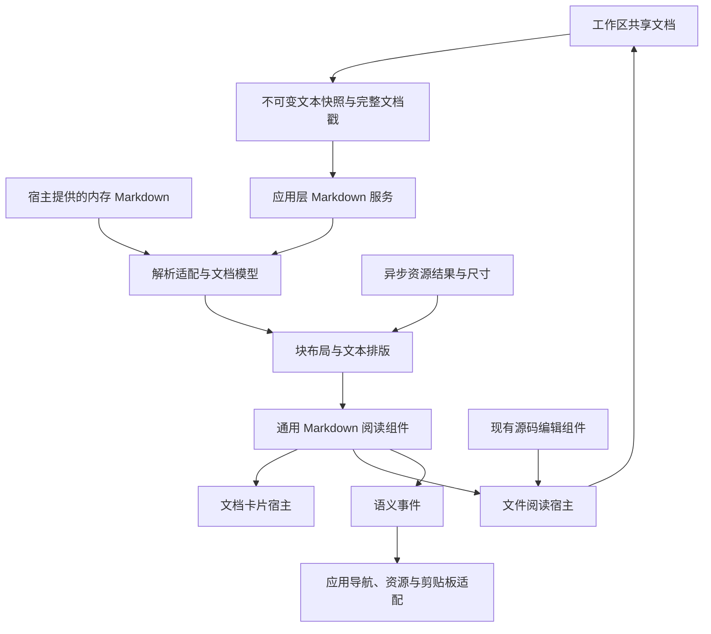

# Loom 通用 Markdown 文档能力：架构、设计与实施跟踪（临时）

- 创建日期：2026-10-23。
- 状态：P0–P5、24项任务均已完成；功能修复ea73b40已推送main，三平台构建/测试/打包及质量任务全部通过。最新验收见第23节R-MD014；第19–22节及R-MD011–013为历史阶段记录。
- 调研代码基线：`35ed36ad65c21f27c78f6eb3ea8abdf9de02e201`。
- 目标：建立可长期扩展和维护的 Markdown 文档能力，复用源码编辑、阅读界面、文档卡片与文档生命周期。
- 用途：本文件是本项工作的架构、设计、规划、实施和验收记录入口；临时指文档形态，不代表功能是临时实现。
- 状态入口：第 14 节任务表、第 15 节验证矩阵、第 16 节实施记录；最新结果见第 23 节；P0 收敛结果见第 19 节；P1 生产迁移见第 20 节。新增 MD-024 为 P2 前置，当前共 24 项任务。
- 关联设计：[语言服务设计](LANGUAGE_SERVICES_DESIGN.tmp.md)、[LSP 设计](LSP_DESIGN.tmp.md)。共享文档身份、版本和语言服务约定沿用这些设计及实际代码，不另外建立一套。

## 1. 目标与实施原则

### 1.1 长期目标

1. 同一个 Markdown 文档可以显示为源码、阅读预览，或在多个视图中同时显示；各视图共用文本、撤销历史、保存状态与文档服务。
2. 文件预览、Hover、补全详情、签名帮助和未来内嵌说明共用 Markdown 解析、排版与交互能力。
3. 编辑沿用现有编辑器；阅读组件可独立接收内存文本，不依赖文件、工作区或 LSP。
4. 新增语法、阅读样式或资源提供方式时，有明确的扩展位置和测试边界。
5. 中文、Unicode、未保存内容、异步更新、多视图和资源失败是基础场景。
6. 各阶段可交付、可验证；阶段划分不改变核心模型的长期方向。

### 1.2 实施原则

- 先确定文档/视图身份、源码映射、选择与阅读位置契约，再接文件预览。
- 状态有唯一所有者；派生结果、运行时服务与持久化 DTO 分开。
- 不为源码与预览创建两个可变文本副本，不为每个界面维护独立 Markdown 引擎。
- 优先形成项目内部清晰的模块边界；是否抽出独立 crate 由真实消费者和依赖隔离需求决定。
- 扩展点围绕资源解析、代码高亮和特殊节点等实际需求设置，不以完整插件框架作为启动条件。
- 本项工作不引入所见即所得编辑语义。未来如需支持，单列编辑模型和撤销事务设计。

## 2. 已核实的项目现状

本节记录调研基线，实施后的事实以任务和记录为准。

| 位置 | 当前能力 | 本项工作的接入方向 |
| --- | --- | --- |
| `crates/editor-core` | 文本、选择、变更记录、撤销、命令、Vim；无 GUI/I/O | 继续复用编辑算法，Markdown 语法和阅读状态留在外层 |
| `src/domain/workspace.rs` | 文档共享；文档内视图按 `PaneId` 索引；窗格标签使用 `FileId` | 引入独立视图身份，保留共享文档事务 |
| `src/domain/document.rs` | `DocumentStamp` 包含文档身份、生命周期、文本版本、快照身份、语言代次 | 后台请求和交付使用完整戳校验 |
| `src/features/markdown.rs` | 手写 Markdown 子集；最多读取 400 行，嵌套深度 6 | 统一解析适配、语法配置、预算与带源码范围的模型 |
| `src/ui/markdown.rs` | 排版、绘制、选择入口、链接、代码块横向滚动 | 扩展为通用阅读组件及排版能力 |
| `src/ui/editor/docs.rs` | 为 Hover、补全和签名帮助提供文档卡片适配 | 保留卡片样式与尺寸适配，共用新引擎 |
| `src/app/editor_view.rs`、`src/ui/editor_binding.rs` | 视图投影和语义事件回调 | 源码与阅读组件采用同类窄接口 |
| `src/app/runtime.rs`、`src/app/syntax.rs` | 服务生命周期、后台完成通知和版本校验 | 复用组织方式，增加 Markdown 服务 |
| `src/domain/workspace_session.rs` | 保存路径、标签顺序和窗格布局 | 增加视图类型、目标与阅读位置的稳定 DTO |
| `scripts/architecture/check.mjs`、`policy.json` | 分层依赖和状态所有权门禁；当前无遗留例外 | 为新增模块、依赖与状态登记规则和负向测试 |

具体缺口：

- 当前节点没有源码范围，不支持图片、表格、任务列表和删除线。
- 当前正文按空白分词，连续中文和超长词不能可靠折行；代码宽度采用字符数估算。
- 当前布局为整份内容生成文本元素，没有完整文件所需的布局预算与可见区域绘制。
- 当前文档链接入口仅打开 HTTP/HTTPS；相对文件、图片、锚点需要统一语义。
- 当前锁定的 lgui `scroll_view` 内部持有偏移，没有对外的受控滚动接口；`selection_region` 从已渲染节点收集文本。
- `OpenMode::Preview` / `Pane.preview` 表示单击产生的可替换标签，不表示 Markdown 阅读预览。两种概念必须分开命名。
- 文件编辑上限为 64 MiB；编辑上限不等于完整 Markdown 预览的性能承诺。
- `Cargo.toml` 中直接使用的 `image` 目前只启用 PNG。新增图片格式应核实完整加载链路及打包成本。
- 仓库 README 含 HTML、徽章、链接和图片，需要作为真实验收样本，同时明确 HTML 的支持范围。

## 3. 架构决策基线

下列决策是当前建议的实施基线，不表示相关代码已经完成。变更时更新理由、影响及对应任务。

| 编号 | 决策 | 理由及约束 |
| --- | --- | --- |
| D-MD01 | 文档 `FileId`、视图 `ViewId`、窗格 `PaneId` 分离 | 支持同一文档的多种呈现、同窗格多标签和独立阅读状态 |
| D-MD02 | Markdown 解析模型不依赖 GUI、工作区或 LSP | 文件和内存说明共用；服务由应用层适配身份 |
| D-MD03 | 采用成熟 CommonMark 解析器，通过适配层输出 Loom 节点；已选定 `pulldown-cmark =0.13.5`（P0 验证依赖） | 第三方事件和类型不泄漏到 UI/业务接口；已验证候选版本的语义、许可证与依赖；生产接入见 P2 |
| D-MD04 | 原生 lgui/Skia 阅读组件与现有源码编辑器组合 | 复用主题、文本系统、交互和打包方式 |
| D-MD05 | 源码范围、显示文本映射、逻辑选择与阅读锚点属于基础契约 | 为定位、长文档选择、同步滚动和恢复提供统一依据 |
| D-MD06 | 语法配置、工作预算、阅读样式和资源策略分开 | 卡片限制不再隐式作用于完整文件；更换样式不改变语法 |
| D-MD07 | 解析、排版和绘制分别缓存、分别失效 | 避免滚动重复解析、主题颜色变化重新解析等问题 |
| D-MD08 | 服务及可变缓存由运行时持有，AppState/视图帧只含纯数据或不可变结果 | 延续项目现有所有权和关停约束 |
| D-MD09 | 初期后台完整解析，结合未变化块的布局复用 | 引用链接、脚注等具有跨块依赖；后续增量解析必须证明一致性 |
| D-MD10 | 明确支持矩阵、预算和降级结果 | 超限或不支持的内容可观察，不静默丢弃文件后半部分 |
| D-MD11 | 先在 Loom 内实现受控阅读视口与逻辑选择 | 当前 lgui 组件不能直接覆盖完整需求；通用上游改动另行核实 |
| D-MD12 | 临时迁移适配有删除任务，不形成永久双实现 | 每个消费者迁移后移除旧入口；最终只有一个解析/渲染规则来源 |

解析器依据：[官方指南](https://pulldown-cmark.github.io/pulldown-cmark/)、[源码范围迭代接口](https://docs.rs/pulldown-cmark/latest/pulldown_cmark/struct.Parser.html#method.into_offset_iter)。文档支持的语法不等于 Loom 已实现的渲染能力。

## 4. 总体架构与模块边界



建议模块划分（名称在实施时可细化，职责边界保持）：

| 模块 | 职责 | 不能拥有 |
| --- | --- | --- |
| `domain::workspace` / 视图模型 | 文档、视图、窗格关系；文档关闭判定；可持久化的纯状态 | Markdown 解析器、GUI、文件系统和服务句柄 |
| `features::markdown` | 文档树、解析适配、语法规则、源码映射、标题索引、逻辑文本模型 | AppState、lgui、I/O、线程 |
| `ui::markdown` | 原生排版适配、阅读组件、受控视口、命中与选择呈现、样式 | AppContext、文件读取、网络、浏览器启动 |
| `app::markdown` / 文档宿主 | 视图投影、命令处理、请求与版本编排、保存和导航 | 第二份可变文档文本 |
| `infrastructure::markdown_worker` | 后台线程、合并请求、取消和结果传递 | UI 根状态和工作区编辑事务 |
| 资源适配模块 | 本地资源读取、网络与解码、缓存、资源变化观察 | 阅读组件内部的隐式服务访问 |

布局算法中纯几何和断行规则尽可能可无窗口测试；实际字体测量和文本绘制保留在 UI/文本系统适配层。后台排版必须先核实文本系统线程约束。

## 5. 文档、视图与窗格模型

### 5.1 身份与所有权

- `FileId` 继续标识工作区文档，不为本项工作统一重命名为另一套文档 ID。
- 新增 `ViewId` 标识一份视图实例；该身份由外层 domain 定义，不让编辑核心依赖 Markdown。
- 窗格的标签顺序、激活项和可替换标签使用视图身份。
- 文件视图引用一个 `FileId`；源码、Markdown 阅读等呈现类型是视图的属性。
- 一个文档只保留一份 TextBuffer、一份撤销历史、一份保存状态和一个文档服务生命周期。
- 源码选区按视图管理，编辑核心仍通过当前选区和 peer 选区执行共享编辑。
- 阅读选区独立于源码选区；阅读锚点通过文档变更记录更新。
- 设置页和 Diff 等现有特殊标签需要可表达的视图目标；先列出并测试其行为，再迁移标签模型，不增加伪文件来表示 Markdown 预览。

### 5.2 生命周期规则

1. 打开阅读视图时引用已打开文档，读取未保存缓冲区；没有文档时沿用异步文件打开流程。
2. 同一文档允许多个视图，视图有独立身份和状态。重复执行“侧边预览”的复用策略见 Q-MD01。
3. 关闭一个视图仅释放该视图；最后一个持有者释放文档时才进入文档关闭流程。
4. 关闭操作集合先计算会释放的文档，再按文档去重进行未保存确认，保留当前 `released_by` 一类行为的语义。
5. 保存按文档执行；任意关联视图能触发保存，不重复写盘或重复向 LSP 打开文档。
6. 移动标签保留视图身份；复制标签创建新身份并按策略复制初始位置。
7. 源码/阅读切换保持文档身份；两种模式的位置状态分别保留。切换时的视图身份策略在 MD-003 中固定并测试。
8. 文档关闭、重开、语言改变、路径改变和服务退出均有显式失效规则。

### 5.3 迁移范围

必须检查工作区索引、标签拖动/复制、焦点、IME 归属、导航历史、搜索跳转、Diff、关闭确认、异步加载占位、语言交互卡片和会话恢复。`ViewId` 的引入是完整事务链路的迁移，不只更改标签渲染类型。

## 6. Markdown 文档与解析契约

解析入口接收文本与明确选项，输出 Loom 的不可变 `MarkdownDocument`。至少包含：

- 语义节点与嵌套关系；段落、标题、代码、列表、表格、链接、图片等使用明确类型。
- 节点源码范围、显示文本片段与映射关系。
- 标题/锚点索引、链接与资源引用信息。
- 完整性和降级信息：完整、预算超限、资源待加载、不支持内容等应能区分。
- 解析选项及模型所对应的内容标识，由宿主/服务关联，不要求纯解析器依赖 `FileId`。

约定：

- 源码范围使用 UTF-8 字节的半开区间，保证字符边界，保留原始 CRLF 坐标。
- 解析器生成的源码范围是映射基础，不直接假设显示字符与源码字节一一对应。实体、转义、缩进剥离、换行规范化需可表达映射或块级回退。
- 节点 ID 在一次解析结果内有效；重新解析后不能用数组下标或字节范围充当永久身份。
- 标题锚点的规范化、重复标题消歧和中文处理必须有固定规则及语料测试；不未经验证宣称完全兼容 GitHub。
- 配置显式启用所需扩展，不使用第三方 `Options::all()` 随升级自动改变语言行为。
- 初期完整解析；任何局部重算必须考虑引用定义等全局依赖。
- 卡片的预算由调用配置决定；保留受限策略，但截断要可观察，避免静默复用当前 400 行限制。
- 不同来源内容按其真实格式处理；纯文本内容不应因统一入口而意外获得 Markdown 语义。

## 7. 排版、阅读视口与选择

### 7.1 排版

- 正文使用实际文本排版能力，正确处理中英文断行、字素、组合字符、Emoji、混合字体和超长词。
- 代码按实际字体/Tab 规则测量，保留原始空白；横向滚动属于代码块或表格局部状态。
- 行高、标题大小、列表缩进、块间距和颜色由阅读样式提供；不能把卡片常量固化在通用引擎中。
- 排版结果含块边界、文本命中信息、源码映射入口、内容尺寸和资源占位。
- 对超长段落、巨大表格及单个巨大代码块设置单块工作预算，避免“按块处理”仍被一个块阻塞。

### 7.2 受控视口与逻辑选择

- 阅读组件接收位置并发出滚动事件；使用稳定 `ViewId` 关联状态，切标签、调整布局和重渲染不丢位置。
- 可见区域绘制依赖布局索引；未精确排版内容可以估算高度，修正后保持当前阅读锚点。
- 逻辑选区存储在文档的显示文本坐标中，与本帧可见元素分离；复制从逻辑文本模型提取。
- 明确列表标记、表格分隔、图片替代文字和代码空白的复制规则，跨屏选择不能只复制已创建的文本节点。
- 选择、链接点击、局部横向滚动和外层纵向滚动有明确命中优先级；覆盖按下、拖动、释放及窗口外释放。
- 预览作为可聚焦阅读表面；复制、全选、翻页和文档首尾移动有独立键盘上下文。
- 预览中的键盘、粘贴和 IME 不得修改背后的源码缓冲区；返回源码时正确清理输入与焦点状态。

## 8. 实时更新、调度和缓存

### 8.1 请求与交付

- 首次打开立即请求；连续编辑合并为最新请求，防抖时间由基准确定并记录。
- 每个请求绑定完整文档戳、解析配置代次和必要的上下文代次；内存内容由宿主提供等价的身份/版本约定。
- 路径/基础地址影响资源解析，必须独立参与资源结果校验；不能只依赖 `DocumentStamp` 判断路径仍相同。
- 后台只持有不可变文本快照及必要配置，不保留撤销历史，不在 UI 状态锁内解析、解码或等待。
- 过期结果可作为缓存候选，但不能发布为当前结果；点击、跳转和定位必须匹配当前映射。
- 有新请求时取消或丢弃旧计算。需验证解析器首次预扫描的可取消程度；不能因存在取消标记就假定计算可随时中断。
- 服务关停后所有排队通知均失效，文档关闭重开后旧生命周期结果不能污染新文档。

### 8.2 缓存与失效

| 结果 | 主要键/失效条件 |
| --- | --- |
| 解析文档 | 内容身份与版本、生命周期、语法和解析配置代次 |
| 块布局 | 块语义内容、可用宽度、字体和度量代次、字号/行距、缩放约定、影响布局的资源尺寸 |
| 绘制样式 | 主题及阅读样式代次；纯颜色变化不触发解析 |
| 资源 | 规范化资源地址、基础地址/来源上下文、内容版本、解码选项和加载策略 |
| 代码高亮 | 代码内容和语言、语法资源代次；嵌入文本与原始源码间保留正确映射 |

- 以文档为单位共享解析结果；不同视图宽度可有不同布局。
- 缓存分别计量文本快照、解析节点、排版、图片和高亮的内存，设总预算与淘汰策略，避免多个有界缓存相加后无界。
- 不在每帧重新计算全文哈希。优先使用现有版本戳，块指纹在解析/更新阶段生成。
- 只绘制可见内容不等于工作量已受控；完整解析、首次布局、单块排版和选择提取都需测试。
- 超预算保持源码可编辑，显示明确的预览状态；禁止无提示遗漏正文。

## 9. 资源、链接与特殊内容

- 通用阅读组件只发出资源请求和导航意图，不直接读取文件、发网络请求或调用系统打开程序。
- 相对地址以明确的基础地址解析。文件内容默认以文件所在目录为基础；内存内容必须显式提供基础地址或返回无法解析。
- 将链接分类为文档内锚点、本地文档/文件、网页及不支持的协议；地址解析与实际打开分离。
- Windows 路径、URI 转义、含空格/中文路径、片段与查询部分分别测试，不能直接字符串拼接或执行链接内容。
- 本地图片异步加载，具有加载、失败、替代文字及尺寸占位；文件变化和路径变化能使资源失效。
- 远程资源默认策略见 Q-MD03；策略由宿主提供，文档不能自行开启额外能力。
- HTML 作为明确的内容类型处理，不沿用当前零散标签过滤作为完整规则。默认不执行 HTML/脚本；具体显示策略见 Q-MD02。
- 图片解码格式逐项声明并验证；SVG 的现有图标链路不自动等于任意文档 SVG 的完整支持。
- 代码高亮通过明确接口消费现有语法服务；不能因某文档有离屏代码块而无界加载所有语言。
- 数学公式、Mermaid 等保留特殊内容扩展位置；解析、渲染、资源消耗及加载策略分别验收后启用。

## 10. 应用界面与复用入口

- `MarkdownView`：接收已解析内容/布局、阅读样式、视图状态和语义事件的独立阅读组件。
- 文档宿主：组合已有源码编辑器与阅读组件，提供切换、侧边预览、保存、标题和状态展示。
- 文档卡片宿主：提供紧凑边距、尺寸、外观与受限资源策略，共用基础引擎。
- 事件至少覆盖打开链接、定位源码、阅读位置变化、选择变化、复制代码；实际 I/O 留在应用适配。
- 独立命令用于切换源码/阅读、侧边打开阅读视图和聚焦对应源码，加入可配置快捷键系统；具体默认键位在实现前检查冲突。
- 现有 Hover、补全和签名帮助的焦点行为应保留；文件阅读表面采用独立的可聚焦语义。
- 第一轮源码定位以块级准确为验收基线；精确行内定位和同步滚动单独跟踪。

## 11. 会话与配置

- 序列化稳定的视图目标、呈现类型、标签顺序、活动项、窗格布局和逻辑阅读位置。
- 不持久化运行时 `FileId`/`ViewId`、分配地址、解析树、布局缓存或服务句柄；恢复时重建身份与共享关系。
- 同一路径的多个恢复视图指向同一恢复文档，避免重复加载和独立脏状态。
- 异步恢复保留每个视图的位置与目标，加载失败不会误显示空文档或覆盖别的视图状态。
- 会话 schema 的升级策略必须在模型迁移前确定，见 Q-MD04；读写测试覆盖明确声明支持的格式。
- Markdown 配置按语法、阅读外观、预算、资源策略分别组织，使用项目现有设置模型与优先级。
- 配置变化产生明确代次，按第 8 节使对应结果失效；新字段在架构所有权表中登记。

## 12. 格式与能力支持矩阵

“规划阶段”是交付安排，不代表已经支持；每项以验证记录确认。

| 能力 | 规划阶段 | 验收/边界 |
| --- | --- | --- |
| CommonMark 常用块与行内格式 | P2 | 使用独立语料覆盖嵌套、引用、转义、实体及未闭合输入 |
| 表格、任务列表、删除线 | P2 | 解析和原生渲染均通过；任务框首版只读 |
| 本地图片 | P3 | 逐项声明格式；尺寸、替代文字、失败和变化可观察 |
| 网页、相对文件、文档锚点 | P3 | 统一地址规则、宿主导航、缺失目标处理 |
| HTML | P0 已定策略，P2/P3 实施 | 首版支持范围和降级样式明确；不承诺浏览器等价呈现 |
| 远程图片 | P3 策略落地 | 默认行为与显式加载入口由 Q-MD03 固定 |
| 代码块语法高亮 | P4 | 复用语言包与服务，按可见需求计算，未知语言保持可读 |
| 标题目录、双向定位、同步滚动 | P4 | 复用基础源码映射和阅读锚点，防止滚动反馈循环 |
| 数学、Mermaid、脚注等进一步能力 | P5 逐项评估 | 每项独立确定语义、渲染、预算和维护成本 |
| 所见即所得编辑 | 单列后续需求 | 本文件不定义其编辑事务和输入语义 |

## 13. 分阶段规划与交付门槛

| 阶段 | 交付内容 | 进入下一阶段的条件 |
| --- | --- | --- |
| P0 架构收敛与验证（已完成） | 公共契约、视图迁移清单、解析器/文字排版/选择/受控视口验证、会话策略和预算基准 | 核心方案有代码级证据；关键未决项有结论；后续任务可执行 |
| P1 文档与视图基础（已完成） | `ViewId`、标签/窗格/关闭/加载/焦点链路迁移，会话新模型 | 原有编辑、Diff、设置页、拖动和恢复回归通过；共享文档不变量成立 |
| P2 共享 Markdown 引擎（含 MD-024 前置） | 新解析模型、源码映射、排版、逻辑选择、受控视口；迁移已有文档卡片 | 两类宿主验证复用；旧卡片功能回归；旧解析/绘制入口有清理结论 |
| P3 文件阅读闭环 | 源码与预览切换/并存、实时更新、图片和导航、命令、配置、会话恢复 | 普通 MD 文件完整可用；异步竞态、长文档降级和资源失败可验证 |
| P4 阅读增强与性能 | 目录、定位、同步滚动、高亮、可见区绘制和性能完善 | 各增强任务有行为测试、基准和桌面目视证据 |
| P5 收尾与后续扩展 | 跨平台、用户文档、临时适配清理、扩展评估 | 当前范围验收完成，未交付能力明确登记；设计稳定后迁入正式文档 |

首次集成版本可以只交付 P0–P3，但源码映射、受控视口、逻辑选择和预算机制属于其基础工作。优化参数和增强功能可以继续迭代。

## 14. 实现跟踪

状态：`待开始`、`进行中`、`待验证`、`受阻`、`完成`、`取消`。编号永久保留；取消或拆分必须注明替代任务。完成需要实现记录和验证证据，文档中写出方案不等于实现完成。

| ID | 阶段 | 工作项 | 主要完成条件 | 状态 | 证据 |
| --- | --- | --- | --- | --- | --- |
| MD-001 | P0 | 项目调研与初始架构记录 | 现状、边界及基础检查可追溯 | 完成 | R-MD001 |
| MD-002 | P0 | 公共接口、状态所有权和门禁设计 | 类型草图、依赖图、负向规则及扩展边界明确 | 完成 | R-MD002 / 第 19 节 |
| MD-003 | P0 | 视图身份及迁移清单 | 明确切换/复制/移动、特殊标签、IME、关闭和导航行为 | 完成 | R-MD003 / 第 19 节 |
| MD-004 | P0 | 解析器与源码映射验证 | 固定候选版本；真实/边界语料与资源成本有结果 | 完成 | R-MD004 / 第 19 节 |
| MD-005 | P0 | 中文排版、受控视口与逻辑选择验证 | 无空格中文、混合样式、跨屏选择和重排位置稳定 | 完成 | R-MD005 / 第 19 节 |
| MD-006 | P0 | 预算基准、会话策略和首版支持范围 | Q-MD02–05 有结论；指标环境和阈值记录 | 完成 | R-MD006 / 第 19 节 |
| MD-007 | P1 | 文档/视图/窗格模型迁移 | 同文档同窗格多视图；无重复文本和服务 | 完成 | R-MD007 / 第 20 节 |
| MD-008 | P1 | 标签、拖动、关闭、加载与焦点迁移 | 原有行为回归；关闭确认按文档去重 | 完成 | R-MD008 / 第 20 节 |
| MD-009 | P1 | 会话 DTO、共享关系及异步恢复 | 视图与文档正确重建；格式策略测试通过 | 完成 | R-MD009 / 第 20 节 |
| MD-010 | P2 | Markdown 文档模型与解析适配 | 稳定内部类型、显式扩展、源码范围和降级结果 | 完成 | R-MD014 / 第 23 节；最终生产回归与三平台CI |
| MD-011 | P2 | 正文/代码/列表/表格等排版 | 中文、Tab、Emoji、长词及单块预算通过 | 完成 | R-MD014 / 第 23 节；最终生产回归与三平台CI |
| MD-012 | P2 | 受控阅读组件与逻辑选择 | 跨屏复制、键盘、命中、稳定身份和重排正确 | 完成 | R-MD014 / 第 23 节；最终生产回归与三平台CI |
| MD-013 | P2 | 后台服务、缓存及失效 | 最新请求优先、版本校验、关停和总内存预算验证 | 完成 | R-MD014 / 第 23 节；最终生产回归与三平台CI |
| MD-014 | P2 | Hover/补全/签名卡片迁移 | 原有选择/复制/链接/尺寸/焦点回归，清理旧链路 | 完成 | R-MD014 / 第 23 节；最终生产回归与三平台CI |
| MD-015 | P3 | 文档宿主、切换和侧边预览 | 当前缓冲区实时显示；多视图独立状态 | 完成 | R-MD014 / 第 23 节；最终生产回归与三平台CI |
| MD-016 | P3 | 资源、图片、链接与 HTML 策略 | 基础地址、失败状态、文件变化和协议行为明确 | 完成 | R-MD014 / 第 23 节；最终生产回归与三平台CI |
| MD-017 | P3 | 命令、快捷键、设置与会话接入 | 阅读焦点下无误编辑；保存/关闭/恢复正确 | 完成 | R-MD014 / 第 23 节；最终生产回归与三平台CI |
| MD-018 | P3 | 文件阅读集成验收 | 真实 README/文档、编辑竞态、降级和资源场景通过 | 完成 | R-MD014 / 第 23 节；最终生产回归与三平台CI |
| MD-019 | P4 | 目录、定位与同步滚动 | 源码范围匹配，重排稳定，无反馈循环 | 完成 | R-MD014 / 第 23 节；最终生产回归与三平台CI |
| MD-020 | P4 | 代码高亮与可见需求调度 | 语言资源按需、映射正确、未知语言可读 | 完成 | R-MD014 / 第 23 节；最终生产回归与三平台CI |
| MD-021 | P4 | 长文档、可见区绘制与基准完善 | 跨屏选择不回退，单块/总预算和延迟达标 | 完成 | R-MD014 / 第 23 节；最终生产回归与三平台CI |
| MD-022 | P5 | 跨平台和打包验证 | Windows/macOS/Linux 对应证据分别记录 | 完成 | R-MD014；三平台发布打包、原生/UI证据及pin工具链通过 |
| MD-023 | P5 | 旧接口清理、用户文档与正式设计归档 | 临时适配清零；支持矩阵与实际能力一致 | 完成 | R-MD014 / 第 23 节；最终生产回归与三平台CI |
| MD-024 | P2 | lgui 有样式段落及按范围几何接口 | 度量/绘制同源，行摘要与可见范围几何分离；是 MD-011/012 前置 | 完成 | R-MD014 / 第 23 节；最终生产回归与三平台CI |

## 15. 验证与完成判据

### 15.1 必须保持的不变量

- 一个文档只有一份可变文本、撤销历史和脏状态；多个视图不重复文档服务生命周期。
- 保存写入完整文档；关闭确认按将被释放的文档计算。
- 阅读视图不会接收源码编辑输入；源码 IME 不因焦点切换落到错误视图。
- 当前交互只使用当前文档版本的映射；旧后台结果无法复活已关闭内容。
- 滚动不触发全文重新解析；纯颜色变化不触发语法解析。
- 未显示内容仍可被逻辑选区覆盖；复制结果不依赖当前屏幕节点。
- 超限、格式不支持和资源失败可区分；正文不会静默截断。
- UI 和纯功能层不直接取得 I/O、线程或应用根状态能力。

### 15.2 验证矩阵

| 编号 | 场景 | 核心断言 | 当前状态 |
| --- | --- | --- | --- |
| V-MD01 | CommonMark 与扩展语料 | 独立固定预期；不使用同一实现生成测试答案 | 通过：生产固定语料、显式扩展、PlainText/HTML、映射及预算测试；不宣称全套 CommonMark 规范逐例审计 |
| V-MD02 | 超过 400 行、中文、CRLF、组合字符、Emoji | 内容完整、范围合法、正确断行和复制 | 通过：600 段跨屏全文复制、中文/CRLF/组合字符/Emoji、原生 UTF-16 几何与 Tab；生产截图已目视 |
| V-MD03 | 同文档多源码/阅读视图及同窗格多标签 | 共享文本/历史，独立状态与焦点 | 通过：生产多视图共享文本/历史、独立位置、阅读只读及显式关联生命周期 |
| V-MD04 | 编辑、撤销、重做、保存、重命名和外部重载 | 当前缓冲区预览一致，正确失效和恢复 | 通过：生产核心编辑/undo/redo/保存/重命名/重载；当前缓冲区重解析与过期帧拒绝 |
| V-MD05 | 旧结果晚到、关闭重开、关停后回调 | 旧生命周期/配置/路径结果不发布 | 通过：共享结果/租约、最新请求、旧回调、非阻塞关停及换帧释放竞态 |
| V-MD06 | 跨屏选择、链接拖动、局部滚动和释放 | 选区/复制稳定，命中与滚动无冲突 | 通过：逻辑全文复制、纯 reducer 链接/拖动、持续拖选及旧帧释放；真实 UiSession 输入回归 |
| V-MD07 | 窗口缩放、字体改变、图片迟到、主题改变 | 锚点稳定，仅必要层失效 | 通过：源锚点重排、宽度/字体/主题键、图片尺寸迟到重排及过期几何窗口限制 |
| V-MD08 | 相对地址、中文/空格路径、锚点、资源失败 | 地址规则和宿主行为一致，有明确状态 | 通过：UTF-8 百分号/路径/片段，PNG/JPEG/尺寸/失败资源恢复与租约；远程默认关闭 |
| V-MD09 | 标签拖动/复制、Diff/设置页、搜索和导航 | `ViewId` 迁移保留既有行为 | 通过：ViewId 标签移动/复制/特殊项与原有搜索、导航、编辑器、终端回归 |
| V-MD10 | 恢复多个视图、文件缺失、加载中退出 | 共享关系和状态正确，失败不覆盖其他目标 | 通过：schema 2/旧 fixture/重复路径共享恢复/失败保留/原子替换和关联复用 |
| V-MD11 | 普通/大文档、长段落、巨大表格/代码和图片 | 测量首次可读、更新延迟、帧耗时和峰值内存 | 通过：明确单块降级、常驻预算租约；最终release p95为107.43/177.17/4.03ms，Windows进程工作集峰值约109.5MiB，范围见R-MD014 |
| V-MD12 | Windows/macOS/Linux、打包资源和真实界面 | 各平台单独记录构建、交互和目视证据 | 通过：Windows/macOS/Linux分别构建、测试、原生离屏截图和发布打包；CI 39954372874最终成功（attempt 2） |
| V-MD13 | 架构依赖与状态所有权 | 门禁允许正确方向，负向测试拒绝能力泄漏 | 通过：74 项架构门禁测试；415 源文件，16 根/27 editor/15 workspace 字段，0 临时例外 |

性能阈值不能从编辑器的文件上限推导。P0 固定机器、构建模式、样本字节/行/块/图片数量和统计方法，再登记首次可读时间、编辑到预览延迟、滚动帧耗时、取消/关停耗时及各类内存预算。

按变更范围运行有意义的验证，包含相关纯功能测试、`cargo test --locked -p loom-editor-core`、`cargo test --locked -p loom-workspace-tests`、应用集成测试，以及项目标准格式/Clippy/架构检查。完整命令和结果写入实施记录；未运行的检查明确列出。

## 16. 实施与验证记录

### R-MD001 — 2026-10-23：项目调研与设计基线

- 核对代码：`35ed36ad65c21f27c78f6eb3ea8abdf9de02e201`；调研时工作区干净。
- 已检查：现有 Markdown 解析/排版/卡片、共享文档与窗格、编辑器 Binding、文档戳、后台服务模式、快捷键、会话 DTO、架构门禁，以及锁定 lgui 版本的滚动、选择和文本排版接口。
- 已验证：`node scripts/architecture/check.mjs` 通过，393 个源码文件；`node --test scripts/architecture/check.test.mjs` 64 项通过。
- 本轮产物：根目录本临时文档，包含长期架构、设计、任务及验收入口。
- 尚未进行：Markdown 功能实现、Rust 编译/应用测试、GUI 运行验证和跨平台验证。
- 完成范围：仅 MD-001。D-MD 系列为拟定设计基线，其余任务尚未开始。

### R-MD002 — 2026-10-23：公共契约、所有权及架构门禁

- 任务：MD-002；生产代码基线仍为 `35ed36a`，本轮修改未提交。
- 产物：第 19.1/19.2 节类型和所有权契约；`scripts/architecture/check.mjs` 新规则及 `markdown.test.mjs` 负向测试；独立验证 workspace，不进入主依赖图。
- 决策：解析器类型只在适配层可见，纯语法层拒绝 FileId/ViewId/DocumentStamp，阅读界面通过值帧和语义事件协作；继续在内部模块实施。
- 验证：现有 64 项门禁测试及首批 5 项 Markdown 门禁测试已通过；补充 host 禁止导入原型的规则后，70 项架构/Markdown 门禁测试及 3 项关联测试全部通过。
- 修复记录：首次门禁脚本插入匹配到重复位置，负向测试暴露作用域错误；已移除误插入，现有测试恢复通过。
- 未完成的产品工作：生产模块/状态字段尚未新增；P1/P2 新字段需要继续登记所有者。

### R-MD003 — 2026-10-23：视图迁移、生命周期及会话契约

- 任务：MD-003；产物为第 19.3/19.6 节迁移清单及 `contracts.rs`、`session.rs` 原型。
- 决策：切换保留 ViewId、复制新建、移动保留；预览持有文档；Builtin/Diff 保持唯一性。关闭集合按最终释放文档去重。
- 验证：同窗格同文档多视图、独立位置、特殊标签不可复制、关闭去重契约通过；使用实际 editor-core 的 EditorMut 验证 peer 选区变化和跨源视图撤销/重做。
- 会话验证：现有 `session-split.json` 的顺序/树/活动项、schema 2 同路径两种视图往返、坏 v2 不回退为旧格式、未知 schema 显式失败均通过。
- 修复记录：原型首次尝试直接使用 buffer 私有编辑入口，编译检查发现后改用正式 EditorMut API；未放宽 editor-core 可见性。
- 边界：这不是实际工作区迁移完成；完整 DTO 校验、IME/焦点/导航及异步恢复由 MD-007–009 验收。

### R-MD004 — 2026-10-23：解析器与源码映射选型

- 任务：MD-004；固定 `pulldown-cmark 0.13.5`，default-features=false；MIT，包声明最低 Rust 1.71.1。现有主工程依赖未改变。
- 产物：`parser.rs` 的格式入口、显式语法开关、范围映射和预算返回值；独立 Cargo.lock。
- 验证：CommonMark 常见格式及三项扩展、真实 README/Editing 文档、超过 400 行、引用定义影响前文、HTML/图片替代文字、CRLF/实体/转义/代码归一化范围及 PlainText 字面语义通过。
- 结论：三种映射关系明确；不能把规范化内容的显示字节直接当源码偏移。HTML 首版保留为字面内容。LSP 格式丢失列入 MD-014。
- 限制：上游构造阶段不可通过公共 API 中断，事件/深度限额不能约束全部构造成本；保留字节准入、最新请求合并和交付失效。

### R-MD005 — 2026-10-23：原生排版、阅读状态与图片验证

- 任务：MD-005；产物为 `reading.rs`、`native.rs`、原生 JSON 和 PNG。
- 已验证：原生无空格中文折行，混合样式影响布局，字节/scalar 转换、组合字符/Emoji 命中，跨屏逻辑复制，视口重排和图片高度变化保持块内进度，真实变更记录更新源码锚点。
- 已验证：新线程默认无文本服务，显式安装后可原生布局；PNG/JPEG 小图解码及 decoder 尺寸限制通过。
- 性能观察：55,062 字节混排文本，全量 portable 几何 median/p95 248.53/252.97 ms；只塑形和行摘要 27.17/29.22 ms。配置和采样见原生 JSON。
- 结论：新增 MD-024 作为 P2 前置，补有样式段落场景以及行摘要/可见范围几何分离契约；不能直接把当前排版函数套在完整文件上。
- 目视：已检查原生 PNG 的中文、粗体/链接色、斜体及混排。富文本部分是同版本 Skia 的直接栅格证据；实际 lgui 富文本场景尚未接入。
- 边界：桌面焦点、选择手势、IME、可访问性及跨平台验证仍未完成。

### R-MD006 — 2026-10-23：预算、CI 与 P0 完成复核

- 任务：MD-006；第 19.6/19.7 节固定首版 HTML、资源、会话、图片格式、准入/事件/深度/布局/缓存预算及后续产品指标。
- 基准：release，预热 2 次/采样 9 次。约 512 KiB 密集文档 median/p95 6.70/8.15 ms、额外 Rust 峰值 9,896,160 bytes；约 2 MiB 为 27.46/31.73 ms、39,583,968 bytes；8 MiB 诊断样本 105.19/118.10 ms、158,335,584 bytes。
- 异常形状：256 KiB 未闭合方括号生成 262,146 事件，未设预算时额外峰值 50,866,208 bytes；10 万事件预算能显式停止投影，但峰值仍为 34,744,352 bytes，证明前置构造不受事件限额硬约束。
- CI：已登记无 GUI 纯契约测试、Markdown 架构测试及构建矩阵的原生测试；远端尚未运行，不宣称跨平台通过。
- 最终复核：24 项纯契约测试通过；启用 native-text 后共 31 项测试通过（包含上述纯测试）；架构/Markdown 门禁 70 项及关联 3 项共 73 项通过；现有 editor-core 75 项单元 + 3 项 host contract、workspace domain 59 项共 137 项通过。Clippy（native-text/all-targets，-D warnings）、主工程及原型格式检查、隔离/证据检查、git diff --check 均通过。
- 已执行命令（工作目录为仓库根，CARGO_TARGET_DIR 指向仓库 target）：

  ```sh
  cargo test --locked --offline -p loom-editor-core -p loom-workspace-tests --quiet
  cargo test --manifest-path tests/markdown-p0/Cargo.toml --locked --offline --quiet
  node scripts/build/cargo.mjs test --manifest-path tests/markdown-p0/Cargo.toml --locked --offline --features native-text --quiet -- --test-threads=1
  node scripts/build/cargo.mjs clippy --manifest-path tests/markdown-p0/Cargo.toml --locked --offline --features native-text --all-targets -- -D warnings
  node --test scripts/architecture/check.test.mjs scripts/architecture/markdown.test.mjs scripts/architecture/standalone-host.test.mjs scripts/architecture/language-resources.test.mjs
  node scripts/architecture/check.mjs
  node tests/markdown-p0/check.mjs
  cargo fmt --all -- --check
  cargo fmt --manifest-path tests/markdown-p0/Cargo.toml -- --check
  git diff --check
  ```

- 结论：MD-001–006 完成，P0 交付门槛满足。没有将 P1 迁移、MD-024 上游/适配改动或产品完整验收标为完成。
- 环境边界：本地实际工具链为 Rust/Cargo 1.98.0；仓库 pin 的 1.97.1、远端 CI、Linux/macOS 和完整 GUI 尚未验证。CI 已登记对应测试；后续结果在 MD-022/P1/P2 记录。主应用 Cargo.toml/Cargo.lock 和生产 Rust 文件未修改。

### R-MD007 — 2026-10-23：生产文档、视图及窗格迁移

- 基线：沿用 `35ed36a` 与本地 P0 未提交改动；本轮工作未提交。生产模块已迁移，不再只以 P0 原型作为证据。
- 实际改动：文本表只保留 `FileId -> OpenDocument`；独立 `ViewId -> DocumentView` 和 `DiffId -> DiffRecord`。窗格标签、活动项和临时预览槽均存 ViewId；Builtin 以类型目标表示，不创建空文本缓冲区。
- 多视图：支持同窗格同文档多个 Source/Markdown 视图，文本、保存基线、脏状态、撤销历史与文档服务快照唯一；选区、源码滚动、阅读锚点分别保存。复制创建身份、移动保留身份、切换保留身份并更新输入代次。
- 深入复核：曾采用编辑结束后读取有限修订日志映射锚点的实现；发现长宏可能超出日志容量后，已删除该中间实现。现在 `EditorMut::with_anchors` 在每个 ChangeSet、undo/redo 回放中同步维护锚点，160 次分组编辑的回归覆盖该边界。
- 状态所有权：新增 views/diffs/next_view_id/next_diff_id 已登记 `workspace_core_ownership`；view 模块持有纯视图类型，workspace 单向使用；editor-core 只接收不透明身份和纯编辑锚点。
- 验证状态：同窗格多视图、Unicode/CRLF 共享编辑和撤销、切换位置保持、移动不合并、重载校正、占位安装保留 incarnation、多轮生命周期索引一致性测试已接入；最终结果统一记录 R-MD009。

### R-MD008 — 2026-10-23：标签与输入调用链迁移

- 实际改动：标签绘制/菜单/拖动、关闭请求、Explorer/搜索/导航、异步打开、Git Diff、状态栏、源码 Binding、IME、Vim、补全、代码片段和语言服务交互均已区分 ViewId 与 FileId。
- 关闭确认仍按最终释放的 FileId 去重；关闭一个视图不会释放其他视图持有的文档；文档路径/文档戳及服务仍以 FileId 为轴。程序性多文档编辑使用显式文档入口，阅读视图不获得可编辑 EditorMut。
- 过期保护：呈现切换递增 input_generation；Binding、IME、异步打开和语言服务操作检查视图/代次。IME 提交跟随原 ViewId 的当前窗格；Vim 以具名 ViewKey 区分 pane/document/view/input_generation，文档 marks 保持共享。
- 按 P0 固定的特殊项唯一性：Diff 的显式跨窗格投放移动既有视图，不再创建相同 Diff 的第二份；Builtin/Diff 不允许普通文件式复制。相应旧测试改为验证新的唯一性约定。
- 首轮完整回归暴露并修复：源码输入保护误拦 Diff 滚动条；旧断言仍将分屏标签当成同一个 ID。修复后完整回归一轮 1456 项通过、25 项既有跳过；随后又补长宏锚点与 Vim 代次测试，须以最终复验为交付结果。
- 范围：当前只交付 P1 基础；没有增加 Markdown 阅读器或切换命令的产品入口。模型中的 Markdown 视图路由到非编辑空表面，P2/P3 再接阅读画面与操作。

### R-MD009 — 2026-10-23：会话版本升级、恢复与最终复验

- 生产 EditorLayout 写入 schema 2：每个标签为有 kind 的文本视图记录，保存路径、呈现方式、Source 选区/滚动和 Reader 源码锚点/块内进度；活动项改为序号，允许重复路径，不序列化运行时 ID。
- 冻结 LegacyLayout/LegacyNode 只用于读取旧无版本格式；禁止坏 v2/未知 schema 回退。校验活动索引、分割尺寸/总量、树深度、节点/视图数量、未知类型、路径及非负有限位置；写入前也校验。
- 启动报告读入失败，后续任何会话更新重新执行受检读取；无效/未来版本文件返回 InvalidData 并逐字保留。保留原有临时文件写入、sync_all 和 rename 的原子替换路径。
- 异步恢复按路径建立一个 FileId 和一次准备任务，逐条重建独立 ViewId；占位填充保持 incarnation、顺序、焦点及各视图位置，文件缺失仍按现有行为跳过。旧真实 fixture 与现有恢复测试保留，并新增重复路径 Source/Markdown 的生产集成测试。
- 最终复验通过：完整工作区 1460 项通过、0 失败、25 项既有忽略。分项为主应用 1312、editor-core 单元 75、外部 host contract 3、独立 workspace domain 70；同一生产 domain 在主应用和隔离验证 crate 中分别编译执行，数量按 Cargo 实际运行实例统计。
- 新增 17 个具名 P1 行为测试：8 个视图/生命周期/锚点不变量、3 个会话规则、2 个应用会话集成、2 个 IME、1 个 Vim、1 个异步加载；其中 11 个纯领域测试同时在独立 workspace-tests crate 中执行。旧编辑、Diff、设置页、标签拖动、搜索、导航、语言服务、原子保存及恢复测试均保留。
- 其他检查：P0 native-text 31 项通过；架构/Markdown/关联门禁共 73 项通过；生产架构门禁通过（395 源文件，16 root / 25 editor / 15 workspace 字段，0 legacy 例外）；主工程格式检查、P0 隔离/证据检查及 git diff --check 通过。
- Clippy：全 workspace/all-targets 按仓库 CI 参数通过，未新增 lint 放宽项。一次直接仅带 -D warnings 的试跑报告仓库已有白名单覆盖的警告；后续使用 CI 原有 5 项 -A 参数。新增复杂 tuple/冗余借用已改为具名结构与显式引用后通过。
- 环境：本地 Rust/Cargo 1.98.0、Windows x64、离线依赖缓存。25 项忽略为已有人工视觉/性能、真实语言服务器及外部资源安装等测试，并未在本轮临时跳过失败测试。远端 CI、pin 的 1.97.1、Linux/macOS 和人工桌面端到端体验未运行，继续保留后续验证范围。
- 结论：MD-007、MD-008、MD-009 完成；P1 交付门槛满足。Markdown 产品渲染、切换/关联预览命令、资源服务、阅读交互与可访问性仍由 P2/P3 等任务负责。
- 最终验证命令（仓库根目录；原生依赖由现有 wrapper 准备）：

  ```sh
  node scripts/build/cargo.mjs test --locked --offline --workspace -- --test-threads=1
  node scripts/build/cargo.mjs clippy --locked --offline --workspace --all-targets -- -D warnings -A clippy::redundant_closure_call -A clippy::collapsible_if -A clippy::too_many_arguments -A clippy::let_and_return -A clippy::manual_div_ceil
  node scripts/build/cargo.mjs test --manifest-path tests/markdown-p0/Cargo.toml --target-dir target --locked --offline --features native-text --quiet -- --test-threads=1
  node --test scripts/architecture/check.test.mjs scripts/architecture/markdown.test.mjs scripts/architecture/standalone-host.test.mjs scripts/architecture/language-resources.test.mjs
  node scripts/architecture/check.mjs
  node tests/markdown-p0/check.mjs
  cargo fmt --all -- --check
  git diff --check
  ```

### R-MD010 — 2026-10-23：P2 实现优先的换机检查点（未验证）

- 用户明确要求先实现、暂不验证，以便切换机器前推进更多。本轮未运行 cargo check/test/clippy、架构测试、diff 检查或 GUI；只做实现与格式整理。R-MD009 的通过数字是上一轮 P1 的历史证据，不能据此宣称当前新增 P2 工作区已通过。
- MD-010：新增 production model/parser。平面 arena、明确块/行内类型、表格/任务/删除线开关、PlainText 格式、规范化复制文本、Exact/Transformed/Synthetic 映射、标题索引、字面 HTML、预算/取消/完整降级结果均已写入；只在 parser.rs 引入 pulldown-cmark。主工程固定 =0.13.5，关闭默认 features；锁条目沿用 P0 的版本/checksum，并未进行依赖解析复核。
- MD-011/024：新增 ParagraphBackend 的完整段落请求、行摘要/按 scalar 范围几何分离、UTF-8/scalar/UTF-16 段落索引及字体/宽度/缩放输入。结构排版包括正文、标题、代码、引用、列表和表格；整段塑形委托后端，不再按词绘制。还没有 lgui 原生有样式段落绘制/几何后端，不能宣称富文本预览已可用。
- MD-012：新增逻辑选区、带源码变更回调的选区重定位、可见盒范围、源码锚点重排恢复、协议分类。受控 UI 组件接受不可变帧、可见字素几何和绘制端口，发出指针/滚动/复制/键盘语义事件，不注册文本输入/IME；选择覆盖只画可见几何，复制基于完整逻辑文本。实际宿主 reducer、块内横向滚动、自动滚动及可访问性尚需补齐。
- MD-013：新增单线程解析 worker；原子替换多视图需求，按完整 key 去重，首轮立即、后续 80 ms 合并且保留 250 ms 最长等待窗口；每源一个在途和最新等待结果；过期请求取消、交付校验、LRU 淘汰、显式预算失败和非阻塞关停。文档以 DocumentStamp 标识，Markup 预留独立 owner/revision，避免与源代码快照或其他卡片串缓存。
- 缓存基础：统一父预算 128 MiB、parse/layout/image 子上限 32/32/64 MiB，解析单结果 16 MiB；Publication 持有租约，宿主必须随帧保留 Publication，不能只克隆内部文档后丢弃租约。布局/图片缓存的租约接线尚未完成；上游临时解析堆并非硬内存限制。
- 运行时接线：AppRuntime 持有服务，AppContext 文档更新和 shell 投影同步解析需求，结果通过 LatestNotification 校验当前文档戳后只递增 markdown_revision；根状态只新增整数失效代次，所有权登记同步更新。超大自动预览在构造快照前拒绝。
- 兼容边界：现有卡片 parse/layout 入口保留，未做 MD-014 的半程替换；未增加产品菜单/切换命令，文件 Markdown 表面仍未挂接新绘制组件。现有 lgui pin 不变，没有修改缓存中的依赖源码。
- 接续：见第 21 节；本轮任务状态使用“待验证/进行中”，没有将 P2 或其余功能标为完成。

后续记录统一包含：日期、任务编号、代码基线/提交、实际改动、设计变化及理由、运行的验证与结果、未验证项、剩余任务。失败和推迟验证保留记录，后续补充关联结果，不覆盖历史事实。

## 17. 问题收敛与后续策略

P0 已按用户授权收敛以下策略，详细契约见第 19 节。后续如需变更，在对应决策、任务和实施记录中说明影响。

| 编号 | 问题 | 当前结论 | 决策证据 |
| --- | --- | --- | --- |
| Q-MD01 | 重复执行侧边预览是复用还是新建？ | 已定：优先复用显式关联阅读视图；复制创建新身份；不自动跟随其他文件 | R-MD003 / 19.3 |
| Q-MD02 | 首版 HTML 如何显示？ | 已定：完整保留字面 HTML，块级原文块、行内字面文本；不执行或静默删除 | R-MD004 / 19.6 |
| Q-MD03 | 远程图片默认是否加载？ | 已定：默认不自动联网，宿主提供显式加载入口和上下文策略 | R-MD006 / 19.6 |
| Q-MD04 | 会话格式升级是否读取旧格式？ | 已定：schema 2；旧无版本格式单入口只读转换，只写 v2；坏/未知版本不回退覆盖 | R-MD003 / 19.6 |
| Q-MD05 | 预览预算与性能目标是多少？ | 已定首期参数：自动 512 KiB/10 万事件，显式 2 MiB/20 万事件；深度、输出、原生段落和总缓存分别约束 | R-MD006 / 19.7 |
| Q-MD06 | 首版图片格式支持哪些？ | 已定：P3 首批 PNG/JPEG，解码与尺寸限制已验证；SVG 明确降级，单列后续 | R-MD005 / 19.6 |
| Q-MD07 | 是否抽出独立 Markdown crate？ | 已定：当前保留内部模块，独立验证 workspace；出现真实外部消费者后评估抽取 | R-MD002 / 19.2 |

## 18. 文档维护规则

1. 每轮实施开始时更新任务状态；结束时补记录、验证和未完成项。
2. 架构变化先更新 D-MD 决策和受影响章节，再更新任务/验收矩阵，保留变更理由。
3. 新增任务使用新编号；已完成、取消或拆分任务保持可追溯。
4. “实现完成”“测试通过”“桌面目视通过”“跨平台通过”分别记录，不能相互替代。
5. 阶段完成要求其任务、相关不变量及验收均有证据；推迟项明确移入后续任务，不能从清单中删除。
6. 设计稳定后把架构、用户说明和测试约定迁入正式文档，本文件保留历史入口或通过明确归档任务移除。

## 19. P0 收敛结果与后续实施契约（2026-10-23）

本节细化第 3–11 节的设计基线。证据位于 [独立验证工程](tests/markdown-p0/README.md)；原型只供契约和技术验证，应用尚未接入新视图或新解析器。P0 完成不代表 V-MD 全部产品验收完成。

### 19.1 公共数据与坐标契约

以下为生产接口的类型草图，字段可细化，所属层及坐标含义不得隐式改变：

```rust
// domain：不依赖 Markdown AST、GUI 或服务。
struct ViewId(u64);
enum ViewTarget { Text(FileId), Diff(DiffId), Builtin(AppPage) }
enum Presentation { Source, Markdown }
struct DocumentView {
    id: ViewId,
    target: ViewTarget,
    presentation: Presentation,
    source: SourceViewState,
    reader: ReaderPosition,
}
struct ReaderPosition { source_byte: usize, block_fraction: f32 }

// features::markdown：解析模型；不引用上述工作区身份。
enum ContentFormat { PlainText, Markdown }
struct SourceByte(usize);
struct DisplayByte(usize);
enum MappingKind { Exact, Transformed, Synthetic }
struct MappingSegment {
    display: Range<DisplayByte>,
    source: Range<SourceByte>,
    kind: MappingKind,
}
struct MarkdownDocument {
    nodes: Vec<Node>,             // 有界 arena；节点 ID 只在本结果内有效
    display_text: String,         // 逻辑阅读/复制文本，不是已渲染节点的集合
    mapping: Vec<MappingSegment>,
    headings: Vec<Heading>,
    diagnostics: Vec<Diagnostic>,
}

// app：身份、生命周期、配置及资源上下文的结果信封。
struct ParseKey { stamp: DocumentStamp, parse_generation: u64 }
struct ResourceKey { parse: ParseKey, base_generation: u64, policy_generation: u64 }

// ui：不可变帧和语义事件，不携带 AppContext/服务。
struct ReaderFrame { /* document, revision, viewport, selection, style, assets */ }
enum ReaderEvent { /* Scroll, Select, OpenLink, RevealSource, CopyCode */ }
```

- 运行时采用现有 `DocumentStamp`，原型中的简化 ResultKey 不进入生产，也不形成第二套文档戳。
- 源码/逻辑阅读使用 UTF-8 字节偏移；lgui 的 `TextSpan`、命中、行和光标范围使用 Unicode scalar 索引；Skia 底层查询还涉及 UTF-16。转换集中在文本适配层，使用段落级有界索引，禁止把整数直接混用或每次命中扫描全文。
- Exact 才允许字节对应。实体、转义、CRLF、代码缩进及代码跨度归一化使用 Transformed，映射到整段事件范围，初版定位可回退到块范围；不能伪造逐字精确位置。
- Synthetic 用于列表标记、表格分隔和布局分隔，其源码映射是邻近合法锚点。生产复制规则：普通段落软换行为空格、硬换行为 LF；无序列表使用 •、有序列表保留编号、任务状态保留 [ ]/[x]；表格列以 TAB 分隔且末列不追加 TAB，行以 LF 分隔；图片使用替代文字；代码保留原始空白；HTML 保留字面文本。P0 平面投影只验证映射可行性，完整规范化复制由 P2 AST 实现。
- 生产节点使用明确的块/行内类型及有界 arena，避免深层递归析构和每个词一份独立字符串。估算内存按容量计算，计入快照保留成本。
- 选择端点保存所属结果版本。文本更新后经源码锚点重定位；无法可靠映射时明确清理/回退，不能把旧显示偏移用于新文本。
- LSP `markup()` 当前丢失 `plaintext` 格式；MD-014 迁移调用链时保留真实格式，PlainText 走字面文本入口。原型已验证 `**文字**`、实体及链接标记不会被误解析。

### 19.2 状态所有权与服务边界

| 数据/能力 | 唯一所有者 | 其他层获取方式 |
| --- | --- | --- |
| 文本、历史、脏状态、文档生命周期 | domain 共享文档 | 编辑事务或不可变快照 |
| 视图身份、目标、源码选区、两种模式的位置 | domain 视图模型 | app 投影为窄帧 |
| 拖动、悬停、当前阅读选区、键盘焦点与手势 | UI 值状态，由 app 组合 | 语义事件与状态投影；不保存服务句柄 |
| 解析/排版调度、取消、缓存、资源请求 | AppRuntime 持有服务，infrastructure 执行 | app 提交带完整 key 的值请求 |
| 解析结果、布局摘要与资源结果 | 服务拥有不可变结果/缓存 | 视图帧持有 Arc；服务统一预算和淘汰 |
| 字体环境、原生段落与绘制缓存 | 文本/渲染适配层 | 代次化的段落请求和摘要；不泄漏 Skia 对象到 domain |
| 稳定会话 DTO | domain DTO + 现有文件系统适配 | app 捕获与恢复，不序列化运行时身份 |

纯规则/阅读界面不持有 Mutex、线程、AppState、AppContext、I/O 或运行时服务。现有根状态所有权登记方式保留；P1/P2 新增字段时同步登记，不预先添加不存在的状态字段。

架构门禁现已覆盖当前平铺模块和未来 Markdown 子目录：第三方解析器只允许 `features/markdown/parser.rs` 导入；语法层拒绝工作区身份/GUI；语法与 UI 拒绝根状态、原生资源、迁移例外和包含适配源码的绕行方式。门禁仍是词法检查，不宣称能解析任意别名或 Rust 宏。

### 19.3 ViewId 行为决策与迁移清单

- 切换 Source/Markdown 保留 ViewId 和 FileId，两种位置独立保留；复制创建新 ViewId，移动保留 ViewId。
- 侧边预览优先复用显式关联的阅读视图；关联按源 ViewId 和文档生命周期记录。阅读视图被移动/关闭后清理关联，用户显式复制可以保留多个阅读视图。首版不自动跟随其他文件。
- 普通文件“打开/跳转”优先激活已有 Source 视图；仅有阅读视图时创建或明确切到 Source，不能把服务编辑命令投递给阅读表面。
- Builtin 与 Diff 继续保持现有唯一性，禁止按普通文件复制。生产使用有类型的目标，特殊标签不再通过“是否有文件缓冲区”推断呈现。P1 可保留原内容构建算法，但迁移存储/身份适配必须有清理任务。
- 关闭操作以 ViewId 为目标，先计算将失去最后一个视图的 FileId，再按文档去重确认。预览也持有文档，不因最后一个 Source 视图关闭而丢失未保存内容。
- IME 与延迟事件绑定源 ViewId、FileId、生命周期和输入代次；移动视图不改变归属。模式切换先结束/取消组合输入，迟到提交不能修改阅读表面；沿用源视图跨焦点提交语义的场景单独测试。

| 迁移链路 | 需要改动的位置/约定 | P1 必须证明 |
| --- | --- | --- |
| 文档/视图索引 | `domain/workspace.rs`、`domain/identity.rs`、workspace 所有权表 | 一文档多视图，同窗格同文档多标签 |
| 编辑借用和 peer 选区 | 工作区 editor 接口、`app/editor*.rs`、Editor Binding | 共享编辑、另一源视图选区变更及跨视图撤销 |
| 标签与拖动 | `app/tabs.rs`、`app/tab_menu.rs`、`ui/chrome/tab_state.rs`、tabs Binding | 移动身份不变，复制身份不同，特殊标签保持唯一 |
| 关闭/保存 | `app/workspace_commands.rs`、CloseRequest、`released_by` | 多个关闭目标只确认/保存一次文档 |
| 异步加载/恢复 | `app/file_loading.rs`、`app/workspace_restore.rs` | 请求和占位指向 ViewId；过期加载不夺取其他标签 |
| 焦点/快捷键/IME | `app/keymap_context.rs`、`features/keymap/context_stack.rs`、ImeSession | 阅读上下文无编辑输入，模式切换和迟到事件正确 |
| Vim | `app/editor_vim.rs` 及活动视图标识 | Vim 状态定位到 Source ViewId，不以 PaneId+FileId 代替 |
| LSP 交互 | `app/language_ui/*`、目标与卡片的来源视图 | 文档同步仍按 FileId；Hover/补全/片段/Peek 绑定源视图 |
| 导航与搜索 | `language_ui/navigate.rs`、搜索/诊断定位 | 路径历史能恢复呈现与位置；失效视图有明确 Source 回退 |
| Diff/设置页/状态栏 | pane surface、Diff/内置页投影和 chrome | 特殊内容保持原功能，不产生伪文本编辑目标 |
| 会话 | `domain/workspace_session.rs`、`app/workspace_session.rs` | 树/顺序/活动项、共享加载关系和两种位置正确恢复 |

原型已使用真实 editor-core 验证共享编辑、peer 选择和另一视图撤销；真实应用链路迁移仍由 MD-007–009 验收。

### 19.4 解析器选择与预算解释

固定候选为 `pulldown-cmark = "=0.13.5"`，关闭默认 features，只启用表格、任务列表、删除线。已核对下载包的许可证为 MIT、最低 Rust 声明为 1.71.1，默认关闭避免引入 HTML 输出器和命令行选项。独立锁文件记录完整依赖；主工程 Cargo.toml/Cargo.lock 未增加解析器依赖。

技术验证已覆盖真实 README/Editing 文档、超过 400 行、引用定义影响前文、实体/转义/CRLF/代码归一化、图片替代文字、字面 HTML、未闭合输入、来源格式及显式预算结果。该集合验证接口选型，不代表完成 CommonMark 全规范一致性测试。

上游 `Parser::new_ext()` 内部执行一次全量 first pass，没有取消/内存限额回调。事件数限制在这一步之后生效，因此只能限制后续投影，不能宣称限制了构造阶段的峰值内存或硬超时。失效立即阻止发布；单个在途任务通过合并/丢弃和有界输入控制，不能不停创建新线程绕过旧任务。

### 19.5 原生文本结论与新增前置任务

- 原生 Skia 可完成中文无空格换行、混合字体样式、组合字符和 Emoji 的布局，命中返回可转换的 scalar 索引。
- lgui 的文本服务是线程局部安装；新线程默认没有服务。已验证在工作线程显式安装文本环境后可布局。生产后台度量线程须拥有自己的环境/字体代次，不能仅把 UI 函数放进线程后假设可用。
- 当前 `TextLayoutRequest.spans` 能影响度量，但场景 `UiElement::text` 没有对应的完整富文本段落请求；普通 TextStyle 不能表达段内全部样式/颜色。原型图片的富文本部分直接通过同版本 Skia 验证，不是已接通的 lgui Markdown 界面。
- 当前 `portable_text_layout()` 为整段导出字素和光标几何，长段落成本明显。不能在每帧调用它或用简单按词绘制替代整段 shaping。
- 新增 **MD-024**：P2 排版前置的 lgui 段落契约。提供可绘制的有样式段落，度量/绘制共用请求和字体/宽度/代次键；将“塑形与行摘要”与“可见 scalar 范围的命中/选区几何”分开；预览自行持有逻辑选区。
- MD-024 通过项目自有的文本适配接口接入，经验证的上游版本再更新 pin。P0 不修改缓存中的依赖源码，也不把 Skia 作为应用领域层依赖。该任务未完成前，MD-011/012 不得宣称文件阅读已达到性能/排版要求。

原生图见 [Windows 原生排版证据](tests/markdown-p0/native-text.windows-x64.png)。已目视检查中文折行、粗体/链接色、斜体和混排；此证据不代替桌面窗口事件、可访问性和其他平台验收。

### 19.6 已定的产品与持久化策略

| 项目 | 收敛结论 |
| --- | --- |
| HTML | 首版完整保留为字面 HTML 节点，块级以原文块呈现，行内以字面文本呈现；不执行，不静默删除标签或内容。静态标签子集单列后续需求 |
| 远程图片 | 默认不自动联网；文件宿主提供显式加载入口，许可限定当前资源策略/文档上下文；卡片可保持更严格策略 |
| 图片 | P3 首批 PNG/JPEG，已验证解码及尺寸限制；生产主工程届时显式启用 JPEG。SVG 先显示替代文字/不支持状态，另行验收 |
| 会话 | `EditorLayout` 写入显式 `schema: 2`；每个窗格保存有类型的视图列表及活动序号，路径可重复、运行时身份不保存 |
| 旧会话 | 保留当前无 schema 布局的一次性只读转换，只写 v2；旧 reader 单一入口/冻结 DTO，新功能不写入旧格式。仅在正式宣布停止支持后移除 |
| 未知/坏会话 | 未知版本不尝试按旧格式读取；保留原数据、报告不兼容，不静默覆盖为默认会话。恢复容错范围和原子写入在 MD-009 集成 |
| 阅读位置 | 保存源码字节锚点与块内进度；恢复后对当前文本边界/长度校验。文件已改变时按最佳努力回退，不承诺精确复原旧内容位置 |
| crate | 目前保留主项目内部模块；独立 `tests/markdown-p0` 提供验证隔离，后续工程消费者出现后再评估抽出正式 crate |

原型 v2 DTO 已验证现有真实 split fixture 的树/顺序/活动项，以及同路径 Source/Markdown 两视图往返；P1 生产 DTO 仍需补有类型枚举、活动索引、分割尺寸、未知视图类型、路径身份和原子保存等完整校验。

### 19.7 首期预算与性能目标

以下参数为 P0 收敛后的首期基线，依据本机基准保守选取。生产 AST、布局、资源合成完成后必须重新测量；它们不是已实现的应用性能承诺。

| 项目 | 首期基线 | 触及上限时的行为 |
| --- | --- | --- |
| 自动实时预览输入 | 512 KiB、100,000 事件、64 层、2 MiB 逻辑文本 | 显式预算结果和源码入口；不静默截断 |
| 用户显式较大文档预览 | 2 MiB、200,000 事件、64 层、4 MiB 逻辑文本 | 同样保留事件/深度上限；不保证所有 2 MiB 输入都完整预览 |
| 单段落精细几何 | 仅可见范围，首期每次至多约 512 scalar；细化值由 MD-024 基准固定 | 后台继续，UI 不等待全段光标几何 |
| 单段落塑形 | 初期单次最多 16 KiB 文本进入后台度量 | 超长段落明确以只读原文块降级；禁止任意插入硬换行伪装正确排版 |
| 解析/布局/图片常驻缓存 | 统一父预算 128 MiB，子上限分别 32/32/64 MiB；单文档解析结果 16 MiB | 按代次和可见需求淘汰；容量计量，不能把三个独立无关上限相加后继续增长 |
| 图片 | 编码资源 8 MiB、单图解码 16 MiB、边长 4096；解码前检查尺寸及 decoder limits | 可观察失败/替代文字，禁止先完整解码后才判断 |
| 编辑调度 | 首次立即；80 ms 合并窗口，连续输入至多约 250 ms 提交一次最新快照 | 每文档最多一个在途和一个最新等待请求，活跃视图优先 |
| UI 预算 | 每帧新增布局投影/元素约 4 ms，精细文本度量后台执行 | 分批交付并保持阅读锚点，不阻塞输入 |
| 应用验收目标 | 暖字体、普通约 64 KiB 文档：首次可读 p95 ≤150 ms，编辑到预览 p95 ≤250 ms，滚动帧 p95 ≤16.7 ms | 在 P3/P4 实测；本机 P0 解析/原生段落指标不能代替 |

解析器内部临时分配、Skia/native 堆和图片解码瞬时工作内存不等于上述常驻缓存。P0 内存统计只覆盖 Rust allocator 的额外活跃/峰值分配，不是 RSS；源输入在基线外。内部构造阶段无法提供硬限额，完整进程硬隔离若成为要求需要另列设计。取消/关停先使交付无效，UI 不执行无期限 join；线程退出由运行时回收。

### 19.8 证据、复现与剩余边界

- [解析基准 JSON](tests/markdown-p0/parse-baseline.windows-x64.json)：release，预热 2 次、采样 9 次，p95 使用 nearest rank（9 样本即最大值）；包含明确放宽限额的诊断样本及自动预算拒绝样本。
- [原生段落基准 JSON](tests/markdown-p0/native-baseline.windows-x64.json)：dev，lgui 依赖 opt-level=2，测试壳未优化；420 逻辑像素、16 字号，记录全量几何与只塑形/行摘要的不同成本。
- 本机：Windows NT 10.0.26200.0，AMD Ryzen 5 5600GT，12 逻辑核；本地实际 Rust/Cargo 1.98.0、Node 24.19.0。仓库 pin 仍为 Rust 1.97.1，本地未验证该版本；CI 已配置按仓库 pin 运行，但远端 CI 尚未执行，后续记录结果。
- 字体：Microsoft YaHei / Segoe UI / sans-serif；300/600 逻辑像素测试分别产生 8/4 行。具体数值依赖字体和机器，不作为跨平台固定断言。
- 已验证范围：独立契约、真实编辑核心的关键借用/历史行为、解析与映射、原生文本度量、静态原生栅格和小型图片解码。
- 尚未验证范围：真实工作区 ViewId 迁移、完整 Markdown AST/界面、桌面指针/键盘/IME 链路、完整预览首次可读/帧耗时/native 峰值内存，以及 Linux/macOS 和打包。对应 MD-007 以后任务继续保持未完成。
- P0 原型未接入应用；后续生产实现应迁入上述模块，再迁移这些验证的语料/断言并通过 MD-023 清理重复原型。原型 session/节点类型不直接变为稳定外部 API。

## 20. P1 生产实现与后续接入边界

### 20.1 身份、所有权与依赖

| 对象 | 当前生产实现 | 生命周期/所有权 |
| --- | --- | --- |
| 文本 | `Workspace.documents: HashMap<FileId, OpenDocument>` | 一条路径一个可加载文本记录；一份 buffer/history/saved_text/文档戳 |
| 呈现 | `Workspace.views: HashMap<ViewId, DocumentView>` | 目标为 Text(FileId)、Diff(DiffId)、Builtin(AppPage)；一视图恰好一个窗格槽位 |
| 窗格 | `Pane.items/active/preview` | 只存 ViewId；不会按同路径合并不同视图 |
| Diff | `Workspace.diffs` | 独立内容和元数据；一个 DiffRecord 对应一个视图；无文本缓冲区 |
| 位置 | `DocumentView.source/reader` | Source 选区/滚动与阅读源码锚点/块内进度独立 |
| 文档持有 | `OpenDocument.view_ids` | 仅成员索引；位置的唯一真值在 views，不能在索引重复存状态 |
| 输入 | `input_generation` + ViewId | 切换呈现时失效；和 DocumentStamp 的文档版本职责分开 |
| 锚点变更 | `EditorMut::with_anchors` | 与 peer selection 一起逐次映射；不依赖有容量上限的历史修订查询 |

运行时 ViewId 位于 editor-core 的 identity 中，Vim 与应用共用一种不透明身份；DiffId 只在外层 domain。纯视图类型位于 domain/view，既不引用 Workspace，也不引用 GUI/线程/文件系统。App 的 Workspace 适配继续承担 I/O 与退休对象回收。

### 20.2 调用约定

- 标签 API（active/activate/move/copy/close_item/pane_of/view_meta）使用 ViewId；文档 API（meta/save_snapshot/is_dirty/文档戳/语言服务）使用 FileId；转换必须通过 view_document/active_document/pane_document 等具名入口，禁止数字互转。
- 打开路径返回 FileId 以保留服务/加载语义，内部附着或复用当前窗格的 Source 视图；文件导航通过 activate_document 明确找到 Source。普通标签选择不隐式切换呈现。
- Source 编辑入口只向 Source 文本视图提供 EditorMut。语言服务器的多文件事务通过 document_editor_mut 作用于共享文档；阅读视图的键盘/IME/Vim 操作不能借此绕过只读表面。
- Source 隐藏位置及所有阅读锚点仍随文本编辑、undo/redo、磁盘重载更新；重载和异步初次安装将位置校正到有效 UTF-8/字素边界。
- 后台同步和语法缓存继续以文档标识/戳为轴；新增视图不会复制文本或增加文档服务实例。阅读解析及渲染服务仍由 P2 接入。

### 20.3 P2/P3 接入前提

1. 在已有 ViewTarget::Text + Presentation::Markdown 上接入受控阅读帧，不再新增平行文档/标签模型。
2. 优先推进 MD-024 与 MD-010：补足样式段落绘制、行摘要/可见几何，再建立正式 Markdown AST、源码映射和预算入口。
3. P3 命令层调用 set_presentation 或显式创建/关联阅读视图，沿用输入代次和独立位置。关联侧预览复用策略尚未实现，不等同于本轮 copy_item。
4. P0 独立探针继续作为历史技术证据；MD-023 按既定阶段清理重复原型和临时约束，不允许生产导入探针。
5. 本轮不变更主工程 Cargo.toml/Cargo.lock，不引入新的 Markdown 运行时依赖，也不将 P2/P3 的渲染/资源/可访问性工作提前标为完成。

## 21. 换机接续检查点：P2 已写入，验证暂缓

### 21.1 本轮生产文件

| 入口 | 当前实现 | 未完成边界 |
| --- | --- | --- |
| src/features/markdown/model.rs | 稳定语法类型、坐标、arena、映射/标题、预算和结果 | 尚未编译/测试 |
| src/features/markdown/parser.rs | 固定 CommonMark 适配及完整规范化文本投影 | 需校对边界语料、映射和容量计量 |
| src/features/markdown/layout.rs | 整段后端契约、索引转换、正文/表格/容器结构布局 | 缺 MD-024 原生后端与正式布局缓存 |
| src/features/markdown/reader.rs | 逻辑复制/选区重定位、视口/源码锚点、链接意图 | 宿主需传入真实源文本变更映射；无映射时清理旧选区 |
| src/ui/markdown/reader.rs | 受控值帧、可见绘制、可见几何选择覆盖、语义事件 | 绘制端口、真实命中窗口及宿主状态 reducer 待挂接 |
| src/infrastructure/markdown_worker.rs | 后台调度、文档/Markup key、需求去重、预算租约、取消/淘汰 | 需验证竞态、持有帧的预算、重试/公平性与关停 |
| src/app/markdown_service.rs | 文件视图需求、戳校验、合并 UI 通知及查询 | 卡片 owner/revision 和显式较大预览的命令接线待实现 |
| app/context + runtime + shell + editor | 生命周期、需求同步、结果代次 | 尚未运行真实桌面链路 |
| Cargo.toml/Cargo.lock | 固定解析器正式依赖，复制 P0 锁条目 | 下一台机器先用 --locked 构建校对锁文件 |

### 21.2 建议接续顺序

1. 若仍优先实现，先补 MD-024 原生整段绘制/按可见范围几何适配。使用项目自有适配接口；需要改 lgui 时在可提交的源码中实施，不能修改 Cargo 的 git 缓存。当前 ParagraphBackend/Binding.paint 是明确接入口。
2. 接布局服务与共享预算：按字体/宽度/比例代次缓存行摘要，单独请求可见几何；缓存信封必须持有解析 Publication 的租约，不能逃逸成未计量文档 Arc。
3. 接文件阅读宿主的 per-view 交互 reducer、滚动锚点和只读键盘上下文，再接命令、Source/Markdown 切换与显式关联侧预览（MD-015/017）。不要直接让新组件成为源码编辑器的回退分支。
4. 按 MD-014 迁移 LSP 卡片，保留真实 PlainText/Markdown 格式，再移除旧 400 行/手写解析和按词布局链路；当前旧入口有意保持。
5. 恢复验证时先构建并修正 API/借用/锁文件/格式问题，再补 parser、逻辑选区、布局后端及 worker 竞态回归，最后运行项目原有回归与实际 UI。当前代码可能有尚未被编译器发现的问题。

### 21.3 文件与版本状态

- 本轮没有提交或推送；需要迁移所有未提交的 P0/P1/P2 修改和新增文件，不能仅切换到当前 Git HEAD 后假定已经同步。
- 切换机器携带的源码包应包含根目录本文件和 Cargo.lock；不需要搬运 target、Cargo 缓存或当前任务的 work 目录。
- R-MD009 是已验证的 P1 检查点；R-MD010 是后续未验证实现。两者不能混用验收结论。

## 22. 持续实施（2026-10-23）

用户授权持续完成全部剩余工作，恢复必要的编译/回归，在完成后以最近提交身份 lius-new <liushuinew@gmail.com> 提交并推送 origin/main。当前为进行中；不可将本节实现描述当作最终验收结论。

- 原有 P2 源码已通过 cargo check --locked --workspace --all-targets。
- MD-024：项目自有 ui/markdown/native.rs 适配同版本 Skia Paragraph；整体 shaping、行摘要、按 UTF-16 查询并输出 UTF-8 字素范围、透明可见图块绘制共用同一原生段落。lgui pin 不变，未修改依赖缓存。选择覆盖和语义命中继续由逻辑模型承担。
- MD-011/012/013：新增后台排版 worker、布局复用、可见图块/几何、过期交付检查和解析租约保留；统一父预算为原生段落缓存保留 16 MiB，并为布局与可见结果申请租约。原生临时堆和 GUI 图像缓存仍需实测，不能宣称进程硬上限。
- MD-015/017：已接文件阅读表面、切换/侧边预览/返回源码命令；新 Markdown 键盘上下文、纯 per-view 交互状态、显式侧预览关联；当前缓冲区解析，阅读侧无编辑入口。
- 编译记录：原生后端、排版 worker、文件宿主分别完成工作区全目标编译；正在增加正式生产模型、原生后端与宿主回归。尚未迁移卡片、图片/本地导航、目录/同步滚动/高亮及最终跨平台与打包验证。

### 22.1 已落盘的后续实现

- 本轮新增 8 项解析/原生/文件宿主回归先通过；加入图片与 URI 策略后，Markdown 相关 32 项测试通过（其中包括当时尚在的旧链路测试）。旧链路正在删除，该历史数字不等于删除后的最终回归结果。
- 资源：生产开启 PNG/JPEG；后台受限加载/验证解码，默认远程关闭，当前文档显式授权才加载。统一预算保留编码与解码尺寸成本；本地图片每秒检查文件戳，变化后清理相应结果并重排。图片在文档流中拥有独立几何，Alt 留在规范逻辑文本中；行内图片当前提升为流对象显示。
- 导航：纯地址解析分离路径/查询/片段并做 UTF-8 百分号解码，锚点标题规则固定并消歧；本地链接沿用异步 FileLoader，保留输入代次校验，完成后切阅读并处理片段。
- MD-019：目录按可见行创建元素；阅读锚点定位、返回对应源码、焦点驱动的双向同步滚动已接入，非活动侧不会回写导致反馈循环。
- MD-014/023：Hover、补全、签名已改为有格式/身份的内存文档，经端口复用解析和原生受控阅读服务；移除了原手写 400 行解析器及按词排版器。卡片默认更紧预算、不允许资源网络 I/O；公共源码坐标不依赖卡片/工作区。
- ui/markdown/card 是内存宿主端口，运行时以 Consumer::Document / Consumer::Card 区分身份，避免构造假的 ViewId。卡片逻辑位置/选区由有界运行时卡片宿主管理，语言交互状态只持有原始 Markup；解析、布局和资源的租约一直随不可变结果保留。
- 上述新迁移正在编译和回归，尚未宣布 P2/P3/P4 完成；跨平台、打包、真实性能和桌面事件证据仍待补齐。


## 23. 最终生产实现与验收（持续回填）

### R-MD011 — 2026-10-23：P2–P4 收敛与 P5 交付准备

- MD-010–021/024 的生产实现已接通：文件与内存卡片共享解析、原生整段排版、逻辑选择 reducer、可见几何和图块；图片、路径/标题片段、侧预览关联、会话、目录、同步滚动、快捷键及阅读设置已接入。
- 上一轮完整工作区回归通过：1454 项通过、25 项既有忽略。新增验收继续增加，最终数字以本节后续记录为准。新增拖选持续滚动、全文复制/输入与 IME 隔离、UTF-16/Tab/远端横向可见几何、原生图块复用和超大块明确降级测试已通过。
- 发布配置、暖字体、65636 字节真实生产路径：首次可读 p95 123.18 ms（目标≤150），编辑到预览 p95 157.22 ms（目标≤250），UI 投影+Skia 软件绘制 p95 3.61 ms（目标≤16.7）。首次/编辑各9样本、绘制30样本、nearest-rank p95；Windows x64 / Ryzen 5600GT / Rust 1.98.0。不是桌面合成器/GPU帧、RSS或原生瞬时堆测量。最终源码重跑和 JSON 归档仍在进行。
- Markdown P0 重复实现退出：生产纯规则由 crates/markdown-tests 直接编译正式源码，文档/会话由 workspace-tests 验证，原生与宿主由主工作区验证。tests/markdown-p0 只保留历史 JSON/PNG，不再维护第二套 parser/session/layout。旧按词布局、手写解析器以及 Parts/below/content/above 兼容绘制接口均已删除。
- 正式维护文档：docs/markdown.md（操作/支持矩阵/设置/限额），docs/architecture/markdown.md（身份、所有权、线程/预算、状态流及扩展步骤）。根目录本文件作为实施追踪记录保留，不再是唯一架构说明。
- 收敛说明：卡片源码标签/诊断元数据继续由其专用文本区域选择，Markdown 文档使用独立完整逻辑选区；两者不再依赖 lgui 对可见文本节点的合并选择。重解析无法可靠映射的旧选区清理，阅读源锚点仍由编辑核心逐次变换。
- 单块预算：超过原生段落预算时显示明确提示和完整源码入口，其余块继续显示；逻辑复制仍包含全部内容。超大表格单元格使该表格明确降级。没有插入硬换行伪装正确塑形，也不静默截断。
- 跨平台：CI 已替换为生产规则/原生/UI证据；Windows、Linux、macOS各自上传截图/JSON，再走现有发布编译与打包。尚不能把配置为三平台当成三个平台均已通过，MD-022 仍进行中。


### R-MD012 — 2026-10-23：提交前最终验收

- cargo test --locked --workspace：1481 通过、0 失败、26 忽略（25 项原有手动/环境测试 + 新增生产基准）；包括主程序1320、editor-core单元75/宿主3、Markdown纯规则12、workspace纯规则71。
- cargo clippy --locked --workspace --all-targets（与 CI 同一 -D warnings 和仓库允许项）：通过；cargo fmt --all / diff --check：通过。架构规则74通过；基线/打包资源/发布工具26通过。
- 新增真实 JSON WASM 高亮验证：未知语言不加载模块，已知可见片段加载一个模块并复用，UTF-8 范围合法；移除语言资源的独立宿主仍走纯文本回退。
- 修复并回归：后台换帧期间 PointerUp 必须结束当前视图手势，不能因帧已过期继续自动滚动；过期释放不打开链接。焦点事实与布局版本解耦，侧栏获得焦点时不会被 Markdown 复制快捷键截获。
- 最终 release 生产基准：首次可读 p95 **135.64 ms**、编辑到排版结果 p95 **167.54 ms**、UI 投影+软件绘制 p95 **5.16 ms**；三项目标通过。完整原始样本在 tests/markdown/production-baseline.windows-x64.json，真实 UI 场景截图在 docs/images/markdown-preview.png；README 离屏截图也已检查，HTML 按既定策略完整字面显示。
- Windows：release 二进制成功；正式便携包61890560字节、Inno Setup安装器42481399字节均生成。便携包资源分发及内置 MinGit 375文件清单、git init/status 冒烟通过；未安装或自动启动用户应用，也未发布版本。
- 本地工具链仍为1.98.0；pin 1.97.1及Linux/macOS由即将推送的三平台CI核验。MD-022暂不标完成；CI结果和提交推送回执在下一记录回填。


### R-MD013 — 2026-10-23：首轮三平台 CI 反馈与修复

- 功能提交3b70fb8已推送main，作者与提交者均为lius-new <liushuinew@gmail.com>。首轮CI：https://github.com/lius-new/loom/actions/runs/39952342600 。pin 1.97.1的独立规则、格式/Clippy/架构与移除语言来源的宿主检查通过；三个构建任务在运行时测试处失败，尚未进入打包，不把这轮记为三平台通过。
- Linux/Windows暴露同一交互竞态：后台可能比显示树提前发布新的栅格帧；同一解析版本内，用“后台最新布局帧”拒绝仍在屏幕上的逻辑事件会丢失拖动。文件宿主保留可见帧的逻辑事件，继续严格校验当前解析版本/ViewId/输入代次；卡片只允许同解析版本重定向，禁止跨解析结果复用。加入确定性宿主拖动/释放与纯事件断言。
- macOS长文档功能测试在并行原生字体初始化下超过原10秒等待。普通段落不再逐段查询等宽字体或进行无用的Tab列统计；仅含Tab的请求测量等宽空格，并按字体代次/比例保留8项缓存。功能等待改为状态驱动，上限60秒；拖选测试等待读取位置实际前进，不再把180ms机器时钟当功能断言。性能门槛仍由独立release基准检验。
- 另修工具条目标：非活动阅读窗格的Larger Preview先激活自身视图；窄窗格工具条支持横向滚动访问全部控制。已有回归覆盖按钮不能更改另一文档。
- 本地修复后：完整工作区1484通过、26忽略；补充确定性断言后Markdown相关32通过、1手动基准忽略；Clippy通过。移除全部语言来源的物理副本完成构建和完整测试。
- 更新后的release基准：首次可读p95 **107.43ms**、编辑到结果p95 **177.17ms**、UI投影+软件绘制p95 **4.03ms**，三项目标仍通过；JSON和生产PNG已更新。首轮失败保留为修复证据，下一次CI独立回填MD-022。


### R-MD014 — 2026-10-23：P5 完成与最终交付

- **结论：MD-001–024全部完成，P0–P5验收收敛。** 正式架构、用户文档与根目录历史跟踪均已保存；后续扩展依照docs/architecture/markdown.md，支持矩阵依照docs/markdown.md。
- 功能主提交3b70fb8、跨平台/工具条修复ea73b40均已推送origin/main；最近提交用户身份lius-new <liushuinew@gmail.com>沿用为作者和提交者。
- **最终CI全部成功**：https://github.com/lius-new/loom/actions/runs/39954372874 （source ea73b4093a0ae8bcf18318d726a4b1e6ca3270ac，最终attempt 2）。五项任务：独立editor/workspace/Markdown规则、格式与Clippy/架构/移除语言来源验证、Windows x64、Linux x64、macOS universal。三平台均通过完整测试、生产原生/UI证据、独立WASM链路、release构建及发布打包；Mac包含arm64/x86_64合并包。首轮3b70fb8的真实竞态已修复，不抹去此前失败记录。
- ea73b40的attempt 1已完成三个平台构建/打包；末尾质量任务的Ubuntu镜像字体包下载异常慢，取消并单独重试。attempt 2质量任务成功，已通过构建结果保留，功能源码没有变化。不是忽略或跳过失败测试。
- 产物：六项CI artifact（3平台发布包 + 3平台Markdown PNG/JSON证据），精确ID/大小/摘要和job链接已归档tests/markdown/ci-validation.json。三平台rich截图已逐一目视：中文/组合字符/Emoji、粗斜体、引用、任务、表格、代码/复制入口及字面HTML正常。真实README生产场景也已生成。图片、目录/链接/滚动等交互由生产UiSession事件回归覆盖；未把离屏验证冒充桌面合成器或OS屏幕阅读器人工审计。
- 本地最终功能回归：1484通过、0失败、26忽略；Clippy/格式、74架构测试、26关联基线/打包/发布工具测试通过；移除语言来源的物理宿主构建/全测试通过。pin Rust 1.97.1由CI实际验证，本地Rust 1.98.0的差异有独立记录。
- **release性能**（65636字节/暖字体/9次首读/9次编辑/30帧，Windows同基线机器）：p95首读107.43ms、编辑到排版结果177.17ms、UI投影+软件Skia绘制4.03ms，分别满足150/250/16.7ms目标。三平台CI的dev观察样本另存*.dev.json，不能冒充其他平台release指标。
- **进程内存实测**：release生产证据场景新进程，父进程请求10ms采样，共285样本；观测Windows生命周期工作集峰值114864128字节（约109.5MiB）、私有字节峰值100429824（约95.8MiB），包含原生字体/栅格、代码与测试壳。完整范围和方法在tests/markdown/process-memory.windows-x64.json；不是原生堆单独统计、所有输入最大值或进程硬限制。常驻父/子预算及持有帧租约仍由确定性测试约束。
- 本机ea73b40发布包重建完成：便携包61895565字节，安装器42473863字节；MinGit375文件清单及init/status冒烟通过。SHA-256分别为5d48e7b022a03ffc16a6edd16030ac12a004d33d76badb85e2d489187db261dc、725e7252eb5e352a4278e2c6d1c426c25bd31e6135ce21f47eae5118409aa699。未自动安装，也未发布新版本。
- 最后仅提交文档/数据回执，使用[skip ci]避免对相同功能源码重复执行完整构建；上述CI精确绑定ea73b40。交付时确认main与origin/main一致、工作区干净，并生成含本记录的最终源码压缩包。
