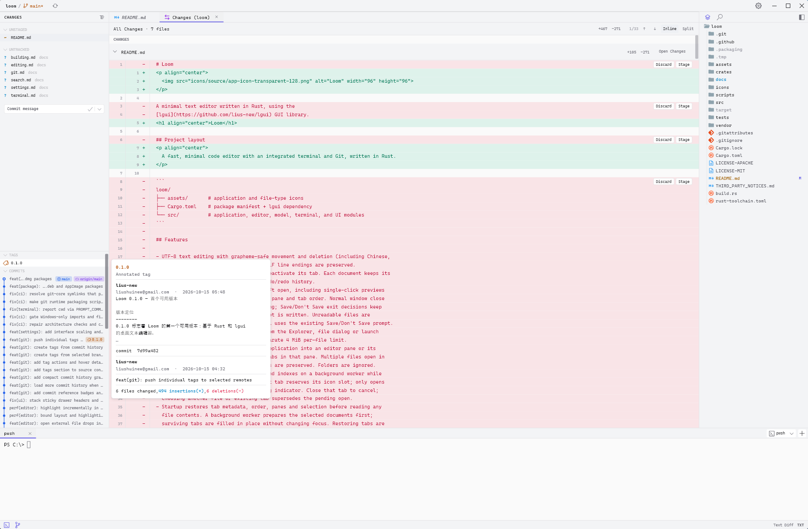

<p align="center">
  
</p>

<h1 align="center">Loom</h1>

<p align="center">
  <a href="README.md">English</a> | <strong>简体中文</strong>
</p>

<p align="center">
  使用 Rust 编写的快速、简洁的代码编辑器，集成终端与 Git。
</p>

<p align="center">
  <a href="https://github.com/lius-new/loom/actions/workflows/ci.yml"></a>
  <a href="#许可证"></a>
</p>

Loom 是一款适用于 Windows、macOS 和 Linux 的桌面编辑器，基于使用 Skia 渲染的
Rust GUI 库 [lgui](https://github.com/lius-new/lgui) 构建。它希望在保持轻巧和响应迅速的同时，
让编辑、搜索、运行命令和 Git 操作等日常工作都能在同一个窗口内完成。

> [!NOTE]
> Loom 仍处于早期开发阶段（0.1 系列），部分体验尚待完善，设置和行为可能随版本变化。



## 功能

- **编辑** — 按字素簇处理光标移动和文本编辑，支持中日韩文字、组合字符和 Emoji，
  提供多光标、矩形选择、自动换行、代码折叠、分屏、输入法以及可选的 Vim 模式。
  同一文件的多个视图共享文本和撤销历史，各自保留选区与滚动位置。
  最大支持打开 64 MiB 的文件，由后台线程加载；大文件采用纯文本渲染。
- **语言支持** — 基于 Tree-sitter 的语法高亮，支持嵌入式语言，并按需下载语法资源。
  语言服务器提供代码补全、悬浮文档、签名提示、定义与引用跳转、重命名、格式化、
  诊断和代码操作。大纲可展示 Markdown 标题或语言服务器提供的符号。
  默认需在语言面板中手动安装服务器，也可选择自动安装。
- **文本编码** — 支持 UTF-8、UTF-16、GBK、GB18030、Big5、Shift_JIS 等编码，
  提供自动检测和状态栏编码选择器。保存时保留所选编码、BOM 和 LF/CRLF 换行符。
  详见[文本文件编码](docs/encoding.md)。
- **Markdown** — 阅读模式和侧边预览实时反映尚未保存的内容，与悬浮文档、补全文档、
  签名文档共用渲染能力；支持按完整逻辑文本复制、大纲、代码块、表格和受资源限制的图片显示。
  详见 [Markdown 阅读](docs/markdown.md)。
- **会话恢复** — 重启后恢复文件标签页、窗格布局、源码位置和终端工作目录。
  额外光标和折叠状态仅在当前会话中保留；终端会重新启动 Shell。
- **工作区搜索** — 跨文件夹搜索，支持区分大小写、全字匹配、正则表达式，以及包含和排除
  glob 模式；遵循 `.gitignore`，并搜索尚未保存的缓冲区。
- **集成终端** — 支持 PowerShell、命令提示符、Git Bash、bash、zsh、fish 和自定义
  Shell，提供标签页与分屏，并在 `cd` 和重启后跟随、恢复工作目录。
- **Git** — 支持暂存、提交、获取／拉取／推送、分支、标签、储藏、历史记录、单文件差异和
  worktree，并在后台刷新工作区内各仓库的状态。
- **自定义** — 提供浅色、深色和高对比度主题，支持 Zed 风格的 `keymap.json`
  （上下文与组合键序列）、项目级 `.loom/settings.json`、80% 至 200% 的界面缩放，
  以及 Material 文件图标。

## 安装

从 [Releases](https://github.com/lius-new/loom/releases) 页面下载适合你所用平台的安装包。

| 平台 | 安装包 |
| --- | --- |
| Windows x64 | `…-windows-x86_64-setup.exe`（仅为当前用户安装，无需管理员权限）或 `…-portable.zip` |
| macOS 11+（Apple Silicon 和 Intel） | `…-macos-universal.dmg` 或 `.zip` |
| Linux x64 | `.deb`、`.AppImage` 或 `.tar.gz`（运行 `./install.sh` 为当前用户安装） |

每个发行版都为各平台提供 `SHA256SUMS` 校验文件。

- **Windows**：安装包尚未进行代码签名，首次运行时 SmartScreen 会显示警告。包内附带 Git 运行时。
- **macOS**：在应用完成公证之前，Gatekeeper 会阻止首次启动。
  按住 Control 点击 Loom.app 并选择**打开**，或运行
  `xattr -dr com.apple.quarantine /Applications/Loom.app`。Loom 使用系统的 `git`。
- **Linux**：需要 glibc 2.39 或更高版本（例如 Ubuntu 24.04、Fedora 40），
  以及 X11 或 Wayland 会话。Loom 使用系统的 `git`。

在终端使用 `loom .` 或 `loom path/to/file` 打开文件夹和文件。
Windows 安装程序可将 `loom` 加入 PATH；Linux 的 `.deb` 和 `install.sh` 安装方式会提供此命令。
在 macOS 上，请将应用内的启动脚本链接到 PATH 中的目录，例如：

```sh
ln -s /Applications/Loom.app/Contents/Resources/bin/loom /usr/local/bin/loom
```

便携版启动方式和各安装包的安装内容详见[打包说明](scripts/package/README.md)；
不同安装方式的自动更新支持详见[更新说明](docs/updates.md)。

## 从源码构建

Loom 使用 [`rust-toolchain.toml`](rust-toolchain.toml) 固定的 Rust 工具链
（当前为 1.97.1），`rustup` 会自动安装。还需要 Node.js 20+ 和所在平台的 C/C++ SDK；
构建脚本会在项目私有目录中准备 CMake 和 Skia。

```sh
git clone https://github.com/lius-new/loom.git
cd loom
node scripts/build/cargo.mjs build --release --locked
node scripts/build/stage-resources.mjs target/release
node scripts/build/cargo.mjs run --release --locked
```

开发运行时，请先执行 `node scripts/build/stage-resources.mjs`，
再执行 `node scripts/build/cargo.mjs run --locked`。
资源准备脚本会将语法资源和语言服务器目录清单复制到可执行文件旁；仅运行 Cargo 不会复制这些资源。

在 Debian 或 Ubuntu 上，请先安装系统库：

```sh
sudo apt install build-essential \
    libfreetype-dev libfontconfig-dev \
    libegl1-mesa-dev libgl1-mesa-dev libgles2-mesa-dev \
    libwayland-dev libxkbcommon-dev
```

首次构建时会下载固定版本的 CMake 和预编译 Skia 归档，并验证 SHA-256。
无需安装系统级 CMake 或手动下载 Skia。
离线构建、测试、CI 和打包说明详见[构建 Loom](docs/building.md)。

## 文档

以下详细文档目前为英文。

- [编辑](docs/editing.md) — 文件、会话、多光标、折叠、自动换行和 Vim
- [文本文件编码](docs/encoding.md) — 检测、切换和保存
- [语言资源](docs/languages.md) — 语法包与按需下载
- [设置与按键绑定](docs/settings.md) — 语言服务器、格式化、主题和快捷键
- [Markdown 阅读](docs/markdown.md) — 阅读模式和实时预览
- [工作区搜索](docs/search.md)与[大纲](docs/outline.md) — 查找文本和浏览文件结构
- [终端](docs/terminal.md) — Shell、WSL 和工作目录
- [Git](docs/git.md) — 源代码管理、差异、历史记录和 worktree
- [更新](docs/updates.md) — 检查、下载和应用新版本
- [构建 Loom](docs/building.md) — 工具链、测试、CI 和打包

实现细节参见[语言服务](docs/architecture/language-services.md)、
[LSP](docs/architecture/lsp.md) 和 [Markdown](docs/architecture/markdown.md) 架构文档，
以及[语言服务待完成事项](docs/language-services-todo.md)。

## 参与贡献

欢迎在 [GitHub](https://github.com/lius-new/loom/issues) 提交问题和 Pull Request。
请先阅读 [CONTRIBUTING.md](CONTRIBUTING.md)。贡献相关工具使用 Node.js 24；
克隆仓库后，请启用本地提交钩子和提交信息模板：

```sh
node scripts/commit/install.mjs
```

每次提交的信息正文必须恰好包含一个 `Release Notes:` 小节。
面向用户的变更需使用英文发布说明条目，仅内部变更使用 `- N/A`；
接受的条目类型详见[发布说明规范](scripts/release/README.md)。压缩或合并提交时也需保留该小节。

提交 Pull Request 前，请运行与 CI 相同的检查：

```sh
cargo fmt --all -- --check
node scripts/build/cargo.mjs test --locked --workspace
node scripts/architecture/check.mjs
```

此外，还需按照 [`ci.yml`](.github/workflows/ci.yml) 中的参数运行 Clippy。
[`crates/editor-core`](crates/editor-core/README.md) 中的编辑核心不依赖 GUI，适合作为入门起点。

## 许可证

Loom 采用双许可证，你可以任选其一：

- Apache License, Version 2.0（[LICENSE-APACHE](LICENSE-APACHE)）
- MIT 许可证（[LICENSE-MIT](LICENSE-MIT)）

除非你明确声明其他条款，否则你有意提交并纳入 Loom 的任何贡献，
均按上述双许可证授权，不附加其他条款或条件。

Loom 包含第三方代码，包括 vt100 解析器、Zed 按键映射设计的部分实现，以及 Windows 版附带的 Git；
详见 [THIRD_PARTY_NOTICES.md](THIRD_PARTY_NOTICES.md)。
Material Icon Theme 图标的 MIT 许可证及署名保存在
[`assets/icon-themes/material`](assets/icon-themes/material) 中。
